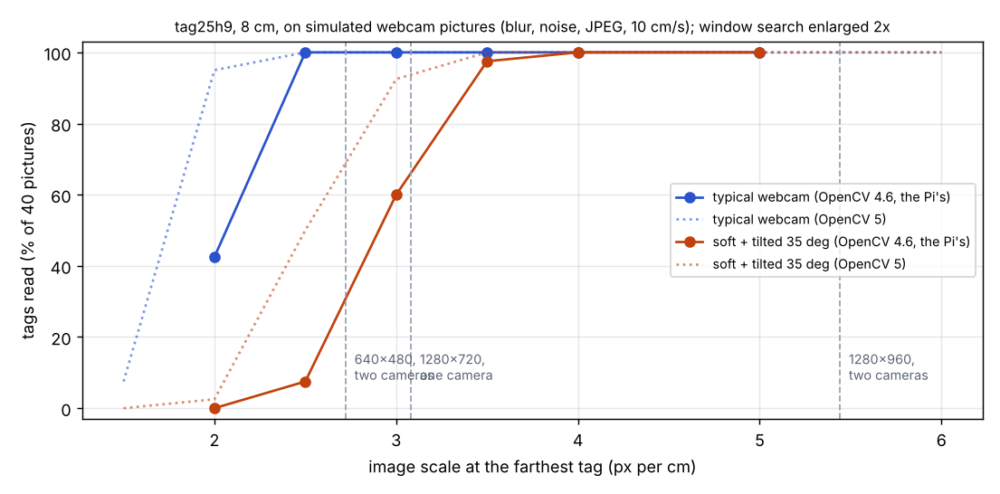
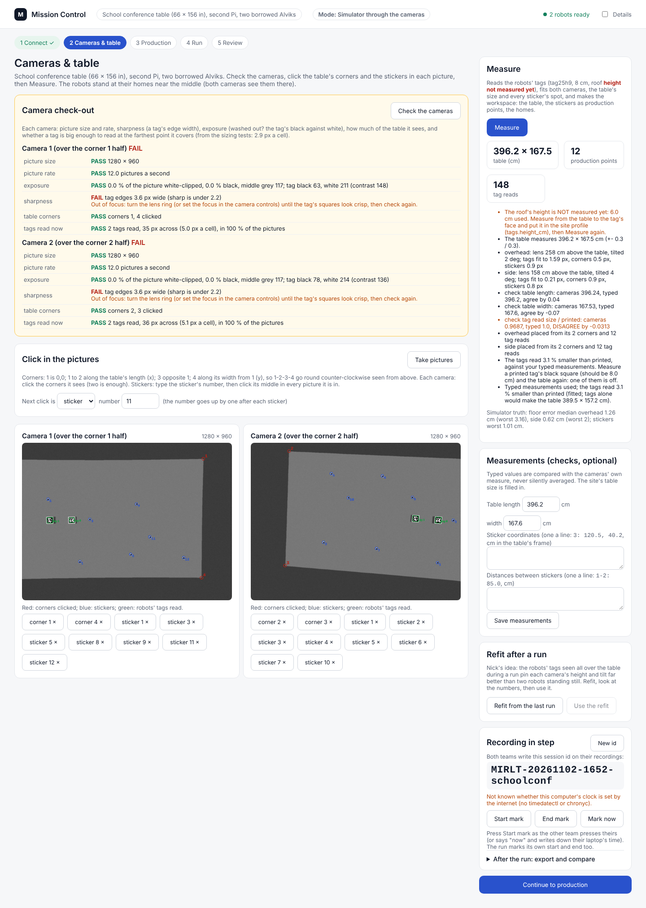
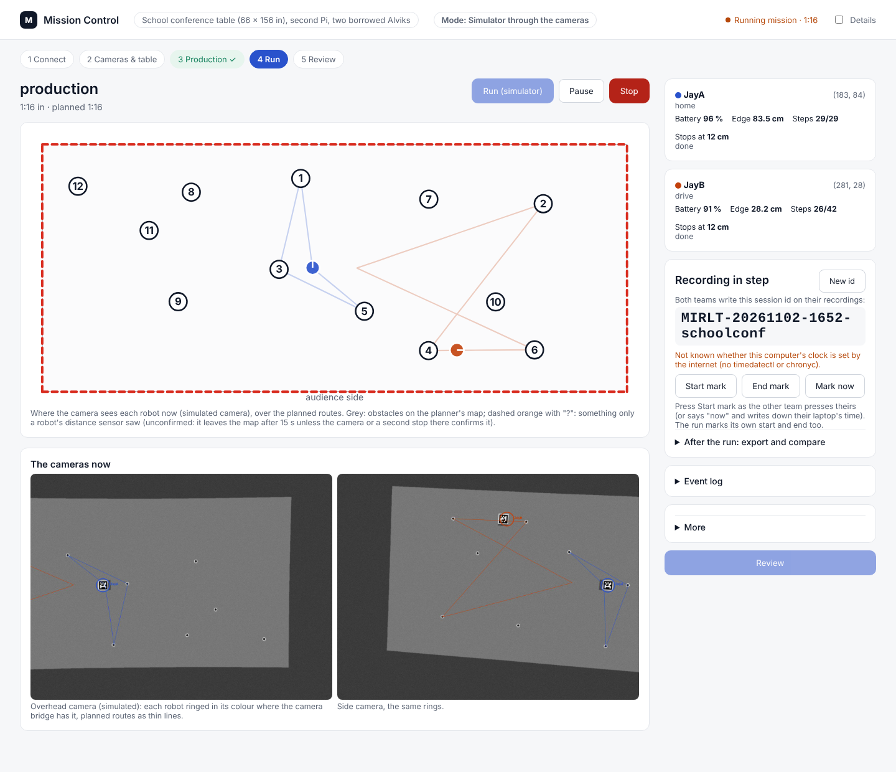
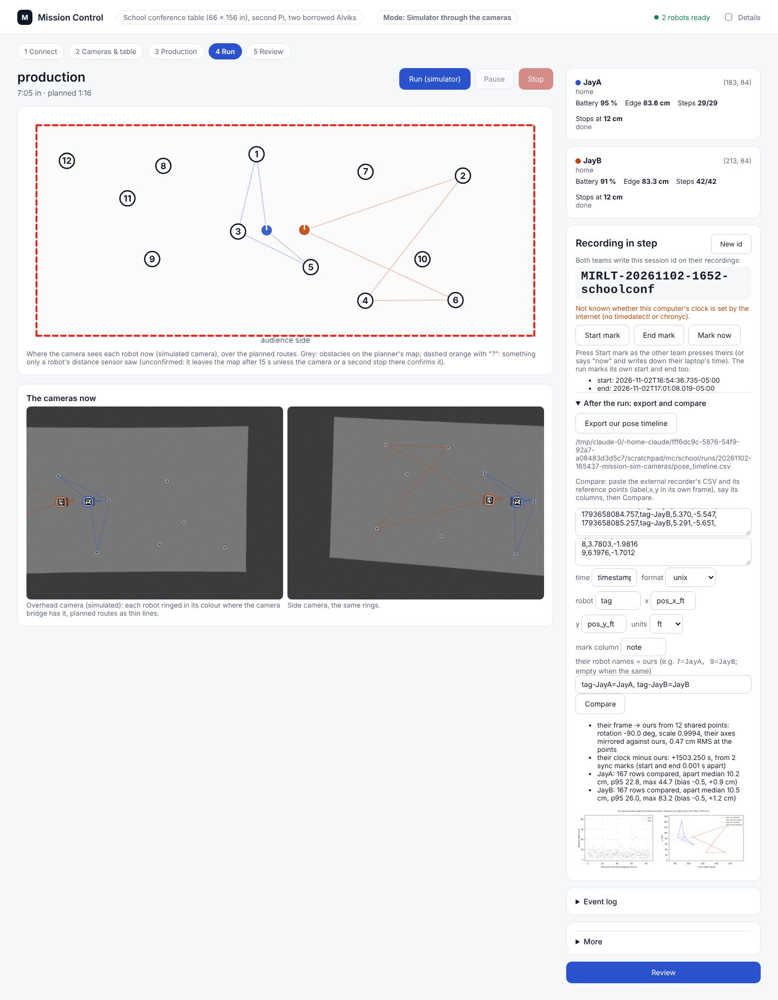

# The conference table: AprilTag robots, a second setup, and recording in step with an RFID recorder (2 Nov 2026, simulator only)

## Premise

Nick, 2 Nov, top priority, as soon as possible: a run at school on a large conference table, 66 x 156 in
(167.6 x 396.2 cm), with a second set of equipment: a new Raspberry Pi 4, two new USB cameras (resolution unknown,
"similar" to ours at 640 x 480), a router in the room, and two of the grad student's Alviks, reflashed with our
firmware. An external RFID recorder records the robots' positions at the same time on its own laptop. Our system must
not use RFID for steering or corrections this week; the two recordings only have to be comparable afterwards. Nick
chose AprilTags on a roof (the roof covers the robots' lights).

Nothing here touched a robot or a Pi. Everything was tested in the simulator, on synthetic pictures and on recorded
logs. No code or data of the other team's system is in this repo.

## What was built

| Requirement | Built | Where |
|---|---|---|
| 1. Site profiles | `home` (the default, exactly as before) and `school-conference`: robots and addresses (none: found on the WiFi), Pi address, camera labels, picture size, tracking (lights or tags), tags, a calibration folder of its own (`~/.config/mirlt/sites/school-conference`) and a Mission Control folder of its own. `./run-fleet-pi.sh site <name>` switches | `tools/fleet/sites.py`, `tools/fleet/sites/*.json`, `run-fleet-pi.sh` |
| 2. Camera check-out | Per camera: size, rate, sharpness (a tag's edge width), exposure (clipping, the tag's black against white), coverage of the table, the tag's pixels per cell at the farthest point; both cameras together: any gap, the overlap. PASS / WARN / FAIL with what to do. In Mission Control and as `./run-fleet-pi.sh camcheck` | `tools/fleet/camera_checkout.py` |
| 3. AprilTags | Detector on OpenCV's aruco (4.6 as Raspberry Pi OS ships it, and 4.7+/5), pupil-apriltags as a fallback; windows round each robot, enlarged 2x; identity, heading and position from the tag; a tag bridge that sends the same camera fixes the lights bridge did; the facing check reads the tags. Printable sheet and roof spec | `tagcore.py`, `tag_geom.py`, `tag_bridge.py`, `facing.py`, `docs/hardware/apriltag-sheet.pdf`, `docs/hardware/roof-tag-spec.md` |
| 4. Scale and floor | The site fit: both cameras (pose, focal length, lens bend), the table's size and every sticker's spot from corner clicks, sticker clicks and the robots' tags (known size, known height: the tag plane against the table plane). Typed measurements are checks, compared and named, never silently averaged. After a run, a refit with the run's tag reads (Nick's idea) | `site_fit.py`, `tag_setup.py` |
| 5. Production points | Click each sticker in each picture with its number; optional typed coordinates and distances; saved per site (`tagcal/points.json` and the map's spots) | Mission Control, Cameras & table |
| 6. Production run | Each robot: start-up (calibrates if not calibrated since power-on; today's calibration on the same power-on is kept), its points in Nick's order with a 3 s stop at each, then home. Homes: the table's middle, 30 cm apart, both facing +y. Same planner, run_plan, 8 cm net, no-stops behaviour | `production.py`, `missions.py` (`go-home`, `sync-spin`), Mission Control, Production |
| 7. Sync | Session id on screen; Start / End / Mark-now marks with the Pi's exact time and clock status (NTP); the run marks its own start and end; optional sync spin; pose timeline CSV (camera tags and the robots' own poses, with uncertainty); the merge tool (columns configurable, clock offset from marks or from the tracks, transform from shared stickers, differences over time, summary, chart) | `sync_tools.py`, `merge_external.py`, Mission Control's "Recording in step" card |
| 8. Simulator | Two simulated tag cameras over the 396 x 168 cm table (drawn pictures, read by the real detector), the setup simulated as Nick would do it, production runs; faults: a tag covered, a camera at low resolution, robots put down off home, marks missed | `tools/sim/tag_cam.py`, `fleet_sim.py --tag-cams`, `mission_run.py --tracking tags` |

## Data

### 1. Which tag, how big, how many pixels

The roof has the Alvik's footprint (9.5 cm), so the tag's black square is 8.0 cm, leaving a 0.75 cm white margin.
The question is pixels. Synthetic pictures (40 random spots and headings per point, lens blur, sensor noise, motion at
10 cm/s, JPEG) read by the real detector:



Each line is the share of pictures in which the tag was read, against how many pixels a centimetre of tag covers;
the dashed lines are what each camera layout gives at its farthest point.

| Camera layout over 396 x 168 cm (70 deg webcam) | Lens height | Worst scale | Tag | tag25h9 px a cell |
|---|---|---|---|---|
| One camera, 640 x 480, straight down | 303 cm | 1.5 px/cm | 12 px | 1.8: **does not read** |
| Two cameras, 640 x 480, each over half + 20 cm | 174 cm | 2.7 px/cm | 22 px | 3.1: reads typical, **not** soft or tilted |
| One camera, 1280 x 720 | 303 cm | 3.1 px/cm | 25 px | 3.5 |
| Two cameras, 1280 x 720 | **230 cm** (16:9 is short across the table) | 4.1 px/cm | 33 px | 4.7 |
| **Two cameras, 1280 x 960 (4:3), each over half + 20 cm** | **174 cm** | **5.4 px/cm** | **44 px** | **6.2** |
| Any camera at one end, angled | 200 cm | 0.4-2.5 px/cm | 3-20 px | under 3: **does not read** at the far end |

<sub>Lens height: above the table top. Sources: `docs/results/tag-sizing/budget.csv`, `reads.csv` (OpenCV 5),
`reads-opencv4.6.0.csv`; `tools/fleet/tag_sizing.py`.</sub>

- Families: tag16h5, tag25h9 and ArUco 4x4 need about the same pixels (tag25h9 reads in 100 % from 2.5 px/cm with a
  typical webcam's blur, from 3.5 px/cm soft and tilted 35 deg); tag36h11 needs more and costs 15x the time per
  window in OpenCV 5. **Chosen: tag25h9** (works in both OpenCV versions; 16h5's 5-bit spacing misreads clutter).
- **Found on the way:** OpenCV 4.6 (Raspberry Pi OS) read only 3 % of large tags. The roof's white margin on the
  darker table is a second square round the tag, and 4.6 kept that one and threw the tag away. A detector setting
  fixes it (`minMarkerDistanceRate` 0.02); after it, 4.6 reads like 5.
- Position error of a read (median / p95): 0.10-0.17 / 0.18-0.31 cm; heading 0.3-0.5 / 1.3 deg.
- **CPU.** Per picture, with two robots, under OpenCV 4.6 here: bridge 3.8 ms + decoding 5.6 ms at 1280 x 960 (2.6 +
  1.4 ms at 640 x 480). The Pi 4 is about 5 times slower than this machine (earlier reports): about 47 ms a picture,
  so two cameras at 12 a second take about 1.1 of the Pi's 4 cores, besides the recorder. *Claude's estimate; not
  measured on a Pi.* A whole-picture search (a lost tag, at most every 5th picture) is about 23 ms here, 115 ms on
  the Pi.

**Conclusion for the cameras (Claude's):** run both cameras at **1280 x 960** (4:3) if they offer it, each straight
down over one half, about 175 cm above the table, overlapping about 40 cm in the middle. At 640 x 480 the tags read
with sharp cameras but have no margin. 16:9 cameras need to hang about 230 cm up to see the table's width. An angled
camera from one end cannot read the far end.

### 2. The site fit (simulator truth)

| Setup | Floor error, median / worst (cm) | Table | Notes |
|---|---|---|---|
| Measure with the robots still, table size typed (4 room layouts, robots at home; 7 more in the runs below) | 0.2-2.9 / 0.6-8.0 | within 0.5 cm | robots side by side at home: the worst; robots 85 cm apart: 0.3-0.5 / 0.9. The cameras' heights come out 15-30 % off: with two still tags, focal length and height trade |
| Refit after one production run (100 tag moments) | **0.1-1.3 / 0.2-2.7** (median of the 7 runs: 0.3 / 0.7) | within 0.3 cm | heights within 2-5 % |
| Tags alone, nothing typed, many tag spots (self-test) | under 0.3 / 0.5 | +0.3 cm | |

<sub>Floor error: where the fitted and the true camera put a 40 x 15 grid over the table, at the table and at the
tag's height. `tag_setup.py --dry`, `site_fit.py --selftest`, `mission_run.py ... --refit`.</sub>

Two findings that shaped it:
- **A blurred tag reads 1.5-3.5 % small** (its rounded corners are found inside the true ones). From the tags alone
  that makes the table 1.5-3.5 % large (6-14 cm). With the table's size typed, the fit takes the tag's read size as
  an unknown (`k`); Measure says it ("tags read 3.1 % smaller than printed"). Over 5 % is a warning (printer scaling
  or a wrong tape).
- Two still robots cannot check a typed size well. A check now counts a difference as a disagreement only beyond the
  cameras' own uncertainty, and says when the check is weak ("drive the robots about, then Refit").

### 3. Production runs and faults (simulator, both tag cameras, the setup simulated, then the run)

| Case | What was injected | Result (s: run / plan) | Points reached | Closest robots / edge (cm) | Camera vs truth, median / p95 (cm) | Setup, median / worst (cm) | Refit, median / worst (cm) |
|---|---|---|---|---|---|---|---|
| Orders A (3 + 3) | nothing | done, 72 / 69 | 6 of 6, both home | 16.0 / 17.8 | 1.6, 3.4 / 2.8, 3.6 | 2.8-2.9 / 4.9 | 0.2-0.3 / 0.6 |
| Orders B (4 + 4, seed 2) | another room layout | done, 93 / 88 | 8 of 8 | 11.3 / 28.0 | 1.4, 1.0 / 2.7, 2.6 | 1.5-1.9 / **8.0** | 0.6-0.7 / 1.9 |
| Orders C (5 + 5, no stops) | another layout | done, 146 / 141 | 10 of 10 | 12.0 / 14.3 | 0.4, 0.3 / 0.5, 0.5 | 0.2-0.3 / 0.9 | 0.1-0.2 / 0.4 |
| Mission Control, with sync spin | through the page (Playwright) | done, 78 / 76 | 6 of 6 | 16.6 / 16.8 | 1.1, 0.5 / 1.2, 0.9 | 0.6-0.8 / 2.5 | 0.4 / 0.7 |
| A tag covered | JayA's tag unreadable 15-27 s into the run | done, 83 / 69 | 6 of 6 | 16.6 / 16.7 | 1.8, 0.8 / 1.9, 1.4 | 0.7-1.5 / 3.4 | 0.2-0.3 / 0.7 |
| A camera at low resolution | camera 2 sends 640 x 480 | done, 72 / 69 | 6 of 6 | 16.6 / 16.7 | 1.5, 1.2 / 1.6, 1.3 | 1.2-1.3 / 2.4 | 0.6-1.3 / 2.7 |
| Put down off home | JayA 37 cm off, facing 210 deg; JayB 40 cm off, facing 300 deg | done, 72 / 69 | 6 of 6 | 16.7 / 16.3 | 0.4, 0.5 / 0.6, 0.6 | 0.3-0.5 / 0.9 | 0.2-0.3 / 0.6 |
| Marks missed | the external file without its mark rows | offset from the tracks, 0.4 s off | | | | | |

<sub>One run each, simulator truth. Points reached: production points whose step reported done. Closest: the two
bodies, and a body to an open edge (both over the 8 cm net and the 10 cm edge plan). Camera vs truth: the tag
bridge's fixes against the simulator's true poses (line_check.py), JayA, JayB. Setup: Measure with the robots still
(the table's size typed); Refit: after the run, with its tag reads; floor error as in section 2, each camera. Every
run: no contact, nothing over an edge, 0-1 warnings. The covered tag first ended its run ("re-plan failed"); fixed and
re-run (below).</sub>

What the cases show:
- **A covered tag:** JayA drove on its wheels and gyro, reached the 40 cm blind limit, was held, was found again by
  its tag 12 s later, rejoined and finished. The first run of this case found a bug in run_plan: the held robot's
  halted step came back "failed", the re-plan no longer had that robot, and everyone stopped. Fixed (a held robot's
  late step report is logged, not re-planned).
- **Put down off home:** found by their tags, turned and driven to their homes, then the run as planned.
- **The setup depends on where the robots stand during Measure.** Robots apart (the off-home case: 85 cm apart in
  the overlap) gave 0.3-0.5 cm; robots side by side at home gave up to 8 cm worst in one layout. The refit after a
  run fixes it either way (under 2 cm worst). Steps below: Measure with the robots apart.
- **640 x 480 on one camera:** the run was as good, but its refit was worse (2.7 cm worst on that camera).

### 4. Mission Control (simulator, Playwright)



Cameras & table after Measure: corners and stickers clicked in each camera's picture, the tags read (green), the
result with its checks and the simulator's truth.



The Run screen during a production run: the planned routes on the table, both tag cameras' pictures with each robot
ringed, and the session id with the marks.



The comparison with a made-up external recording of the same run (in feet, turned 90 deg, mirrored, its clock 1503.25
s ahead, 8 cm noise). The marks gave the offset to 0.001 s; the mirror and the units were found from 12 stickers
(0.47 cm at the points); the two robots were 10.2 and 10.5 cm apart (median), which is the noise put in.

Without marks (the "marks missed" fault), the offset came from lining up the tracks: 0.4 s off on the same data.

### 5. Problems found and fixed (pictures in `docs/screenshots/2026-11-02/`)

- The simulator's distance sensor saw the home board's room wall at x = 220 cm, so on the 396 cm table a robot
  stopped at every turn: the walls now sit 80 cm outside any table.
- A start that crashed after starting the bridge left it running; the next run could not open its port and read the
  robots 9 cm off with the old models. mission_run now stops its bridge if the start fails.
- The bridge fused the two cameras in 2 of 478 fixes (a moment held back by the rate limit went out alone later); now
  each moment waits for both cameras or goes out when the next moment starts.
- The check-out's first sharpness line (2.2 px) failed a sharp picture (3.6 px in the simulator): now 4.0 / 5.5.
- run_plan stopped everyone when a held robot's halted step came back "failed" (the covered-tag case): now logged
  and left to the robot's rejoin.
- OpenCV 5 has no `undistortPointsIter`; two places now fall back to `undistortPoints` (OpenCV 4.6 is unchanged).

**Tests.** `tools/fleet/tests/test_conference_table.py`: 24 tests (sites, detector, geometry, simulated pictures,
site fit, production, sync, comparison, check-out, bridge, facing by tags, tag sheet). Fleet, Pi and simulator suites (`python3 -m pytest tools/fleet/tests tools/pi/tests tools/sim/tests`): **616 passed, 9 skipped** (one Pi test, `test_camrec_dual`, failed once while the fault runs loaded the machine and passed alone).

## Conclusion

- **The system can run the conference table on tags, in the simulator, end to end:** setup by clicks, production
  runs with every point reached, no contact, and positions with a known accuracy (median under 2 cm after the first
  Measure, under 0.5 cm after a refit).
- **The cameras decide it (Claude's conclusion).** 1280 x 960, two cameras straight down over the halves, about
  175 cm up. 640 x 480 is marginal; an angled camera at one end does not work for this table.
- **The comparison works on made-up data.** Its real limit is the external recorder: it must export timestamped
  positions per robot (not raw reads), and both teams must press the marks together.
- Not done: nothing ran on a Pi or a robot; the Pi's CPU and the cameras' real pictures are estimates until the
  first check-out at school.

## What's next

1. Nick: print the tags, build the roofs, measure the roof height (steps below).
2. At school: the camera check-out first. If a camera FAILs on size, the layout table above says what to change.
3. After the first run: Refit, look at the numbers, Use it.
4. Measure the bridge's CPU on the Pi (`cpu.csv` in the run's folder). Over 2 cores: lower the rate to 10 a
   second or use the recorder's shared pictures (not wired for the tag bridge yet).

## Nick's steps

### A. At home, before school (laptop)

1. Open `docs/hardware/apriltag-sheet.pdf`. Print it at **100 % / Actual size** on **matte** paper (2 pages).
2. With a ruler: the 10 cm line must measure 10.0 cm, and the black square of tag 0 must measure 8.0 cm. If not, the
   printer scaled the page: print again with scaling off.
3. Make the two roofs from `docs/hardware/roof-tag-spec.md` (9.5 cm square, flat, removable). Glue tag **0** on the
   roof for **Alpha** and tag **1** for **Bravo**, the FRONT arrow towards the nose, the tag's middle over the middle of
   the wheel axle.
4. Measure from the table to the tag's printed face with the roof on a robot (to 1 mm). In the **GitHub web page**
   of the repo, open `tools/fleet/sites/school-conference.json`, click the pencil, change `"height_cm": null` to the
   number (for example `"height_cm": 6.2`), and commit. (Or tell me the number.)

### B. Flash the borrowed robots with our firmware (laptop, Arduino IDE)

1. On your laptop, in File Explorer, open the repo's `firmware/home_lab` folder. Open `secrets.h` (your own copy;
   it is not in the repo) in Notepad.
2. Change the line `#define WIFI_SSID2 "..."` so the text between the quotes is the **school router's network name**,
   exactly. Change `#define WIFI_PASSWORD2 "..."` to its password. Save. (Never paste the password anywhere else.)
3. Plug Alpha's Nano ESP32 into the laptop by USB-C. Switch the robot ON.
4. Arduino IDE: open `firmware/home_lab/home_lab.ino`. Tools, Board: **Arduino Nano ESP32**. Tools, Port: the one
   that appeared. Press **Upload** (the right arrow). Wait for "Done uploading".
5. Tools, **Serial Monitor**, 115200. Within 15 s you should see `This robot is AL-xxxx`. Write AL-xxxx down.
6. Repeat 3-5 for Bravo.

### C. Set up the new Pi (once; a terminal on the new Pi, or SSH from the laptop)

Type each line into the Pi's terminal and press Enter after each:

```
sudo apt install -y git tmux v4l-utils python3-opencv python3-scipy python3-numpy python3-matplotlib
```
```
git clone https://github.com/nfmaxfield-cmd/alvik-fleet-capstone.git
```
```
cd alvik-fleet-capstone
```
```
python3 -c "import cv2; print(cv2.__version__, hasattr(cv2, 'aruco'))"
```
You should see a version and `True`. If you see `False`, type `pip3 install --break-system-packages pupil-apriltags`.
```
./run-fleet-pi.sh site school-conference
```
You should see `Site now: school-conference` and the site's lines.

### D. At school: the cameras and the robots' names (the Pi's terminal)

1. Plug both cameras into the Pi. Type `python3 tools/pi/camnames.py` and press Enter. It lists each camera's name
   and its USB port (the last part of "usb-...-1.4", here `1.4`). The camera over corner 1's half is `overhead`, the
   other is `side`. Type, with the name and port it printed for the camera over corner 1's half:
   ```
   python3 tools/pi/camnames.py --set overhead "USB 2.0 Camera" 1.4
   ```
   You should see `Saved: the overhead camera is the one named ...`. Then the same with `side` and the other port.
2. Mount each camera straight down over its half of the table, about 175 cm above it, so that both see the
   middle.
3. Switch both robots on, on the table. Type (with the AL-xxxx you wrote down for Alpha):
   ```
   python3 tools/fleet/robot_cmd.py --to AL-xxxx --wait-s 3 "name Alpha"
   ```
   You should see `AL-xxxx is now called Alpha (kept after power-off)`. The same for Bravo.
4. Type `./run-fleet-pi.sh rec` and press Enter (the recorder). Then `./run-fleet-pi.sh mc`.

### E. Mission Control (the laptop's browser, at the address `mc` printed)

1. **Connect**: choose **Robots**. Continue.
2. **Cameras & table**: put the two robots on the table near the middle, about 80 cm apart (Alpha 40 cm towards
   corner 1's end, Bravo 40 cm towards the other end), where both cameras see them. Press **Check the cameras**. Every line should be PASS; do what any WARN or FAIL line says.
3. Press **Take pictures**. With "Next click is: corner", click in each picture the table corners it sees, in order
   1, 2, 3, 4 going round counter-clockwise seen from above (1 is 0,0). Switch to **sticker**, type the sticker's
   number, click its middle in every picture it is in (the number goes up by itself).
4. Check the table size under Measurements (396.2 x 167.6 cm, your 156 x 66 in, is filled in). Press **Measure**. You should see the table's
   size, the number of production points, and checks that say "agree".
5. (You may leave the robots where they are: the run's start finds them by their tags and drives each to its
   home.) **Production**: type each robot's points in order (or click points on the table). Tick "sync spin" if the other
   team wants a visible moment. Press **Plan**, then **Continue to run**.
6. **Recording in step**: read the session id to the other team; both write it down. Press **Start mark** at the
   same moment they press theirs.
7. **Run**. When it ends, press **End mark** with them. Open "After the run: export and compare", press **Export
   our pose timeline**.
8. Back on Cameras & table: **Refit from the last run**; if its words say the checks agree, **Use the refit**.

## Questions for Nick

**Substantive**
1. **Cameras: 1280 x 960, two straight down over the halves, about 175 cm up.** Can you mount them like that at
   school (a stand or the ceiling), and do the new cameras offer 1280 x 960? If only 640 x 480: tags at the far
   corners will read most of the time but with no margin.
2. **The external recorder's output.** The comparison needs timestamped positions per robot. If the other team's
   system exports raw reads only (positions come later from their model), the comparison waits for their positions.
   Will they press a mark (or note their laptop time) at our Start and End marks?
3. **Their RFID tag's place.** The spec puts it under the roof over the axle midpoint, so both systems measure the
   same point. Is that acceptable to them? If not, measure its offset.
4. **A 3 s stop at each point** (Claude's addition, for still RFID reads). Keep it, change it, or 0? *Answered (Nick, 2 Nov 17:59): keep it.*

**Other**
5. Robot names and tags 0 / 1. *Answered (Nick, 2 Nov 17:59): the robots are **Alpha** (tag 0) and **Bravo** (tag 1), renamed from JayA / JayB everywhere in the code, the site profile, the tag sheet and these steps (the results above keep the names the runs had).*
6. Homes 30 cm apart at the middle, facing +y: fine? *Answered (Nick, 2 Nov 17:59): fine.*
7. The roof height is a placeholder (6.0 cm) until you measure it.
8. Is the Pi's clock on the internet at school (the router may have no internet)? If not, the marks are what line the
   recordings up. *Answered (Nick, 2 Nov 17:59): the school Pi will have internet (NTP).*

## Sweep 1: new tests that may now be necessary

- At school: the camera check-out on the real cameras at 1280 x 960 and 640 x 480; read rate at the far corners.
- Pi: the tag bridge's CPU (cpu.csv) with the recorder at 1280 x 960, two cameras.
- Real pictures: tag read-size factor `k` on printed tags (does blur really read them 1.5-3.5 % small?).
- Real: Measure with the robots at home against a tape across the table; then Refit after one run.
- Simulator: Measure with the robots in different places (side by side, 80 cm apart, one per half) across 10 room
  layouts: the worst floor error against where they stood (one case gave 8 cm worst side by side).
- Board: the roof on the robot: distance sensor stops (does the roof enter its view?), weight on the turns.
- Simulator: three robots; a tag covered for over 30 s while the robot drives (held, then rejoins).
- Logs: the comparison with the other team's real export (columns, units, clock).
- Unit: pupil-apriltags fallback path on the Pi if aruco is missing.

## Sweep 2: possible inaccuracies in what this relied on

- **The simulator's pictures** are drawn: lens blur, noise and JPEG are modelled, not glare, rolling shutter or a
  real lens. The sizing thresholds (2.5 / 3.5 px/cm) come from them. DOE worth it: the real cameras at three heights.
- **OpenCV on the Pi is assumed to be 4.6 with aruco** (Raspberry Pi OS Bookworm's package); step C checks it.
- **Pi CPU = 5 x this machine's** (an earlier report's ratio), not measured with tags.
- **Chosen numbers** (each in the code with its note): tag 8.0 cm (as large as fits: no DOE); window 3 tags wide,
  enlarged 2x (DOE: 1.5 / 2 / 3 on real pictures); whole-picture search every 5th picture (DOE: 1 / 5 / 15); corner
  sigma 0.35 px (DOE: a still tag's spread); fix rate 10 a second (no DOE); jump guard 25 cm (no DOE); size refuse
  20 % (no DOE); homes 30 cm apart (DOE: 22 / 30 / 40 cm); dwell 3 s (DOE: 0 / 3 / 10 s against RFID spread);
  sharpness lines 4.0 / 5.5 px and contrast 80 / 40 (DOE: focus sweep on the real cameras); typed-check lines 1.5 %
  / 1.5 cm and tag-scale warn 5 % (DOE: spread over real setups); focal prior 70 deg +- 25 % (no DOE: weak); click
  sigmas 2 / 1.5 px (DOE: Nick clicks the same corner 5 times); refit at most 100 moments (no DOE: time).
- **Table size** 66 x 156 in is Nick's; the fit uses it as typed.
- **The roof height** is a placeholder (6.0 cm).
- **The comparison's test data** is made up from the simulator's truth, with chosen noise (8 cm), outliers (5 %) and
  a chosen clock offset; real RFID errors are not Gaussian.
- **Homes in the overlap**: Measure relies on both cameras seeing both robots at home; a camera mounted so that the
  middle is outside its picture leaves that camera placed from its corners and stickers alone.

## Appendix A. What changed

- New: `tools/fleet/sites.py`, `sites/home.json`, `sites/school-conference.json`, `tagcore.py`, `tag_geom.py`,
  `tag_bridge.py`, `site_fit.py`, `tag_setup.py`, `tag_job.py`, `production.py`, `camera_checkout.py`,
  `sync_tools.py`, `merge_external.py`, `tag_sizing.py`, `tag_sheet.py`, `tools/sim/tag_cam.py`, the tests,
  `docs/hardware/apriltag-sheet.pdf`, `docs/hardware/roof-tag-spec.md`, `docs/results/tag-sizing/`.
- Changed: `mission_run.py` (`--site`, `--tracking tags`, the simulated setup, sync marks, pose timeline, `--refit`,
  the bridge stopped on a failed start), `run_plan.py` (`--facing-tags`; a tag-read pose has no lights' offset),
  `facing.py` (`tag_check`; waits up to 90 s for a fitted model), `missions.py` (`go-home`, `sync-spin`, a wait's
  label), `mission_control.py` / `.html` (the site, the two screens, the sync card, tag-site camera pictures),
  `fleet_sim.py` (`--tag-cams`; walls outside big tables), `run-fleet-pi.sh` (site, picture size, `site`, `camcheck`),
  `run_plan.py` (a held robot's late step failure no longer stops the run), `tools/pi/camnames.py` (the site's folder;
  a USB port as a 4th word),
  `cameras.py` / `corner_setup.py` (OpenCV 5 undistort fallback).
- Home: the `home` site gives the same robot addresses, folders, picture size and lights tracking as before; the
  fleet suite passes unchanged.
