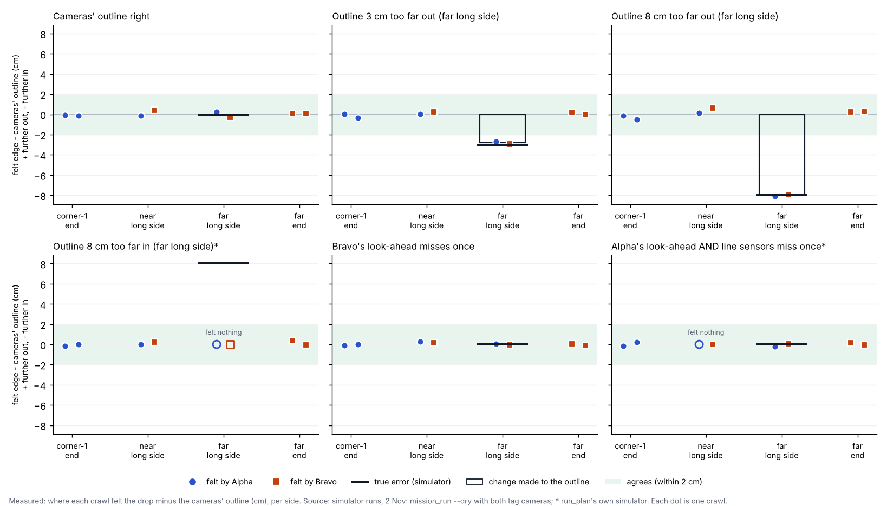
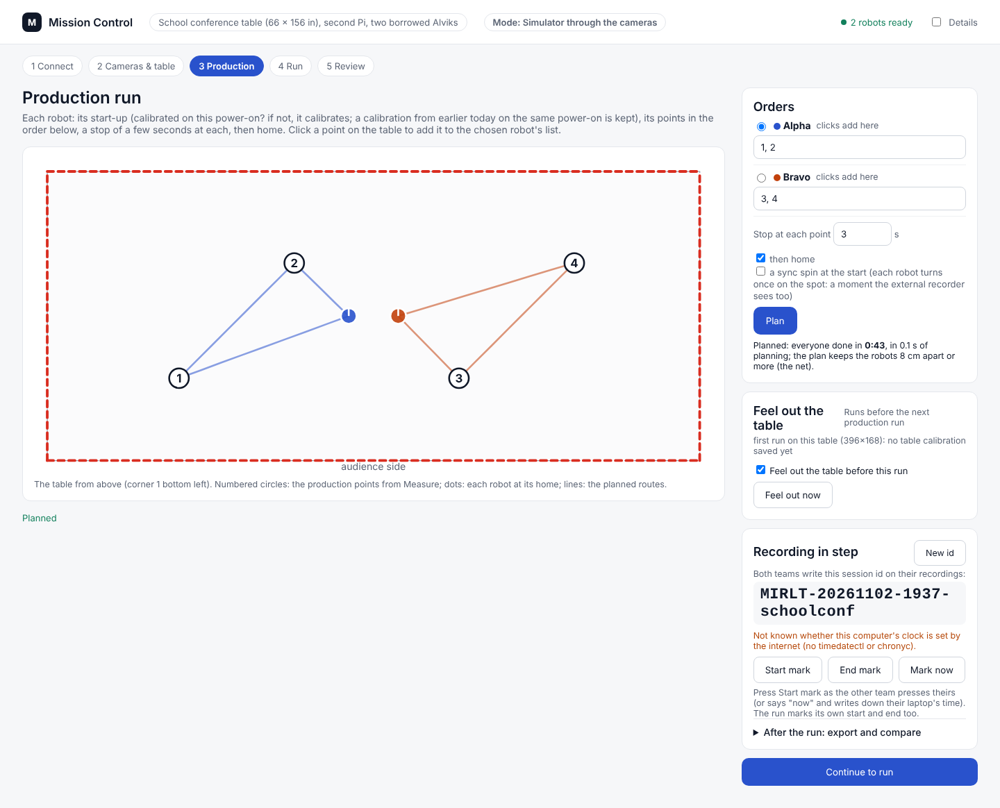
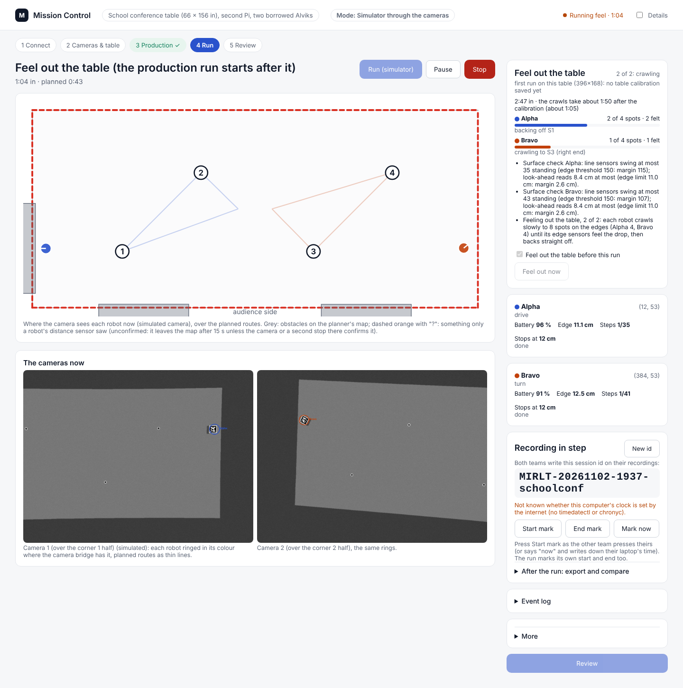
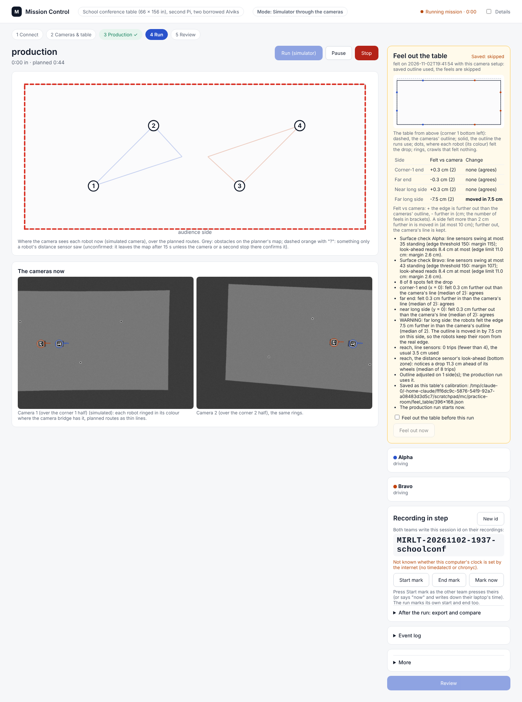
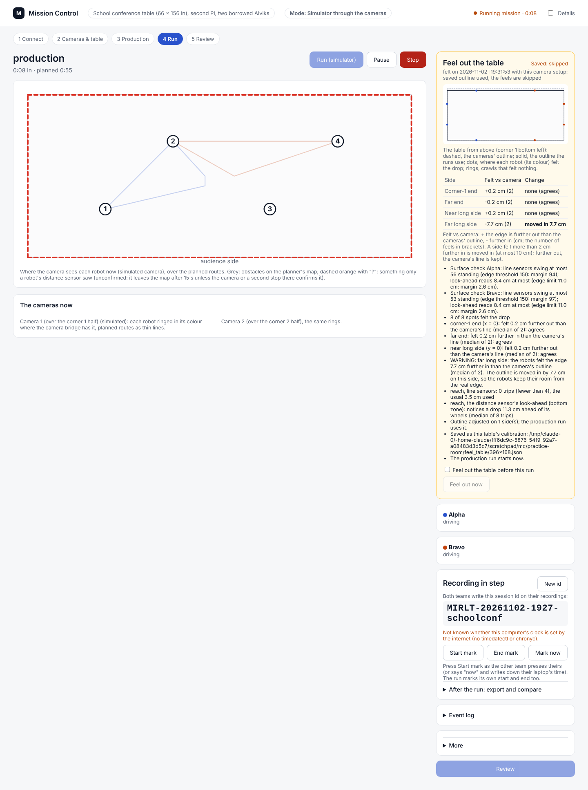

# Feel out the table: the robots check the cameras' outline with their own edge sensors (2 Nov, simulator only)

## Premise

Nick, 2 Nov 18:33 (approved): on the first run on a new table, before the production run, Mission Control runs "Feel
out the table" by itself: each robot is calibrated, crawls slowly to spots on the edges nearest it until its edge
sensors see the drop, and backs off; where the robots felt each edge is compared with where the cameras' fit puts it;
a side that disagrees by more than a few cm is adjusted (bounded) and Nick is told in plain words; the result is saved
for that table so later runs skip it, unless the camera setup is redone or Nick asks again. Old data is used once
there is some.

An independent risk review (read-only, same evening) added: the edge thresholds were set on plywood, never on a glossy
conference top with a 75 cm drop; the guard only works driving forward. It asked for a surface check before any
crawl, no driving past the cameras' edge, a straight slow back-off, one tick-box to skip it, and these listed here.
All five are built (section "Safety, as built").

Nothing here touched a robot or a Pi. Everything ran in the simulator and in unit tests.

## What was built

| Part | What it does | Where |
|---|---|---|
| 1. Calibration and surface check | A run of its own: every robot fully calibrated (as a start-up), then standing still 4 s at home while its line sensors and look-ahead read the tabletop. Passes only when each robot's line sensors swing at most half the edge threshold (75 of 150) and its look-ahead reads at least 1.5 cm under its 11 cm edge limit. Fails: no crawls, a warning, the cameras' outline kept and saved | `feel_table.py` `surface_check` |
| 2. The crawls | 8 spots: 2 on each long side (at 1/4 and 3/4), 2 on each end (30 % and 70 % across). Each robot takes the 4 in its own half. A crawl starts 22 cm inside the cameras' line and is planned to end 3 cm **inside** it, at 3 cm/s (the warm-up's feel speed). The edge guard ends it at the drop; the robot backs **straight** out the way it came at 3 cm/s, then goes on. Guard on all the time (line sensors and look-ahead); the robots' own virtual border off, as in the warm-up | `feel_table.py` `plan_tasks`; `planner.py` (straight back-off) |
| 3. The comparison | Each edge-guard stop: the cameras' place of the stopped robot (median of the fixes 0.1-0.8 s after the stop) plus how far ahead of its wheels the cue that tripped notices a drop (the reach). The reach is learned from all the trips (median), so one wrong side does not move it. Per side, the median of its 2 feels: within 2 cm agrees; further **in** by 2-10 cm, that side is moved in and a WARNING says it; further in than 10 cm, nothing is moved and the production run waits (STOP: redo the camera setup); further **out**, said, cameras' line kept. A crawl that felt nothing is "not felt, cameras' line kept", and named as a likely sensor miss when the side's other feel found the drop | `feel_table.py` `analyze` |
| 4. Saved per site and table | `<site folder>/feel_table/<table>.json` (school: `~/.config/mirlt/sites/school-conference/feel_table/396x168.json`), named by the site's typed table size, tied to the camera setup (a short code from the corner clicks; a refit keeps it). The next run with the same setup uses it and skips the feels | `feel_table.py` `save_cal`, `needed`, `setup_id` |
| 5. Old data | Every trip's reach is kept per robot (`reach.json`, last 60) and pooled with the next feel-out | `feel_table.py` `load_reach`, `reach_used` |
| Mission Control | Run on a tag site: if needed, the feel-out runs first (surface check, then crawls), the outline is applied to the map, the production mission is planned again on it, and the production run starts by itself. A "Feel out the table" card on the Production and Run screens: the reason, progress per robot, a drawing of the cameras' outline, the outline in use and each felt point, a side-by-side table, the words, one tick-box ("Feel out the table before this run") and "Feel out now" | `feel_job.py`, `mission_control.py`, `mission_control.html` |
| Command line | `mission_run.py --feel-table auto/always/skip` (auto by default on the robots, skip on `--dry`), `--feel-only`, `--feel-conf-dir` | `mission_run.py` |
| Simulator | The conference table's drop (74 cm: the look-ahead then reads the room's floor), a real table apart from the map's outline (`--true-floor`, `--sim-true-floor`), an edge sensor that misses once (`--edge-miss NAME:N:line/bottom/both`), and every trip, miss and the centre of mass's closest approach to the edge in the report | `fleet_sim.py`, `robot.py`, `mission_run.py` |

**Switches (Nick's rule from today: keep features, switch them off):** nothing was removed. The old back-off (a free
re-plan from the stop) is the planner setting `probe_back_straight: false`; moving a side **out** is
`feel_table.MOVE_OUT = True`; the whole step is off per site with `"feel_out": false` in the site profile, or per run
with `--feel-table skip` or the tick-box.

## Tests and data

### The simulator runs

Through the whole chain (`mission_run.py --dry --tracking tags`: both simulated tag cameras, the real detector, the
fitted cameras, the tag bridge), 396.2 x 167.6 cm table, two robots. The cameras' outline was made wrong by giving the
planner a different table than the simulator's real one.

| Case | Injected | Result | Far long side: felt vs cameras (cm) | Other sides (cm) | Closest centre of mass to the real edge (cm) | Time (s) |
|---|---|---|---|---|---|---|
| Cameras right | nothing | all 4 sides agree, nothing changed, saved | -0.0 | -0.1 to +0.1 | 9.2 | 234 + production 51 |
| Outline 3 cm out | far long side 3 cm too far out | moved in **2.8 cm**, WARNING said | -2.8 | -0.2 to +0.2 | 9.1 | 234 |
| Outline 8 cm out | 8 cm too far out | moved in **8.0 cm**, WARNING said | -8.0 | -0.3 to +0.4 | 9.1 | 237 |
| Outline 8 cm in * | 8 cm too far in (table bigger) | not felt (the look-ahead reaches 7.9 cm past the line), cameras' line kept | not felt | -0.1 to +0.2 | 9.1 | 107 |
| Look-ahead misses once | Bravo's bottom zone misses its first drop | its line sensors stopped it 3.7 cm short of the edge; all agree | +0.0 | -0.1 to +0.2 | **2.1** | 232 |
| Both cues miss once * | Alpha's line sensors and look-ahead miss its first drop | stopped on its planned end; named: "Alpha felt NO drop at S5 ... check its edge sensors" | -0.1 | 0.0 to +0.1 | **1.6** | 110 |
| Put down near an edge | Alpha 11 cm from the near long side, facing it | calibrated, found by its tag, driven home, then the crawls as planned; all agree | +0.2 | -1.0 to +0.4 | 9.1 | 282 |
| Second run | the same table and camera setup | "felt on 19:02 with this camera setup: saved outline used, the feels are skipped"; production only | - | - | 21.8 | 75 |

* run_plan's own simulator (fixes from the simulator, no cameras), for speed. Felt vs cameras: the median of the
side's 2 feels, + further out. Closest centre of mass: the simulator's hang model (centre of mass 1.5 cm ahead of the
axle, a guess); a robot tips when it passes the edge. No robot hung in any run. Look-ahead reach learned in every run:
10.8-11.0 cm (the simulator's sensor geometry; the trips' true distance 10.7-10.9 cm).

Each panel is one simulator run: every dot is one crawl's felt edge against the cameras' outline, per side; the black
dash is the error put in, the black outline the change made.

- Felt edges land within 0.4 cm of the truth on the right sides and within 0.2 cm of the error put in on the wrong
  side (3.0 put in, 2.8 found; 8.0 put in, 8.0 found).
- Each feel-out took about 4 minutes: 100 s for the calibration and surface check, 110 s for the 8 crawls, the rest
  the cameras' setup and starts. In the simulator, all 8 crawls ended on the look-ahead, 10.7-10.9 cm short of the
  edge: the line sensors only acted when the look-ahead missed.

### Mission Control (Playwright, simulator through the cameras)

A production run started from the page on the practice room (simulator through the cameras), the cameras' outline 8 cm
too far out on the far long side (`sim_true_floor`): Run started the feel-out by itself, then the production run on
the moved outline; the second Run skipped the feel-out.

Production screen before the first run: the card says why it will run ("first run on this table") with its one
tick-box.

Run screen during the crawls: the card's bar per robot (spots done, drops felt, what it is doing), the surface
check's numbers above.

The result as the production run starts: the far long side felt 7.5 cm further in and moved in, the other three
sides within 0.3 cm, saved. (In this run the look-ahead's learned reach was 11.3 cm against 10.9 in the command-line
runs, so 7.5 of the 8 cm was found: within the 2 cm line, the 0.5 cm left over is on the safe side.)

The second Run: "felt ... with this camera setup: saved outline used, the feels are skipped" and the production run
straight away. (From the first page run; the second page run was cut short by a container restart before this
picture.)

Problem found on the page: the progress bar counted a crawl as done after its first 10 cm piece
([picture](../screenshots/2026-11-02/feel-problem-mc-progress-counted-a-crawl-done-after-its-first-piece-sim.png));
now only the crawl's last piece or an edge stop counts.

### Unit tests

`tools/fleet/tests/test_feel_table.py`, 18 tests: the spots (8, halves, 22 / 3 cm), the plan (8 cm net), the
comparison on made-up sessions (right; 3 and 8 cm out moved in; 4 cm in kept; 13 cm out held; a missed drop named;
old reach data pooled), the surface check (a quiet top passes, a glossy one fails, saved as "no crawls"), saving and
skipping by camera setup, the progress count, the setup code, the outline in the production map, mission_run skipping a saved table,
Mission Control's chain and card, and one simulator run (both cues miss once: the planned end keeps the robot on).

Fleet, Pi and simulator suites (`python3 -m pytest tools/fleet/tests tools/pi/tests tools/sim/tests`): **646 passed, 9 skipped, 1 failed**; the failure was `test_camrec_dual` (frame count while the machine was loaded, the same flake as in the conference report), which passed alone (12 passed). Before this build: 628 passed, 10 skipped here (629 / 9 in the last report).

### Problems found and fixed on the way

- **The table's saved name came from the cameras' outline.** With the outline 3 cm wrong it was saved as `396x171`;
  after the side was moved the next run would have looked for `396x168` and felt the table again. Now named by the
  site's typed size.
- **A 3 cm error was called "agrees"** with the first line of 3.0 cm (2.9 cm measured). Nick's test needs it caught:
  the line is 2.0 cm.
- **The look-ahead's assumed reach was 3 cm short of the simulator's** (run_plan's 8.0 cm "errs near"; the trips came
  at 10.8 cm). With a fixed reach every side would have read 3 cm "further in". The reach is now learned from the trips.
- **The progress bar counted a crawl as done after its first piece** (page run 1); fixed and tested.
- **The surface check's first line (a third of the threshold, 50) failed the simulator's own plywood** (Alpha swung
  50 standing). Now half (75): the cue needs 150 three times in a row.

## Safety, as built (the risk review's five points)

1. **Surface check before any crawl.** Each robot standing still on the tabletop: line sensors' largest swing against
   the edge threshold (simulator: 44-50 against 150, margin 100-106), look-ahead's highest reading against its limit
   (simulator: 8.1-8.8 cm against 11, margin 2.2-2.9 cm). Fails: no crawls, a warning, the cameras' outline kept.
2. **Never past the cameras' edge.** Every crawl is planned to stop 3 cm inside the cameras' line. Only trips before
   that count; a crawl that reaches its end is "not felt, cameras' line kept". A side is never moved out.
3. **Straight, slow back-off** the way it came (3 cm/s, reverse), no turn at the edge: checked in the plans after
   every trip (planner `probe_back_straight`).
4. **One tick-box** on the card, ticked by default only when the table needs it and the last surface check did not
   fail.
5. **Stop.** Mission Control's Stop stops a feel-out like any run (Ctrl+C to mission_run, run_plan stops each robot it
   found on the WiFi), and the production run is then not started. **`./run-fleet-pi.sh stopall` sends `stop` to
   home's fixed addresses (192.168.1.250/252/253), not the school robots** (found on the WiFi): a separate fix is
   coming; until then use Mission Control's Stop or Ctrl+C in the run's window. Not changed here.

**Not covered (Claude's assessment):** two faults on one crawl: the cameras' outline too far out on a side **and**
both cues missing there. The planned end is 3 cm inside a line that is itself wrong, so the robot could pass the real
edge. The camera guard and the robots' own border do not catch it during a feel-out (the border is off for the
crawls).

## Conclusion

- **The feel-out works end to end in the simulator** (Claude's conclusion from 8 runs): it finds a side 3 or 8 cm too
  far out to within 0.2 cm, moves it in and says so, leaves right sides alone, skips itself the second time, and the
  production run starts on the felt outline by itself.
- **No robot left the table** with one cue missing (2.1 cm of centre of mass to spare) or both (1.6 cm, on the planned
  end). Those margins rest on two guesses: the centre of mass 1.5 cm ahead of the axle and the look-ahead's reach.
- **On a real glossy table the sensors decide it.** The surface check refuses the crawls if the tabletop is not
  clearly apart from the thresholds; whether the line sensors or the look-ahead see the drop at all is unknown until
  the robots stand on that table.

## What's next

1. At school, the first production run: let the feel-out run (steps below) and read its card.
2. Measure the real robot's centre of mass (it sets the 3 cm planned stop; DOE backlog row).
3. After 3-5 feel-outs on the school table, the DOE for the 2 cm line (backlog).
4. The `stopall` addresses (separate fix).

## Nick's steps

### A. At school, the first production run (the laptop's browser, Mission Control)

1. Do the camera setup as before (Cameras & table: corners, stickers, **Measure**).
2. **Production**: type each robot's points, press **Plan**, then **Continue to run**.
3. On the Run screen, look at the card **Feel out the table** on the right. It should say "Runs before the next
   production run", with the box **Feel out the table before this run** ticked.
4. Keep about 25 cm clear round the table's edges (nothing on the table near them). Stand where you can reach both
   robots.
5. Press **Run (robots)**. The card shows "1 of 2: surface check" (about 1 minute 40: each robot calibrates, then
   stands still), then "2 of 2: crawling" with a bar per robot (about 2 minutes), then the result. The production run
   starts by itself after it.
6. Read the card: a table with each side, "felt vs camera" and "change". Lines starting WARNING say a side was moved;
   a line starting STOP means the production run waits: do the camera setup again (step 1), then press Run.
7. If the card says **Surface check failed**: the crawls did not run and the production run uses the cameras'
   outline. Tell me the card's lines (they give each robot's numbers).
8. To stop everything at any moment: **Stop** on the Run screen. (Not `./run-fleet-pi.sh stopall` at school yet: it
   does not reach the borrowed robots.)

### B. Later runs

- Nothing to do: the card says "Saved: skipped". To feel the table again: tick **Feel out the table before this run**
  and press Run, or press **Feel out now** (no production run after it).
- To run once without it: untick the box before pressing Run.

## Questions for Nick

**Substantive**
1. **Moving a side out.** When the robots feel the table bigger than the cameras say, the cameras' line is kept (the
   risk review's rule: the robots never drive past it). Keep it that way, or allow moving out (it is a switch)?
2. **"Old data" (item 5).** I read it as each robot's reach, learned across sessions and tables. If you meant reusing
   an old table's outline after the cameras are set up again, say so: the outline belongs to one camera setup, so I
   did not carry it over.
3. **If the surface check fails at school**, the production run goes on with the cameras' outline (as before this
   build). Do you want it to wait for you instead?

**Other**
4. The table's height (74 cm in the simulator) and the robot's centre of mass: measure if you get a minute.
5. 8 spots (2 per side): fine, or 6?

## Sweep 1: new tests that may now be necessary

- At school: the surface check's readings on the real tabletop (both robots); then one feel-out with the outline
  tape-checked.
- Board: does the look-ahead (bottom zone) see a 75 cm drop on a glossy top at all, and at what reach?
- Board: the line sensors over a glossy top and over the drop (which way does the reading move?).
- Bench: the robot's centre of mass ahead of the axle (sets END_IN_CM).
- Simulator: the feel-out with one camera at 640 x 480; with a tag covered during a crawl; with three robots.
- Simulator: the double fault (outline too far out and both cues missing on that side) to show its size.
- Pi: Mission Control's chain (feel-out, then production) on the real Pi with the robots.
- Unit: a refit used between feel-outs (the setup code must stay the same).

## Sweep 2: possible inaccuracies in what this relied on

- **The simulator's sensors**: line readings past an edge (1000), the look-ahead's geometry (a guess,
  tools/sim/config.py) and the 74 cm drop are models, not the borrowed robots on the school table.
- **Centre of mass 1.5 cm ahead of the axle** (simulator guess): the safety margins above depend on it.
- **The learned reach assumes most sides of the cameras' outline are right**; a whole outline too big (a scale error
  on every side) would be taken for a longer reach and not found. The typed table size check in Measure guards against
  that; old reach data helps more over time.
- **Chosen numbers** (each with its note in `feel_table.py` and the DOE backlog): agrees within 2.0 cm (DOE: yes); move
  at most 10 cm (no DOE); two feels apart 3 cm (DOE with the same runs); start 22 cm in (geometry); planned end 3 cm in
  (to measure); line swing half the threshold and look-ahead 1.5 cm under its limit (DOE on the real top); 8 spots;
  back-off 3 cm/s; surface check 4 s; camera place from fixes 0.1-0.8 s after the stop.
- **The simulator's calibration caps** came from the plan's start (the simulated cameras are fitted after the run
  starts): the robot put down 11 cm from the edge had its calibration roll limited as if at home. On the Pi the saved
  camera models exist before the run, so its real place should be used (Claude's reading of run_plan; not tested).
- **The production run after a failed surface check** uses the cameras' outline unchecked, as every run did before.

## Appendix A. What changed

- New: `tools/fleet/feel_table.py`, `tools/fleet/feel_job.py`, `tools/fleet/tests/test_feel_table.py`.
- Changed: `mission_run.py` (`--feel-table`, `--feel-only`, `--feel-conf-dir`, `--sim-true-floor`, the drop for tag
  sites), `mission_control.py` and `.html` (the chain, the card, `/api/feel*`, `sim_true_floor`), `production.py`
  (`site_map(outline=...)`), `planner.py` (straight back-off after an ended feel, `probe_back_cms`,
  `probe_back_straight`), `tools/sim/fleet_sim.py` and `robot.py` (`--drop-cm`, `--true-floor`, `--edge-miss`, trips
  and centre of mass in the report), `docs/doe-backlog.md`.
