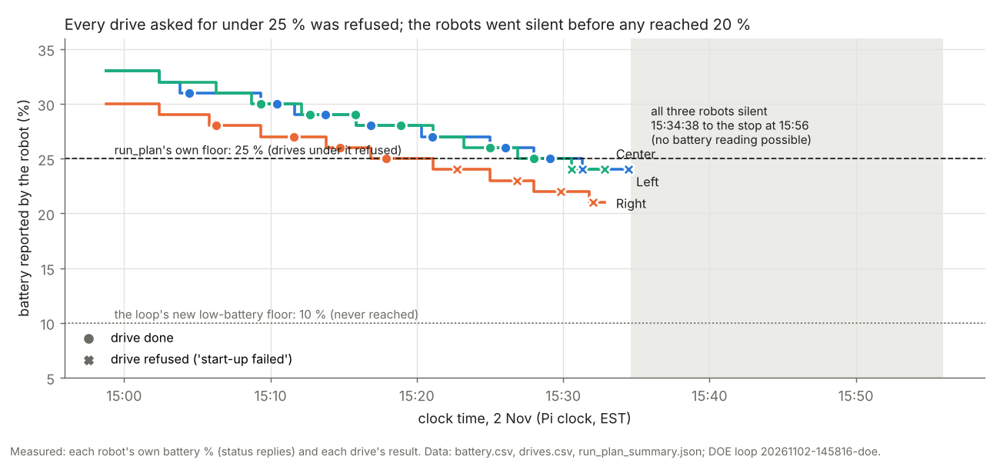
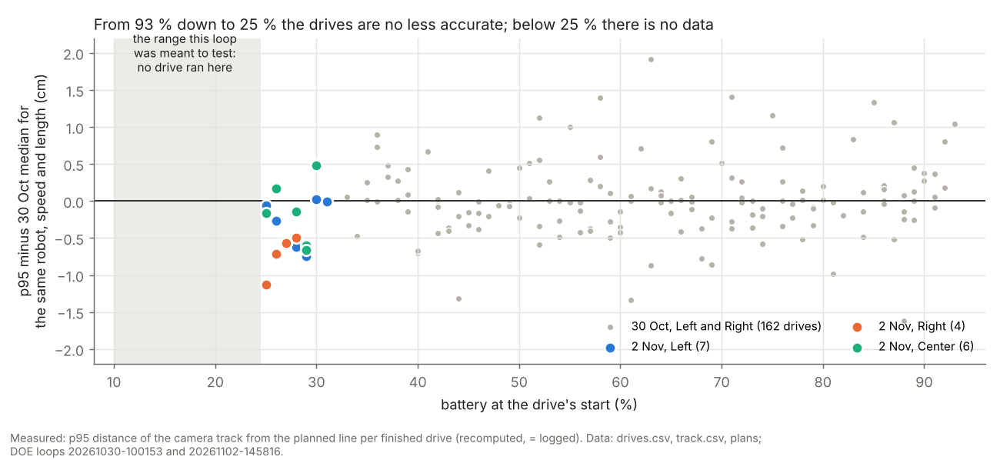
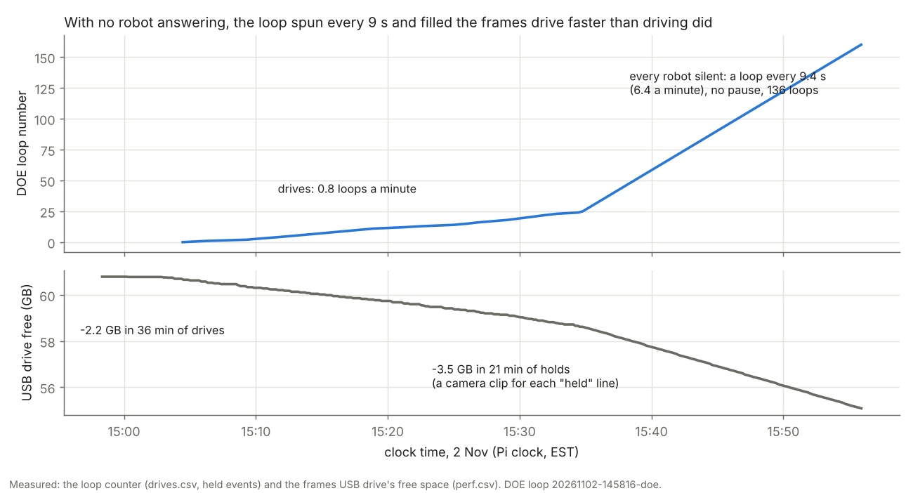

# Low-battery DOE loop, 2 Nov 14:58-15:56: drives refused under 25 %, then all three robots went silent together

**Premise.** The DOE loop `doe-20261102-145816-doe` (`./run-fleet-pi.sh doe 2 keep-going low-battery`) was meant to
record accuracy while the batteries ran down to 10 %. Code dfb3396 (robots set aside under 10 % instead of 25 %), the
no-stops code of 30 Oct, firmware 2026-10-28a, three robots (Left, Right, Center), afternoon daylight. Batteries at
the start: Left 33 %, Right 30 %, Center 33 %. Questions: why drives ended "start-up failed"; accuracy against battery
compared with the 30 Oct high-battery loop ([report](e02-oct30-daytime-doe.md)); the 15:34 dropout; the holding loop;
the heat tracker. Everything below is from the release's logs (2.7 MB; frames not downloaded). The robots and the Pi
were not touched.

## Data

**1. Every "start-up failed" was the drive program's own 25 % battery floor. The low-battery option did not reach it.**
25 drives were asked for (Left 9, Right 8, Center 8): 17 done, **8 refused** (the last 6 in a row, plus Right's at
15:22 and 15:26). Every refusal printed the same line, e.g. "Battery under the 25 % floor: Left 24 %. Charge it first
(nothing was moved)" ([terminal](../screenshots/2026-11-02/lowbatt-problem-terminal-left-drive-refused-25pct-floor-then-all-silent.png)).
dfb3396 lowered only the loop's set-aside line (`ladder.MIN_BATTERY`, read from `MIRLT_MIN_BATTERY`). Each drive is a
separate `run_plan.py`, whose `--battery-floor` defaults to 25 (`engine_checks.BATTERY_FLOOR_PCT`), and the loop never
passes it. So no drive could run under 25 %. Label: **loop design** (my dfb3396 missed the second floor), for all 8.

Each line is one robot's battery as it reported it. Dots are finished drives and crosses are refused ones: every cross
sits under the 25 % line.

- The "low p95" on doe-status for those drives (0.38-1.58 cm) is the camera watching a robot that **never moved**.
  It is not a measurement of driving and should be blank.
- The turn checks before two refused drives still ran (Right at 24 %, 15:22; Left at 24 %, 15:33). They are the only
  motion recorded under 25 %. Both passed (largest error 3.2 deg).
- One finished drive is only partly valid: Right's drive 1 (15:06). Its distance sensor stopped it 2.5 s in ("obstacle
  12.0 cm ahead", one zone of five; no camera saw anything there). It was re-planned and ended in 8.8 s instead of
  16 s, with no camera heading. Label: **robot** (distance sensor, probably a false reading). Every drive is in
  Appendix A.

**2. Accuracy against battery: no worse from 93 % down to 25 %. Under 25 % there is no driving data.**

Each dot is one finished drive's p95 minus the 30 Oct median for the same robot, speed and length (0 = as accurate as
30 Oct). Grey dots are 30 Oct (93 % down to 33 %) and coloured dots are today (31 % down to 25 %). Neither shows a slope,
and the shaded 10-24 % range has no drives.

| | Today, 25-31 % | 30 Oct, 33-93 % |
|---|---|---|
| Drive p95, median (cm): Left / Right / Center | 1.72 (7) / 1.80 (4) / 1.69 (6) | 2.08 (81) / 2.23 (81) / - |
| Ends / straight p95, median (cm): Left | 1.72 / 0.78 | 2.17 / 1.13 |
| Ends / straight: Right | 1.80 / 1.83 | 2.34 / 1.29 |
| Ends / straight: Center | 1.85 / 1.07 | - |
| Drives below their 30 Oct cell median | 14 of 17 (median -0.50 cm) | - |
| Turn-check error, mean of size (deg): Left / Right / Center | 1.88 (12) / 1.70 (8) / 1.23 (8) | 1.30 (84) / 1.55 (92) / - |
| Both cameras saw the robot (median share): Left / Right / Center | 98 / 95 / 96 % | 99 / 99 % |
| Lighting at L0 (overhead board level; weakest robot contrast) | 190; 20 grey levels | 193; 20 |

p95 (95th percentile): over one drive, the distance from the planned line that 95 % of the camera's positions stay
within. Recomputed from bridge/track.csv and the plan files; it matches drives.csv to 0.00 cm. "Ends": positions
within 3 cm of A or B along the line, or beyond them; "straight": the rest. Center has no 30 Oct drives, so it is
compared with Left and Right pooled. Brackets: number of drives or turns. Sign test, in fine print: if battery did
nothing, each drive would land above or below its cell median like a coin toss; 14 of 17 below happens by chance about
1 time in 80 (two-sided p = 0.013). Within 30 Oct alone, p95 changed by +0.07 cm per 10 battery points for Left
(95 % range from a bootstrap, i.e. re-drawing the drives at random 2,000 times: -0.01 to +0.17) and +0.02 for Right
(-0.14 to +0.18): no slope. Turn checks, Mann-Whitney test (are today's turn errors usually larger than 30 Oct's?):
Left p = 0.09, Right p = 0.68: no clear difference. Sources: drives.csv, turns.csv, run_plan_summary.json (battery),
L0/lighting.json of both loops.

- *Claude's conclusion:* down to 25 % the battery shows **no** loss of accuracy. Today's drives were slightly
  *better*, which a falling battery cannot explain. It is mixed up with other differences: one drive per robot,
  speed and length (30 Oct: about 10); the same fixed order of speeds and lengths, so battery and the 40 cm drives
  fell together; afternoon (15:00-15:30) against morning; a third robot on the board; Right's partial drive 1.
- **Too little data for the question that was asked.** The 10-24 % range had 0 drives, and 25-31 % had 17. The
  shortfall was the floor (section 1) and then the dropout (section 3), not the battery.

**3. The dropout: all three robots stopped answering within the same 24 seconds, about 15:34:14-15:34:38. None came
back before the stop.**

| Robot | Last message heard | Last status (battery, WiFi) | Battery trend before |
|---|---|---|---|
| Left | 15:34:25.0 (status, during its refused drive) | 15:34:25: **24 %**, -68 dBm | 33 -> 24 % in 35.5 min |
| Right | 15:34:14.2 ("nothing running") | 15:32:50: **21 %**, -62 dBm | 30 -> 21 % in 34 min |
| Center | 15:34:14.2 ("nothing running") | 15:32:50: **24 %**, -64 dBm | 33 -> 24 % in 34 min |

No voltage is logged anywhere: the firmware reports only the battery % (status, RUNINFO and RUNEND lines). From
15:34:15 to 15:34:27 the link belonged to Left's drive program, which records only Left; Right's and Center's lines
from then were not recorded. The first check that heard nobody began about 15:34:38 (ask, wait 4 s, `wake`, ask
again, wait 4 s), and all three were "held: not answering" at 15:34:47. Sources: messages.csv (the loop's and each
drive's), battery.csv, events.csv.

Evidence, for each cause:

| Cause | For | Against |
|---|---|---|
| **Battery: each robot switched itself off (power-off or brown-out)** | All three were low (21-24 %) and draining about 15 % an hour; the 25 % floor exists because a run at 20 % sagged (25 Oct) | Three separate batteries at 21, 24 and 24 % all failing within 24 s of each other. Right sat at 21 % for 2.5 min and answered normally. Right and Center were standing still. A brown-out restart boots and announces itself, which would have been heard; nothing was heard for 21 min |
| **WiFi signal at the robots** | - | The last readings, -62 to -68 dBm, were ordinary for this loop (Left -65 to -72 all session). Nothing was getting worse |
| **The Pi's network or the router (all three share it)** | Explains "all at once" | The Pi kept working: cameras at 25 pictures a second to 15:55:58 (they are local), the loop ran on, sends raised no error. The Pi's own WiFi and the router's state are **not logged**. The upload worked at 16:48 |
| **A `sleep` command from elsewhere** (`robot_sleep.py`, `wake_loop.py --naps`) | Explains "all at once"; a sleeping robot hears nothing | Nothing on the Pi's screen sent it. A robot napping under 21 min would have checked in and been woken (the loop sent `wake` every 9 s). Only `sleep 0` or a long nap fits |

- *Claude's conclusion:* a cause shared by all three (the network, or a command) fits the timing better than three
  batteries giving out within the same 24 s. The logs cannot prove it. One answer from Nick decides it (question 1).
- **No robot came back** before the loop was stopped: no "answering again" event in 136 checks.
- **When it stopped:** the screen shows `^C` and "Stopped (Ctrl+C, doe-stop, or the tmux session closed)" right
  after loop 160's header, at 15:55:58 by the Pi's clock. That clock matches the 14:58 start, so the loop ran 58 min,
  not to 16:47. The release's files were uploaded at 16:48 (GitHub asset time 21:48 UTC), so 16:47 is probably when
  the upload was run.

**4. The holding loop: one loop every 9.4 s (6.4 a minute) for 21 minutes, 136 loops, with no pause.**

The top panel counts DOE loops: slow while robots drove, then steep once none answered. The bottom panel is the free
space on the frames USB drive. It fell faster during the holds than during the drives.

- Why: a robot held for "not answering" stays in the active list. So the existing 20 s wait ("no robot passed its
  checks", `RETRY_ALL_WAIT_S`) never runs. The check returns nobody, the loop counts up and starts again at once. Its
  length is only the check's two 4 s answer waits.
- **CPU and heat: not a problem.** The loop used 5 % of a core while holding (68 % while driving). The Pi cooled from
  a 73 C mean to 62 C (section 5).
- **Log spam: yes.** 408 "held" lines in 21 min (events.csv, screen.txt, and 101 KB of summary.md, most of it these
  lines). doe-status showed only these, so the 15:34 change was easy to miss.
- **Disk: yes.** Every "held" line asks the recorder for a clip from both cameras. The frames drive lost 3.5 GB in
  21 min of holding, against 2.2 GB in 36 min of driving. Over the 2 h cap that is about 10 GB, for pictures of robots
  standing still.
- **Design flaw** (*Claude's conclusion*): nothing could run, nobody was told, and the loop would have spun to its
  16:58 cap.
- **Proposed fix (not implemented):**
  1. Every robot held for "not answering": wait, getting longer each time (20 s, 40 s, then every 2 min). Meanwhile
     send `wake` to each robot every 2 s, as wake_loop.py does, so a sleeping robot is caught in its 20 s check-in.
  2. Don't count held loops as DOE loops.
  3. Log a change once ("Left, Right, Center not answering since 15:34:38"), then one line every 5 min. A camera clip
     only for the first "held" of a run of holds.
  4. After 10 min with every robot silent: a headline on doe-status ("ALL ROBOTS SILENT since 15:34"), the recorder
     paused, and the loop ended with that reason after 30 min, so the upload runs.
  5. With it, the section-1 fix: `low-battery` passes `--battery-floor` to every drive, and a battery refusal is
     logged as "held: battery under the drive floor", not "start-up failed" with a p95.

**5. Heat tracker** (`--cooling=unknown`, [row and chart](../results/heat-tracker.md)): median 70.1 C, top 77.9 C,
0 minutes at 80 C, no soft limit or throttling during the session. The camera held 25.0 pictures a second (rho 0.01).
The Pi was at 73 C while driving and fell to 61-62 C once only holds ran.

## Conclusion

- **"Start-up failed" was the drive program's 25 % floor**, which the low-battery option did not change (loop design,
  dfb3396). All 8 refusals; nothing moved in them.
- **Down to 25 %, no battery effect on accuracy** (drive p95, ends and straight, turn checks). **Under 25 %: no
  driving data at all.** The low-battery question is still open.
- **The 15:34 dropout hit all three robots within 24 s.** *Claude's conclusion:* more likely a shared cause (network
  or a command) than three batteries at once. Not provable from these logs.
- **The holding loop spins every 9.4 s** when no robot answers: harmless for heat, costly for logs and disk, and
  silent to Nick.

## What's next

1. Fix the floor (section 4, fix 5) and the holding loop (fixes 1-4). Simulator test: three silent robots for 15 min.
2. Before the next low-battery run, test one robot alone on the board: drive it from 25 % down to 10 % in the DOE
   loop with the floor fixed. If it also goes silent near 21-24 %, the battery is the cause after all.
3. Log the Pi's own network: a ping to the router and to each robot every 10 s into perf.csv. The next dropout then
   says whether the Pi lost the network.

## Questions for Nick

Substantive:
1. When you went to plug the robots in after 15:55, were they still switched on (any light on the robot), or dark?
   Did they answer again once plugged in without you pressing reset or the power switch? This decides between
   battery and network.
2. Did anything else run around 15:34: a `sleep` or `wake_loop` command, the router restarting, or another program
   on the robots' WiFi?
3. The loop stopped at 15:56 by the Pi's clock (Ctrl+C), not 16:47; the upload was at 16:48. Is that right?

Other:
4. For the next low-battery run, should the drive floor go to 10 % too (my plan), or 15-20 % with a guard that stops
   a drive when the robot goes silent? The firmware's edge guard stays either way.

## Sweep 1: new tests that may now be needed

- Simulator: DOE loop, all three robots silent for 15 min. Check that the loop backs off, logs once, takes no clip per
  hold, alerts at 10 min and ends at 30 min.
- Simulator: low-battery loop with simulated batteries 25 -> 10 %. Check that every drive runs (floor passed through)
  and that a battery refusal is logged as a hold.
- Board, one robot: a drive every 2 min from 25 % down to 10 %. Note the % at which it stops answering, if it does.
- Pi: a network log (router and robot pings) in perf.csv during every loop.
- Unit: drives.csv leaves p95 blank for a drive that never moved.

## Sweep 2: possible inaccuracies in what this relied on

- Battery is the robot's own integer % with no voltage. The Alvik's % may not be linear with charge, so "24 %" may
  not mean the same on each robot.
- The silence window (15:34:14-15:34:38) is limited by what was being recorded. Right's and Center's link was not
  recorded 15:34:15-15:34:27.
- "No brown-out restart was heard" assumes a restarted robot announces itself to the Pi on boot. It does
  (home_lab.ino "ready" line), but only if it rejoins the WiFi.
- Today's cell values are one drive each, against about 10 per cell on 30 Oct. Right's drive 1 is a partial drive.
- The ends/straight split uses my 3 cm definition (the 30 Oct report's). It gives 2.2 / 1.1-1.3 cm for 30 Oct, where
  that report had 2.5 / 1.2. The method differs slightly; today and 30 Oct here use the same script.
- Lighting is compared only at L0 (board level 190 vs 193). Light in the room after 15:00 is not measured.
- Chosen numbers:
  - The 3 cm "ends": no DOE; a 2/3/5 cm check on the logs would show if the split is stable.
  - The proposed waits (20 s, 40 s, then every 2 min), the 10 min alert and the 30 min end: no DOE. They are patience
    choices, not settings that change accuracy.
  - The 25 % run_plan floor (from one sag on 25 Oct) and the 10 % low-battery floor (the E1b plan's 8 % plus a
    margin): safety floors, no DOE. The low-battery run itself is the experiment that should set the drive floor.
  - STATUS_WAIT_S 4 s per check: no DOE.

## Appendix A: every drive, outcome and cause

| Clock | Robot | Drive | Speed / length | Battery | Result | p95 (cm) | Cause | Label |
|---|---|---|---|---|---|---|---|---|
| 15:04 | Left | 1 | 5 / 25 | 31 | done | 1.63 | | |
| 15:06 | Right | 1 | 5 / 25 | 28 | done (partial) | 1.09 | distance sensor stop 2.5 s in (12 cm, one zone), re-planned, 8.8 s of 16 s, no camera heading | robot |
| 15:09 | Center | 1 | 5 / 25 | 30 | done | 2.10 | (first moved from 24 to 31 cm from the edge, 15:07) | |
| 15:10 | Left | 2 | 7.5 / 25 | 30 | done | 2.28 | | |
| 15:11 | Right | 2 | 7.5 / 25 | 27 | done | 1.64 | | |
| 15:12 | Center | 2 | 7.5 / 25 | 29 | done | 1.61 | | |
| 15:13 | Left | 3 | 10 / 25 | 29 | done | 1.54 | | |
| 15:14 | Right | 3 | 10 / 25 | 26 | done | 1.97 | | |
| 15:15 | Center | 3 | 10 / 25 | 29 | done | 1.68 | | |
| 15:16 | Left | 4 | 13 / 25 | 28 | done | 1.72 | | |
| 15:17 | Right | 4 | 13 / 25 | 25 | done | 2.18 | | |
| 15:18 | Center | 4 | 13 / 25 | 28 | done | 2.63 | | |
| 15:21 | Left | 5 | 5 / 40 | 27 | done | 0.89 | | |
| 15:22 | Right | 5 | 5 / 40 | 24 | start-up failed | (still) | run_plan's 25 % floor | loop design / battery |
| 15:24 | Center | 5 | 5 / 40 | 26 | done | 1.69 | | |
| 15:26 | Left | 6 | 7.5 / 40 | 26 | done | 1.73 | | |
| 15:26 | Right | 6 | 7.5 / 40 | 23 | start-up failed | (still) | run_plan's 25 % floor | loop design / battery |
| 15:27 | Center | 6 | 7.5 / 40 | 25 | done | 1.69 | | |
| 15:29 | Left | 7 | 10 / 40 | 25 | done | 2.02 | | |
| 15:29 | Right | 7 | 10 / 40 | 22 | start-up failed | (still) | run_plan's 25 % floor | loop design / battery |
| 15:30 | Center | 7 | 10 / 40 | 24 | start-up failed | (still) | run_plan's 25 % floor | loop design / battery |
| 15:31 | Left | 8 | 13 / 40 | 24 | start-up failed | (still) | run_plan's 25 % floor | loop design / battery |
| 15:32 | Right | 8 | 13 / 40 | 21 | start-up failed | (still) | run_plan's 25 % floor | loop design / battery |
| 15:32 | Center | 8 | 13 / 40 | 24 | start-up failed | (still) | run_plan's 25 % floor | loop design / battery |
| 15:34 | Left | 9 | 5 / 25 | 24 | start-up failed | (still) | run_plan's 25 % floor | loop design / battery |

"(still)": the logged p95 (0.38-1.58 cm) is of a robot that did not move. Camera and tracker: no fault in any
drive (both cameras saw the robot in 94-99 % of pictures, except Right's partial drive 1, 65 %). Other events: Center's
setting read-back unanswered once at 15:32:06 (resent and confirmed). Sources: drives.csv, screen.txt,
run_plan_summary.json, sensor_stops.csv, events.csv. The per-drive recomputation (battery, p95 all / ends / straight,
both-camera share) was done in the analysis scratchpad and is not committed.
