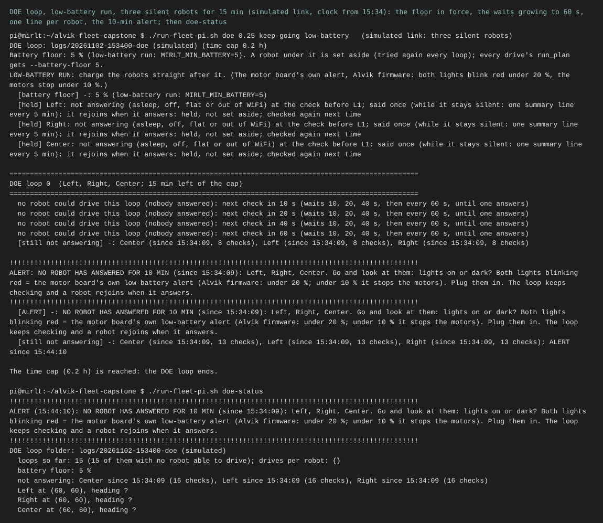
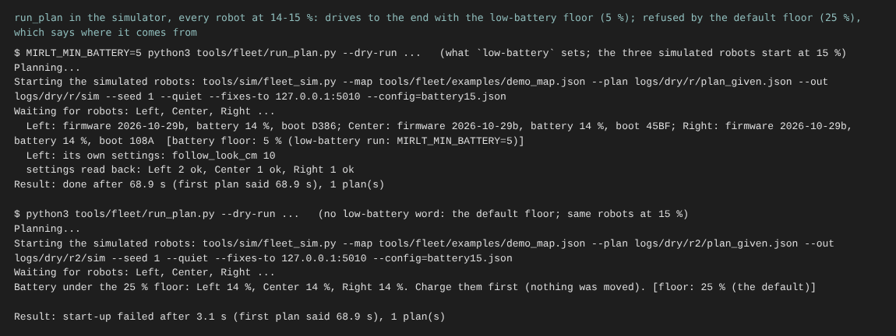

# Low-battery fixes: one battery floor, a quiet holding loop, power telemetry (2 Nov)

**Premise.** The 2 Nov low-battery DOE loop ([report](e02-nov02-low-battery-doe.md)) found three problems:

1. `low-battery` lowered only the loop's own floor. `run_plan.py` kept its 25 % floor and refused all 8 drives under 25 %.
2. With every robot silent, the loop ran one loop every 9.4 s with a "held" line and a camera clip each time. Nobody was told.
3. No battery voltage is logged, so a power loss cannot be told apart from a network loss.

Nick (2 Nov): "I don't think it needs to stop before 5%". Everything here was tested in the simulator and with unit
tests. The robots and the Pi were not touched. The firmware compiles with the stand-in headers only (`tools/fwcheck`).
Nick flashes it later.

## What changed

**1. One battery floor, from the loop to every drive.**

| Where | Before | Now |
|---|---|---|
| Source of truth | ladder: `max(10, MIRLT_MIN_BATTERY)`; run_plan: 25 | `engine_checks.battery_floor()`: `MIRLT_MIN_BATTERY` if set, never under 5; otherwise 25 |
| `./run-fleet-pi.sh doe <h> low-battery` | 10 (loop only) | 5, the same for the loop's check and every drive |
| Loop's check, ladder L0 | `ladder.MIN_BATTERY` | the same function |
| Every drive and room move (`run_planned`) | no `--battery-floor` passed, so run_plan used 25 | `--battery-floor <floor>` passed |
| run_plan default (start-up refusal, mid-run note, a restarted robot's re-check; warm-up, straightening and calibration all run inside it) | 25 | the same environment variable, so mission_run and Mission Control inherit it too |
| Printed | nothing | at the loop's start, in L0, on run_plan's start line and in every refusal, e.g. `5 % (low-battery run: MIRLT_MIN_BATTERY=5)` |
| A drive that run_plan refuses on battery | "start-up failed" with the p95 of a robot that never moved | a battery park (tried again next loop); no p95 for any drive where nothing moved |
| Help text | - | "CHARGE THE ROBOTS STRAIGHT AFTER A LOW-BATTERY RUN", also printed when the loop starts |

The default with no `low-battery` word is still 25 %.

**Found while checking every floor on the drive path: the motor board has its own floor, and our code cannot change
it.** The Alvik's motor-board firmware (Arduino_AlvikCarrier 1.1.1, `robot_definitions.h` and `updateBehaviours`) has
a battery alert that the Alvik library turns on at every power-on. When the robot is not charging:

- under **20 %**, it blinks both lights red, which overrides our ID lights;
- under **10 %**, it stops the motors and ignores every command, while still sending its sensor readings.

So with the motor board's firmware as it is, no robot drives under 10 %. From 20 % down, its lights blink red, and
the find step and the facing check use those lights. This matches what Nick saw (both lights blinking red when he
went to plug the robots in). It does not by itself explain the WiFi silence at 21-24 %. Question 1 asks what to do.

**2. The holding loop.**

| | 2 Nov | Now |
|---|---|---|
| Wait when no robot can drive | none: one loop every 9.4 s | 10, 20, 40, then 60 s. It starts again at 10 s when a robot answers or drives |
| During the wait | - | `wake` and `status` to each silent robot every 2 s, so a robot that answers ends the wait at once |
| A held robot's "not answering" | one line and one clip per loop (408 lines in 21 min) | one line and one clip when it goes silent, then one summary line every 5 min, and one line when it answers again |
| Camera clips | one for every event | only for a new event: the same event again for the same robot (numbers aside) gets no clip |
| Battery parks and retries, every loop | a line each loop | said once while the reason stays the same |
| 10 min with nobody answering | nothing | an `ALERT` block on the loop's screen, at the top of `doe-status`, and an `ALERT` row in events.csv. It clears when a robot answers |
| doe-status | loops only | the alert, loops with no robot able to drive, the battery floor, who is not answering and since when |



The DOE loop with three robots that never answer, run for 15 min on a simulated link and clock (source: the test
`test_three_silent_robots_for_15_min_back_off_log_once_and_alert`). It shows the floor in force, the waits growing to
60 s, one line per robot, the alert at 10 min, and `doe-status` afterwards.

**3. Power telemetry (firmware 2026-10-29b; Nick flashes it later).**

- **No voltage exists to log.** The Alvik library gives the Nano only the charge %, signed for charging. The motor
  board reads the battery chip (MAX17332), voltage included, and sends only the %. The library reads the chip itself
  only while the motor board is off. So battery.csv gets no voltage column. It gets what there is instead: `charging`,
  `motor_board` (the motor board's power pin, `is_on()`), `sensor_age_ms` (how old its newest sensor reading is),
  and `floor_pct`.
- `status` now ends with `charging 0, motor board on, sensors 12 ms old`. Every existing parser still reads it.
- **Motor board not answering:** the motor board sends the IMU about every 10 ms. When the readings stop changing for
  `stm_stale_ms` (2000 ms), the robot sends one line, `M,<name>: motor board not answering (no new sensor reading for
  ... ms; motor board power on/off; ...)`. When they come back it sends `answering again`. The check runs in the main
  loop and in every motion loop. The DOE loop logs both lines as `motor board` events.
- The E02 runner accepts 2026-10-29b. The simulator's `status` has the new ending.



run_plan in the simulator with every robot at 14-15 %. Top: with the low-battery floor (5 %) the plan runs to the end.
Bottom: with the default floor (25 %), it refuses and names the floor and where it comes from (source: the dry test).

**Also in this build (Nick, 17:59):** the school robots are renamed JayA -> **Alpha** and JayB -> **Bravo** in the
site profile, code, simulator, tests, roof spec, tag sheet PDF (regenerated; only the names changed) and the
conference report's steps. Tags stay 0 = Alpha, 1 = Bravo. Nick's answers are marked in that report: keep the 3 s stop,
homes as planned, the school Pi has internet.

## Tests

- New, `tools/fleet/tests/test_low_battery_fixes.py`, 13 tests:
  - the floor: default 25, low-battery 5, clamp at 5, text;
  - run_plan's default follows the environment variable;
  - the loop passes `--battery-floor` to every drive;
  - a robot at 15 % passes the loop's check on a low-battery run and is set aside at the default floor;
  - a battery refusal becomes a hold with no p95;
  - **simulator:** three robots at 15 % drive the demo plan to the end with `MIRLT_MIN_BATTERY=5`, and are refused
    with the default;
  - **three silent robots for 15 min:** waits 10/20/40/60 s, 15 loops instead of about 96, one line and one clip per
    robot, 2-3 summary lines, one alert at 10 min on the screen, in events.csv and in doe-status;
  - a robot that answers ends the wait within 2 s and clears the alert; a robot silent again gets a new line;
  - battery parks said once;
  - the status ending and the motor-board line are parsed;
  - firmware version and the runner's lists.
- Firmware: `sh tools/fwcheck/check.sh` clean.
- Full suite (`python3 -m pytest tools/fleet/tests tools/pi/tests tools/sim/tests`): **629 passed, 9 skipped** (616
  before, plus the 13 new). Five older tests pinned firmware 2026-10-29a exactly. They now accept 29b, and the
  E02 runner's tests (`tools/experiment/tests`) were run too.

## What's next

1. Nick: flash firmware 2026-10-29b (steps below). Until then the loop works, with the new battery.csv columns blank.
2. Decide question 1 (the motor board's 10 % stop), then do the one-robot low-battery run from the earlier report:
   one robot, from 25 % down, with `low-battery`.
3. Log the Pi's own network (router and robot pings in perf.csv), as the earlier report proposed. This build did not
   do it.

## Nick's steps

### A. Flash firmware 2026-10-29b (laptop, Arduino IDE), each robot in turn

1. Plug the robot's Nano ESP32 into the laptop by USB-C. Switch the robot ON.
2. In the Arduino IDE, open `firmware/home_lab/home_lab.ino`. Tools, Board: **Arduino Nano ESP32**. Tools, Port: the
   one that appeared. Press **Upload** (the right arrow). Wait for "Done uploading".
3. Tools, **Serial Monitor**, 115200. You should see `home_lab 2026-10-29b ready, battery NN%`.

### B. Check it from the Pi (a terminal on the Pi, SSH from the laptop)

Type this and press Enter:

```
./run-fleet-pi.sh check
```

Each robot's line should end with `charging 0, motor board on, sensors NN ms old`. NN is a small number, usually
under 50.

### C. The next low-battery run (a terminal on the Pi), only after question 1

```
./run-fleet-pi.sh doe 2 keep-going low-battery
```

It prints `robots set aside under 5% battery` and `LOW-BATTERY RUN: the robots drive down to 5%. Charge them
straight after it.` To watch it:

```
./run-fleet-pi.sh doe-status
```

If nobody answers for 10 min, the first lines are a block of `!` with `ALERT: ... NO ROBOT HAS ANSWERED`. **Charge
the robots straight after the run.**

## Questions for Nick

Substantive:
1. **The motor board stops the motors under 10 %, and blinks both lights red from 20 %.** The library can switch this
   alert off (`set_behaviour(0)`). The battery chip's own cut-off still protects the cell, at a voltage I could not
   confirm. Options:
   - (a) Leave it. A low-battery run then really ends at 10 %, and the lights may fail from 20 %.
   - (b) A firmware setting, off by default, that switches the alert off for low-battery runs only.
   - (c) Keep the alert, but have the loop treat under 20 % as "find by camera body, not lights".

   I lean to (b) plus (c). This is a safety choice, so it is yours.
2. Should the loop end on its own after 30 min with nobody answering, so the upload starts (proposed in the earlier
   report)? Not built: today it alerts and keeps checking until the time cap.

Other:
3. Is a 2 s silence right for "motor board not answering" (`stm_stale_ms`)? A log check after flashing can confirm it
   (docs/doe-backlog.md).

## Sweep 1: new tests that may now be necessary

- Board, after flashing: `status` on each robot shows a small sensor age. Switching the motor board off with the power
  switch, with the Nano on USB, should give "motor board not answering" within about 2 s. Unconfirmed: it depends on
  the library's thread.
- Board: one robot from 25 % down. Note the % at which the lights start blinking red and whether the find step still
  finds it, and whether it really stops at 10 % (question 1).
- Logs: after a day on 2026-10-29b, the longest normal sensor-age reading, to set `stm_stale_ms`.
- Simulator: a DOE loop where robots are parked for battery while others are silent (mixed). Only unit-tested.
- Pi: the network log (router and robot pings), still not built.

## Sweep 2: possible inaccuracies in what this relied on

- The motor-board behaviour (20 % blink, 10 % stop, commands ignored) is read from Arduino_AlvikCarrier **1.1.1 on
  GitHub**, not from our robots' motor-board firmware. That version is not logged per robot. RUNINFO's `motor_fw`
  column has it.
- The motor board's 10 % and 20 % are its own charge readings. The Nano's % is the same number rounded, so they should
  agree. Not checked on a robot.
- "The IMU's six floats never repeat exactly while it runs" is assumed from sensor noise. A robot standing perfectly
  still could in principle repeat a reading. That is why the limit is 2 s (about 200 readings), not one reading.
- The stale check cannot report if the Nano's own loop is blocked by a library call waiting on the motor board.
  Our firmware avoids blocking calls, but this is not proven.
- Chosen numbers: waits of 10/20/40/60 s, wake every 2 s, summary every 5 min, `stm_stale_ms` 2000. The 10 min alert
  and 5 % floor are Nick's. Whether a DOE should set each number is in docs/doe-backlog.md, "Low battery and the
  holding loop".
- The screenshots come from the simulator and a fake clock, not the Pi.
- The firmware compiles with stand-in headers only, not the Arduino toolchain.
