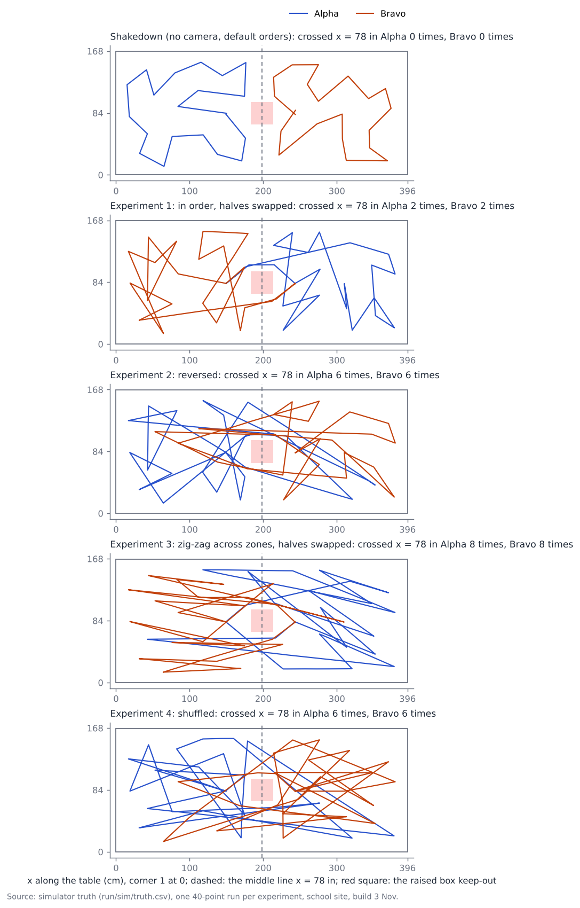
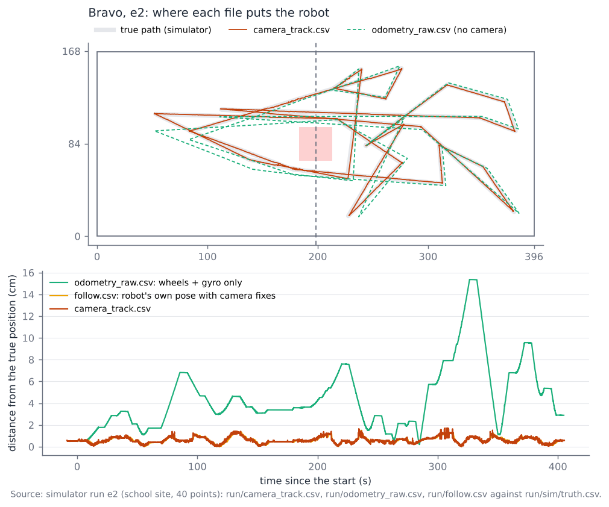
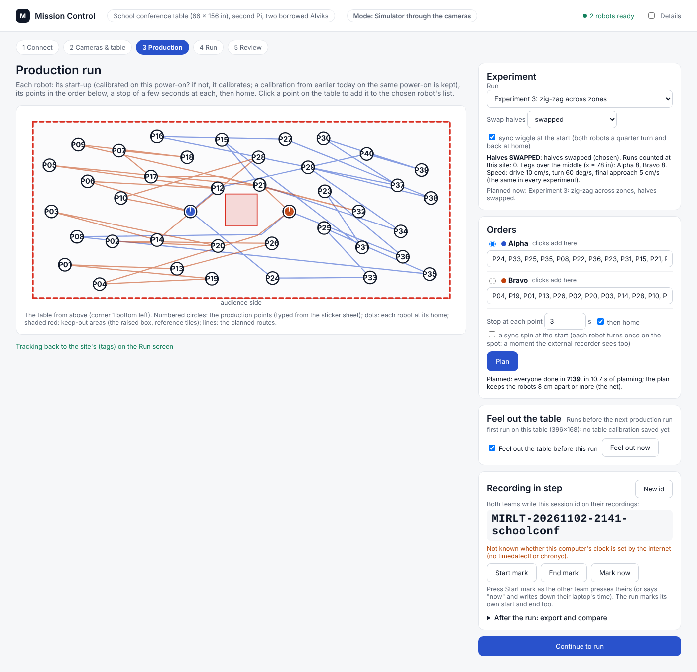
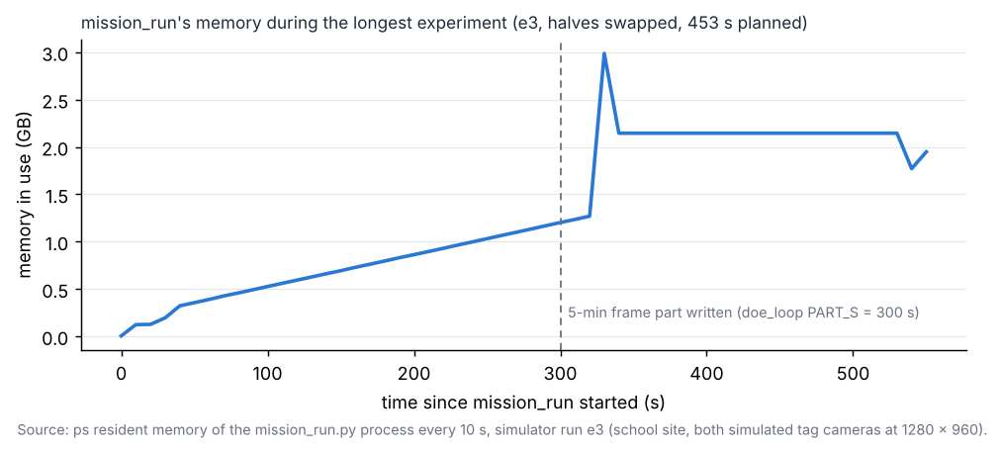

# Experiment routes, sync wiggle and Jay-Sun's run data (3 Nov, simulator and tests only)

## Premise

Jay-Sun's thesis needs training runs from tonight's school session (5 pm):

- "a few different point orders (not the same order every run), the robots swapping halves every other run, and some
  legs that cross the middle line at x = 78 in. Same speed in all four experiments."
- "the camera position for every frame while driving, not just at the stops, plus the wheel+gyro odometry on its own
  with no camera correction, as separate columns", and "the raw run files so I can rerun the alignment on my side".
- The first no-tag odometry run is a **shakedown**, not one of the four experiments.

Nick added a **sync wiggle** at the start of each run. The build also fixes the keep-going bug from
[e02-nov03-robot-gap](e02-nov03-robot-gap.md): points handed back and forth were listed two or three times, and both
robots could stay held for about 10 minutes. Nothing touched a robot or a Pi; everything below comes from the
simulator and the tests.

## Data

### What was built (details: Appendix B)

1. **Experiment routes**, picked in Mission Control's new Experiment card or with `mission_run --experiment`:
   - shakedown (no camera, the default orders);
   - E1 in order;
   - E2 reversed;
   - E3 zig-zag;
   - E4 shuffled (seed recorded).

   In E2-E4 each robot also takes 3 points of the other half. The halves swap every other run (a run counter per
   site; `on`/`off` to choose); the homes stay. One speed (10 / 60 / 5) is pinned for all of them.
2. **Sync wiggle** at every school run's start. It is the RFID clock's primary anchor; the route fit is the
   cross-check.
3. **run/camera_track.csv**: every camera read, the whole run.
4. **run/odometry_raw.csv**: wheels + gyro rebuilt from the RAW rows, anchored once, never camera-corrected. No
   firmware change.
5. **`./run-fleet-pi.sh jay-bundle`**: our raw files for Jay-Sun, never anything from RFID.
6. **Keep-going fixes**: a point is listed once, and the both-held loop is capped.
7. **Runbook**: [school-experiments.md](../archive/school-experiments.md).

Every new behaviour has a switch back to the old one.

### The routes



<sub>Each panel is one 40-point simulator run: the true path of Alpha (blue) and Bravo (orange). The dashed line is
x = 78 in; the red square is the raised box keep-out.</sub>

### Simulator runs: the shakedown and experiments 1-4 at school (halves swapped in alternate runs)

| run | halves | result | time (s) | points done (unique / stands) | closest bodies (cm) | legs over x = 78 in, Alpha / Bravo (driven; planned) | ± range (cm) | truth inside ± | closest body to edge (cm) | wiggle starts apart (s) | camera-track rows | raw odometry off the truth, median / max (cm) |
|---|---|---|---|---|---|---|---|---|---|---|---|---|
| Shakedown (no camera) | as usual | done | 185 | 40 / 40 | 53.2 | 0 / 0; 0 / 0 | 2.0-53.7 | 40 of 40 | 4.9 | 0.000 | none (no camera) | 4.1 / 10.5 |
| E1 in order | **swapped** | done | 294 | 40 / 40 | 12.1 | 2 / 2; 2 / 2 | 1.0-2.2 | 37 of 40 | 7.7 | 0.011 | 3256 / 3249 | 3.1 / 33.1 |
| E2 reversed | as usual | done | 404 | 40 / 40 | 9.2 | 6 / 6; 6 / 6 | 1.0-2.0 | 39 of 40 | 7.2 | 0.010 | 4759 / 4762 | 3.6 / 15.4 |
| E3 zig-zag | **swapped** | done | 471 | 40 / 40 | **8.6** | 8 / 8; 8 / 8 | 1.0-2.5 | 38 of 40 | 7.5 | 0.001 | 5498 / 5576 | 8.0 / 38.3 |
| E4 shuffled | as usual | done | 477 | 40 / 40 | 9.6 | 6 / 6; 6 / 6 | 1.0-2.5 | 38 of 40 | 7.2 | 0.021 | 5582 / 5650 | 4.3 / 45.5 |

<sub>Each row is one simulator run (`mission_run.py --site school-conference --dry --experiment <id> --swap-halves
on|off`, seed 1, both simulated tag cameras, 3 s stands, keep going). Swap was set by hand to what `auto` gives when
the shakedown is run 1. "Closest bodies" is the closest the two 9.5 cm bodies came (simulator truth; the net is 8 cm).
"Legs over" counts the true path's crossings of x = 78 in against the planned count. "Truth inside ±" is how many
points' true position fell inside the ± the run gave (95 % expected). "Raw odometry" is odometry_raw.csv against the
truth, every 10th row. Sources: each run's `mission_summary.json`, `run/sim/truth.csv`, `run/odometry_raw.csv`.</sub>

- Every run did all 40 points, each once. Each robot drove the same speeds (10 / 60 / 5, in each summary's
  `speed_pinned`).
- **The experiments run longer than the old default: 294-477 s against 185 s**, because the routes are not the
  shortest ones. The swapped and crossing runs bring the robots closer together (8.6-12.1 cm against 53 cm), but
  every run stayed above the 8 cm net.
- Each wiggle started on both robots within 0.02 s of each other and lasted about 5.3 s.

**Keep-going stress case** (the robot-gap report's: seed 2, both roof tags covered 25 s at 60 s, re-plan cap 3;
default orders):

| Code | Result | Time (s) | Points done / stands | Hand-overs | Held / rejoined | Closest bodies (cm) |
|---|---|---|---|---|---|---|
| Fixes off (`--dedupe-points off --all-held-max 0 --all-held-max-s 0`) | every robot out | 673 | 39 / 39 | 13 | 9 / 7 | 12.1 |
| Fixes on (default) | every robot out | 675 | 39 / 39 | 13 | 9 / 7 | 25.7 |

<sub>Source: each run's `mission_summary.json` and `run/coordinator.jsonl`.</sub>

- **The duplicated points did not come back in this case even with the fix off** (39 stands for 39 points; the
  robot-gap report's run had 80 stands). The fix is shown by the unit test that replays the exact sequence (a point
  handed there and back), not by this run.
- **The 10 minutes here were not both robots held:** both were held only once, at 583 s. The time went on one robot
  at a time being held and rejoining (9 times held, 7 rejoins), which the new cap does not count. That loop is still
  bounded by the 10 rejoins per robot and the 90 s wait (What's next, 5).
- Found, not fixed: a re-plan made while a robot stands at a point can list that point again later in the same
  robot's plan (7 plans in the stress run; same with the fix off). It was never driven, because a later re-plan
  dropped it each time, but nothing guarantees that (Sweep 1).

### Camera track and raw odometry against the truth



<sub>Bravo in experiment 2. Top: the true path, the camera track and the raw odometry. Bottom: how far each file's
position is from the truth over the run. The camera track and the robot's own fused pose stay within about 1.5 cm;
the raw odometry drifts and comes back as its heading error turns with the route.</sub>

- The camera track has every kept read of the whole run, about 11-12 moments a second per robot: 3,250-5,650 rows a
  robot against the 80 stops. The tag bridge's `fixes.csv` keeps at most 10 a second, and the old `cam_track.csv`
  1,150.
- The raw odometry never takes a camera fix. Two checks: (1) a unit test makes the fused pose jump 3 cm at a "camera
  fix" and the raw track does not change at all; (2) in the simulator the raw track drifts to 10-46 cm off the truth
  by the end, while the fused pose (with fixes) stays within about 1.5 cm. In the simulator this drift comes mostly
  from heading (about 15 deg after 15 m for Bravo in E1). It is plausible, but it is the simulator's gyro, not the
  real one (Sweep 2).

### The RFID clock from the wiggle

Twelve fake RFID captures (`simulate_jay_csv.py`: invented tags and guessed antennas), three each from the
shakedown, E1, E2 and E3 runs. For each, the reader-to-Pi offset was recovered with the wiggle as the anchor and with
the route fit alone (`--no-wiggle`):

| Anchor | error, median (s) | error, largest (s) | true offset inside the stated range | EPC -> robot right |
|---|---|---|---|---|
| Sync wiggle (primary, as asked) | 0.047 | 0.122 | 12 of 12 (with the floor at ±0.15 s; 11 of 12 at ±0.10) | 12 of 12 |
| Route fit (before; now the cross-check) | 0.028 | 0.071 | 12 of 12 | 12 of 12 |

<sub>Source: `school_rfid.run` on each fake, `summary.json` "reader_to_pi_s" against the fake's answer key. The wiggle
did better on 4 of the 12.</sub>

**The wiggle did not recover the offset as well as the route fit on these fakes** (median 0.047 s against 0.028 s),
so the asked-for check "at least as good" **fails** here. Both are well inside one RFID row, which already spreads
over up to 0.5 s. Claude's reading: the fakes are made from the same smooth signal model the route fit assumes
(position surface plus the tag's turn pattern), so they favour the route fit. On real data the wiggle does not depend
on that model, only on a known turn at a known time. The wiggle stays primary as asked, the route fit is always
computed beside it (`route_fit_shift_s`, `wiggle_agrees_with_route_fit` in the summary), and `--no-wiggle` makes the
route fit primary again. Tonight's captures decide which to trust (What's next, 2).

### Mission Control



<sub>The Production screen in the simulator with Experiment 3 chosen and the halves swapped. The card says what the run
does, and the lists and planned routes (lines on the table) follow the choice.</sub>

### A problem found: mission_run's memory with the long experiments



<sub>mission_run's memory, sampled every 10 s, in the e3 simulator run. It climbs while the tracking-rate pictures for
one 5-minute .avi part are held, then jumps to 3 GB while that part is written.</sub>

The tracking-rate pictures are kept in memory until each 5-minute .avi part is written (`doe_loop.PART_S`, since
28 Oct). Earlier runs were under 5 minutes, so the part was only written at the end. The experiments run up to
8 minutes. In the simulator, mission_run reached 3.0 GB (e3) and 3.4 GB (e4) while writing. On this machine, with the
test suite running beside it, one e3 run was killed for lack of memory at 400 s. **Fix (Claude's choice, a switch):**
the school site sets `frames_part_s: 60`, and mission_run sets the part length from it (home keeps 300 s).
With 60 s parts, the 675 s stress run's mission_run levelled off at 0.86 GB (sampled every 10 s), against
3.0-3.4 GB with 5-minute parts.

### Tests

- `tools/fleet/tests/test_experiments.py`, 30 tests. Every experiment and swap visits each of the 40 points once;
  in-order and reversed follow the numbers; every non-in-order experiment has at least 4 legs per robot over x = 78 in
  (both swaps); zig-zag alternates zones; a swap exchanges the halves and keeps the homes; the shuffle is fixed by its
  seed; the four experiments differ; auto swap alternates with the run counter; the old default orders are kept. The
  wiggle: the block comes first for both robots, plans a quarter turn and back at t = 0, its times are read from the
  step log, and it is off at home. Exports: the camera track fuses the two cameras and drops refused reads; the raw
  odometry is unchanged when the fused pose jumps (no camera correction), has no jumps, is anchored once, and is on
  the Pi clock. The bundle has our files and the README, and nothing with "rfid" in its path. A handed-back point is
  listed once (twice with `--dedupe-points off`); a done or already-listed point is never inserted; the both-held cap
  ends the run on the 3rd time, and with the cap at 0 it waits as before.
- `tools/rfid/tests/test_school_rfid.py`, +1: on a made-up session with a wiggle, three fakes: the anchor is the
  wiggle, the true offset is inside its range, and its largest error is no worse than max(route fit's, 0.15 s).
- Mission Control was exercised through Playwright (the Experiment card, Plan with e3 swapped and e4 auto; no page
  errors), and its API was tested with curl.
- Full suite before the first push: 768 passed, 12 skipped, 2 failed: `test_ref_tags` setup (a port held by my own
  test Mission Control; it passes alone) and `test_camrec_dual` (the known flake under load; it passes alone).
  After part 2: **770 passed, 12 skipped**.

## Conclusion

- Built and pushed for tonight (Claude's conclusions from the simulator; the routes and data have not been tried
  on robots yet):
  - the four experiments plus the shakedown, with the halves swapped every other run, legs over the middle in E2-E4
    (6-8 per robot) and one pinned speed. Each simulator run did all 40 points once, and the closest the robots came
    was 8.6 cm, above the 8 cm net;
  - the sync wiggle on both robots within 0.02 s of each other;
  - the per-frame camera track, at about 12 moments a second for the whole run;
  - the raw wheel+gyro track. It needs no firmware change, never takes a camera fix, and drifts 10-46 cm over a
    run in the simulator;
  - the bundle for Jay-Sun;
  - the duplicated-points fix and the both-held cap.
- **The wiggle as the RFID clock is not better than the route fit on the fakes** (median 0.047 s against 0.028 s;
  both inside one RFID row). It is primary as asked; the route fit is kept beside it.
- **Found and fixed with a switch:** the long experiments took mission_run to 3 GB in the simulator (5-minute frame
  parts). School now uses 60 s parts.
- The experiments take longer than the old default: 5-8 minutes each, so about 35 minutes of robot time for
  shakedown + 4.

## What's next

1. Tonight, follow [school-experiments.md](../archive/school-experiments.md): shakedown, then E1-E4, then
   `./run-fleet-pi.sh jay-bundle` after each run.
2. After the session, run `school_rfid.py` on each run with and without `--no-wiggle`, and compare the two offsets
   (the summary says whether they agree). That is the first real test of the wiggle.
3. If Jay-Sun wants the swap per experiment instead of every other run, set **Swap halves** by hand; the run's
   summary records it either way.
4. Possible: score the wiggle against each row's first and last sighting (the bundle's max RSSI), not the row's
   middle, to tighten it.
5. Possible: count one robot's held-and-rejoined cycles in the keep-going cap too (the stress case spent 10 minutes
   that way), if Nick wants runs like that cut short.

## Appendix A: DOE notes on chosen numbers

| Number | Chosen | Would a DOE decide it better? |
|---|---|---|
| Frame parts 60 s at school (frames_part_s) | memory: 5-min parts took mission_run to 3 GB with 8-min runs | Partly: 30 / 60 / 300 s against peak memory on the real Pi during the longest experiment; no effect on the data |
| 3 points of the other half per robot (e2-e4) | at least 4 legs over the middle per robot without making runs much longer | Yes: 2 / 3 / 5 against run time and the RFID model's error on held-out crossing legs (Jay-Sun's data decides) |
| At least 4 crossing legs per robot in the shuffle (redrawn otherwise) | a floor so "some legs" is never 0 | No: a guarantee, not a tuning |
| Shuffle seed 20261103 | any fixed seed, recorded | No |
| Speeds 10 / 60 / 5 | the production speeds already in use since the conference-table build | Only if Jay-Sun wants speed as a factor: one speed per experiment is his request |
| Wiggle 90 deg, 1 s stops | sharp and short (about 5.3 s), stays at home, keeps the tag's pattern change large | Yes: 45 / 90 / 180 deg against the RFID clock error on real captures |
| Wiggle window 6 s before, 0.5 s after | the robots stand still before; the experiments drive off at once | Yes: 3 / 6 / 10 s against the clock error on fakes, then real |
| Wiggle clock floor +- 0.1 s | covers every fake so far (largest error 0.122 s) | Yes: on real captures, the wiggle against the reader's own marks |
| Both-held cap: 3 times or 180 s | the stress case's loop went on for 10 min; 3 times is 2 chances to recover | Yes: 2 / 3 / 5 times and 120 / 180 / 300 s against points done and minutes lost (seed-2 stress, then school) |
| Homes stay when halves swap | nobody re-places robots between runs; swapped runs cross the middle twice more | Not a DOE: the alternative (homes swap) needs the robots moved by hand every other run |

## Appendix B: what was built, in detail

| Item | What | Where | Switch (old way kept) |
|---|---|---|---|
| 1 Experiment routes | `shakedown` (no camera, default orders), `e1` in order (P01.. by number in each half), `e2` reversed, `e3` zig-zag (alternates the half's two zones, each swept across the width), `e4` shuffled (seed 20261103, recorded), `default`. In e2-e4 each robot also takes **3 points of the other half** (the same number each way), spread through its list, so every point is still done once and each robot crosses x = 78 in at least 4 times. Halves swap: Alpha takes zones 3-4 and Bravo zones 1-2; **homes stay** (P11 / P22). Speed pinned per site (drive 10 cm/s, turn 60 deg/s, final approach 5 cm/s) in the planner, and kept by re-plans | `tools/fleet/experiments.py`, `production.site_production(experiment=, swap=)`, `mission_run.py --experiment --swap-halves on/off/auto`, site `experiments` block | no `--experiment` / Custom in the picker = the old default or typed orders |
| | Run counter: one count per production run started on the robots with an experiment (simulator runs never count). `auto` = swapped when the count so far is odd | `<site conf_dir>/experiments_counter.json` | `--swap-halves on/off` |
| | Mission Control: an **Experiment** card on the Production screen (the choice, swap auto/on/off, the swap state in words, legs over the middle, speeds, seed, the sync-wiggle tick-box). Typing in the lists switches it to Custom. The shakedown sets tracking to No camera; an experiment after it sets it back. Before a robot run, a plan made with `auto` is planned again if the counter has moved on | `tag_job.experiment_preview`, `/api/production/experiment`, `mission_control.html` | Custom |
| | Recorded: experiment id, name, orders, swap, seed, traded points, crossings, pinned speeds | `run/experiment.json`, `mission_summary.json` "experiment", "speed_pinned" | - |
| 2 Sync wiggle | A `sync-wiggle` block: both robots at the plan's start (after start-up), at home: quarter turn left, 1 s stop, quarter turn back, 1 s stop (about 5.3 s). Start and end per robot from the step log | `missions.py`, `experiments.add_wiggle / wiggle_events`; summary "sync_wiggle", `SYNC WIGGLE` lines | site `experiments.sync_wiggle.use` (school on, home has no block = off), `--sync-wiggle on/off`, tick-box |
| | RFID clock: the wiggle is the primary anchor (per antenna, RSSI ~ 1 + cos 2h + sin 2h fitted to the wiggle's window, over shifts); the route fit is the cross-check, and both are in the summary | `tools/rfid/school_rfid.py` 2026-11-03b | `--no-wiggle` |
| 3 Camera track | `run/camera_track.csv`: every read the tag bridge kept (refused reads left out), with the two cameras' reads within 0.07 s fused as the bridge fuses them. Columns: time, robot, x, y, heading, sigma, pm95, cams, n_reads, cams_apart, source. Lights runs use the bridge's seen rows; no-camera runs have no file | `tools/fleet/run_exports.py`, made at every run's end | `--no-run-exports` |
| 4 Raw odometry | `run/odometry_raw.csv`: per robot, dead reckoning rebuilt offline from the RAW rows the firmware already logs (50 a second: the motor board's wheel odometry x/y/th, IMU yaw, wl/wr wheel angles, gz). It follows pose.h's tick() step for step and is anchored **once** at the robot's first own pose; no camera fix is ever applied. **No firmware change.** The raw values used are also written as columns | same | same |
| 5 Raw bundle | `./run-fleet-pi.sh jay-bundle [folder]` (default: the newest school run): a zip in the run's folder with our logs, the two new CSVs, the summary, the site file, the points and a README of the columns. It never includes anything with "rfid" in its path, and logs/ is git-ignored | `run_exports.bundle` | - |
| 6 Duplicated points | Only the newest hand-over of a point counts, and a point already in a running robot's list (or already done) is never put in again. Both robots held for the **3rd time**, or again more than **180 s** after the first time, ends the run with the points not done listed | `run_plan.py` | `--dedupe-points off`; `--all-held-max 0`, `--all-held-max-s 0` |
| 7 Runbook | [school-experiments.md](../archive/school-experiments.md): shakedown, experiments 1-4, export; linked from morning-nov03 B7 | | |

## Appendix C: commands

```
python3 tools/fleet/experiments.py --site school-conference            # every experiment's orders and crossings
python3 tools/fleet/mission_run.py --site school-conference --dry --experiment e3 --swap-halves on
python3 tools/fleet/run_exports.py <mission folder> --bundle
python3 tools/rfid/school_rfid.py <mission folder> <capture.csv> [--no-wiggle]
```

## Sweep 1: new tests that may now be necessary

- Board: the sync wiggle on real robots, filmed: do both start within about 0.05 s, and is a 90 deg turn on the spot
  clean (no drift off the home sticker)?
- Board: one swapped run with the cameras: the drive across the middle round the raised box at its real size.
- RFID: on tonight's real captures, the wiggle against the route fit, and the stated ranges against
  each other.
- Simulator: a case that really holds both robots 3 times (the stress case held both only once), to see the cap
  end the run and the summary list the points not done.
- Unit + simulator: a point listed again in a plan made while the robot stands at it (seen in 7 stress-run plans,
  never driven): it should be dropped once its stand is done, whether or not another re-plan comes.
- Simulator: memory with 60 s frame parts in the longest experiment (E3/E4), and on the real Pi (`free -m` during a
  run).
- Unit: the Mission Control auto-swap re-plan (`experiment_auto_swap`) with a counter that moved between Plan and Run.
- Unit: odometry_raw across a robot restart mid-run (a second segment).

## Sweep 2: possible inaccuracies in what this relied on

- **The simulator's odometry and gyro** are models; the real raw track will drift differently, probably more.
- **The fakes favour the route fit** (same signal model); the wiggle-vs-route comparison may not hold on real data.
  The antennas, tag pattern and reader timing in the fakes are guesses.
- **The run counter assumes every started robot run counts.** A run stopped early still counts; then set the swap
  by hand.
- **The 3 traded points, 4 crossing legs, 90 deg wiggle, 6 s window, ±0.15 s floor, both-held 3 times / 180 s and
  60 s frame parts** are chosen numbers (Appendix A), not derived.
- **Homes stay when halves swap** (Claude's choice). If Jay-Sun wanted each robot to start in its new half, the start
  and end legs differ.
- **The raised box is still the assumed 12 x 12 in**; the crossing legs pass beside it in every experiment except
  the shakedown.
- **The camera track's sigma is the tag read's own**; it does not include the table frame's error (the ± at the
  points does).
- **Raw odometry's start** is the robot's first own pose, which comes from the first camera fix (or the typed home
  with no camera), so its start inherits that one fix's error.
- **One simulator run per experiment, seed 1.** The closest approach (8.6 cm) is close to the net; other seeds may
  come closer, and the planner's net is what protects.
