# Keep going, and confidence at every point (2 Nov night, simulator and tests only)

## Premise

Nick, 2 Nov 21:01-21:06: "There will be pillows to protect the Alviks so its okay if they drop, I just want to stay
focused on finishing the run with the highest confidence positional assessment it can make every step of the way,
sometimes that won't be 100%." "The camera should be more trusted than the sensor if we're using April tags. Let's
keep it within the camera barrier for the trial run." "Build what you can. Be ready to initiate a home run in the
morning then hopefully a school run after."

Two builds, one site switch each, old behaviour kept: (1) **keep going**: a problem that used to end the whole run is
said once, logged and worked round; (2) **confidence at every point**: each production point gets a position, a ± and
where it came from. Plus the morning runbook. Nothing touched a robot or a Pi.

## What was built

| Part | What it does | Switch (old way kept) |
|---|---|---|
| Site policy | `on_problem`: `keep_going` (school) / `stop` (home, unchanged); `feel_out_trust`: `camera` (school) / `sensor` (home); `lost_robot_points`: `reassign` (default) / `skip`. A wrong word stops the launcher with the file and the line | `tools/fleet/sites/*.json`; per run `mission_run --on-problem / --lost-robot-points / --feel-trust`; Mission Control's tick-box **Keep going when something goes wrong** |
| Keep going (run_plan) | Each run-wide stop converted (full table: Appendix A): camera vs pose → pose snapped to the camera; out of re-plans → re-plans go on 5 s apart; no plan / re-plan failed → the blocked point skipped and planned again (a robot set out after 4 failures); a lost robot → its points handed to the robot still running; edge guard ends a run → that spot a no-go strip; time limit stretched to the newest plan's end | `--on-problem stop` = every path as before |
| Unreachable points | Named and listed (`point 6 cannot be reached ... skipped`), and their 3 s stand is skipped too (it used to be stood out wherever the robot was); at the first plan, keep going skips them instead of refusing the plan | the planner's own skip (unchanged under `stop`) |
| Feel-out, camera trusted | Crawls unchanged (3 cm inside the cameras' line). A side felt apart from the cameras' outline is reported and logged (`NOTE: ... the camera's outline is kept`), never moved, never holds the production run; its trips do not teach the robots' reach | `feel_out_trust: sensor` = moved in up to 10 cm, held past 10 (as built 2 Nov) |
| Confidence at every point | During each 3 s stand: position (median of the camera fixes), ± (95 %), source (two cameras / one camera / odometry only), cm and s since the last camera fix the robot took. `run/points.csv`, `run_plan_summary.json` / `mission_summary.json` `points`, the Event log (`POINT point 7 (Alpha): ±0.9 cm, two cameras`), Mission Control's robot cards (live) and a **Confidence at each point** card on Run and Review | adds information only |

**How the ± is made** (plain: "95 % of the time the robot was within this distance of the number given"):

- **Camera:** the bridge's own noise for the fix, combined with the camera fit's own error from the setup
  (`site_fit.json`: robot-tag residual px ÷ px per cm, at least the stickers' uncertainty), at least half the distance
  the two cameras' positions are apart, plus a bumped camera's shift (the bridge's `camera_moved`; also added back to
  points stood at in the 12 s before the bump was noticed).
- **Odometry only:** the ± of the last camera fix the robot took, plus **0.07 cm per cm driven** since. Source:
  29 Oct logs, 4,124 straight stretches, p95 2.17 cm after 5 cm to 4.44 after 40
  (`docs/build-reports/e02-oct29-start-straighten-blind-strip.md`, section 3). MEASURED up to 40 cm of straight
  driving; beyond that and over turns it is extrapolated (DOE backlog row added).

## Data

### Simulator runs (school site, the whole chain: `mission_run.py --dry --tracking tags`, both tag cameras, real detector, fitted cameras)

| case | injected | result | s | points | ± range (cm) | truth inside ± | kept going (kinds) | reassigned | skipped | closest robots (cm) | closest to edge (cm) | contact | hung |
|---|---|---|---|---|---|---|---|---|---|---|---|---|---|
| base | nothing (baseline) | done | 73 | 6 | 0.9-1.2 | 6 of 6 | - | - | - | 16.6 | 16.78 | no | none |
| blackout | Alpha's tag covered 20 s (17-37 s) | done | 88 | 6 | 0.9-2.7 | 6 of 6 | cam_guard, points_reassigned | 5 Alpha->Bravo | - | 16.6 | 16.85 | no | none |
| silent | Bravo dead at 30 s | done | 80 | 6 | 0.9-1.2 | 6 of 6 | points_reassigned | 4 Bravo->Alpha; 6 Bravo->Alpha | - | 16.6 | 16.76 | no | none |
| camguard | Alpha's true pose pushed 10 cm at 25 s | done | 73 | 6 | 0.9-1.2 | 6 of 6 | cam_guard | - | - | 16.6 | 16.71 | no | none |
| unreach | a brick dropped on point 6 at 38 s | done | 52 | 5 | 0.9-1.2 | 5 of 5 | - | - | 6 (Bravo) | 16.6 | 16.76 | no | none |
| feel8 | table 8 cm smaller than the cameras' outline | done | 73 | 6 | 0.9-1.2 | 6 of 6 | - | - | - | 16.6 | 8.31 | no | none |
| bump | side camera knocked 1 deg at 30 s | done | 72 | 6 | 0.9-5.3 | 6 of 6 | - | - | - | 16.6 | 16.78 | no | none |

One run each, seed 1, 396.2 x 167.6 cm, Alpha and Bravo, 3 points each, 3 s stands. "truth inside ±": the point's
position against the simulator's true pose over the stand's last second. Closest to edge: the simulator's closest body
to an open edge. Pictures of each run's summary: Appendix C.

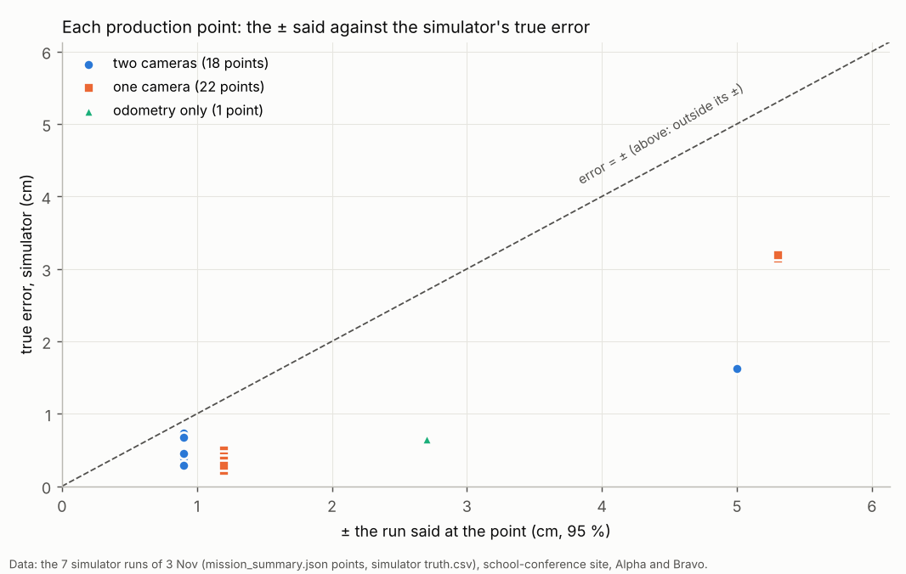

Every point the runs recorded: the ± the run said (across) against how far off it really was (up). A point above the
dashed line would have been outside its ±.

- **All 41 points were inside their ± on the final code; in the first version one was not, and was fixed.** In the first bump run, Bravo stood
  at point 4 just after the side camera was knocked and before the bridge noticed (two checks, 5 s apart): said ±1.2 cm,
  truth 3.1 cm off. The ± is now worked out from what is known when the stand ends, and a bump noticed later is added
  to the points of the 12 s before. The same run had counted the bump twice on point 6 (±9.4 cm, truth 3.2): now once.
- **Odometry points are honest but wide**: the blackout run's point 3 (25 cm on wheels and gyro) said ±2.7 cm,
  true 0.7. The simulator's wheels drift less than the real ones (29 Oct: the real p95 at 25 cm was 3.8 cm).

### Mission Control (Playwright, school site, practice room; Bravo dead at 30 s)

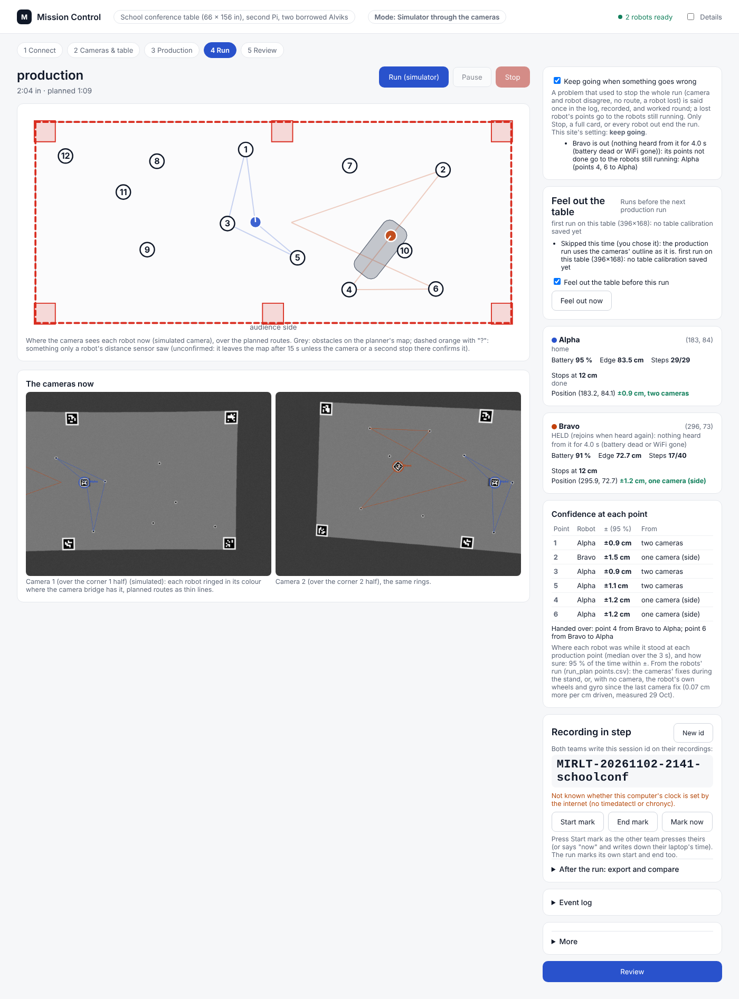

The Run screen as the run ends: the tick-box and what keep going did (top right), each robot's position with its ±
and source, and the points with their ± (Bravo's points 4 and 6 handed to Alpha).

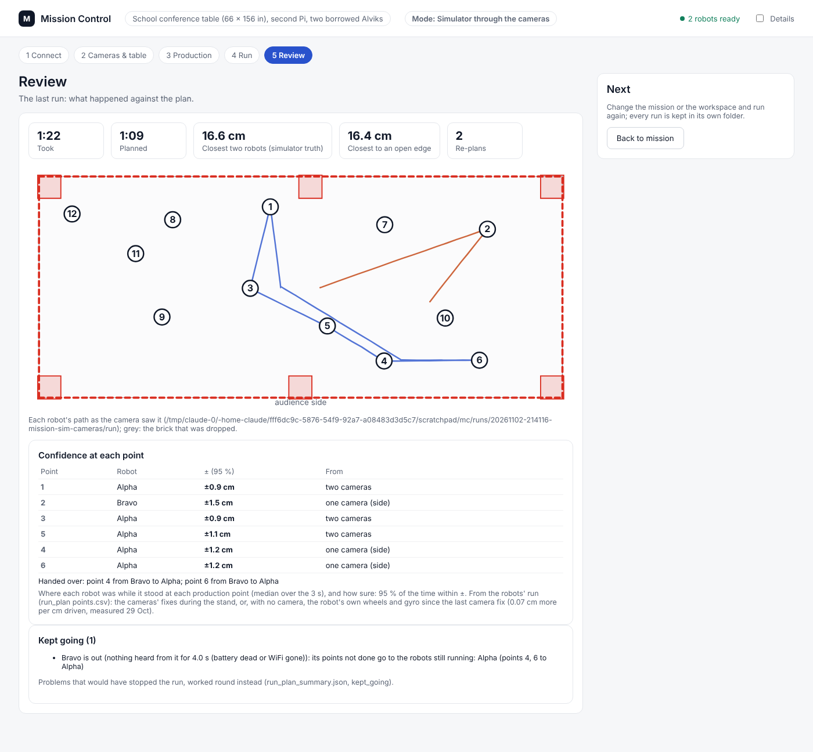

The Review screen: the same points, the hand-over and the kept-going list. The run took 1:22 against 1:09 planned
(Alpha did 6 points instead of 3).

### Home unchanged (on_problem stop)

| Home dry chain | Before (commit 5957d29) | After |
|---|---|---|
| Monday mission, 61 x 122, Left and Right (`mission_run --dry`) | done 98.9 s, 1 plan, closest robots 10.19 cm, edge 9.43 cm, mirroring 7 of 7 within 0.5 s and 3 cm | done 98.8 s, 1 plan, closest 10.08 cm, edge 9.57 cm, 7 of 7; new line `on a problem: stop the run (as before)` |
| DOE loop, 5 min dry, three robots (`doe_loop.py run --dry`) | L0, L1 (calibrations), Left's turn check (4 turns, mean -0.65 deg) and one drive (p95 0.36 cm), then the 5 min cap | the same steps: turn check mean -0.72 deg, drive p95 0.32 cm |

Same events in the same order; differences are the simulator's timing. Mission Control at home now shows each
robot's ± on its card (display only).

### Unit tests

`tools/fleet/tests/test_keep_going.py`, 26 tests: site policy (defaults, a wrong word stops loudly, mission_run's
resolution); each converted stop under keep_going and under stop (camera guard, out of re-plans, failed re-plan and
the skip then set-out, every robot out still stops, the stretched time limit, the edge-guard strip); reassignment
through the real planner (to a running robot, to a finished one, points already stood at not handed over, a lost
hand-over put back, skip and stop do not reassign); the unreachable point and its stand skipped; the feel-out's
camera trust (8 cm reported, nothing moved, no hold, no reach learned from that side; sensor trust unchanged); the ±
numbers (fit error, two cameras, cameras apart, a bump, 0.07 cm per cm, the point record and CSV, a bump noticed
later); Mission Control's tick-box and the feel job. Full suite (`python3 -m pytest tools/fleet/tests tools/pi/tests tools/sim/tests`): **710 passed, 9 skipped** (684 / 9 before).

## Conclusion

- **Keep going works end to end in the simulator** (Claude's conclusion, one run per case): every injected case
  finished (`done`), each problem said once with `KEEP GOING:`, no contact, nothing over an edge.
- **A lost robot's points are done by the other**: Bravo dead at 30 s, Alpha stood at all 6 points; the run no longer
  waits 90 s for a robot whose points were handed over.
- **The ± is honest in the simulator**: every point's true error was inside its ± after the bump fix; the camera's ±
  is 0.9-1.5 cm here, odometry grows it 0.7 cm per 10 cm.
- **Much of keep going already existed for one robot at a time** (the 30 Oct self-correcting run held a robot instead
  of stopping everyone for the camera guard, driving blind and a run that ended). What is new: the run-wide stops (no
  plan, out of re-plans, the time limit), the hand-over of points, the skip that names the point, and the feel-out's
  camera trust.
- **Claude's risk note (camera trusted):** if the cameras' outline is really too big on a side (the 8 cm case), points
  near that side are planned 8 cm closer to the real edge than the 17 cm rule. In the 8 cm run the closest body came
  8.3 (16.8 in the other runs) cm from the real edge; the edge guard still stands. Pillows are the backstop Nick named.

## What's next

1. Morning: the home run, then the school run: `docs/how-to/morning-nov03.md`.
2. At school, tape-measure 6-8 points and compare with their ± (DOE backlog: the camera's fit error).
3. Logs: odometry drift over longer stretches and turns (the 0.07 cm per cm is measured only to 40 cm, straight).

## Review of this build (Claude, after the first runs)

Re-read the diff for stop paths missed and home changes; ran the cases again on the final code. Found and fixed:
- the bump counted twice on a one-camera point, and not at all on a point stood just before the bump was noticed;
- `mission_run` stored the feel trust under the wrong name (the unit test caught it; the feel-out would have
  crashed under keep going);
- a held robot whose points were handed over still kept the run waiting 90 s;
- a robot's "since the last camera fix" did not reset when its pose was set from the camera (camera guard, after a
  blind stretch, a rejoin) or when its fix counter restarted;
- Mission Control's feel job still stopped the chain when the feel-out's result could not be read;
- the hand-over said "out" for a robot that was only held.
No home behaviour changed (table above). Not converted, on purpose: start-up refusals before anything moves (robots
are already held one at a time there since 30 Oct), the 8 cm plan refusal, a missing camera model, Stop and a full
card.

## Questions for Nick

**Substantive**
1. **Lost robot's points: reassign (built, my assumption).** Keep it, or list them as not done (`skip`)? A robot
   only held for a moment (a WiFi blip) also hands its points over and, if it comes back, only drives home.
2. **The home run in the morning**: I wrote the runbook for the DOE loop (the unattended home run of the last week).
   Did you mean that, or a Mission Control mission at home? (Monday's mission is two robots only; the three-robot
   command line refuses.)
3. **Camera trusted at school**: with the outline really 8 cm too big on a side, points there come 8 cm nearer the
   real edge than planned. Fine with the pillows, or should a felt difference over some size still move that side in
   (only in, never out)?
4. **Bumped camera**: still warn-and-go, and the ± counts it. Should the refit after the run leave out the time after
   a bump (the camera's new place is then mixed with the old)?

**Other**
5. The time limit stretches to the newest plan's end + 2 min, at most 3 x the limit (30 min from Mission Control).
6. The roof tag's height above the table (6.0 cm placeholder) is still needed.

## Sweep 1: new tests that may now be necessary

- School: 6-8 tape-measured points against their ± (two cameras, one camera, and after covering a tag for 30 cm).
- Simulator: a robot lost while the other is already home (unit-tested, not run end to end); both robots lost one
  after the other; a re-plan that fails 4 times in a row on the full chain (unit-tested only).
- Simulator: three robots with one lost (who gets which point); a lost robot that rejoins and only goes home.
- Logs: dead reckoning over 40-150 cm and over turns (the odometry ±).
- Pi: Mission Control's tick-box and the ± column on the real Pi (CPU of the extra numbers per fix).
- Simulator: the bump case with the refit after the run (does the bumped part spoil the refit?).

## Sweep 2: possible inaccuracies in what this relied on

- **0.07 cm per cm** is measured on 29 Oct's straight drives up to 40 cm, home robots, home plywood; the school robots
  and table are not measured, and turns are not in it.
- **The camera's ±** rests on the fit's own residuals and the bridge's pixel noise; the simulator's fit was 0.4-1.3 cm
  off its truth on the floor and the ± still covered every point, but real lenses, glare and the roof's unmeasured
  height (6.0 cm placeholder) are not in the simulator.
- **CHOSEN numbers** (each in the code and the DOE backlog): 0.5 cm fit error before the fit is read; 5 px per cm
  fallback; ± = 2 sigma; re-plans 5 s apart past the cap; 3 failed re-plans before a robot is set out; time limit
  + 120 s, at most 3 x; the nearest-robot rule for handing points over; 12 s bump look-back.
- **One simulator run per case**, seed 1; the simulator's wheels drift less than real ones.
- **The silent-robot case** used the simulator's "dead" robot (still, never heard again); a real WiFi blip that comes
  back would rejoin with only its trip home.

## Appendix A. Every stop and hold, under stop and keep_going

"Self-correcting" = mission_run's runs since 30 Oct (`--straighten`): one robot's trouble already held that robot.
Direct run_plan runs (the DOE loop, the ladder) never pass keep_going: they behave exactly as before.

| # | Path (file: where) | stop (home; before) | keep_going (school) |
|---|---|---|---|
| 1 | Pi's card full on a log write (run_plan `log`) | everyone stops | **same (real stop)** |
| 2 | Card under its hard floor (run_plan `disk_watch`; mission_run `space_watch` sends Ctrl+C) | everyone stops | **same (real stop)** |
| 3 | Camera and own pose > 6 cm apart for 1 s (run_plan `cam_guard`) | everyone stops; self-correcting: that robot halted, pose set from the camera; 3rd time in a minute held | pose set from the camera, `KEEP GOING` said once; 3rd time in a minute held and checked again (its points handed over) |
| 4 | Out of re-plans, 30 (run_plan `handle_obstacle`) | everyone stops | said once; re-plans go on at least 5 s apart (robots stand meanwhile), the obstacle kept on the map |
| 5 | Re-plan failed: planner error (`handle_obstacle`) | everyone stops | everyone stands, obstacle mapped, the robot's current point skipped (listed), planned again; after 4 failures in a row that robot set out, points handed over |
| 6 | No new plan (`finish_replan`, after unconfirmed obstacles were dropped) | everyone stops | as 5 |
| 7 | Every robot out (`retire`, `rejoin_watch` after 90 s) | stops | **same (real stop)** |
| 8 | Drove > 40 cm with no camera, or near an edge blind (`blind_watch`) | everyone stops; self-correcting: that robot held, checked again | held, checked again; its points handed over |
| 9 | A robot's follow run ended, incl. its edge guard (`run` loop) | everyone stops; self-correcting: held, checked again | the spot mapped as a no-go strip; held, checked again; points handed over |
| 10 | Silent robot (`silence_watch`) / restarted mid-run (`note_boot`) | held, others re-plan; rejoins when heard | same, and its points handed over (it rejoins with only its trip home) |
| 11 | Time limit (`run` loop) | everyone stops at --timeout-s | stretched to the newest plan's end + 120 s, at most 3 x --timeout-s, said once; then stops |
| 12 | Ctrl+C, SIGHUP, Mission Control Stop, `stopall` | stops | **same (real stop)**; a Stop also blocks the feel-out's chain into production |
| 13 | Step failed: edge guard "plywood edge", own border, sensor obstacle | no-go strip / re-plan (no stop) | same |
| 14 | New plan under the 8 cm net (`finish_replan`) | everyone holds, tries again every 3 s (no stop) | same |
| 15 | Point unreachable at a re-plan (planner `skip_unreachable`) | skipped (a warning in the plan only); its 3 s stand done elsewhere | same skip, now named in the log and summary; its stand skipped too (both policies) |
| 16 | Point unreachable at the first plan (mission_run `build`) | plan fails, nothing moves | skipped and listed, the run starts |
| 17 | Start-up refusals (28 in run_plan: not heard, firmware, battery, calibration, follow run, settings, camera fix, start spot, plan refused, card) | self-correcting: each robot held at the start, checked again during the run; "no robot could be made ready, twice" stops | **same** (nothing has moved yet) |
| 18 | The start's correction fails (`run_correction`, straighten) | retried once, then the start stops | **same** (start-up) |
| 19 | Plan refused under the 8 cm net, no camera model, card under its floor at the start (mission_run) | not started | **same** |
| 20 | Surface check run did not finish (mission_run `feel_first`; Mission Control `feel_job`) | production not started | said; no crawls, production on the cameras' outline |
| 21 | Feel-out run did not finish / its result unreadable | production not started | said; what was felt (or the cameras' outline) used; production starts |
| 22 | A side felt > 10 cm from the outline (feel_table `suspect`) | outline not moved, production waits | camera trust: never a hold, `camera kept` per side; sensor trust + keep going: not moved, production starts |
| 23 | A side felt 2-10 cm in | moved in | camera trust: reported, not moved |
| 24 | Bumped camera (tag_bridge `ref_check`, mission_run `bridge_watch`) | warning, run goes on | same, and the ± of that camera's points grows by the shift |
| 25 | Unknown point label in the orders (production `check_orders`) | refused before planning | **same** (Nick's typing) |
| 26 | Tag bridge: no camera model / port in use (exits at its start) | no fixes: the start stops ("no camera fix") | **same** |

## Appendix B. What changed

- New: `tools/fleet/tests/test_keep_going.py`, `docs/how-to/morning-nov03.md`, this report.
- `tools/fleet/run_plan.py`: `--on-problem`, `--lost-robot-points`, `--bridge-events`, `--cam-fit`; the keep-going
  helpers (`carry_on`, `replan_trouble`, `skip_current_point`, `reassign_points`, `insert_visits`, `keep_reassigned`,
  `note_skips`, `deadline`, `edge_end_strip`); the confidence (`note_fix`, `odometer`, `cam_unc`, `conf_now`,
  `record_point`, `bump_back`, `points.csv`); summary fields `on_problem`, `kept_going`, `points`, `points_skipped`,
  `points_reassigned`; live.json `conf`, `points`, `kept_going`.
- `mission_run.py`: the policy from the site, passed on; skip unreachable points at the first plan under keep going;
  the feel-out never stops the production run under keep going; points with simulator truth in `mission_summary.json`.
- `feel_table.py`: `TRUST`, verdict `camera kept`; `feel_job.py`: trust and keep going; `planner.py`: the skipped
  point named, its stand skipped; `sites.py` and both site files: the policy; `tag_bridge.py`: fixes carry `apart` and
  `ppc`; `mission_control.py` / `.html`: the tick-box, `--on-problem`, the ± on the cards, the points card on Run and
  Review; `docs/doe-backlog.md`: 8 rows.

## Appendix C. The runs' summaries

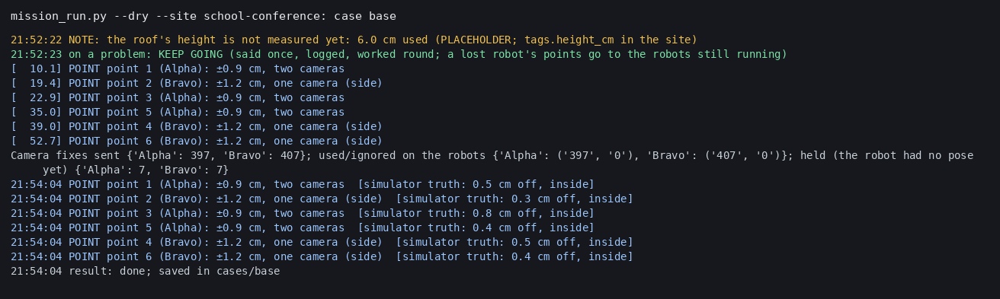

Nothing injected.

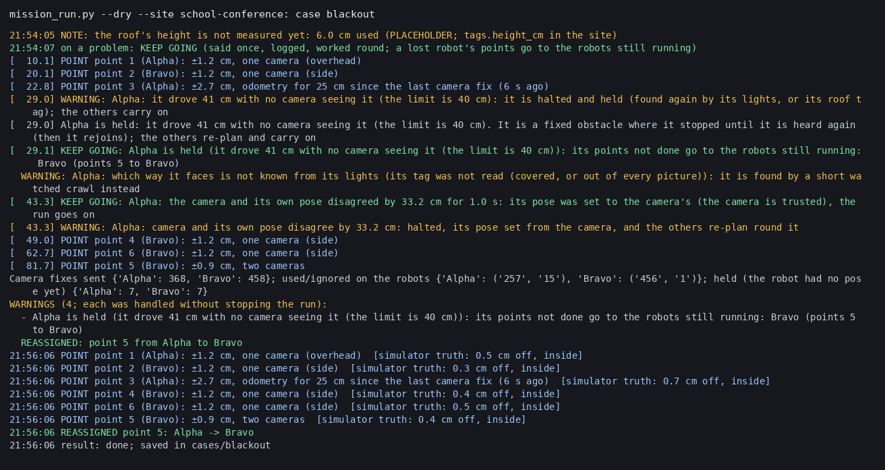

Alpha's tag covered 20 s: point 3 from odometry (±2.7 cm, 25 cm since the last fix), held after 41 cm blind, point 5 to Bravo; after its re-check its own pose was 33 cm off the camera: set to the camera's.

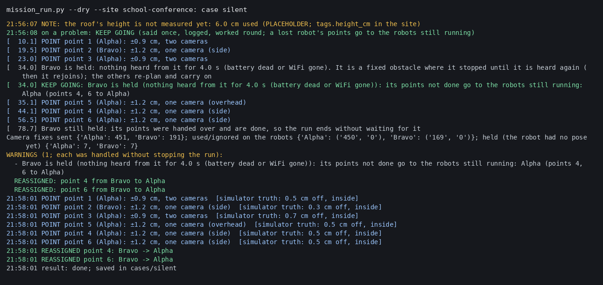

Bravo dead at 30 s: points 4 and 6 to Alpha, the run ends without the 90 s wait.

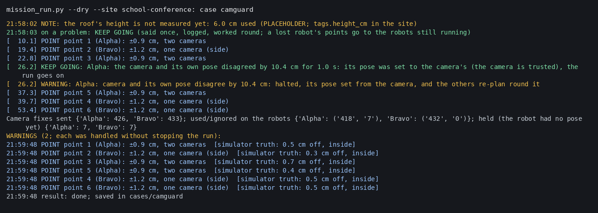

Alpha pushed 10 cm: its pose set to the camera's, said once.

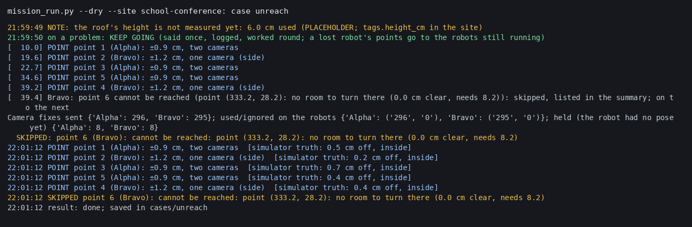

A brick on point 6: point 6 and its stand skipped, named.

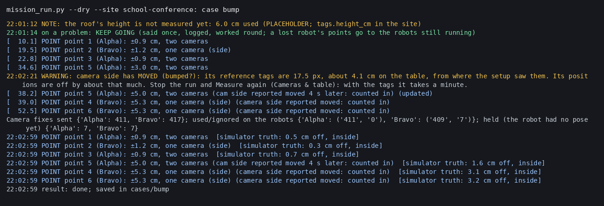

Side camera knocked: the ± of its points grows (up to ±5.3 cm, true 3.2).

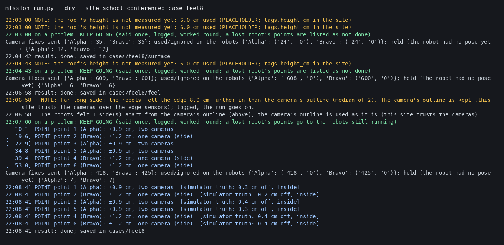

Feel-out: far long side felt 8 cm in, camera kept, no hold; production on the cameras' outline.

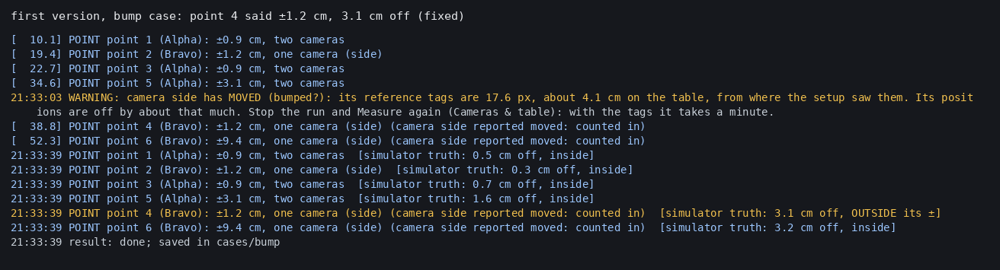

The first version's bump run: point 4 said ±1.2 cm and was 3.1 cm off (fixed, see Review).
