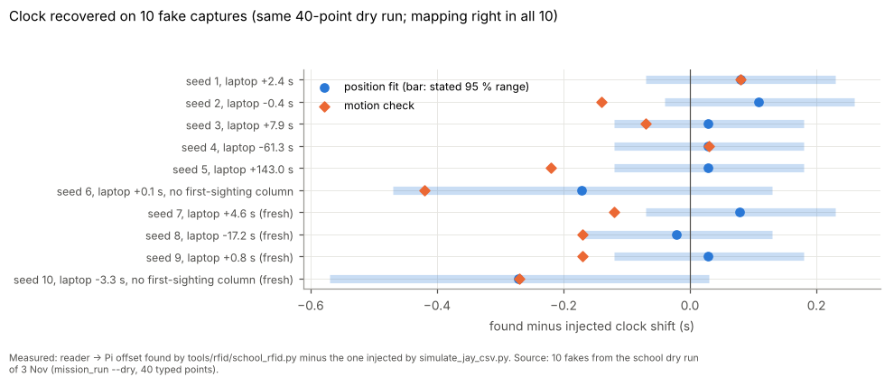
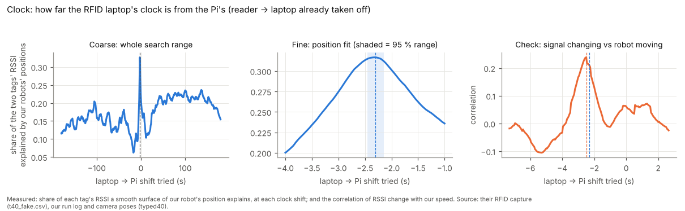
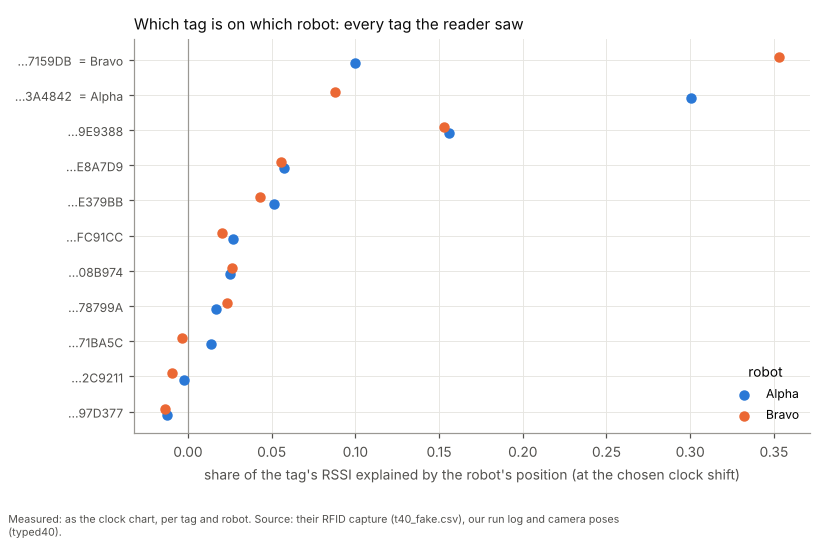
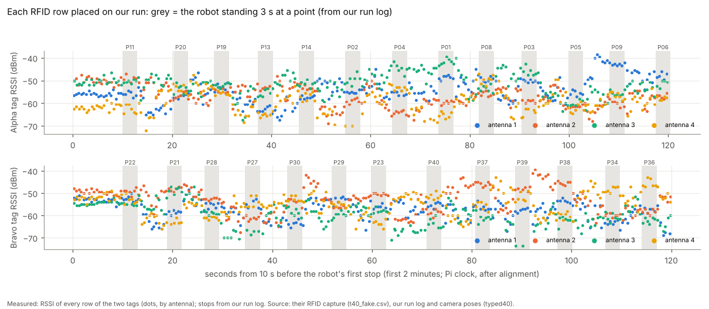
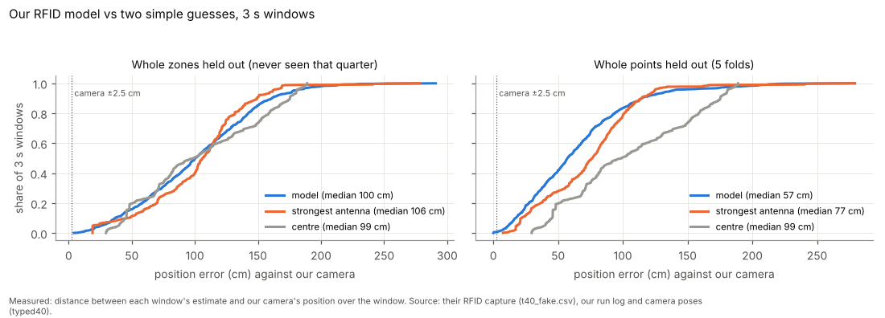
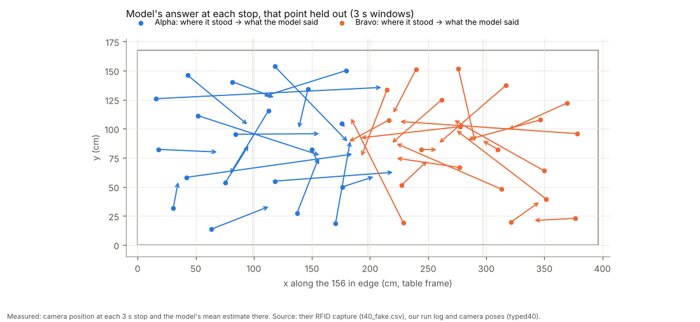
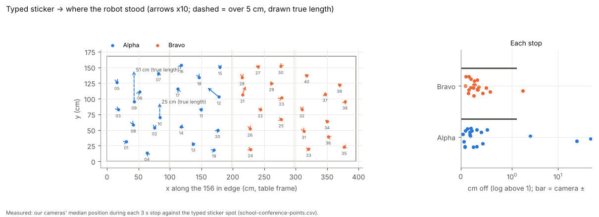
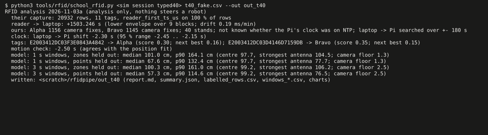

# RFID pipeline for the school sessions (3 Nov, simulator and tests only)

**Analysis only.** Nothing here steers a robot (Nick: "never use RFID to steer this week"). Nothing touched a robot,
a Pi or the RFID reader. The other team's code and data were read only to learn the capture's column layout; no code,
data, tag numbers, figures or text of theirs are in this repo. Every tag number below is invented by our generator.
**Claude's conclusion** marks a judgement.

## Premise

At school Jay records our two robots' RFID tags on his laptop (his own clock, his own capture CSV) while our cameras
record where Alpha and Bravo really are. After the session we want, from those two files alone: the clock offset
between them, which of the two robot tags is on Alpha and which on Bravo, every RFID row labelled with our camera
position, a conference-room model of our own with honest error numbers, and how far each robot actually stood from
its typed sticker.

## What was built (`tools/rfid/`)

| File | What it does |
|---|---|
| `school_rfid.py` | The command Nick runs. Loads the capture (its own column names; RSSI and phase from whichever column is filled), the clock, the tag mapping, the labels, the sticker comparison, then the model and report. Output goes to `<session>/rfid/` (inside `logs/`, which git ignores). `latest` = the newest school run on the Pi |
| `rfid_model.py` | Windows (1 s and 3 s, every 0.5 s) per robot tag: per antenna rows read, sightings, RSSI mean / max / spread, phase spread. Our own nearest-neighbour model (numpy only: the Pi has no scikit-learn). Zones held out (x 0-39, 39-78, 78-117, 117-156 in) and points held out (5 folds of whole stops). Baselines: table centre, strongest antenna. A 27-cell DOE (window x features x k) |
| `rfid_report.py` | `report.md` + 6 charts per session, each saying what is measured and where it comes from, one plain sentence under each |
| `simulate_jay_csv.py` | A fake capture in the same columns from a dry run's true paths: reader clock 25 min off, laptop clock off by a chosen amount, rows bundling about 3.5 sightings per 0.5 s report, 8 still distractor tags + 1 wandering one with the same invented prefix, path-loss RSSI from guessed antennas 6 in outside each corner, 50 cm up |
| `tests/test_school_rfid.py` | 11 tests (columns and fallbacks, envelope, poses, labels, stickers, `latest`, end to end on a made-up session) |

**How the clock is found** (two steps):
1. Reader to Jay's laptop: the lower envelope of `host_ts_unix - reader_ts_us` (median of the 30 s blocks' minima;
   drift as a Theil-Sen slope). Row time = middle of `reader_first_ts_us` .. `reader_ts_us`; `host_ts_unix` is never
   used to time a row.
2. Laptop to our Pi: for every tag, every robot and every shift tried (0.5 s steps, then 0.05 s), how much of the
   tag's RSSI a smooth surface of the robot's position (plus its heading) explains. The tag pair and the one shift
   that explain most win: this gives the **clock shift and the EPC -> robot mapping together**. Its range is a block
   bootstrap, never under ±0.15 s (±0.3 s without `reader_first_ts_us`). A second, separate check: RSSI changing vs
   our robot moving (speed + turning), over ±10 s.

## Data (simulator)

One school dry run (`mission_run.py --dry --site school-conference`, the 40 typed points, both tag cameras, 191 s,
40 stops, all inside their ±), then 10 fake captures from its true paths (6 in a first sweep, then 4 fresh seeds and
offsets after the range floor was set from the first 6).

| Check | Result |
|---|---|
| EPC -> robot mapping | **right in 10 of 10** (11 tags each; chosen tags explained 0.30-0.40 of their RSSI, best other tag 0.14-0.21) |
| Reader -> Pi offset, with first sightings (8 fakes, laptop off by -61 to +143 s) | found within **-0.02 .. +0.11 s**; inside the stated range 8 of 8 |
| Without the first-sighting column (2 fakes) | -0.17 and -0.27 s (rows timed by the last sighting); inside the stated ±0.3 s range |
| Motion check | within 0.22 s with first sightings, 0.42 s without; agreed every time |
| Pipeline time | about 37 s per session on this machine with a ±180 s clock search, 8 s with ±10 s (the Pi is slower) |



Each row is one fake capture: the dot is how far the found clock shift was from the one we put in, the pale bar the
range the tool stated.



The tool's own chart for one session: one sharp peak over ±180 s, narrowed to 0.05 s steps, and the motion check
peaking at the same place.



Every tag the reader saw: the two robot tags stand far to the right; the wandering badge scores about half as much and
the still tags near zero.



The first two minutes of each robot: grey bands are the 3 s stops from our run log, where the tag's signal stays
level.

**Model (fakes; 3 s windows, median / p90 cm)**, across the 10 fakes:

| Test | Our model | Strongest antenna | Table centre | Camera ± (floor) |
|---|---|---|---|---|
| Points held out | 52-62 / 105-123 | 72-79 | 98-99 | 2.5 |
| Zones held out | 90-100 | about 105 (one fake) | 98-99 | 2.5 |



Each line climbs as more windows fall within that error: left is better. With whole points held out our model beats
both guesses; with a whole quarter of the table held out nothing beats the table's centre.



Each arrow runs from where a robot stood to where the model put it with that point left out: most are pulled toward
the middle.

**Model DOE (fakes, points held out, median cm, k = 3 / 7 / 15):** 1 s: RSSI only 60 / 57 / 60, all features
71 / 68 / 69; 3 s: 47 / 47 / 51 and 53 / 57 / 60; **5 s RSSI only: 39 / 42 / 46**. Longer windows and fewer features
win here, but the fakes' read counts and phase carry no position information by construction, so this ranks nothing
for the real room. The tool runs the same 27 cells on every real session (report section "Model DOE").

**Stickers vs where the robots stood** (typed sheet `tools/fleet/sites/school-conference-points.csv`): 38 of 40 stops
within 0.7 cm (p90). Two stops are listed as far:



Arrows from each typed sticker to where the robot stood, ten times longer than real; the two dashed ones are drawn
true length: P09 (51 cm) and P10 (25 cm), the two points the site file overrides (assumed typos, "to confirm"). The
report names the override beside each, and the frame check (turn 0.03 deg, offset 0.1 cm) leaves those two out.



What Nick sees in the Pi window for one session.

## Conclusion

- **The pipeline works end to end on the simulator**: the right tag on the right robot 10 of 10, the clock to about
  0.1 s, every row labelled with the camera pose, ± and stand / moving, and the sticker comparison catches the two
  overridden points. (Measured, fakes only.)
- **Claude's conclusion:** at 10 cm/s a 0.1 s clock error is 1 cm of label error, under the camera's own ±, so the
  labels are good enough to train on; without `reader_first_ts_us` it is 2-3 cm.
- **Claude's conclusion:** the model numbers here say nothing about the real room (the RSSI model is invented). What
  carries over is the test design: points held out says how well it fills in between trained points; zones held out
  says whether it can place a robot where it was never trained, and on the fakes it cannot (as good as the centre).
- **The mapping needs the robots to move**: a tag is matched by how its signal follows the robot's track; a session
  where the robots only stand would not tell the two tags apart.

## What's next

1. After today's session: run it (commands below); I read the report and put the real numbers here.
2. The first real session decides the window / feature / k DOE and whether the ±0.15 s floor holds (against the start
   and end sync marks).
3. If the zone-held-out error stays at the table centre's: more points per zone, or the moving rows, before any model
   choice.

## Commands for Nick after the session

**1. Get Jay's CSV.** Ask Jay to AirDrop it or hand it over on a USB stick (his capture CSV for today's run, whatever
he named it). Do not copy anything from his laptop yourself. Put it in your laptop's **Downloads** folder.

**2. Copy it to the Pi.** Laptop: Windows key, type `powershell`, **Enter**. Type (change `jay-capture.csv` to the
file's real name):

```
scp "$HOME\Downloads\jay-capture.csv" nick@mirlt-school.local:rfid-today.csv
```

Password, **Enter**. You should see one line ending in `100%`.

**3. Run it (the Pi window).** If no Pi window is open: in PowerShell type the next box, password, **Enter**; you
should see a line ending in `nick@mirlt-school:~ $`.

```
ssh nick@mirlt-school.local
```

```
cd alvik-fleet-capstone
```

```
git pull
```

```
python3 tools/rfid/school_rfid.py latest ~/rfid-today.csv
```

You should see about 12 lines within about 3 minutes, the last starting `written:`. `latest` takes the newest school run; for
another run, use its folder (Review shows the name):
`python3 tools/rfid/school_rfid.py logs/mission-control-school-conference/runs/<that folder> ~/rfid-today.csv`.
A line `WARNING: the best clock shift is at the edge` means the clocks were further apart than searched: run the same
line again with ` --search-s 300` at the end.

**4. Send it to me.** The output is in the run's folder, in `rfid/` (report, charts, labelled rows). The run's own
upload happened before this, so it is not in it: tell me the run's folder name and I will give you a private way to
get `rfid/` to me. It never goes into the public repo (it holds Jay's data).

## Questions

**Substantive**
1. **Where may the output live?** It holds Jay's data (his tag numbers, his RSSI). It stays in the run folder on the
   Pi and is never committed. Where should a private copy go for me to read (and is Jay fine with that)?
2. **Robots must move for the mapping.** The production run does; a session of only parked robots would not tell the
   tags apart. Fine, or should the tool also accept the mapping from Jay (his `robot_id` column is shown beside each
   tag in the report as a cross-check)?
3. **Model at the table's ends.** Zones held out is at the centre-guess level on the fakes. Should the next sessions
   add points in the zones (more stops) or should the moving rows be the training set? I would decide after the first
   real report.

**Other**
4. Antenna positions are guessed (6 in outside each corner, 50 cm up); only the generator uses them. Measured ones
   would let a path-loss model join the comparison.
5. Do you want the report also as a page you can share (an artifact), or is the markdown in the run folder enough?

## Sweep 1: new tests that may now be necessary

- The first real session: the clock found here against the start / end sync marks (and a sync spin seen in both).
- A real capture where Jay's software keeps only his two tags (no distractors): the mapping then rests on the two
  tags alone (unit-tested with 9 distractors only).
- A long capture (Jay recording for an hour with many lab tags): run time and memory on the Pi.
- A capture with a laptop clock step (NTP correcting mid-session): the envelope's block median should ride it out;
  not tested.
- The same point stood at twice (if the order repeats a point): points held out must group both.
- A real session's model DOE (27 cells) and a re-check of the standing / moving split with the real dwell.

## Sweep 2: possible inaccuracies in what this relied on

- **The RSSI model is invented** (path loss, antenna pattern, dipole, 3 dB fading at about half a wavelength,
  1.5 dB per channel, 0.7 dB noise, sensitivity -68 dBm). Every model number above is from it; none is a prediction
  for the room.
- **Antenna positions** (6 in outside each corner, 50 cm up) are guesses from Nick's message; the pipeline itself does
  not use them.
- **The fakes' clocks are ideal** (no drift, no NTP steps, 4-40 ms delivery); the real laptop's lag spread is larger.
- **The ±0.15 / ±0.3 s floor** was set from the first 6 fakes and then held on 4 fresh ones; it is a fake's number.
- **Our camera pose time** is taken as the picture's time; any fixed delay between the picture and its fix time is
  absorbed into the clock shift (harmless for labels, but the "laptop to Pi" figure then includes it).
- **The labels' ±** = camera ± (2 sigma) combined with motion over the row's sightings and over the clock range;
  the camera's 2 sigma is itself an estimate (keep-going report).
- **Rows bundle sightings**: a row's RSSI is the peak over its sightings, its phase the last; a row is placed at the
  middle of its first and last sighting.
- **One dry run** (seed 1, 40 points): 10 fakes vary the radio and clocks, not the robots' paths.
- **Chosen numbers** (each in the code, DOE backlog section "RFID pipeline"): windows 1 / 3 s, k 7, all features,
  stand share 0.6, ±10 s motion search, ±10 / ±180 s clock search, 5 cm "far from sticker" line, 10 cm frame-check cut.

## Review (Claude, after the first version)

Found and fixed: the first clock score (each row predicted from its nearest rows in place) picked a wrong shift by
65 s on a short run, because a production run seldom passes one spot twice; replaced by a smooth position surface,
and rows without a pose at a shift now count as unexplained (a shift with less overlap scored higher before). The
motion check searched ±180 s on its own and found false peaks (2 of 6): now ±10 s. The stated clock range missed the
truth in 4 of 6 fakes (bootstrap only): now never under ±0.15 s, then checked on 4 fresh fakes. The frame check was
turned 1 deg by the two overridden stickers: now uses stops within 10 cm. A stray early row tilted the drift: now a
Theil-Sen slope. Almost no 3 s window counted as standing (a 3 s window seldom fits a 3 s stop): now by its centre
and a 60 % share.
