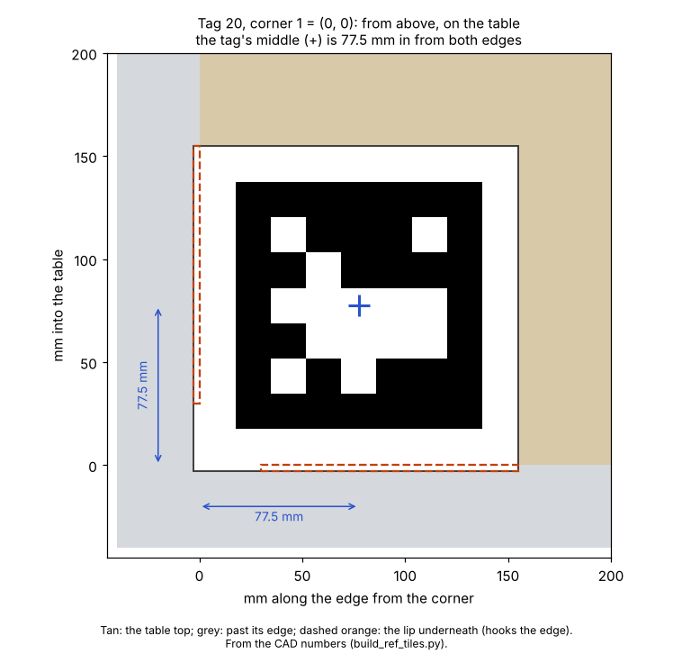
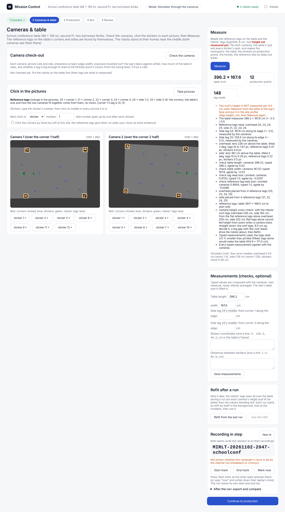
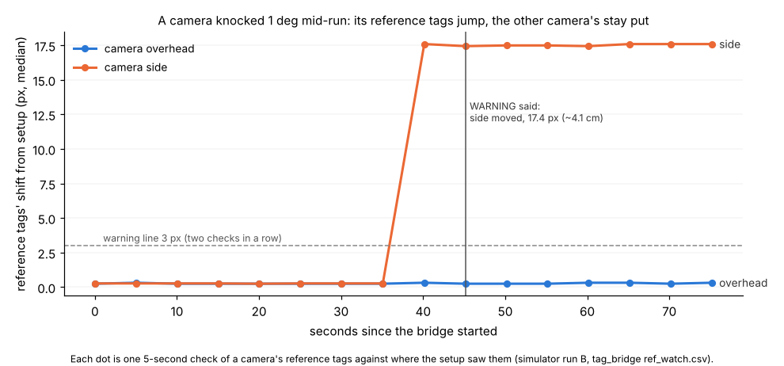
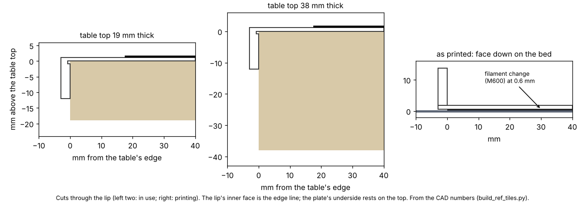
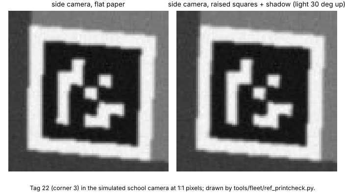

# Risk-review fixes and corner AprilTags (2 Nov evening, simulator, tests and CAD only)

## Premise

Two jobs Nick approved for the school conference-table session:

1. **Six fixes from the independent risk review** (`pre-session-risk-review.md`, 2 Nov): the emergency stop missed
   the school robots; `mc` printed the home Pi's address and died with the SSH window; a typo in the site file
   silently turned school into home; the refit after a run blocked the screen for minutes; the disk warnings assumed
   640 x 480; the new-Pi steps had gaps.
2. **Corner AprilTags** instead of clicking the table's corners: six flat tags on the table (four corners, two in the
   middle of the long sides where the cameras overlap), 3D printed with a lip that hooks the table so the part fixes
   where the tag is, plus a paper option; the software finds them by itself, ties the two cameras together, takes
   corner 1 as (0, 0), and watches them during runs for a bumped camera. Drop-in roof tag tiles for the new roof.

Nothing touched a robot or a Pi. Everything below is simulator, unit tests, CAD and drawn pictures.

## What was built

### Part 1: the six fixes

| # | Fix | Where | Old way kept |
|---|---|---|---|
| 1 | `./run-fleet-pi.sh stopall` now sends `stop` to the site's listed robots, **broadcasts** `stop` to the whole WiFi (255.255.255.255 and each network's own broadcast address), and to **every robot heard** (each fleet program's link now notes the robots it hears in `~/.config/mirlt/heard_robots.json`; plus any robot answering within 1 s when the log port is free). A broken site file never blocks it | `tools/fleet/stop_all.py`, `tools/alvik_console.py` | `./run-fleet-pi.sh stopall listed` (`--only-listed`) |
| 2 | The address shown is **this Pi's own**: Tailscale if up, else its WiFi address, else its name. `mc` starts Mission Control in **tmux session `mc`** (survives a closed window), prints the address, how to see it and how to close it. Hard-coded home addresses removed from the messages | `tools/fleet/pi_addr.py`, `run-fleet-pi.sh` (`mc`, `address`) | `mc here` (in the window); a site may pin an address (`pi.use_site_address`) |
| 3 | A broken or missing site file **stops** every launcher command with the file, the line, a caret under the spot and the likely mistake (e.g. "6.2, not 6,2"); wrong kinds of values are named. Mission Control and `mission_run` no longer fall back to home in silence | `tools/fleet/sites.py`, `run-fleet-pi.sh`, `mission_control.py`, `mission_run.py`, `tools/pi/camnames.py` | `site` and `stopall` still work with a broken file |
| 4 | The refit after a run runs as **its own background process** (`tagcal_refit/status.json`: running / done / failed); the run ends at once. The **Refit button reuses** the run's result (or starts one in the background); the card fills in by itself | `site_fit.py` (`start_refit_bg`, `refit_status`), `mission_run.py --refit-bg`, `tag_job.py`, Mission Control | per site `auto_refit`: `background` (default) / `wait` (old) / `off` |
| 5 | Disk floors and warnings **scale with picture size, rate and cameras**: the recorder's precheck and its warn/stop lines (minutes of video left), and the frames' floors. 1280 x 960 at 15 a second, two cameras: 14.4 GB an hour (home: 6.0, unchanged floors) | `tools/pi/camrec.py`, `tools/fleet/diskguard.py` | home's numbers are the same as before |
| 6 | **New-Pi setup from a blank card**, every step specific (Imager settings, first boot, update, packages, clone, OpenCV, token, Tailscale, cameras, Mission Control); **`./run-fleet-pi.sh selfcheck`** tests it all with PASS / WARN / FAIL lines; cameras' stable `/dev/v4l/by-id` names shown | `docs/how-to/new-pi-setup.md`, `tools/pi/selfcheck.py`, `camnames.py` | - |

**Packages, checked two ways (fix 6):** scanning the imports of every program the school site runs (38 modules,
followed through their own imports) finds numpy, scipy, OpenCV, matplotlib (plus pandas for the heat tracker,
reportlab for the tag sheets, pupil-apriltags only as the fallback); then all 38 imported cleanly in an **empty
Python with only numpy, scipy, opencv-python-headless and matplotlib** installed.

**/dev/v4l/by-id (fix 6):** not wired into the recorder. The launchers already find each camera by its name and USB
port at every start (`camnames.py`), which is what by-id gives; the by-id names are now shown to check by eye
(*Claude's call: the smaller change; say if you want the recorder to open them directly*).

### Part 2: corner AprilTags

| Part | What | Where |
|---|---|---|
| Layout | tag25h9 (the robots' family: one detector, the OpenCV 4.6 fix), ids **20-23 corners** (20 = corner 1 = (0, 0), counter-clockwise from above), **24** side 1-2, **25** side 3-4; never a robot's id (the site refuses a clash). **12 cm** black square, 1.75 cm white round it; the tag's middle **7.75 cm in from each edge** its tile hooks | `tools/fleet/ref_tags.py`, site profile `ref_tags` |
| Fit | Each camera's plane and its tags' places from the tags themselves; cameras joined through a shared tag; each tag's turn on its tile **read**, not assumed (a paper tag may be turned); one small solve gives the table's length, width and the side tags' places along their edges; then the full fit with everything (robot tags, stickers, typed checks). Corner 1's tag defines (0, 0); with it hidden the frame comes from the others. Swapped tiles are named. The **robot roof tags give the camera-height cross-check** (both heights said) | `site_fit.py` (`ref_initial`, `height_check`) |
| Setup | Mission Control's Cameras & table: tags found by themselves (orange in the pictures), stickers still clicked by number, typed coordinates still checks; a typed side-tag place is a check too. **Corner clicking is a switch** (site `corner_clicks`: off at school, on at home; a tick-box on the page). Measure turns the tiles into **keep-out areas** (points moved off them) | `tag_setup.py`, `tag_job.py`, `production.py`, Mission Control |
| Bump watch | Every 5 s each camera's reference tags are looked for where the setup saw them; a median shift over 3 px two checks in a row says **WARNING: camera X has MOVED** on the run screen (`ref_watch.csv`, `camera_moved` event, the run's summary). The run is not stopped (Nick decides) | `tag_bridge.py`, `mission_run.py` |
| Simulator | Tag cameras draw the tiles; `--hide-ref`, `--bump CAM@T:DEG`, `--no-refs`, `--corner-clicks` | `tools/sim/tag_cam.py`, `mission_run.py`, `tag_setup.py --dry` |
| Printed tiles | 4 corner tiles (L-shaped lip), 2 side tiles (straight lip), 2 drop-in roof tiles (keyed); STLs, previews, print sheet page 2 | `hardware/dock/build_ref_tiles.py`, `hardware/print_sheet_tiles.py`, `hardware/PRINT_SHEET.pdf` |
| Paper | Letter, one tag a page, exact scale, 15.5 cm cut line, EDGE marks, 10 cm ruler, id and place | `docs/hardware/reference-tags-letter.pdf` |

**One change from the spec (Claude's):** the tiles print **face down**, so the colour change is **black first, then
white at 0.6 mm** (not white then black at 1.2 mm). A lip underneath means a tag-up print needs support under the
whole tile; face down the lips stand up from the bed and nothing needs support. Turned over, the part is exactly the
check tile's build: 1.2 mm white base, 0.6 mm raised black squares. The roof tiles have no lip and print tag-up like
the check tile. Marker option unchanged.

## Tests and data

### Sizing: why 12 cm



The corner tile on the table: its lip (dashed) hooks the corner, so the tag's middle (+) is 77.5 mm in from both edges.

| Tag | 1280 x 960, lens 175 cm | 1280 x 960, 200 cm | 640 x 480, 175 cm |
|---|---|---|---|
| 8 cm | 5.1-6.2 px a cell | 4.6-5.3 | 2.6-3.1 (marginal) |
| **12 cm** | **7.7-9.3** | 6.8-7.9 | **3.8-4.6** |
| 15 cm | 9.6-11.6 | 8.5-9.9 | 4.8-5.8 |

<sub>Pixels per tag cell at the six tags' spots in the school camera layout (two cameras straight down, 40 cm overlap,
74 deg lens; `python3 tools/fleet/ref_tags.py sizing`). The robots' tags read in 100 % of synthetic pictures from about
3.5 px a cell when soft and tilted (conference report, section 1).</sub>

**Conclusion (Claude's):** 12 cm keeps a margin even if the cameras turn out to be 640 x 480, and the tile (15.5 cm)
still fits a 180 mm printer bed.

### The fit from the tags (simulator truth)

| Setup | Floor error, median / worst (cm) | Table (cm) | Side tags along edge, error (cm) |
|---|---|---|---|
| Tags only, no clicks (CLI dry run A) | 0.06 / 0.21 | 396.2 x 167.6 | 0.03 |
| Tags only, corner 1's tag hidden (run B) | 0.05 / 0.24 | 396.2 x 167.6 | 0.04 |
| Tags only, Mission Control practice room | 0.18-0.43 / 1.4 | 396.2 x 167.6 | - |
| ... its refit after one run (background, 41 s) | 0.06-0.07 / 0.15 | 396.2 x 167.6 | - |
| Old way: corner clicks, no tags (run D) | 0.19-0.33 / 0.79 | 396.2 x 167.6 | - |
| Earlier report, clicks (11 layouts) | 0.2-2.9 / 0.6-8.0 | within 0.5 | - |

<sub>Floor error: where the fitted and the true camera put a grid over the table, at the table and at the roof
tags' height (`site_fit.compare`). Runs A-D: `mission_run.py --dry --tracking tags --site school-conference`; the
practice room: Mission Control through Playwright. One run each. Unit tests add: no robots and nothing typed (table
within 1.5 cm, worst point 2 cm), a paper tag turned a quarter (read, fits), two corner tiles swapped (named).</sub>



Mission Control after Measure with corner clicking off: the six tags found (orange), the table's size, the side tags'
places, the height cross-check and the simulator's truth.

- **The height cross-check does its job.** Flat tags cannot tell a straight-down camera's height from its zoom; the
  roof tags can, but two robots standing still pin it only loosely: in the practice room the heights came out 236 and
  162 cm (true 200), worst 1.4 cm at the roofs' height. The refit after one run brought them to 201 and 200 cm, worst
  0.15 cm. So the order stays: Measure, one run, Refit, Use.

### Runs through the whole chain (simulator)

| Run | What | Result | Points | Closest robots / edge (cm) | Camera vs truth, median / p95 (cm), Alpha, Bravo |
|---|---|---|---|---|---|
| A | tags only, production, refit (old blocking way) | done, 72 / 69 s | 6 of 6, both home | 16.6 / 16.7 | 0.08 / 0.14, 0.10 / 0.20 |
| B | corner 1 hidden; camera 2 knocked 1 deg at 30 s | done, 72 / 69 s; **warning at the second check** | 6 of 6 | 16.6 / 16.7 | 1.6 / 1.7, 3.2 / 3.7 (the bump: why it warns) |
| C | **feel-out, then production**, refit in the background | feel-out: all 4 sides agree; done, 72 / 69 s; refit done 44 s later | 6 of 6 | 16.6 / 16.7 | 0.07 / 0.15, 0.10 / 0.22 |
| D | old way: no tags, corner clicks | done, 72 / 69 s | 6 of 6 | 16.6 / 16.5 | 0.18 / 0.31, 0.26 / 0.36 |
| MC | Mission Control: Measure, Plan, Run (feel-out unticked), refit | done; refit in the background, button reused it in 0.1 s | 6 of 6 | - | 0.26, 0.21 (median) |

<sub>No contact and nothing over an edge in any run. Camera vs truth: the tag bridge's fixes against the simulator's
true poses (`line_check.py`).</sub>



In run B the knocked camera's reference tags jumped from 0.3 to 17 px off where the setup saw them, and the warning
came at the next check; the other camera's tags stayed at 0.3 px.

### Printing



The lip on the thinnest and thickest tops assumed (19 and 38 mm), and the face-down print with its colour change.

- **Nozzle:** a reference cell is 17.1 mm, 38 lines of a 0.4 mm nozzle; a printed corner rounds by about 0.23 mm (1.3 %
  of a cell). Roof cell 11.4 mm, 25 lines.
- **Raised squares, their walls and a light's shadow** (light 45 and 30 deg up), and 0.1 mm over-extrusion with
  rounded corners: every tag read in every picture (35 cases x 3 pictures); the tag's middle within 0.13 cm of its true
  place (flat paper: within 0.07 cm). From overhead the raised walls show as a 0.2 px sliver.



Corner 3's tag in the simulated camera at 1:1 pixels: flat paper beside raised squares with a low light's shadow.

<sub>`python3 tools/fleet/ref_printcheck.py`; data `docs/results/ref-tags/printcheck.csv`. Every part a valid solid,
fits a 180 mm bed (`build_ref_tiles.py` checks).</sub>

### Part 1 checks

- **Stop:** with the school site, `stopall` printed the empty site list, the broadcast and each heard robot; a heard
  robot's address received exactly 3 `stop`s; `stopall listed` reached only the listed address (tests).
- **Site file:** the "6,2" typo stops `check` with line 13, a caret under the spot and the fix; a missing site stops
  `mission_run` instead of falling back to home.
- **Refit:** run C's run ended at once and its refit finished 44 s later in its own process; Mission Control's button
  reused it in 0.1 s; a refit process that died is said as failed.
- **Disk:** at 1280 x 960, 15 a second, two cameras: 1.2 GB per 10 min a camera, warn under 2.4 GB, stop under 0.72 GB
  (home: 1.0 / 0.3 as before).

### Problems found and fixed

- Mission Control's Measure result did not show: a `null` in the simulator-truth line broke the page
  ([picture](../screenshots/2026-11-02/corner-tags-problem-mc-measure-result-not-shown-null-in-simulator-truth-sim.png)).
- The self-check printed the reference ids as "None" and the video space at 640 x 480 when run by hand
  ([picture](../screenshots/2026-11-02/risk-fix-problem-terminal-selfcheck-ref-ids-none-and-video-space-at-640x480.png)).
- The fit's layout used the key "side" for the side tags, the same name as camera 2: renamed before any run.
- `sites.py`'s stricter errors broke one old test that expected a `ValueError`: the error is now both.

**Tests:** `tools/fleet/tests/test_risk_fixes.py` (20) and `test_ref_tags.py` (17). Fleet, Pi and simulator suites
(`python3 -m pytest tools/fleet/tests tools/pi/tests tools/sim/tests`): **684 passed, 9 skipped** (646 / 9 before).

## Conclusion

- **The emergency stop now reaches robots with no fixed address** (broadcast and heard), and nothing in the launcher
  falls back to home in silence. (Tests and this machine; not on a Pi or a robot.)
- **The corner tags replace the corner clicks and are better than them in the simulator:** worst floor error 0.2 cm
  from the tags alone against 0.8 cm with clicks here (up to 8 cm in the earlier report), still 0.24 cm with corner 1's
  tag hidden; the refit after one run still matters for the cameras' heights. (Claude's conclusion from 4 CLI runs and
  1 page run, simulator truth; real pictures may differ.)
- **A bumped camera is caught within 5-10 s** of the bump in the simulator.
- **The printed tiles should read like paper** (simulated); the face-down print is the one design change from the spec.

## What's next

1. Print one corner tile first; check the lip on the school table and the black square with a ruler (120 mm).
2. Give the roof team the pocket: 91.5 x 91.5 mm, 1.2 mm deep, back-left corner cut 8 mm at 45 deg.
3. At school: the self-check, then Measure with the tiles, one run, Refit, Use.
4. Agree with Jay that corner 1 (tag 20) is the (0, 0) both teams measure stickers from.

## Nick's steps

### A. Tonight, the print job (laptop)

1. Open `hardware/PRINT_SHEET.pdf` (page 2 is new) and send it with the 8 STL files in `hardware/dock/stl/`
   (`ref_corner_20.stl` to `ref_corner_23.stl`, `ref_side_24.stl`, `ref_side_25.stl`, `roof_tag_0.stl`,
   `roof_tag_1.stl`) to whoever prints them. The sheet says the colour order: **tiles black first, change to white at
   0.6 mm; roof tiles white first, change to black at 1.2 mm.**
2. No printer in time: print `docs/hardware/reference-tags-letter.pdf` at **100 % / Actual size** on matte paper (6
   pages). Check the ruler reads 10.0 cm and a black square 12.0 cm. Cut on the dashed square. Glue each on thin card.

### B. The new Pi from a blank card

Follow `docs/how-to/new-pi-setup.md` from the top (about 1 hour, mostly waiting). It ends with:
```
./run-fleet-pi.sh selfcheck
```
You should see one line per item and, last, `... 0 FAIL. Ready.` Any FAIL line says what to type.

### C. At school, before anyone watches (the Pi, then the laptop's browser)

1. Put the tiles on: **20 on corner 1** (the corner you and Jay agreed is 0,0), then 21, 22, 23 going round
   counter-clockwise seen from above; **24** on the middle of the long side from corner 1 to 2, **25** on the middle of
   the other long side. Each lip against the table's edge, the tile pressed flat. Paper: the sides marked EDGE flush
   with the table's edges.
2. In the blue PowerShell window, type `ssh nick@mirlt-school.local` and press Enter (password), then:
   ```
   cd alvik-fleet-capstone
   ```
   ```
   git pull
   ```
   ```
   ./run-fleet-pi.sh mc
   ```
   You should see `Mission Control is open: http://...:8095`. Type that address in Chrome on the laptop. You may close
   the blue window; Mission Control keeps running.
3. In Mission Control, **Cameras & table**: press **Take pictures**. You should see orange outlines with
   "20 corner 1", "21 corner 2" and so on in the two pictures: every tile in at least one picture, 24 and 25 in both.
   Do **not** click the corners. Click the stickers by number, as before.
4. Press **Measure**. You should see the table near 396.2 x 167.6 cm, "Reference tags read: ...", and "Every typed
   measurement agrees". If a tile is not seen, its line says which: move the tile so a camera sees it, Measure again.
5. Do one run, then **Refit from the last run** (it was already computed in the background: it shows at once), then
   **Use the refit**.
6. During runs, if the run screen says **WARNING: camera ... has MOVED**: press **Stop**, check the camera's mount,
   then Cameras & table, **Take pictures**, **Measure** (a minute).
7. Emergency stop from the Pi: `./run-fleet-pi.sh stopall`. The real last resort is still to pick the robot up.

## Questions for Nick

**Substantive**
1. **Face-down printing** (black first, white at 0.6 mm): fine with you and the print tech? The other ways need
   supports under the whole tile or a separate lip piece glued on.
2. **Which corner is (0, 0)**: please agree with Jay which table corner gets tile 20, and that his stickers are
   measured from there (x along the long side to corner 2).
3. **A bumped camera only warns** (the run goes on). Should it stop the run instead, or hold the robots seen only by
   that camera?
4. **The roof pocket** (91.5 mm, 1.2 mm deep, a keyed corner): does it fit what the RFID team is designing (Jay's RFID
   tag under the roof)?

**Other**
5. Tag size 12 cm (sizing above): fine, or smaller tiles to keep more of the table free?
6. Corner lips start 30 mm from the corner (fits a corner rounded up to 30 mm). Is the school table's corner square?
7. The recorder does not open cameras by their `/dev/v4l/by-id` name (the name-and-port lookup already does that job).
   Want it anyway?

## Sweep 1: new tests that may now be necessary

- Board / school: one printed corner tile on the real table: the lip's fit, the tag read at the far corner on the real
  cameras, its black square measured (120 mm).
- Real pictures: the reference tags' corner error and the read-size factor (blur) against paper tags; glare on the
  printed black (matte vs glossy filament).
- Real cameras: the bump watch's still spread over an hour (vibration, heat, autofocus) to set the 3 px line.
- Pi: `stopall` reaching a robot by broadcast on the school router (client isolation would block it); `mc` in tmux after
  an SSH drop; the self-check on the fresh image.
- Simulator: Measure with the robots in other places (the practice room's side-by-side homes gave 1.4 cm worst before
  the refit); a tile knocked off its edge mid-run (a tag moved, not a camera: the watch would blame the camera).
- Unit: the background refit on a Pi (time) and two refits started at once (the button while the run's own runs).

## Sweep 2: possible inaccuracies in what this relied on

- All pictures are drawn by the simulator (blur, noise, JPEG modelled; not glare, rolling shutter, a real lens).
- The table is assumed 19-38 mm thick with square edges (Nick's "typical"); its corner radius is unknown (lips allow 30
  mm). A bevelled top edge would move the tag a little off the 77.5 mm.
- **Chosen numbers** (each noted in its code): tag 12 cm (DOE: 8 / 12 / 15 cm on the real table against fit error and
  room on the table); white 1.75 cm; lip 3 mm x 12 mm; corner relief 30 mm; groove 0.8 mm; keep-out margin 1 cm; bump
  line 3 px, two checks 5 s apart (DOE: a still camera's spread); roof pocket play 0.25 mm and wall 1.75 mm; key 8 mm;
  listen 1 s and heard robots kept 24 h in `stopall`; disk warn 10 min and stop 3 min of video; the print check's
  0.1 mm extrusion error, shadow 55 % grey, light 30-45 deg.
- The disk rate scales the 640 x 480 measurement linearly with pixels and rate: an upper bound, not measured at 1280 x
  960.
- The tile's PLA weights (about 350 g in all) are from the STL volumes; print times are not estimated.
- The Mission Control run's camera-vs-truth figures (0.26 / 0.21 cm) are medians only; that run's setup used the
  practice room's own camera layout.
- Every accuracy number here is from one simulator run per case.
