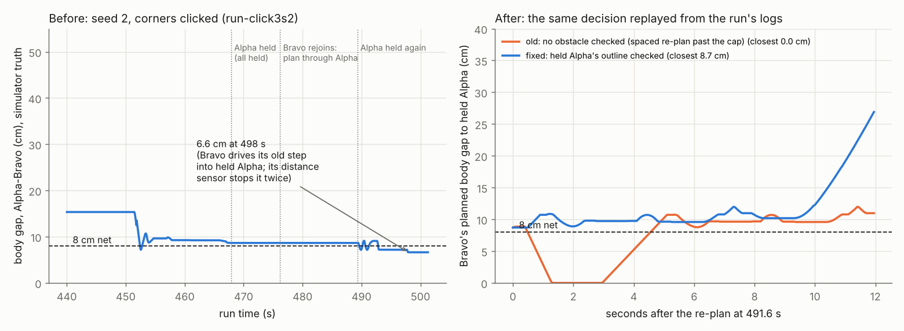

# Two robots 6.6 cm apart under keep going: found, replayed, fixed (3 Nov, simulator and tests only)

## Premise

In the sticker-points build (`e02-nov03-sticker-points-no-tags.md`) the school 40-point mission with corner tags off
and corners clicked, simulator seed 2, left part of zones 1-2 in no camera's view. Robots drove blind, were held and
re-planned under keep going, and Alpha and Bravo came **6.6 cm apart**, under the planner's 8 cm net. Asked: what the
6.6 cm is, when and why it happened, whether it is new with keep going, a fix that keeps the 8 cm in this and similar
cases, and proof nothing else changed. Nothing touched a robot or a Pi.

## Data

### What the 6.6 cm is and when it happened

Source: the original run's logs (`mission_run.py --site school-conference --dry --tracking tags --no-refs
--corner-clicks on --seed 2`, session `run-click3s2`): `run/sim/truth.csv`, `run/coordinator.jsonl`, `run/plan_33-36.json`.

| Item | Value |
|---|---|
| Measure | **body gap** (closest points of the two 9.5 cm bodies, the simulator's truth): 6.63 cm; centre to centre 17.1 cm. The 8 cm net is also a body gap (`engine_checks.plan_gap`) |
| When | run time 498 s, 37 plans and 49 re-plans in (cap 30: re-plans past the cap, spaced 5 s) |
| Who moved | **Bravo, driving** (step "drive (25.0, 80.4) -> (39.0, 78.7)", 10 cm/s). Alpha **held, standing** at (44.3, 81.3) |
| Pose sources | Alpha: camera (set at its rejoin check 486.6 s, matching the truth within 0.1 cm). Bravo: odometry (blind strip) |
| What stopped it | Bravo's own distance sensor, twice (7.6 cm, then 6.5 cm ahead); each time the next spaced re-plan sent the same step again |

Sequence (run time): 448 s Bravo held (no plan fits it back in) -> 468 s Alpha drives 41 cm blind and is held:
**every robot is held** -> 476 s Bravo rejoins; its new plan (plan 33) drives east **straight through Alpha** -> 486 s
Alpha rejoins, no plan fits both, Alpha held again at 489 s -> 491.6 s the spaced re-plan lets Bravo **carry on** its
plan-33 turn and drive -> 496-498 s Bravo stopped by its sensor twice, 6.6 cm.

### The cause (two code gaps; replayed exactly from the logs)

Left: the body gap Alpha-Bravo in the seed-2 run (simulator truth). Right: the decision at 491.6 s replayed with
the run's own plan 33, Bravo's logged state and Alpha's logged outline (`planner.obstacle_decide` + `obstacle_replan`),
old way and fixed: the old decision's plan puts Bravo's body **on** Alpha's (planned gap 0.0 cm); the fixed one holds
Bravo and plans round Alpha (closest 8.7 cm).

1. **Past the re-plan cap, the spaced re-plan checked nothing (new with keep going, 482d4be).** Past 30 re-plans,
   keep going puts the obstacle (here: held Alpha's outline) on the map and re-plans 5 s later with
   `handle_obstacle(None)`. The quick decision "who carries on with the steps already sent" (`obstacle_decide`) only
   checks steps against the obstacles *passed to it*: none. Bravo carried on 2 steps into Alpha. The new plan then
   planned around Alpha but kept the carried-on steps (it cannot take back a step already sent). Plan gap check
   (`plan_gap`) only compares robots inside the plan, and a held robot is an obstacle, not in the plan.
2. **A robot held while every robot was held was never put on the map (old: 29 Oct, c33cc81b).** `retire` returns
   early when no robot is left running, before the outline is added. When Bravo rejoined first, its plan (plan 33)
   went through Alpha: planned body gap **0.0 cm** (replayed).
3. **A held robot's outline ignored its own position error (old).** It is its pose + the net (8 - 1.5 cm planner
   margin). A robot held after driving blind is placed by odometry: here 1.3 cm off its camera position after 41 cm;
   up to 2.8 cm by the 0.07 cm-per-cm rule.

**Is it new? (Claude's conclusion.)** Gap 1 is new with keep going: before 482d4be the run **stopped** at 30
re-plans; this run passed that at about 300 s, so the old code would have ended the run (a stop, not a near
collision). Gap 2 is older (self-correcting runs, 29-30 Oct) and could be reached before keep going, but only when
every robot was held at once. A re-run on the code before the keep-going build was not needed for this answer and not
done: the seed-2 blind strip **did not happen again** in the two re-runs that started (below), so a re-run on old code would not have
shown it either; the replay from the original logs is the exact reproduction.

### The fix (`tools/fleet/run_plan.py`, switch `--gap-fix on|off`, default on; `--held-pm-max-cm`, default 10)

| Part | What | Switch (old way kept) |
|---|---|---|
| A | A re-plan's carry-on check now counts **every obstacle on the map the plan in force was not made with** (spaced re-plans past the cap, a held robot while every robot was held, a confirmed stop coming back), not only the newest | `--gap-fix off` |
| B | A robot held while every robot is held is put on the map, so whoever rejoins first is planned round it | `--gap-fix off` |
| C | **Claude's choice:** a held robot that no camera sees has its odometry drift since its last camera fix (0.07 cm per cm) added to the net round it, at most 10 cm; a robot a camera sees gets nothing extra (the camera's error is already inside the 8 cm) | `--held-pm-max-cm 0` |

Passed to run_plan by `mission_run.py --rp-arg=--gap-fix=off` (or `--rp-arg=--held-pm-max-cm=0`). Nothing changes
for a run with no held robots and no re-plans past the cap: the check only adds obstacles the plan did not know.

### Runs: closest robots (body gap, simulator truth)

| Run | Code | Result | Points | Closest robots (cm) |
|---|---|---|---|---|
| School, corners clicked, seed 2 (the original) | before | every robot out after 597 s | 25 of 40 | **6.63** |
| Same, re-run | before | done, 196 s (the cameras saw everything this time) | 40 of 40 | 53.67 |
| Same, re-run, `--on-problem stop` | before | done, 197 s | 40 of 40 | 53.44 |
| Same, seed 2, fixed (4 tries) | after | **start-up failed** each time (no camera calibration in time: the simulator's corner-click fit did not finish; also on an unchanged copy of the old code, below) | 0 | - |
| School, corners clicked, seed 1 | after | done, 196 s | 40 of 40 | 54.05 (before: 53.9, sticker report) |
| School, corners clicked, seed 3 | after | done, 191 s | 40 of 40 | 53.81 (before: 53.89, sticker build run) |
| School, roof + corner tags (site default), seed 1 | after | done, 191 s | 40 of 40 | 54.00 (before: 54.1, sticker report) |
| Home dry run (`--site home`, lights, seed 1) | before | done, 98.9 s | - | 9.84 |
| Home dry run | after | done, 98.9 s | - | 9.76 |
| Stress: seed 2, both tags covered 25 s, cap 3 re-plans | before | every robot out after 672 s | 40 of 40 (80 stands: points redone after hand-overs) | 12.20 |
| Stress, same | after | every robot out after 675 s | 38 of 40 (P29 skipped once at 47 s; P01, P26 never reached) | **25.16** |

Each line one simulator run (`mission_run.py --dry`, school site unless said, 40 points, 3 s stands). "before":
HEAD 059b49b; "after": this build. Source: each run's terminal output and `run/sim/sim_report.json`. The seed-2
blind strip came from a bad corner-click fit in the original run (overhead lens fitted 176 cm high); re-runs fitted it
at 165 cm and the overhead saw zones 1-2. Seed 2 with corners clicked failed at start-up 5 times from 09:14 on ("no overhead camera calibration":
the simulator's setup fit had not written its calibration when the facing check looked), 4 on this build and **once on
an unchanged checkout of the old code** (059b49b, a clean worktree), as `run-click2s2` did in the sticker build. It
happens before any plan runs, in the simulator's setup only (`tag_setup.sim_setup`), so it is not this fix; why it now
fails every time is not found (Sweep 1). The fixed code's answer for seed 2 is therefore the replay above.

Tests: `tools/fleet/tests/test_robot_gap.py`, 6 tests: the spaced re-plan past the cap checks the obstacle put on the
map (Alpha holds); `--gap-fix off` gives the old decision (Alpha carries on into it); obstacles the plan was made with
are not counted twice; every robot held: the last one on the map (on) / not (off); a held robot's outline grows by its
odometry drift, capped, 0 when off; none when a camera sees it. Full suite (`python3 -m pytest tools/fleet/tests
tools/pi/tests tools/sim/tests tools/rfid/tests`): **741 passed, 9 skipped, 1 failed** (`test_camrec_dual`, the known
flake under load: the suite ran beside two simulator runs; it passes alone, 12 of 12).

## Conclusion

- **Cause (Claude's conclusion, replayed exactly):** Bravo was sent a step into a held Alpha twice over: its rejoin
  plan was made while held Alpha was not on the map (old gap), and past the re-plan cap the spaced re-plan let it carry
  on that step without checking it against Alpha (new with keep going). Its distance sensor, not the plan, stopped it
  at 6.6 cm.
- **Fixed:** replayed, the same decision now holds Bravo and plans round Alpha at 8.7 cm (was 0.0 cm). The runs that
  went well before go the same way after (closest robots within 0.2 cm of before; home dry run 9.84 -> 9.76 cm).
- **The truth can still dip a little under 8 cm by the camera's own error**: in the original run Bravo passed a held
  Alpha at 7.6 cm at 452 s with both plans keeping 8 cm (cameras 0.4 cm off). That is what the 8 cm's "~3 cm camera
  error" allowance is for; not changed.
- **Not fixed, seen here:** keep going can grind for 10 minutes with both robots held and re-held (seed 2 original, the
  stress runs) and the points list grew duplicates when points were handed back and forth (`REASSIGNED P05: Alpha ->
  Bravo` many times; Bravo's plan 34 listed P05-P10 three times).

## What's next

1. At school today: nothing to do differently; the fix is on by default. If a run behaves oddly around a held robot,
   `--rp-arg=--gap-fix=off` gives the old behaviour.
2. The ping-pong reassignment (duplicated points) and the endless held/re-held loop: a separate fix (cap rejoins when
   no plan fits both; de-duplicate handed-over points).
3. Board DOE for the 10 cm cap (Appendix A).

## Appendix A: DOE notes on chosen numbers

| Number | Chosen | Would a DOE decide it better? |
|---|---|---|
| Held robot's extra net = odometry drift since its last fix (0.07 cm per cm) | the run's own ± rule (measured to 40 cm, 29 Oct) | Yes: hold a robot after 20 / 40 cm blind on the board, 5 times each; its true offset against the drift added |
| At most 10 cm extra | 40 cm blind = 2.8 cm, so 10 cm only bites with no camera at all (± grows to ~50 cm, which would wall the table off) | Yes: no-camera runs at 5 / 10 / 20 cm: skipped points against closest approach |

## Sweep 1: new tests that may now be necessary

- Simulator: why seed 2 with corners clicked now fails at start-up every time (the setup fit not finishing in time),
  on the old code too.
- Simulator: force the original case (a camera fit that leaves zones 1-2 unseen) with a fixed fit file, so seed 2's
  blind strip is repeatable instead of depending on the fit's noise.
- Simulator: two robots held at once, rejoining in turn, with the cap at 3 re-plans: closest approach and whether the
  run ever finishes.
- Unit: reassigned points handed back and forth must not duplicate in the visit order.
- Board: a held robot after 40 cm blind, the other robot planned past it: closest approach by the cameras.

## Sweep 2: possible inaccuracies in what this relied on

- **One original run.** The 6.6 cm happened once; the re-runs did not reproduce the blind strip, so "after" for that
  exact run is the replay of its decisions, not a full new run.
- **The replay** uses the logged plan, state and outline with today's planner; the planner did not change in this
  build, so it is the same code path, but the run's timing (what was already sent) is taken from the log.
- **Camera error inside the 8 cm** (the ~3 cm in its DOE note) is assumed, not re-measured; the extra for an odometry
  pose (C) is on top of it.
- **Obstacles are matched by shape** (rounded to 0.1 cm), because map ids are renumbered; two different obstacles
  with exactly the same outline would count as one (harmless: one is checked).
- **The simulator's odometry** drifts less than real robots; a real held robot may be further off than 0.07 cm per cm.
