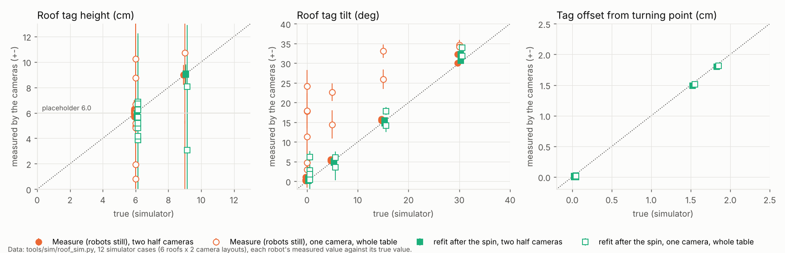
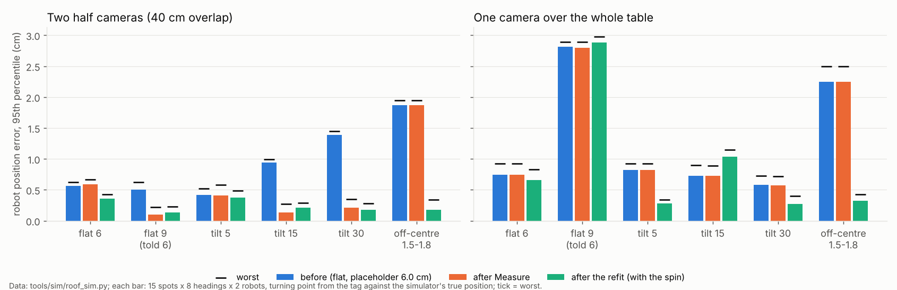
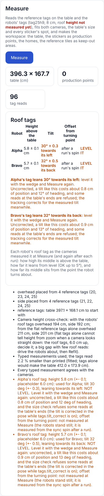

# Roof tags measured in the auto calibration: height, tilt, offset (3 Nov, simulator and tests only)

## Premise

At school the roof tags are paper on the robots' RFID mounts, which lean about 30 deg; Jay-Sun puts a hand-made paper
wedge under each so the tag is meant to sit level over the wheel-axle midpoint. The software assumed every tag flat,
centred, at one typed height (still the 6.0 cm placeholder). Nick (3 Nov 13:56): "checking for height and angle
should be part of the auto calibration process." Asked: measure each robot's tag height, tilt (and which way it
leans) and offset from the turning point during Measure and again in the refit after a run; use them in place of the
placeholder (old path behind a switch); warn plainly over a tilt tolerance; show and log it; test it in the simulator
with both school camera layouts. Nothing touched a robot or a Pi.

## What was built

- **Measure / refit** (`site_fit.py`, `roof_fit`): each robot's tag height and tilt are fitted per tag id together with
  the cameras (weak pulls: height 5 cm towards the typed/placeholder value, tilt 35 deg towards level), with a +- from
  the fit. A robot whose height the cameras cannot pin (+- over 1.5 cm) or whose tilt was seen from one side only is
  held at the typed height / level and the cameras fitted again, so they do not bend to values nobody uses.
- **Offset** (`roof_cal.offsets_from_poses`): in the refit, from the run's sync spin (the tag's middle draws a circle
  round the turning point; a linear fit of middle = centre + heading-turned offset). The robots stand still at
  Measure, so Measure says "after a run's spin".
- **Verdicts and words** (`roof_cal.py`): height used when +- <= 1.5 cm; tilt OK when <= 5 deg (plus twice its +-),
  else "NOT LEVEL", which way it leans in the robot's frame, and what it costs uncorrected; tilt judged only when two
  cameras saw the tag or one saw it turned >= 90 deg. Saved as `roof_tags.json` beside the camera models; the setup's
  words, Mission Control's new **Roof tags** card on the Measure result, and the refit's words carry it.
- **Tracking** (`tag_geom.pose_from_detection(..., roof=)`, `tag_bridge.py`): the tag's middle from its diagonals at
  the measured middle height (exact under any tilt), each corner met at its own height for the heading and size
  check, the offset taken off. Switches in the site's `tags`: `roof_measured` (height and offset, default on),
  `tilt_correct` (default on), `roof_check` (the per-robot fit at Measure, default on); off = the flat typed/placeholder
  model as before. New `tags.heights_cm: {"Alpha": 7.2}` for tape-measured heights per robot. The bridge prints what
  it uses at start and logs it (`events.jsonl` "start", `bridge_summary.json` "roofs"); `tag_poses.csv` gains
  `mid_x, mid_y` (appended columns).
- **Simulator**: `tag_cam.py` draws a tilted / off-centre / any-height roof (`roof_truth` per robot);
  `tools/sim/roof_sim.py` runs one case offline (Measure, a sync spin and refit, then 15 spots x 8 headings x 2 robots).

## Data

Source: `python3 tools/sim/roof_sim.py --case <case> --layout two|one` (12 runs; the real detector on drawn
pictures). "two" = the build's two half cameras, 200 cm up, 40 cm overlap; "one" = one camera over the whole table,
260 cm up, 78 deg. Each robot's truth differs per case (Alpha leans towards its left, lean 90; Bravo towards its back,
lean 200). Placeholder 6.0 cm in every case.

**Table 1. True against measured** (+- is the fit's; "not judged" = one camera, still robot: no verdict given)

| Layout | Case | Robot | True h / tilt / offset | Measure: h, tilt (lean) | Refit: h, tilt (lean), offset | Verdict |
|---|---|---|---|---|---|---|
| two | flat6 | Alpha | 6.0 / 0 / 0 | 5.9 +- 0.6, 1.1 (354) | 5.8 +- 0.3, 0.6 (5), 0.00 | OK |
| two | flat9 | Alpha | 9.0 / 0 / 0 | **9.0 +- 0.7**, 0.2 | 9.0 +- 0.7, 0.2, 0.00 | OK |
| two | flat9 | Bravo | 9.0 / 0 / 0 | **9.0 +- 0.8**, 0.3 | 9.1 +- 0.7, 0.3, 0.00 | OK |
| two | tilt5 | Alpha | 6.0 / 5 (90) / 0 | 6.0 +- 0.6, 5.2 (98) | 5.8 +- 0.9, 4.7 (91), 0.01 | OK |
| two | tilt5 | Bravo | 6.0 / 5 (200) / 0 | 6.3 +- 0.7, 5.5 (201) | 5.9 +- 1.0, 5.2 (201), 0.00 | OK |
| two | tilt15 | Alpha | 6.0 / 15 (90) / 0 | 6.1 +- 0.2, 15.5 (92) | 5.9 +- 0.3, 15.4 (91), 0.00 | LEVEL IT |
| two | tilt15 | Bravo | 6.0 / 15 (200) / 0 | 6.1 +- 0.2, 15.8 (200) | 5.8 +- 0.3, 14.8 (199), 0.01 | LEVEL IT |
| two | tilt30 | Alpha | 6.0 / 30 (90) / 0 | 5.8 +- 0.1, 30.1 (90) | 5.8 +- 0.2, 30.7 (90), 0.01 | LEVEL IT |
| two | tilt30 | Bravo | 6.0 / 30 (200) / 0 | 5.7 +- 0.1, 32.3 (201) | 5.8 +- 0.2, 32.2 (201), 0.01 | LEVEL IT |
| two | offset | Alpha | 6.0 / 0 / 1.5 | 6.0 +- 0.5, 0.4 | 5.9 +- 0.9, 0.8, **1.49** | OK |
| two | offset | Bravo | 6.0 / 0 / 1.8 | 5.9 +- 0.6, 0.4 | 5.6 +- 0.9, 0.2, **1.80** | OK |
| one | flat9 | Alpha | 9.0 / 0 / 0 | -0.4 +- 5.7 (not used), not judged | 3.1 +- 4.9 (not used), 6.1 +- 1.5, 0.01 | OK |
| one | flat9 | Bravo | 9.0 / 0 / 0 | 10.7 +- 5.6 (not used), not judged | 8.1 +- 4.8 (not used), 0.4, 0.00 | OK |
| one | tilt15 | Alpha | 6.0 / 15 (90) / 0 | not used, not judged | not used, 17.9 (88), 0.02 | LEVEL IT |
| one | tilt15 | Bravo | 6.0 / 15 (200) / 0 | not used, not judged | not used, 14.1 (202), 0.00 | LEVEL IT |
| one | tilt30 | Alpha | 6.0 / 30 (90) / 0 | not used, not judged | not used, 33.9 (89), 0.01 | LEVEL IT |
| one | offset | Alpha | 6.0 / 0 / 1.5 | not used, not judged | not used, 2.8, **1.51** | OK |

All 24 rows: appendix A. One camera: every height +- was 3.5-5.7 cm (never used); still-robot tilts read 3-35 deg
on flat tags (why they are not judged); after the spin the tilts were within 3 deg and the 5 deg tags read 3.6-6.0.

Each robot's measured roof height, tilt and offset against its true value in the 12 simulator cases (on the dotted
line = right); the hollow orange points are one camera with the robots still, where heights are not used and tilts not
judged.

**Table 2. Robot position error, 95th percentile / worst (cm)**, 240 robot poses a case. "before" = the setup and
tracking as before this build (flat, 6.0 cm, centred).

| Layout | Case | before | after Measure | after refit (spin) | heading p95 before -> refit | size check refuses (before -> refit) |
|---|---|---|---|---|---|---|
| two | flat6 | 0.56 / 0.62 | 0.59 / 0.67 | 0.36 / 0.43 | 1.5 -> 1.5 deg | 0 -> 0 of 240 |
| two | flat9 (told 6) | 0.50 / 0.62 | **0.10 / 0.22** | 0.13 / 0.23 | 1.0 -> 1.0 | 0 -> 0 |
| two | tilt5 | 0.42 / 0.52 | 0.41 / 0.58 | 0.37 / 0.49 | 1.5 -> 1.4 | - |
| two | tilt15 | 0.94 / 0.99 | 0.13 / 0.27 | 0.21 / 0.29 | 4.1 -> 1.2 | 7 -> 1 |
| two | tilt30 | 1.39 / 1.45 | 0.21 / 0.35 | 0.18 / 0.28 | **8.9 -> 1.5** | 13 -> 0 |
| two | offset | 1.87 / 1.95 | 1.87 / 1.95 | **0.18 / 0.34** | 1.1 -> 1.1 | - |
| one | flat6 | 0.74 / 0.92 | 0.74 / 0.92 | 0.66 / 0.83 | 1.1 -> 1.1 | 2 -> 2 |
| one | flat9 (told 6) | **2.81 / 2.89** | 2.80 / 2.89 | 2.88 / 2.98 | 1.5 -> 1.5 | 6 -> 8 |
| one | tilt5 | 0.82 / 0.92 | 0.82 / 0.92 | 0.28 / 0.34 | 2.2 -> 2.3 | - |
| one | tilt15 | 0.73 / 0.90 | 0.73 / 0.89 | 1.04 / 1.15 | 5.3 -> 2.6 | - |
| one | tilt30 | 0.58 / 0.73 | 0.57 / 0.72 | 0.27 / 0.40 | **12.3 -> 2.5** | 42 -> 3 |
| one | offset | 2.25 / 2.50 | 2.25 / 2.50 | **0.32 / 0.43** | 1.2 -> 1.2 | - |

How far each robot's tracked position was from the truth (95th percentile, ticks = worst) before this build, after
Measure and after the refit with the spin, for each roof and both camera layouts.

**Detection dropouts at 30 deg.** No extra lost tags: 0 of 288 camera reads lost (two cameras) and 6 of 240 (one
camera; 6 also when flat: Alpha's tag at 25 px). The loss at 30 deg is the **size check**: the flat model reads a
30 deg tag up to 32 % off its size, and `tag_bridge` refuses a read over 20 % off. Before: 13 of 240 poses (two cameras: only
at the table's ends x = 25 and 371 cm, headings where the tag faces away from its camera) and 42 of 240 (one camera:
every spot but the middle, all headings); with the measured tilt 0 and 3.

**Mission Control** (the Measure result's Roof tags card, simulator results put into the page):

The Setup screen after Measure with both tags leaning 30 deg (two cameras): which way each leans, what it costs, and
"level it".

## Conclusion (Claude's)

1. **Two cameras: the check works at Measure.** Heights within 0.3 cm (9 cm found with the 6 cm placeholder), tilt
   within 2.3 deg with the right lean, offsets within 0.01 cm after the spin. Positions after: p95 0.10-0.41 cm in
   every case (before: up to 1.4 cm tilted, 1.9 cm off-centre).
2. **One camera cannot measure the height**, from still robots or the spin (+- 3.5-5.7 cm): with a 9 cm tag and the
   6 cm placeholder the error stays 2.8 cm p95. **Type each robot's height (ruler) in that layout.** Tilt and offset
   are measured after the spin (Measure says "not checked yet").
3. **Tilt barely moves the position when the middle height is right** (the diagonals' crossing is exact); what it
   costs is heading (9-12 deg p95 at 30 deg) and refused reads at the table's ends. Both are corrected, so the warning
   is to level it, not a stop.
4. **The +- on height is cautious** (two cameras said 0.1-1.0 cm for true errors up to 0.3 cm).

## What's next

- Tonight: Measure with the tags in place and read the Roof tags card (instructions in the final message). If a tag
  says LEVEL IT, re-wedge and Measure again; tape-measure each tag's middle height anyway (`tags.heights_cm`).
- Start the first run with the sync spin so the refit measures the offsets; Use the refit.
- One camera over the whole table: a spare flat 8 cm tag beside each robot at Measure would cancel the blur in the size
  and give the height (not built; worth it only if the one-camera layout is chosen).

## DOE notes on chosen numbers

| Number | Value | DOE sensible? |
|---|---|---|
| `TILT_OK_DEG` | 5 deg (+ 2x its +-) | Yes: wedges at 0, 5, 10 deg on the real table, tilt read against a phone level |
| `HEIGHT_SD_USE_CM` | 1.5 cm | Yes: Measure 5 times with the robots moved; heights' spread against their +- |
| `OFFSET_SD_USE_CM` | 0.5 cm | Yes: the sync spin 5 times; offsets' spread (real wheels slip; the simulator's spin is perfect) |
| `TILT_VIEWS_DEG` | 90 deg | Partly: the simulator's one-camera cases at 0/5/15/30 deg, still vs spun; real camera next |
| `ROOF_H_PRIOR_SD`, `ROOF_TILT_PRIOR_DEG` | 5 cm, 35 deg | No: weak pulls only; checked that one camera stays at the typed height |
| `SPIN_MIN_DEG`, `SPIN_MAX_DRIFT_CM`, `SPIN_WINDOW_S` | 270 deg, 6 cm, 25 s | No: geometry of the sync spin |
| `TILT_ERR` cost table | from Table 2; 45 deg extrapolated | Already measured (simulator); refresh from the first real runs |

## Self-review (once, then fixed)

- Found: one-camera Measure fitted the false still-robot tilts and bent the cameras (p95 0.74 -> 1.09 cm). Fixed:
  untrusted tilts and heights are held and the cameras fitted again (now equal to before).
- Found: a true 5.0 deg tag read 5.2 +- 0.9 and said LEVEL IT. Fixed: warn only beyond 5 deg plus twice its +-.
- Found: the card showed an unmeasurable height (-0.4 +- 5.7 cm). Fixed: shows the height in use and why.
- Found: a measured offset in use would hide itself at the next refit (the bridge's x, y already have it taken off).
  Fixed: `mid_x, mid_y` logged and used.
- Open: the one-camera refit made tilt15 worse (p95 0.73 -> 1.04) while tilt5 and tilt30 improved; the one-camera
  site fit differs by up to ~0.5 cm run to run (camera height 296 cm fitted for a true 260), so this is within its
  spread, not shown to be caused by the roof fit.

## Sweep 1: tests that may now be necessary

- Real table: Measure with a tag deliberately wedged 0, 5, 10, 30 deg; the card's tilt and lean against a phone level.
- Real sync spin: the offset's repeatability with a tag moved 1 cm ahead on purpose.
- Measure with one robot where only one camera sees it (the two-camera layout's ends): the words and the held height.
- A full school dry run (`mission_run --dry --tracking tags`) with `roof_truth` set in the tag-cams config.
- The bridge's tilt correction speed on the Pi (each read maps 4 more corner rays).

## Sweep 2: possible inaccuracies in what this relied on

- The simulated spin turns exactly about the turning point with no slip; real offsets will be noisier (+- 0.00 here).
- The simulator's tag is a perfect plane; paper on a wedge may bow, which reads as tilt or height.
- Tag yaw on the roof (printed top not along the nose) is still assumed zero; it would show as a heading offset.
- The `TILT_ERR` cost numbers are from these simulated cameras (200/260 cm up); 45 deg is extrapolated.
- Height and tilt +- come from the fit's Jacobian scaled by the residual; cautious for two cameras, but untested
  against repeated real Measures.
- One-camera layout: 260 cm up, 78 deg, placement guessed (Nick has not given the real mount).
- Placeholder 6.0 cm and the 9 cm "true" case are chosen, not measured.

## Appendix A: every robot, every case

Generated by `charts.py` over the 12 summaries (scratch); the rows not in Table 1:

| Layout | Case | Robot | Measure: h, tilt (lean) | Refit: h, tilt (lean), offset |
|---|---|---|---|---|
| two | flat6 | Bravo | 6.2 +- 0.7, 0.3 (196) | 6.0 +- 1.0, 0.2 (250), 0.00 |
| one | flat6 | Alpha | 5.0 +- 3.7, not judged | 4.8 +- 3.5, 1.1, 0.01 |
| one | flat6 | Bravo | 6.2 +- 3.7, not judged | 6.2 +- 3.5, 1.9, 0.01 |
| one | tilt5 | Alpha | 5.2 +- 3.7, not judged | 3.9 +- 5.4, 6.0 (79), 0.00 |
| one | tilt5 | Bravo | 6.0 +- 3.7, not judged | 6.8 +- 5.4, 3.6 (193), 0.01 |
| one | tilt15 | (h) | 0.8 / 10.2 +- 4.4 | 3.9 / 6.4 +- 5.7 |
| one | tilt30 | Bravo | 4.8 +- 3.7, not judged | 5.7 +- 4.3, 31.8 (198), 0.02 |
| one | offset | Bravo | 8.8 +- 4.3, not judged | 6.7 +- 4.5, 1.8, 1.81 |

Pictures also saved: the Setup screen with 9 cm found (`roof-tags-feature-setup-screen-measure-9cm-height-found-...`)
and with one camera (`roof-tags-feature-setup-screen-measure-one-camera-...`).
