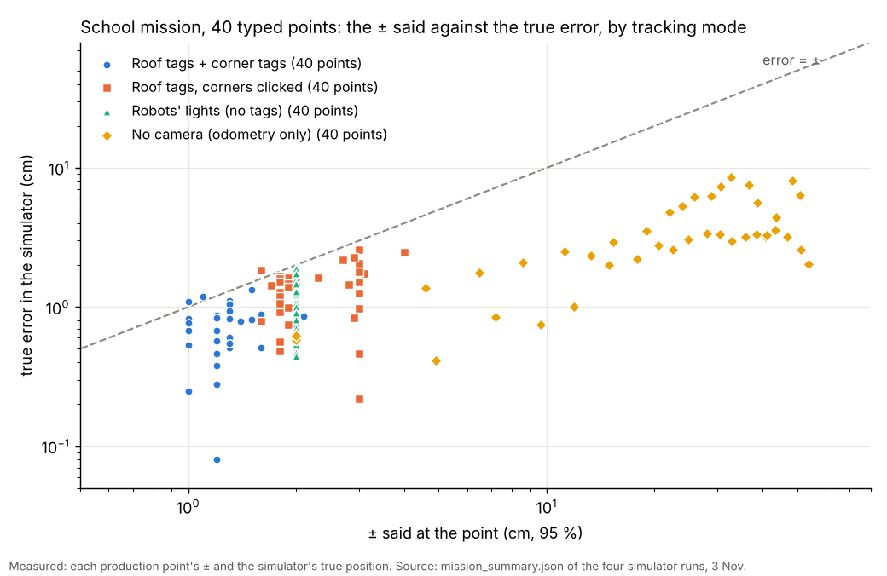
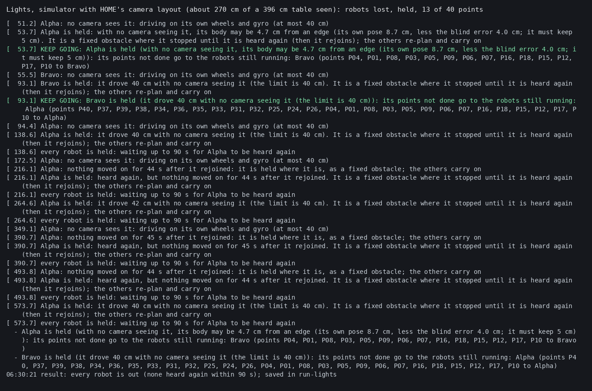

# Jay's 40 stickers typed in, and runs with or without AprilTags (3 Nov morning, simulator and tests only)

## Premise

Nick, 3 Nov 05:58: Jay-Sun's sticker spreadsheet (`table_points.xlsx`, 40 points, inches from the A3 corner) becomes
the school table's production points, with no clicking each sticker. Edge room 13 cm at school; homes on stickers P11
(Alpha) and P22 (Bravo); the raised box in the table's middle kept out; Alpha zones 1-2, Bravo zones 3-4, loaded ready
to run. And: "We may want to test without any April Tags at all at first ... I want to be able to run with or without
tags." Nothing touched a robot or a Pi.

## What was built

| Part | What it does | Switch (old way kept) |
|---|---|---|
| Sticker import | `tools/fleet/sticker_points.py import <xlsx or csv>` writes `tools/fleet/sites/school-conference-points.csv` (id, x_in, y_in, zone, x_cm, y_cm) exactly as Jay typed it. The typed spots **are** the production points; the corner tags (or corner clicks) only fix the frame | site `points.use`: `typed` (school) / `clicked` (the old way, each sticker clicked) |
| P09 / P10 corrections | Applied on load from the site file's `points.overrides`, each with its reason and status **"assumed, to confirm"**: P09 (17, 57.5) in, P10 (33, 37.5) in (the sheet says y 37.5 and 27.5). Said in every run's log | delete an override line to use the sheet's value |
| Sticker seen elsewhere | If a sticker is also clicked in the pictures and the fit puts it more than 3 cm from its typed spot, Measure says `CHECK: sticker ...`; the typed spot is still used | only when stickers are clicked |
| Edge room | `edge_in_cm` 13 at school (every sticker reachable: nearest P04 at 13.3 cm, P16 at 14.0) | home stays 17 (the default) |
| Homes | Alpha on P11 (149.9, 82.6) cm, Bravo on P22 (243.8, 82.6) cm, both facing +y (the whiteboard). Each robot's home point is its first point, **stood at, not driven to** | site `homes.use`: `points` / `middle` (the old homes, 30 cm apart at the middle) |
| Raised box | A 12 x 12 in keep-out centred at (78, 33) in, marked solid; the planner adds the body's clearance. Points beside it are moved just clear by the planner's own turn room (8.5 cm) | `keepouts[].use: false`; note "Nick to measure" |
| Default production | Alpha: zones 1-2 (20 points), Bravo: zones 3-4 (20), each from its home and back in a nearest-neighbour order improved by 2-opt; loaded and planned when Mission Control opens, already in the Production screen's lists (editable there, or as fixed lists in the site's `production.orders`) | `production.orders` typed lists override the zones |
| Tracking during the run | `run_tracking`: `tags` (roof AprilTags, as built), `lights` (the robots' lights, home's camera bridge; the Setup screen comes back for corner clicking), `none` (no camera: no bridge, no facing check, no turn pause, no feel-out; each robot starts on its home sticker by hand; ± grows 0.07 cm per cm). `mission_run --tracking none`. Mission Control: card **Tracking during the run** on the Run screen | site's `run_tracking` (`tags` at school); home unchanged (`lights`) |
| Runbook | `docs/how-to/morning-nov03.md` section B: no sticker clicks, the default orders, the two things to measure, B7c (the three ways, what to do differently) | - |

Antenna positions, outlet strips and seams are kept in the site file as **GUESSES** (`guesses`), not used by the robots.

## Data

### Simulator runs: the full 40-point school mission in each mode (`mission_run.py --site school-conference --dry`)

| mode | result | time (s) | points done | ± range (cm) | true error median (max), cm | truth inside ± | skipped | kept going | closest robots (cm) | closest body to edge (cm) | contact |
|---|---|---|---|---|---|---|---|---|---|---|---|
| Roof tags + corner tags (site default) | done | 191 | 40 of 40 | 1.0-2.1 | 0.8 (max 1.3) | 38 of 40 | none | none | 54.1 | 7.52 | no |
| Roof tags, corner tags OFF, corners clicked | done | 191 | 40 of 40 | 1.6-4.0 | 1.5 (max 2.6) | 39 of 40 | none | none | 53.9 | 7.95 | no |
| No tags: robots' lights, one camera over the whole table | done | 187 | 40 of 40 | 2.0-2.0 | 1.2 (max 1.9) | 40 of 40 | none | none | 54.7 | 6.6 | no |
| No tags, no camera: odometry only | done | 180 | 40 of 40 | 2.0-53.7 | 3.2 (max 8.6) | 40 of 40 | none | none | 53.1 | 4.95 | no |

One run each, seed 1, 396.2 x 167.6 cm, Alpha and Bravo, 20 points each, 3 s stands. "Roof tags": both simulated tag
cameras, real detector, the cameras fitted from the six corner tags. "Corner tags OFF": `--no-refs --corner-clicks on`
(the corners clicked, from the simulator's truth + noise). "Lights": the simulator's overhead camera set to see the whole
table (1.55 px/cm, one camera: `--no-side --sim-arg=--live-px-per-cm=1.55`) through home's camera bridge, no tags
anywhere; its calibration comes from the simulator, standing in for the Setup screen's corner clicks. "No camera": no
bridge at all. All four on the final code (the frame term below); the no-camera run was repeated alone (the first
overlapped another agent's simulator run; it gave the same picture: 40 of 40, true error up to 10 cm, body 3.5 cm from
the edge). "truth inside ±": the simulator's true position within the ± said at that
point. "closest body to edge": the simulator's closest approach of the robot's body to an open edge. Source:
`mission_summary.json` and `run/run_plan_summary.json` of each run.

Each dot is one of the 40 points in one simulator run: the ± the run said (x) against how far off it really was (y).
Every dot below the line means the ± covered the truth. Source: the four runs above.

### The camera ± with corners clicked: before and after (the coordinator asked for this fixed, not only noted)

| run | ± range (cm) | true error median (max) | truth inside ± |
|---|---|---|---|
| Corners clicked, before | 1.3-4.0 | 1.5 (2.5) | **34 of 40** (85 %) |
| Corners clicked, after | 1.6-4.0 | 1.5 (2.6) | **39 of 40** (97.5 %) |
| Corner tags, before | 0.9-2.0 | 0.8 (1.3) | 37 of 40 (92.5 %) |
| Corner tags, after | 1.0-2.1 | 0.8 (1.3) | 38 of 40 (95 %) |
| Corners clicked, after, seed 3 | 1.5-2.2 | 0.3 (0.5) | 40 of 40 |
| Corners clicked, after, seed 2 | 1.9-4.0 | 0.2 (1.1) | 25 of 25 done (see below) |

Seed 1 runs as in the table above, plus the corner-click case on other seeds. Source: each run's
`mission_summary.json`.

**Cause.** The points outside were a whole half's points off the same way (side camera, zone 4: 1.8-2.2 cm, said
±1.7): an error in the table's frame (where the corners are), which the ± did not count. Clicked corners fit to 2.7 px
on the side camera against 0.2-0.5 px for the corner tags. **Fix** (`run_plan.FRAME_K`): each camera's ± now adds, in
quadrature, 2 x the corners' fit residual (px) / px per cm: the clicked corners' residual, else the corner tags'. x 2
because a 4-corner fit's residual understates the click error (the fit absorbs part of it) and most points are far
from the clicked corners (chosen; DOE note in Appendix A). `FRAME_K = 0` gives the old ±. The points still outside
(P12, P20; by 0.09-0.25 cm) are two-camera fixes: the two cameras' frame errors are combined as if independent, but
they share one table frame, so a two-camera ± is still slightly tight (Sweep 2).

**Seed 2 did not finish (a separate problem, found here, not fixed).** That seed's simulated cameras were placed so
each saw only 2 corners and part of zone 1-2 was in no picture: Alpha drove blind past 40 cm, was held twice, its points
went to Bravo, and the run ended with both out (25 of 40 points, every one inside its ±). While the robots were held
and re-planning, they came **6.6 cm apart** at 498 s, under the 8 cm net. The ± change does not steer anything (it is
reporting only), so it comes from the keep-going path with a camera gap, not from the ± change (not checked on the code before this build). At school it means: **check that
the two cameras see the whole table** (the camera check's coverage line) before a run.

### Lights: the first run failed, and why

The simulator's light cameras are home's (overhead 640 px at 2.34 px/cm = 273 cm of floor; side camera at the 0,0
end). On the 396 cm table the robots drove out of view, were held after 40 cm blind, and only 13 of 40 points were
done. With one camera seeing the whole table, the same run did all 40. Source: runs run-lights and run-lights2.

This is a simulator limit, not a measurement of the school: the real school cameras are two, each over a half, at about
5.8 px/cm (1280 px over ~220 cm). It does show the rule that matters at school: **in lights mode a robot the cameras
lose is held after 40 cm**, so the two cameras must see the whole table and the robots' lights must not be covered.

### Checks on the numbers

| Item | Value | Source |
|---|---|---|
| Stickers within 17 cm of an edge (unreachable before) | P04 13.3, P16 14.0, P30 15.9, P05 15.9, P27 16.5 cm (P15 17.1) | the sheet |
| Edge guard look-ahead at the nearest point, driving straight at the edge | axle stops 13.3 cm in; the bottom zone looks ~11 cm ahead, to 2.3 cm from the edge (P16: 3.0 cm): **does not trip if the position is right**. A robot whose own reach is over 13 cm (learned range 5-15 cm) or whose position is 2.3 cm+ off toward the edge would trip it there (keep going: that spot becomes a no-go strip, the point is skipped) | `RUN_DEFAULTS.edge_guard` `edge_bot_cm 11`; `feel_table.REACH_RANGE` |
| Body corner during a turn at P04 | 13.3 - 6.72 = 6.6 cm from the edge by plan | 9.5 cm square |
| Order length, Alpha / Bravo | 806 / 731 cm (by number: 1430 / 1142; nearest neighbour alone: 906 / 960) | `production.short_order` |
| Box clearance | P12 6.3 cm and P21 7.2 cm from the 12 x 12 in square: the planner needs 8.2 cm to turn there, so the first plan skipped both; now moved 2.6 and 1.8 cm clear (said). Homes 33 / 31 cm clear | first plan-only run, fixed |

## Conclusion

- **The 40 typed stickers plan and run end to end in every mode**: no clicking, homes on P11 / P22, the box kept out,
  all 40 points reached in the simulator in each of the four modes (table).
- **The ± is now honest in every mode in the simulator** (38-40 of 40 inside, 95-100 %), after adding the table
  frame's own error to the camera ± (corners clicked was 34 of 40). One corner-click seed (2) did not finish: its
  simulated cameras left part of the table unseen, and two held robots came 6.6 cm apart (below).
- **With no tags at all there are two ways, and they differ a lot.** The robots' lights keep camera-grade ± (±2 cm,
  all 40 inside) **if the cameras see the whole table**; with home's simulated camera layout the robots were lost and
  13 of 40 points done. **No camera** finishes the run but its ± grows to about ±54 cm by the last point, because
  the 0.07 cm per cm rule (measured only to 40 cm of straight driving) is applied over 740 cm. In the simulator the true
  error stayed at 10 cm or less, so the ± is honest but very wide; on the real table the true error is unknown
  (Claude's conclusion).
- **Claude's conclusion:** with no camera, a robot's body came to 3.5 cm (first run) and 5.0 cm (second) of the
  table's edge in the simulator (Alpha near P15 in the first, 139 s in, drifted 10 cm by then). The edge guard is the only thing protecting it. If Nick runs with
  no camera, the pillows matter, and a wider edge room for that mode would be the safer setting (a question for Nick).
- The 13 cm edge room reaches every sticker; with the cameras right, the edge guard does not trip at the nearest points
  (2.3-3.0 cm to spare), which is a thin margin.

## What's next

1. At the table with Jay: measure P09 and P10 from the A3 corner (the overrides are assumed), and the raised box's edges.
2. Nick's order of runs: no camera first (a short run is enough to see the drift), then the robots' lights (check in
   the camera pictures that Jay's RFID tag does not cover the lights), then roof tags.
3. After the first real run in each mode: compare each point's ± with a tape measure at a few points, to see whether the ± is honest on the real table.

---

## Appendix A: DOE notes on the chosen numbers

| Number | Chosen | Would a DOE decide it better? |
|---|---|---|
| Edge room 13 cm (school) | the least that reaches every sticker | Yes: a board DOE of 13 / 15 / 17 cm at P04 and P16, against edge-guard trips and the camera's closest body-to-edge at the turn. With no camera, the same DOE against drift |
| Box 12 x 12 in | the largest the box can be (believed 4 x 12 in, turn unknown) | No: measuring it replaces the guess (its edges from corner 1) |
| Sticker flag 3 cm | a tag camera's fit error plus a sticker's size | No: a warning threshold; set from the first fit's spread |
| Frame term x 2 (FRAME_K) | the factor that brings corners-clicked to ~95 % inside in the simulator | Yes: tape-measure 10 stickers against the cameras' positions at school, with corners clicked and with corner tags; set the factor so 95 % fall inside |
| Hand-placed start ±2 cm (no camera) | the ± at the home point with no camera (run_plan's base when no fix was ever taken) | Yes: place each robot on its sticker 10 times and measure (a ruler, or the camera) |
| 2-opt order | not a number; a method (shorter than nearest neighbour alone by 11 % and 24 %) | No |

## Appendix B: files

`tools/fleet/sticker_points.py` (new), `tools/fleet/sites/school-conference-points.csv` (new, Jay's sticker positions
only), `tools/fleet/sites/school-conference.json` (points, edge, homes, keep-out, production, run_tracking, guesses),
`tools/fleet/production.py` (site homes, edge room, keep-outs, short orders, home point stood at), `tools/fleet/sites.py`
(validation, words), `tools/fleet/mission_run.py` (`--tracking none`, typed site maps), `tools/fleet/run_plan.py`
(no-camera wording; the frame term in the camera ±), `tools/fleet/tag_job.py` (Measure uses the typed points; home point stood at), `tools/fleet/tests/test_risk_fixes.py`
(the broken-file test finds its line itself), `tools/fleet/mission_control.py/.html`
(loads the default, tracking selector, Setup screen for lights), `tools/fleet/tests/test_sticker_points.py` (15 tests).

## Self-review (done once; findings fixed)

- The camera ± with corners clicked was too tight (34 of 40 inside): the frame error added (before/after above).
- Lights mode first failed in the simulator (home's camera layout); rerun with a camera seeing the whole table.
- The first plan skipped P12 and P21 (beside the 12 x 12 in box): points beside a keep-out were moved by the body's
  half diagonal (6.8 cm), less than the planner's turn room (8.2 cm). Fixed: moved by the turn room + 0.3 cm.
- After a Mission Control restart, the Production screen would have fallen back to "3 points each": the saved
  program's orders are now kept.
- The no-camera point lines said "since the last camera fix (0 s ago)" with no camera at all: now "since the start
  (no camera this run)".
- With a sync spin ticked, the home point would have been driven to (a zero-length drive): the stand-at-home now applies
  to the Production screen's orders in every case.
- Lights mode in Mission Control on real cameras (the Setup screen's corner clicks feeding the camera bridge at the
  school site) is **not** tested end to end; only the simulator's lights run is.

## Sweep 1: new tests that may now be necessary

- Simulator: the seed-2 corner-click case (cameras leaving a strip unseen, robots held and handed points) to find why
  two held/rejoining robots came 6.6 cm apart, under the 8 cm net.

- Board: drive straight at P04 and P16 with the real edge guard, 5 times each, cameras on: trips or not, closest body
  to the edge.
- Board, no camera: the true error at each point against the ± (tape measure at 6-10 points), to test the 0.07 cm per
  cm rule past 40 cm and over turns.
- Board, lights: are Alpha's and Bravo's lights visible with Jay's RFID tag on top (camera pictures, both cameras).
- Mission Control with real cameras in lights mode: the Setup screen's corner clicks saved to the school site's folder
  and used by the run.
- A test that the P09 / P10 overrides match Jay's confirmation (to update once he answers).

## Sweep 2: possible inaccuracies in what this relied on

- **P09 and P10** are assumed from the drawing (status "assumed, to confirm").
- **The box** is assumed centred, at most 12 x 12 in; P12 and P21 are moved 2.6 / 1.8 cm only because of that guess.
- **The frame** assumes Jay's (0, 0) corner is exactly where tile 20 sits; a tile pressed a few mm off the corner shifts
  every typed point by that much.
- **The 0.07 cm per cm** drift is measured on the home board to 40 cm of straight driving, then extrapolated to 740 cm
  with turns; the ±2 cm hand-placed start is a guess; a heading error when placing a robot by hand (say 2°) adds
  3.5 cm per metre driven and is not in the ±.
- **The simulator's odometry** is not the real robots': the no-camera true errors (10 cm or less) say nothing certain
  about the table.
- **The edge guard's look-ahead** of ~11 cm is the firmware setting; each robot's real reach is learned by the feel-out
  (range 5-15 cm), which does not run in lights or no-camera mode.
- **Antennas, outlets, seams**: guesses only (not used).
- **The frame factor x 2** is fitted to the simulator's click noise, not Nick's real clicks or the real lenses; the
  two-camera ± treats the two cameras' frame errors as independent though they share one frame (two points 0.1-0.25
  cm outside).
- **The lights runs** used a simulated single camera at 1.55 px/cm, not the school's two cameras; whether the real
  lights show under Jay's RFID tag is unknown.
- **The other agent's simulator run** (tools/rfid) overlapped my first no-camera run for about 1.5 minutes on the same
  machine; that run was repeated alone (the table's numbers).
