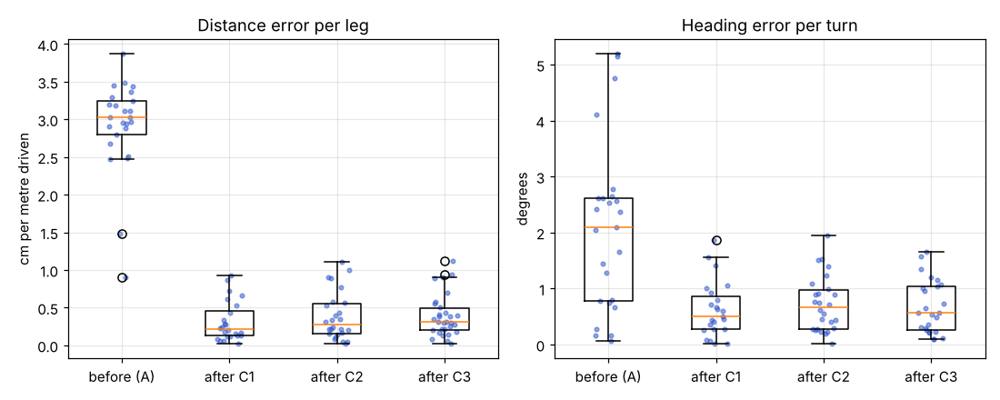
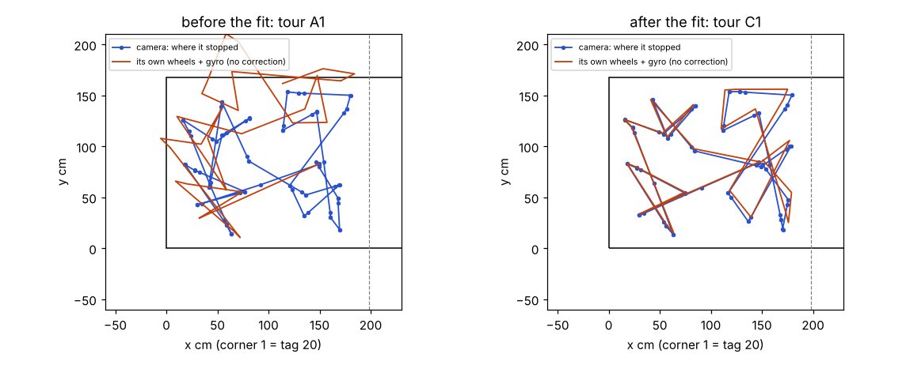
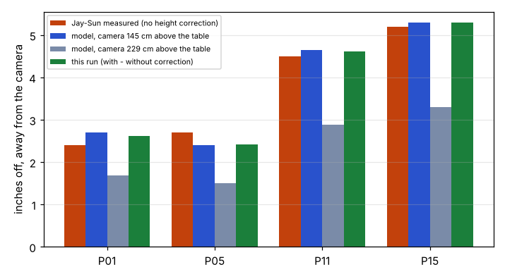

# School calibration run, zones 1-2 (4 Nov, simulator and tests only)

## Premise

Tonight one robot (Alvik 3, WiFi name AL-1DC0, roof tag 2, asleep on P11) is calibrated at the school table with the
one C920e camera at the TV end. Nick: "Get enough data without calibration to use as a base level of measurement. But
use calibration for safety purposes like keeping it from the edge of the table and returning it to a parked position.
After that, perform a series of runs with updated calibration." At experiment speed (10 cm/s, 60 deg/s, 5 cm/s final
approach). Nobody types which tag is on which robot. Nothing here touched a robot or a Pi.

## What was built

| Part | Where | In one line |
|---|---|---|
| Calibration run | `tools/fleet/calib_run.py` | find and wake the robot, bind its tag by the sync wiggle, phase A (current values, wheels + gyro alone, camera for safety), B (fit, `set` + `get`), C (3 tours), park on P11, `sleep 10` |
| Report | `tools/fleet/calib_report.py` | written at the run's end: premise, data, conclusion, what's next, two sweeps, 3 charts; `calib_report.py <folder>` re-makes it |
| Mission Control | `calib_job.py`, `mission_control.py/.html` | **Calibration (zones 1-2)** card on the Production screen: start (robot or simulator), phase, bound robot, plain-words result, the report; Stop and `stopall` stop it |
| School Pi | `./run-fleet-pi.sh school-setup` (`tools/pi/school_setup.sh`, `camera_focus.py`) | installs what is missing, sets focus (also at every `mc` start and every run), picks the site, self-check |
| Runbook | `docs/how-to/school-calibration-tonight.md` | Nick's steps tonight, one command per box |
| RFID off | `tools/rfid/rfid_gate.py`, README | refuses unless `--jay-requested` / `MIRLT_RFID_JAY_REQUESTED=1`; kept for Jay-Sun |
| Simulator | `fleet_sim.py --true-cal --asleep`, `calib_run --dry --sim-gap` | a robot that needs other values than it has, starting asleep; tag dropouts |

Switches kept (old way behind each): `--binding fixed` / site `tags.binding` (the old `tags.ids`), `--lost-policy
keep_going` (the experiments' policy; tonight `hold`, see below).

One firmware fact found while building (it shaped the design): a robot with no camera fix starts every idle `go` /
`turn` leg at pose (0, 0, 0) (`pose::start(false)`), so the run adds up the legs itself, and the still period for
drift is the standing start of one `turn 0` leg (edge_learn_ms set to 60 s, then put back).

## Data (simulator dress rehearsal)

Setup: the school site, one camera at the TV end 45 in back (pinhole model, reads a tag only if it is at least 8 px
in the picture: all of zones 1-2, not tags 21/22), one robot named only by its WiFi (AL-1DC0, not in the site),
roof tag 2 (a spare), starting asleep, values stored 1 / 1 / 0, true values 0.97 / 1.03 / 0.3 deg/s.

| Run | Camera height | Fit: wheel_scale | gyro_scale | gyro_drift_dps | Read back | Distance error cm/m, median: before -> after (C1/C2/C3) | Heading error per turn, median deg: before -> after | Closest to edge (true) | Closest to keep-out (true) | Furthest x | Points skipped | End |
|---|---|---|---|---|---|---|---|---|---|---|---|---|
| z145 | 145 cm (7.5 ft above the floor) | 0.9692 +- 0.0037 | 1.0291 +- 0.0012 | 0.303 +- 0.016 | all 3 OK | 3.03 -> 0.21 / 0.28 / 0.31 | 2.10 -> 0.50 / 0.66 / 0.57 | 13.6 cm | 8.4 cm | 184 cm | P08 once (fixed, see z145b) | parked 0.2 cm off P11, asleep |
| z228.6 | 229 cm (7.5 ft above the table) | 0.9721 +- 0.0037 | 1.0288 +- 0.0014 | 0.297 +- 0.018 | all 3 OK | 3.03 -> 0.36 / 0.44 / 0.28 | 2.28 -> 0.68 / 0.56 / 0.73 | 13.7 cm | 8.5 cm | 180 cm | none | parked 0.3 cm off P11, asleep |
| z145b (after the detour fix) | 145 cm | 0.9654 +- 0.0034 | 1.0303 +- 0.0013 | 0.313 +- 0.017 | Z145B_RB | Z145B_DIST | Z145B_TURN | Z145B_EDGE | Z145B_KO | Z145B_X | Z145B_SKIP | Z145B_END |
| truth | | 0.970 | 1.030 | 0.300 | | | | margin 13 cm | body touches at 6.7 cm | camera reads to 198 cm | | |

+- = 95 % (1.96 x SE). Binding worked in every run (tag 2 turned +85 to +91 deg with the 90 deg wiggle). Every run
took about 38 minutes and used 7 % battery (simulated). Data: each run's `legs.csv`, `fit.json`, `events.jsonl`,
`sim/truth.csv` (scratch folders, not in git; the pictures below are from them).

Tag lost (cautious hold): covered 3 s and 2.5 s while driving -> stop, held 1.8 s and 0.2 s, carried on; covered 40 s
-> the run ended where the robot was, not parked, `sleep 10` sent.

Four-point check, inches off with no height correction (camera 45 in back): Jay-Sun 2.4 / 2.7 / 4.5 / 5.2 at P01 /
P05 / P11 / P15; model with the lens 145 cm above the table 2.7 / 2.4 / 4.6 / 5.3 (worst 0.3 in off); 229 cm above
the table 1.7 / 1.5 / 2.9 / 3.3. The table fit (`site_fit.full`) from tags 20, 23, 24, 25 alone with one camera put
zones 1-2 within 2 cm everywhere at both heights (test), and the rendered picture's detector read exactly 20, 23, 24, 25.

Each dot is one leg of a P01-P20 tour in run z145: how far the robot's own wheels and gyro were off where the camera saw
it stop, before the fit (A) and in the three tours after it (C1-C3); simulator, from legs.csv.

Where the camera saw the robot stop (blue) against where its own wheels and gyro put it with no correction (orange), one
tour before and one after the fit; simulator run z145, from legs.csv.

How far the 6.19 cm high tag is put away from the camera when its height is ignored, at Jay-Sun's four points: his tape
(3 Nov) against the tag-height model for the two readings of the camera height and the simulated run.

## Conclusion

- The fit recovers all three values within the stated targets (wheel +-0.008, gyro +-0.005, drift +-0.03 deg/s) in all
  three rehearsals. wheel_scale's own 95 % interval missed the truth once (z145b: 0.9654 +- 0.0034 against 0.970).
- (Claude's conclusion) "Enough" phase-A data is 12 in-place turns (90 and 170 deg, both ways), 12 out-and-back rolls
  (20 / 45 / 70 cm), 60 s still and one 20-point tour: it reached about half the targets' +-; fewer (the quick mode: 4
  turns, 4 rolls, 20 s, 6 points) left wheel and drift unpinned, and the run then keeps their old values.
- With the fitted values the median distance error per leg fell from about 3 cm per metre to 0.2-0.4, the heading error
  per turn from about 2.2 deg to 0.5-0.7.
- Safety held in the simulator: never under the 13 cm edge margin, never nearer a keep-out than 8.4 cm (6.7 touches),
  never past x = 184 cm (the camera reads to 198), always parked on P11 and asleep at the end. The camera stepped in
  before about 25 legs per run (in phase A mostly, as designed).
- (Claude's conclusion) The camera's 7.5 ft is above the floor: only that reading reproduces Jay-Sun's 2.4 / 2.7 / 4.5 /
  5.2 in (to 0.3 in). Both readings calibrate equally well (the bridge corrects the height either way).

## What's next

- Tonight: Nick runs it (runbook). The report lands in the run's folder and on the Mission Control card.
- Tomorrow: Jay-Sun re-checks P01, P05, P11, P15 (the report prints the camera's position with and without the height
  correction beside his numbers).
- The new values last until the robot is switched off (`set`). Keeping them across power-offs (`corr save`) and using
  the binding in the experiments' runs (mission_run still uses `tags.ids`) are questions below.

## Sweep 1: new tests that may now be needed

- The real camera's dropout lengths (camera_track.csv) against LOST_HOLD_S 1 s, logs only.
- The turn rate the camera measures against the 60 deg/s asked (turn_max_rpm 26.5 is derived).
- A second calibration on another day: do the values hold over a battery and a power cycle?
- wheel_scale at 5 and 13 cm/s (speed dependence); the coast term per leg against speed.
- The binding with two robots on the real WiFi (unit-tested only).
- The rendered-picture path end to end (tag bridge on simulated pictures) for this run; the rehearsal used a pinhole model.

## Sweep 2: possible inaccuracies in what this relied on

- Simulator camera: pinhole, noise 0.08 cm + 0.12 % of range, 8 px read limit (chosen to match Jay-Sun's views), no
  rendering, no camera-fit error. Real errors will be larger.
- Simulator robot: its slip, coast and gyro bias walk are the simulator's guesses; the 3 % / 3 % / 0.3 deg/s errors were
  chosen to be removed.
- Camera position 45 in back, centred, 7.5 ft: Jay-Sun's estimate; the run uses Measure's fitted camera, not these.
- Tag height 6.19 cm typed; one camera cannot measure it. The site's tags.height_cm is still empty (self-check WARN); the
  run takes the typed per-robot value.
- Chosen numbers: LOST_HOLD_S 1 s, LOST_GIVEUP_S 30 s, SETTLE/MEASURE 0.4 + 1.2 s, FINAL_CM 5, the 1 cm edge aim, the
  10 cm camera-driven edge final, SAFE_BUF 3 cm + 4 %, GO_PIECE_CM 100, the ENOUGH targets, the turn / roll / still
  counts (DOE backlog rows added; each would be set by a DOE except the limits).
- Run length "about 40 minutes" is from the simulator; the real robot's legs may be slower.
- The robot's address hint (site calibration.robot_ips: 192.168.1.134) is from Jay-Sun's message; the broadcast covers
  a changed address.

## Questions

Substantive:

1. Keep the fitted values only until power-off (`set`, as asked), or also `corr save` them so they survive a restart?
2. Should the experiments' runs (mission_run) use tonight's wiggle binding (binding.json) instead of tags.ids? Not wired
   in yet.
3. Tonight's run drives one robot; with two found it binds both but calibrates the first only. Enough for now?

Other:

4. The site still lists two cameras (overhead, side) and Alpha / Bravo; the self-check says "2 cameras" for video space.
   Change the site to one camera for now?
5. P09/P10 overrides say "confirmed by Jay-Sun (spreadsheet correct)" but keep the drawing's values: which is right?
