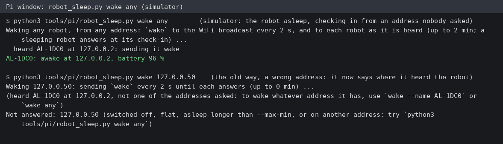
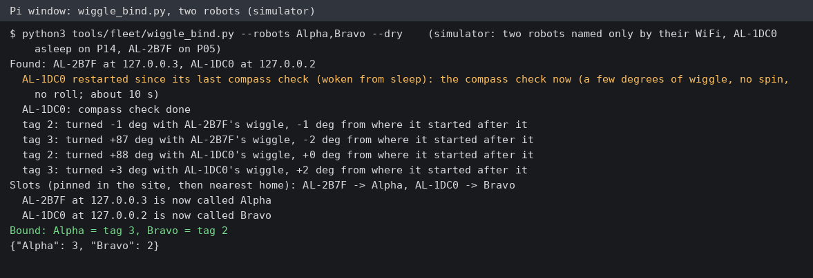
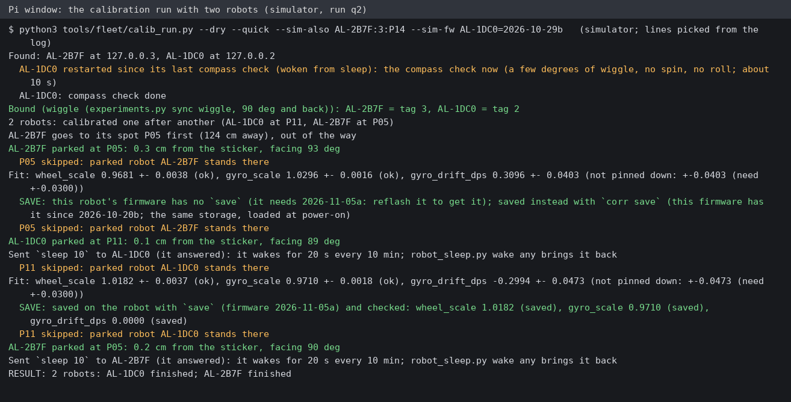
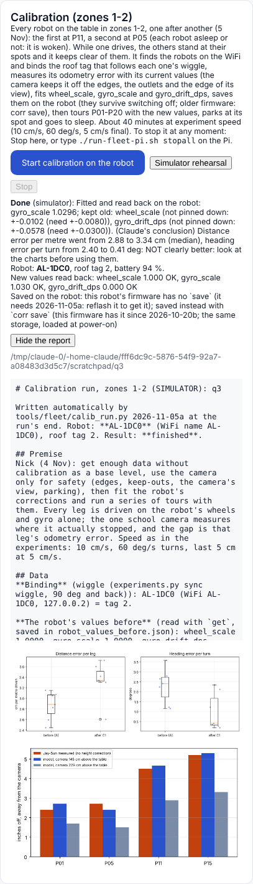
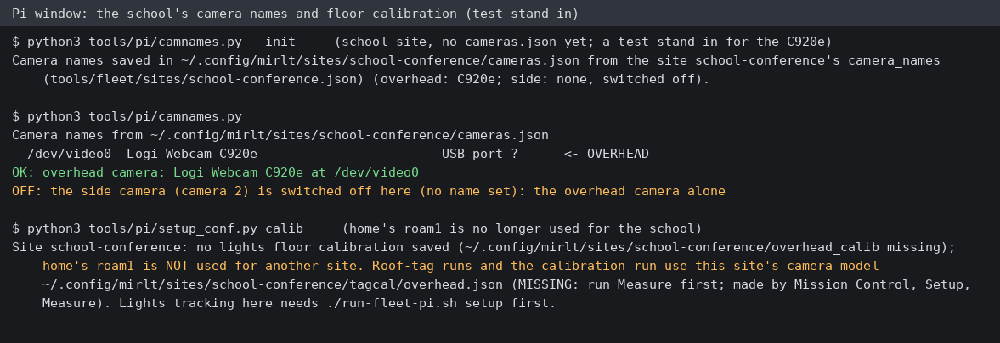

# Save on the robot, wiggle-first naming, every robot calibrated (5 Nov, simulator and tests only)

## Premise

Nick's decisions of 5 Nov, plus two fixes found on the school Pi this morning:

1. The fitted calibration (wheel_scale, gyro_scale, gyro_drift_dps) is **saved on the robot** so it survives power-off
   and sleep, and the run checks the save. Robots on the old firmware must keep working.
2. **Wiggle-first naming in every run**: each robot wiggles, the roof tag that turns with it is its tag, and the robot is
   then given the run's slot (Alpha / Bravo). The typed tag ids stay available behind `tags.binding`.
3. **Every robot found is calibrated, one after another**; while one drives, the others stand at their own spots and
   it keeps clear of them. Each robot parks at its own spot and goes to sleep.
4. The school site uses **one camera** for now; the second camera's entry is kept, switched off.
5. **`robot_sleep.py wake` by address waited 10+ minutes**. It now has a mode that wakes a robot from whatever
   address it answers from, and the calibration run no longer depends on a fixed address.
6. (Coordinator, mid-build) **`rec` looked for home's camera** (`USB 2.0 Camera`) on the school Pi and warned it used
   home's floor calibration.

Nothing here touched a robot or a Pi. Every run below is the simulator (`fleet_sim.py`, the school table, the one
camera as a pinhole model).

## Data

**What was built**

| Part | Where | In one line |
|---|---|---|
| Firmware 2026-11-05a | `firmware/home_lab/corr.h`, `home_lab.ino` | `save` (the three values as they are now, all or nothing, `corr save`'s limits), `unsave` / `defaults`, `saved`, `id` (the WiFi name AL-xxxx even after `name`); the start-up log line says which values came from saved storage |
| Calibration run | `tools/fleet/calib_run.py` 2026-11-05a | `save` after the phase-B read-back, then `saved` + `get` to check; old firmware: says so, then `corr save` per value (switch `calibration.old_firmware_save`; `calibration.save_on_robot` / `--no-save`); a compass check first when a robot woke from sleep; every robot found, in turn (P11, P05, P01); robots found at whatever address they answer from |
| Wiggle-first binding | `tools/fleet/wiggle_bind.py`, `mission_run.py` | find, compass check, wiggle, slots (pinned in the site, then nearest home), `name <slot>` with temporary names when two swap, `robot_binding.json`; mission_run does it before its bridge and its feel-out (Mission Control runs and the experiments go through mission_run); `--binding fixed` / `tags.binding fixed` keeps the typed ids |
| Waking | `tools/pi/robot_sleep.py` | `wake any [--count N]`, `wake --name AL-1DC0`: to the broadcast and to every robot heard, from any address; prints address and battery; the address mode is kept and now names robots heard elsewhere |
| Camera names | `tools/pi/camnames.py`, `setup_conf.py`, `school_setup.sh`, site file | a non-home site never gets home's names or home's roam1 floor calibration; the school's `camera_names` (overhead C920e, side off); `school-setup` writes them; an existing `cameras.json` always wins |
| Simulator | `tools/sim/fleet_sim.py` | `save` / `unsave` / `saved` / `corr` / `name` / `id`; `--fw NAME=VERSION` (old firmware), `--saved`; a wake from sleep is a restart (new boot, no compass check, saved values back) |
| Mission Control | `mission_control.html`, `calib_job.py` | the card says "every robot", lists robots and spots, shows the save line, each robot's chart |
| Runbook | `docs/how-to/school-calibration-tonight.md` | wake any, the save line, two robots, reflash (step 11), three new rows in "If something is different" |

**Simulator runs** (the school site; true values 0.97 / 1.03 / 0.30 for AL-1DC0, 1.02 / 0.97 / -0.20 for AL-2B7F;
`--quick` = 4 in-place turns, 2 roll lengths, 20 s still, so wheel_scale and drift are often not pinned down and their
old values are kept, by design):

| Run | Robots, firmware | Found / compass check | Fit (wheel / gyro / drift), 95 % +- | Saved | Parked | Points skipped |
|---|---|---|---|---|---|---|
| q1, quick, 3 tours | AL-1DC0 asleep, 2026-11-05a | found at its check-in; compass check run, then the wiggle | 0.9631 +-0.0104 (kept 1.0) / 1.0283 +-0.0022 / 0.267 +-0.047 (kept 0) | `save`, checked (`saved`: all 3 "(saved)") | P11, 0.5 cm | none |
| q3, quick, 1 tour | AL-1DC0 asleep, **2026-10-29b** | as q1 | 0.9609 (kept) / 1.0296 / 0.276 (kept) | "no `save`" said; `corr save`, checked with `get` | P11, 0.1 cm | none |
| q2, quick turns, full tours | AL-1DC0 asleep (**10-29b**) + AL-2B7F awake (11-05a) | both found (the run waited for the second); both bound | AL-1DC0: 0.9681 +-0.0038 / 1.0296 +-0.0016 / 0.310 +-0.040 (kept 0); AL-2B7F: 1.0182 +-0.0037 / 0.9710 +-0.0018 / -0.299 +-0.047 (kept 0) | AL-1DC0 `corr save` (old firmware, said), AL-2B7F `save`, both checked | AL-2B7F first drove to P05 (0.3 cm off, round the zone 1 outlet), then each at its own spot: P11 0.1 cm, P05 0.2 cm; both asleep | P05 in AL-1DC0's tours, P11 in AL-2B7F's (the other robot stood there); AL-2B7F went round AL-1DC0 at P13, P15, P19 |

The sleep check (fleet_sim, the same commands as the firmware): `set wheel_scale 0.97`, `save`, `set wheel_scale 0.5`,
`sleep 1`; at its check-in the robot restarts and says `calibration at power-on: wheel_scale 0.9700 (saved), ...`;
`get wheel_scale` = 0.970 (the unsaved 0.5 is gone); `unsave` puts it back to 1.000. On `--fw ...=2026-10-29b`:
`unknown command 'save'`, `corr save` works, `get` reads it back.

Wiggle-first binding (simulator, two robots named only by their WiFi, AL-1DC0 asleep on P14, AL-2B7F on P05): both
found, AL-1DC0's compass check run, tag 3 turned +87 deg with AL-2B7F's wiggle and tag 2 +88 deg with AL-1DC0's (the
other tag within 3 deg), AL-2B7F -> Alpha, AL-1DC0 -> Bravo (least total distance to the homes P11 and P22), both
renamed, `binding.json` written, every time.

Two-robot run q2, closest approaches (camera, the robot's middle): to a keep-out or the other robot 9.4 / 8.9 cm
(8.7 wanted); to an edge **12.5 cm (AL-1DC0) and 9.5 cm (AL-2B7F), under the 13 cm margin**; see the problems table.
Battery 96 -> 92 % and 90 -> 87 % (simulated). About 35 minutes for both robots with quick phase A and one full tour
each.

`robot_sleep.py wake any` in the simulator: the robot asleep, checking in from an address nobody asked, woken there with
its battery printed; below, the old address mode with a wrong address now says where it heard the robot.

`wiggle_bind.py` with two simulated robots: each wiggles in turn, the tag that turns with it is bound, each gets a slot
by where the camera sees it and is renamed to it.

The two-robot rehearsal's log: the second robot drives to P05 first (round the zone 1 outlet), the first is calibrated at
P11 with P05 skipped in its tours, then the second; simulator run q2.

Mission Control's calibration card after the old-firmware rehearsal (q3): the save line says the firmware has no `save`
and the values were kept with `corr save`.

The school's camera names with no `cameras.json` (a test stand-in for the C920e): the site's names are written, camera 2
is off, and home's roam1 floor calibration is no longer offered for the school.

**Problems found while building (all fixed)**

| Found | What | Fix |
|---|---|---|
| Simulator, once a wake was modelled as the restart it is | A robot woken from `sleep` refuses `turn` / `go` until its compass check has run (firmware 2026-10-25c); the 4 Nov calibration run's wiggle would be refused with "no compass check since power-on" after the robot slept | `compass_check()`: a `turn 0` asks; if refused for that, the calibration run with no spin and no roll (run_plan's compass_only: a few degrees of wiggle), then asks again. Coordinator told at once with a workaround |
| First two-robot run | Waiting for robots flooded them: every heard robot was sent `wake` + `status` in a tight loop (thousands of packets), and every leg then timed out | discover sends once every 2 s, as before |
| First two-robot run | The run went on with one robot while the other (asleep) had not answered; the driving robot then went for the sticker the silent one stood on | `--count` (simulator: all of them); a roof tag no robot claimed is kept out like a parked robot |
| Staging the second robot to P05 | After a detour round an outlet with odometry off, the next leg was aimed from where the robot was BEFORE the detour (ended 59 cm off P05). This was also in park() on 4 Nov, never hit in the rehearsals | aim from where the detour ended (parked 0.3 cm off P05 after) |
| Two-robot run q2, P15 -> P16 along the far edge | In phase A (uncalibrated), a 173 deg turn came out 6 deg short (gyro 0.97). The 47 cm drive along the edge then ended **9.5 cm from the edge** (margin 13). The safety check counted the drive's own error (3 cm + 4 %) but not the turn's error. The 4 Nov rehearsals came no closer than 13.2 cm, so this was not seen before | After the turn, the drive is checked again along the heading the camera now sees. If it is unsafe, a turn from the camera first (logged, counted as a correction). Full-length two-robot rerun q4: see the line under this table |
| `rec` on the school Pi (coordinator) | No `cameras.json` in the school folder: home's camera names used | the site's `camera_names`; `school-setup` writes them |

Rerun q4 (full phase A, one C tour, two robots, the turn check in): RUNNING when this was written (about 50 minutes);
its closest approach to an edge is added here when it ends.

**Firmware compile check**: `tools/fwcheck/check.sh` (g++ `-fsyntax-only` against the stand-in headers, which now include
`Preferences::isKey` and `clear`, both in the ESP32 core) is clean. **No real Arduino build**: arduino-cli 1.1.1 was
downloaded, but this machine's proxy refuses `downloads.arduino.cc` (403), so the ESP32 core and the Alvik library could
not be installed. The first real compile is Nick's upload in the Arduino IDE (runbook step 11).

**Tests**: fleet, Pi and simulator suites (`python3 -m pytest tools/fleet/tests tools/pi/tests tools/sim/tests`, in its own network): **798 passed, 9 skipped, 1 failed** (22 min; 751 / 9 on 3 Nov). The failure was the new save test. It sent its first command before the simulated robot's first check-in, and the harness misread a `--fw NAME=VERSION` pair. The test was fixed and passes, and the new and calibration files then passed together: **29 passed**. The two edited e02 runner test files passed: **87 passed, 1 skipped**. New tests (13): wake any / by name / by address (3), the save surviving a sleep restart and old firmware's `corr save` (1), the firmware's commands and syntax check (1), slots and rename order (2), wiggle binding in the simulator (1), mission_run's switch and feel-out children (1), parked-robot keep-out and spots (1), school camera names and no roam1 (5, `tools/pi/tests/test_school_cameras.py`, counted in the Pi suite).

## Conclusion

- The fitted values now survive power-off and sleep. In the simulator, a robot on today's firmware (2026-10-29b) is
  saved with `corr save` and checked with `get`, and a robot on 2026-11-05a is saved with `save` and checked with
  `saved`. **Reflashing is not needed for the save to work today.** It is needed for `save`, `unsave`, `saved`, `id`
  and the start-up line that says which values are saved.
- (Claude's conclusion) The 4 Nov calibration run would most likely have stopped at the wiggle on a robot woken from
  sleep. The simulator's wake did not restart the robot, which is why the rehearsals passed. The fix is pushed and
  backward compatible.
- Several robots: each robot is calibrated at its own spot. The others are parked and kept out (the other robot's spot
  is skipped in the tours), and each robot parks and sleeps. One run, q2, shows this in the simulator. It is not yet
  checked with two real robots.
- Wiggle-first naming is in mission_run (and so Mission Control's runs and the experiments). It runs before the feel-out
  and the run's bridge. The feel-out's own runs reuse the binding instead of wiggling again. Only the binding step is
  tested in the simulator: a dry mission run keeps the simulator's own names and tags, said on the screen.

## What's next

- Nick: `git pull` on the school Pi (camera names, wake any, the compass check, the save), then the runbook as before.
- When convenient: reflash each robot with 2026-11-05a (runbook step 11). The saved values stay through the reflash.
- The first real mission run with wiggle-first naming: watch the `WIGGLE FIRST` lines and the slots it chose.
- A second camera, then the parked robot can wait in zones 3-4 instead of on P05 (it would not cost the first robot
  a tour point).

## Sweep 1: new tests that may now be needed

- A real robot: `save`, switch off and on, then check the start-up line and `get` (the simulator's Preferences are
  modelled, not run).
- A real robot woken from `sleep 10`: the compass check before the wiggle (does the few-degree wiggle disturb the
  binding's "before" heading? The simulator says no).
- Two real robots: the keep-out round the parked one (closest approach from both robots' camera tracks).
- A full dry mission run with wiggle-first naming in the tag simulator. This needs the tag simulator to start before the
  binding; today the dry run skips the wiggle and says so.
- Renaming on real firmware: `name Alpha` with another robot already called Alpha (the temporary names avoid it; never
  tried on hardware).
- `wake any` on the real school WiFi: does the robot hear the broadcast, or only the reply to its check-in? Either works
  by design.

## Sweep 2: possible inaccuracies in what this relied on

- The firmware build is checked only against stand-in headers. `Preferences::isKey` and `clear` are assumed from the
  ESP32 core's API; no real compile was possible here.
- The simulator's save is a dictionary that survives `simctl restart` and the sleep restart. Flash wear, a write lost
  at power-off, and NVS being full are not modelled.
- The second spot P05, the keep-out PARKED_R_CM 6.72 + 2 cm, AT_SPOT_CM 5 cm and wiggle_bind's 3-minute wait are chosen,
  not derived (DOE backlog rows added; P05 and the keep-out are worth a simulator DOE).
- Slot by position minimises the total distance to the slots' homes. With one camera, both robots are in Alpha's half,
  so the choice between them is close to arbitrary (the binding run: 270 cm against 274 cm).
- `corr save` on old firmware relies on its limits (0.8-1.25, drift +-3) matching calib_run's BOUNDS (0.90-1.15,
  +-2): they do today.
- In `--quick` runs, wheel_scale and drift were often "not pinned down" and kept old (by design). The full-length run
  (4 Nov) is still the evidence for the fit's precision.
- Each simulator run is real time on a 2-core machine shared with the test suite. Timing-sensitive steps (holds, legs
  timing out) may behave differently on the Pi.

## Questions

Substantive:

1. On old firmware, the run saves with `corr save`, which is your intent before a reflash. Keep that as the default,
   or say "not saved, reflash first" (`calibration.old_firmware_save: off`)?
2. Slots: give each robot the slot whose home is nearest (default, `tags.slot_by: position`), or keep a robot already
   called Alpha as Alpha (`name`)? Should a borrowed robot be pinned to a slot by its WiFi name in the site
   (`robots[].wifi`)?
3. Renaming robots to their slot (`name Alpha`) is kept on the robot. Fine for Jay-Sun's borrowed robots, or rename them
   back after each run?
4. Phase A uses the robot's values at the start, which are now the saved ones. A re-calibration therefore starts
   calibrated. Keep that (the fit refines), or reset to 1 / 1 / 0 for a true "no calibration" baseline each time?

Other:

5. Who reflashes the borrowed robots, Nick or Jay-Sun (whoever has their `secrets.h`)?
6. P05 as the second robot's spot: fine, or do you prefer another sticker?
