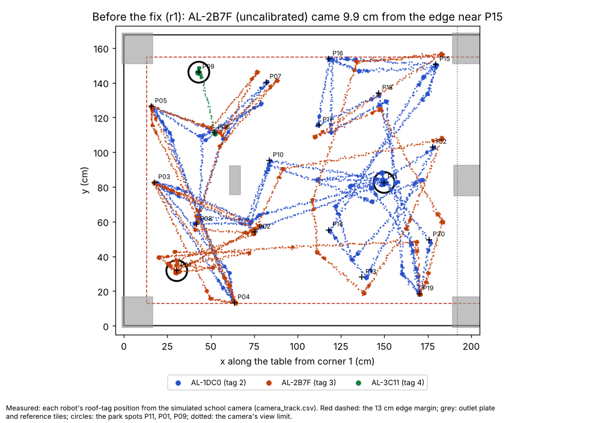
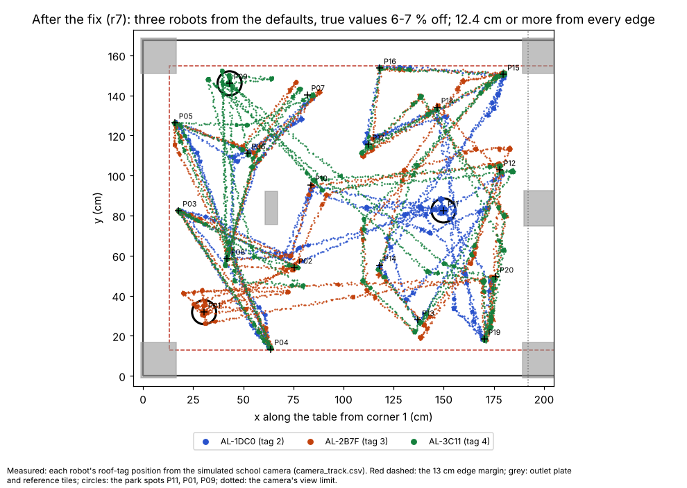

# Baseline from defaults, pinned tags, names in the run only, firmware check, WiFi flashing via the Pi (5 Nov, simulator and tests only)

## Premise

Nick's answers to the e03 questions (5 Nov, 11:00), plus two coordinator updates (Jay-Sun's cable flash adds the
OTA password; another agent works in the same repo):

1. The **first** calibration of each robot starts phase A from the defaults (1 / 1 / 0), so the baseline is
   uncalibrated; later calibrations start from the saved values. Be careful at the table edges: during an uncalibrated
   phase A the camera must keep the robot off them.
2. No renaming on the robot at school; the slot names (Alpha / Bravo) live in the run only. Keep the feature.
3. Every robot will be on 2026-11-05a: runs refuse older firmware with a plain message, behind a switch. Keep the
   `corr save` fallback, switched off. Be ready for 2 or 3 robots on the table.
4. Pin robot, slot and roof tag once a wiggle has found them ("the tags won't change"). After that the wiggle is a
   quick check, and the robot is re-bound only when it has no pin or fails the check, said loudly.
5. Flashing a school robot over WiFi when Nick is not on the robots' network.
6. The second robot's spot is P01, not P05; pick a third spot; rehearse 3 robots.

Nothing here touched a robot or a Pi. All runs are the simulator (`fleet_sim.py`, the school table, the one camera as
a pinhole model).

## Data

**What was built**

| Part | Where | In one line |
|---|---|---|
| Baseline | `calib_run.py` 2026-11-05b | first calibration of a robot (its WiFi name not in `<site folder>/calibrated_robots.json`): `set` 1 / 1 / 0, read back, before phase A; recorded only after a checked `save`; values not pinned down go back to the robot's own; a run ending before the fit puts the robot's own values back; `--baseline-defaults` / `--from-saved` / site `calibration.baseline`; said on screen, the card and the report |
| Firmware check | `calib_run.py`, `wiggle_bind.py`, site `calibration.min_firmware` | `status` read for each robot; older than 2026-11-05a: calibration refuses that robot (not moved, its tag kept out, the others go on); a mission's wiggle refuses the run. `""` switches it off. `old_firmware_save` set to `off` at school (the `corr save` code kept) |
| Pins | `calib_run.bind_by_wiggle`, `<site folder>/robot_pins.json`, site `tags.pin` / `tags.pins` | WiFi name (from `id`) -> roof tag and slot; pinned robots do a 45 deg check wiggle; another tag turning: `PIN CHECK FAILED ... re-bound`, the pin updated; a slot, once given, stays. `--no-pins` = the old full wiggle |
| Names in the run only | site `tags.rename_to_slot false`; `wiggle_bind.py` record `aliases`; `run_plan.py --alias`; `alvik_console.Session.aliases`; `mission_run.py` | the robot keeps AL-xxxx; every line it sends is filed under its slot in the run. Renaming on the robot is kept (`rename_to_slot true`, `wiggle_bind.py --rename on`) |
| Stray tag | `wiggle_bind.py`, site `tags.unclaimed` | a mission refuses to start when a roof tag on the table did not turn with any robot of the run (a third robot asleep, or not in the run) |
| Spots | `calib_run.PARK_SPOTS`, site `calibration.park_spots` | P11, P01, P09 (P05 kept as `PARK_SPOTS_E03`); a spot where a robot nobody drives stands is not used |
| Parking | `calib_run.park` | re-aimed from the camera until within 2 cm (2 more legs at most), then the heading within 3 deg |
| WiFi flashing | `tools/pi/ota_push.py`; runbook sections 11-12 | `check` (restarts the robot once and reads its start-up line: WiFi updates on/off); `push` (checks the .bin, finds the robot, checks it is idle, asks the password without showing it, runs espota.py, waits for the new version) |
| Simulator | `calib_run.py --sim-saved`, `--quick-full-tour` | a robot with saved values; quick phase A but the full P01-P20 tours |

**Simulator runs**

| Run | Robots (true wheel / gyro / drift) | What it shows |
|---|---|---|
| wb1-wb3, `wiggle_bind.py` | AL-1DC0 (tag 2), AL-2B7F (tag 3) | 1st: bound by the 90 deg wiggle, pins written, not renamed (`AL-1DC0 is Bravo, AL-2B7F is Alpha`). 2nd: both `pin checked` with 45 deg. 3rd, tags swapped: both `PIN CHECK FAILED ... re-bound`, pins updated, slots kept |
| r3, quick | AL-2B7F on 2026-10-29b, AL-1DC0 (0.97 / 1.03 / 0.30) | AL-2B7F `REFUSED` (not moved, kept out at its spot); AL-1DC0 from the defaults, gyro 1.0323 saved, recorded; parked 0.2 cm off P11 |
| r2, quick, after r3 | AL-1DC0 with r3's saved values | `pin checked`; `PHASE A STARTS FROM ITS SAVED VALUES`; gyro 1.0314; parked 0.2 cm off P11 |
| r1, 3 robots, quick phase A, full tours, e04 first code | AL-1DC0 at P11 (**0.93 / 1.06 / 0.30**, with 0.97 / 1.03 / 0.30 already saved on it); AL-2B7F from P02 and AL-3C11 from P06 (**1.07 / 0.94 / -0.25**) | AL-2B7F, uncalibrated, came **9.9 cm** from the edge near P15 (4 % allowance): fixed (problems table). Stopped by the 30-minute background limit during robot 2 |
| r5, as r1, 10 % allowance everywhere | as r1 | 6 of 20 points skipped in AL-1DC0's phase A beside the outlet plate: allowance narrowed to the edges (problems table). Stopped by hand |
| **r7, as r1, final code, firmware 2026-11-05b** | as r1 | all three `firmware 2026-11-05b ... OK`, from the defaults, fitted, saved, parked; table below |

r7 (41 min for three robots; quick phase A = 4 turns, rolls of 20 and 40 cm, 20 s still; every tour the full P01-P20;
one phase-C tour). Closest edge: the camera's averaged pose at each stop / every single camera read (read noise about
0.3 cm included):

| Robot, spot (true values) | Fit, 95 % +- | Saved | Distance error cm/m, before -> after (median) | Heading error per turn, deg | Closest edge, stops / reads (cm) | Closest keep-out, other robot (cm) | Points skipped | Parked |
|---|---|---|---|---|---|---|---|---|
| AL-1DC0, P11 (0.93 / 1.06 / 0.30) | 0.9298 +-0.0038 / 1.0615 +-0.0017 / 0.283 +-0.040 (kept 0.30) | `save`, checked | 7.11 -> 0.29 | 4.96 -> 1.12 | 13.4 / 12.4 | 9.5 / 16.3 | P01, P09 (robots there), P16 in phase A (edge allowance) | 0.2 cm off P11 |
| AL-2B7F, P01 (1.07 / 0.94 / -0.25) | 1.0684 +-0.0037 / 0.9398 +-0.0014 / -0.240 +-0.036 (kept 0) | `save`, checked | 6.94 -> 0.31 | 6.14 -> 0.93 | 13.6 / 12.9 | 9.2 / 16.6 | P09, P11 (robots), P16 in phase A | 1.0 cm when staged, 0.5 cm at the end |
| AL-3C11, P09 (1.07 / 0.94 / -0.25) | 1.0665 +-0.0035 / 0.9400 +-0.0018 / -0.184 +-0.046 (kept 0) | `save`, checked | 6.91 -> 0.41 | 6.13 -> 0.80 | 13.6 / 12.8 | 9.3 / 16.3 | P01, P11 (robots), P16 in phase A; its 40 cm rolls (edge allowance at P09) | 0.3 cm when staged, 0.3 cm at the end |

Robots' centres never came closer than 16.3 cm to each other (the keep-out wants 17.4 between parked and moving; the
moving robot's own camera reads include its noise). Every spot was reached within 2 cm by the re-aim.

r1, before the fix: each robot's track from the simulated camera; the uncalibrated AL-2B7F (orange) crossed the dashed
13 cm margin near P15.

r7, the final code: all three robots, each started uncalibrated, stayed at the dashed margin or inside it.

**Problems found while building (all fixed)**

| Found | What | Fix |
|---|---|---|
| r1 | AL-2B7F (wheels 1.07, gyro 0.94, uncalibrated) came **9.9 cm** from the edge near P15: the leg from a detour waypoint was checked with 3 cm + 4 % of its length as its possible error, but it was 7 % long and 6 deg off | An uncalibrated robot's legs (phase A from the defaults, staging) count 10 % at the edges and the camera's view (`SAFE_FRAC_UNCAL`); 4 % once fitted, as before. r7: 13.4-13.6 cm (stops), 12.4 cm or more (single reads) |
| r5 | With 10 % at the outlets and tiles too, 6 of 20 points were skipped in phase A beside the 1/16 in outlet plate | The 10 % applies to the edges and the camera's view only |
| Wording | The save line said "firmware 2026-11-05a" for an 11-05b robot | "2026-11-05a or newer" |
| r1, first try | An uncalibrated robot (wheels 1.07) driven to its spot parked **7.0 cm** off P01 in one leg. In e03 the true values were closer to 1 and the same code parked within 0.5 cm | `park` re-aims from the camera until within 2 cm. After the fix: 0.9 cm (P01), 0.3 cm (P09), 0.2 cm (P11) |
| Review of the pins | A one-slot run would have overwritten a robot's pinned slot | A slot, once pinned, stays; it is changed by editing `robot_pins.json` |
| Review of renaming off | With `rename_to_slot false` the e03 code stopped the run ("not called by their slot") | names in the run only (aliases), as Nick asked |
| Review of 3 robots, 2 slots | A third robot on the table, not in a 2-slot mission, would not be tracked by the run | the wiggle refuses the run and names the tag (`tags.unclaimed`) |

**WiFi flashing (item 5)**

- `firmware/home_lab/ota.h`: WiFi updates are on only when `secrets.h` defines `OTA_PASSWORD`. At every start-up,
  including each wake from sleep (a restart), the robot says `<name>: WiFi firmware updates on` or `... off (add
  OTA_PASSWORD ...)`, also on the Serial Monitor. `ota_push.py check` uses this.
- The robots Jay-Sun flashed (instructions: change the WiFi lines only) most likely have it off. Per the coordinator,
  Jay-Sun now flashes each by cable with an `OTA_PASSWORD` line he chooses and gives Nick privately (runbook section
  11). Then Nick's path is: PC (Arduino IDE, Sketch > Export Compiled Binary, `home_lab.ino.bin`) -> PowerShell `scp`
  to the Pi over Tailscale -> `ota_push.py push` -> robot (section 12). WiFi flashing worked on the home robots on
  19 Oct (session notes; a Windows firewall fix was needed there, the Pi has none in the way).
- espota.py (arduino-esp32 `tools/espota.py`) has no licence header of its own (authors credited; the project is
  LGPL-2.1) and needs only Python's standard library. It is **not copied into the repo**; the runbook downloads it to
  the Pi's home folder (about 15 KB). It handles both the older MD5 and the newer SHA-256 password exchange.
- The .bin holds the WiFi passwords from `secrets.h` in plain bytes: it goes only to the Pi and is deleted after
  (runbook step F). The password is typed at a prompt, never on the command line or in a file; `ota_push.py` passes
  it to espota.py as an argument, so it is visible in the Pi's process list for the few seconds of the upload.
- Space: .bin about 1-1.5 MB plus espota.py; the Pi card's ~1 GB free is plenty.

**Tests**: the full fleet, Pi and simulator suite at 11:20-11:40 (in its own network, while two rehearsals ran):
786 passed, 10 skipped, 21 failed. None of the 21 is from this build: 3 were the other agent's unfinished firmware
edits in the shared folder (they pass on this build's commit), 15 fail the same way on the e03 commit in this machine's
network setup (the launcher, camera page and stop-all tests need a network the isolated namespace does not have; feel
table and ref tags fail at e03 too), and 3 passed when run again alone. After merging with the free-roam work (firmware
2026-11-05b): the calibration, pins, save / wiggle and firmware-acceptance tests, **34 passed**; after the rebase onto
0c1cd37: see the commit message. 9 new tests (`test_e04_baseline_pins.py`).

## Conclusion

- The first calibration of each robot now measures it uncalibrated, as Nick asked, and later ones start from its saved
  values. In r7, three robots 6-7 % off in wheels and gyro were fitted to within 0.004 (wheels) and 0.002 (gyro) of
  the truth, distance errors fell from about 7 to 0.3-0.4 cm per metre, and heading errors per turn from 5-6 to
  about 1 deg.
- (Claude's conclusion) Uncalibrated, the e03 edge check was not enough: 4 % of a leg did not cover a robot 7 % long
  and 6 deg off (9.9 cm from the edge). With 10 % at the edges, all three stayed at the margin (13.4-13.6 cm at the
  stops). The cost: P16 (13.9 cm from the edge) is skipped in an uncalibrated phase A, and P09's longer rolls.
- Robots on 2026-11-05b are accepted (r7); older firmware is refused and kept out (r3). Pins, the check wiggle and
  the loud re-bind work in the simulator (wb2, wb3, r2). Names in the run only are tested at the console and in the
  arguments; not yet in a full mission (sweep 1).
- (Claude's conclusion) P09 works as the third spot but, like P05 before, leaves room only for the short rolls once the
  uncalibrated allowance is applied. The wheels still came out within 0.004 from the tour legs.
- Pins are records of what each wiggle discovered, not typed positions, so they fit the new standing rule "discover,
  don't pre-map"; the typed `tags.pins` in the site is only a seed.

## What's next

- Jay-Sun: cable-flash each robot with 2026-11-05a and an `OTA_PASSWORD` line (runbook section 11).
- Nick: `git pull` on the school Pi, then the runbook. The first real calibration of each robot will say
  `PHASE A STARTS FROM DEFAULTS`.
- `ota_push.py check` on the table robot after Jay-Sun's flash, then one real `push` to prove the path.
- The first real mission with names in the run only: watch `NAMES in this run only` and that the run's logs file each
  robot under Alpha / Bravo.

## Sweep 1: new tests that may now be needed

- A full dry mission run where the simulated robots answer with WiFi names and the run uses `--alias`. Today only the
  console's alias and the arguments are tested; the simulator's robots carry the slot names in a mission.
- A real robot: `ota_push.py check` (does the start-up line after `sleep 1` reach the Pi?) and one `push`.
- A real uncalibrated phase A on the school table, with the camera's closest approach to the edges from
  `camera_track.csv`, against the rehearsal's numbers.
- The 45 deg check wiggle on the real camera: no false `PIN CHECK FAILED` over several runs.
- A full-length (not quick) 3-robot run; r1 had a quick phase A (4 turns, 2 roll lengths, 20 s still).

## Sweep 2: possible inaccuracies in what this relied on

- P09 as the third spot, PIN_CHECK_DEG 45, PARK_TOL_CM 2 and PARK_TRIES 2 are chosen, not derived (DOE notes in the
  code). A simulator DOE of P06 / P07 / P09 against points skipped and detours would decide the third spot.
- "First calibration" is decided by the Pi's record. A robot calibrated before 5 Nov 11:00 (or on another Pi) counts
  as first once and starts from the defaults: what Nick asked for a baseline, but said here.
- In phase A from the defaults, values that are not pinned down go back to the robot's own (saved) values, not to the
  defaults. Chosen (least change); r1's drift (+-0.031, need 0.030) was kept at the saved 0.30 this way.
- The simulator's true values (0.93 / 1.06; 1.07 / 0.94) are chosen to be bad, not measured. The real robots' errors
  may differ in kind (wheel slip, a gyro that changes with temperature).
- espota.py's behaviour against the Nano ESP32's ArduinoOTA version is assumed from its source summary (it handles
  both password exchanges); it was used successfully only through the Arduino IDE on 19 Oct, never from a Pi.
- The Arduino IDE's build folder name (`build/arduino.esp32.nano_nora`) is from the IDE 2 convention, not checked on
  Nick's PC; the runbook says to open "the one folder inside `build`".
- Each simulator run is real time on a 2-core machine, with the suite running beside it for part of r1.

## Questions

Substantive:

1. In a phase A from the defaults, a value that is not pinned down goes back to the robot's own (saved) value. Keep
   that, or keep the default (so an uncalibrated robot stays uncalibrated in that value)?
2. A mission refuses to start when a roof tag on the table did not turn with any robot of the run (a third robot not
   in a 2-slot mission). Right, or should it go on and keep that robot's tag out as an obstacle?
3. A third slot (Charlie, its home and zone) for 3-robot missions: wanted now? Today a mission has Alpha and Bravo.

Other:

4. Third spot P09 (chosen). Fine, or another sticker?
5. Should the pins also be copied into the site file (`tags.pins`: WiFi names and tag ids only) once they are known,
   so they survive a new Pi?
