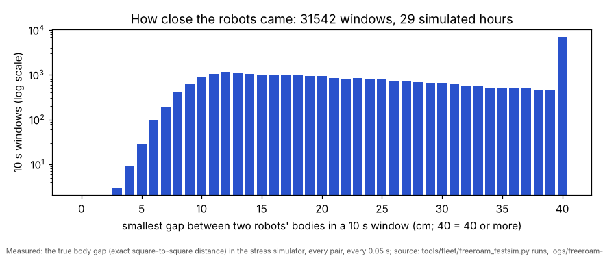

# Home free roam: three robots moving at once until their batteries run down (5 Nov, simulator and tests only)

## Premise

Nick, 5 Nov: three home robots (Left, Center, Right) moving **simultaneously and continuously** on the home board
until each battery reaches 10 %, up to 4 h, unattended: started from the home Pi over SSH, still running after he logs
out and switches Tailscale, uploading at the end like the DOE loop. "Continuous simultaneous movement of multiple robots
is the accomplishment, that's a trophy." At 11:23: "I would prefer to find directional solutions instead of stops. The
trophy is shiniest if they never stop moving", and "are we sure the plan for collisions is robust enough?"

What was asked, in short: rule-steered free roam from a balanced menu of turn x length x speed (seeded, least-used
first); a fallback ladder with no waiting; reservations in space and time with execution margins; a reflex on actual
positions that changes speed or steers before it stops, with every case logged; robots' own backstops (front sensor,
watchdog); dead reckoning with a growing bubble when the camera loses a robot (the old hold kept behind a switch);
battery to 10 % then park; an automatic report; simulator rehearsals and stress tests with the numbers.

**Measured, and where from.** "Moving" = the robot's own wheels and gyro (FOLLOW records, 10 a second) show at least
1 cm/s or 4 deg/s over 0.6 s, sampled every 0.5 s; "any motion" counts turns on the spot, "translating" does not.
Gaps between robots = the exact distance between the two 9.5 cm square bodies, from the simulators' true positions.
Nothing here touched a robot or a Pi.

## Data

**What was built** (all pushed to main)

| Part | Where | In one line |
|---|---|---|
| Controller | `tools/fleet/freeroam_core.py` | no sockets, no clock: the same code on the Pi, in the real-time simulator and in the stress simulator. Menu, reservations, fallbacks, reflex, dead reckoning, battery, logs |
| Runner | `tools/fleet/freeroam.py` | real start = the ladder's L0 + L1 (as the DOE loop), a heading crawl where needed, the camera bridge, then the controller at 20 Hz; `--dry` (fleet_sim, compressed battery, tag dropouts, WiFi drops), `--dry-chain` (the real start against the ladder's simulated board and pictures) |
| Report | `tools/fleet/freeroam_report.py` | `report.md` + 5 charts in the run folder at the end of every run |
| Stress simulator | `tools/fleet/freeroam_fastsim.py` | the controller against a kinematic model of three robots, about 100x real time: packet loss, latency, bad turns, wheel and gyro errors, tag dropouts, a robot that dies, the Pi frozen for 4 s; exact body gaps; `summarize` |
| Firmware 2026-11-05b | `firmware/home_lab/follow.h`, `pose.h`, `params.h`, `home_lab.ino` | `fspd <scale>` (speed x 0-1.5 while driving; 0 = stand on the line, step kept) and `fsteer <x> <y>` (the rest of a forward drive to a new end, turning while moving), answered by an FSPD record; heartbeat watchdog `follow_wd_ms` (0 = off; the roam sets 1.5 s). Reset at every step, so run_plan and missions are unchanged. Simulator mirrors all three |
| Launcher | `run-fleet-pi.sh` | `freeroam [hours] [hold] [full-video]`, `freeroam-status`, `freeroam-stop`; tmux session `freeroam`; uploads at the end (`freeroam-finish`); `stopall` covers it |
| Runbook | `docs/how-to/home-free-roam.md` | reflash, pre-flight, PowerShell / Pi window / browser, one command per box |
| Kept | `tools/fleet/roam.py` | unchanged (its test still imports it); the old cautious hold is `--lost-mode hold` / `freeroam ... hold` |

**The design as built** (Nick's numbered points; deviations in bold)

1. **Menu**: 7 turns (-150, -90, -45, 0, 45, 90, 150 deg, drawn +-15) x 4 lengths (10-20, 20-35, 35-55, 55-80 cm) x 4
   speeds (5, 7.5, 10, 13 cm/s, the DOE loop's) = 112 cells. Cells are tried least-used first (whole run, then per robot;
   seeded shuffle breaks ties; seed in run.json); 10 % of picks try the cells in random order (so the three robots do not
   all chase the same rare long cells; DOE row). The first feasible one is taken.
2. **Fallback ladder, no waiting** (Nick 11:23): off-menu (any heading in 15 deg steps, the longest of 70 ... 5 cm) ->
   escape towards the board centre / open space at the longest feasible length (gap relaxed to the reflex's, only if it
   never brings it closer to anyone) -> **deadlock: two robots holding next to each other, the lower-priority one
   (Right < Center < Left) yields** -> a holding turn on the spot (+-40 deg, only with its own circle clear). The last
   rung, standing, happens only near an edge with no room to turn; it is a logged "trophy break". **The asked-for
   "wait for a crossing robot" and "wait and retry" rungs were replaced by moving ones**, as Nick asked at 11:23.
3. **Reservations**: each move = turn spot + swept line sampled every 0.25 s + standing at its end until its next move,
   with margins 1 cm + 0.06 cm per cm along the move (at most +3 cm: line tracking 2-3 cm p95 with camera fixes) and
   time slack 0.6 s + 15 % of the time since commit (camera frame, tracking, command and ack with one resend, step
   start, turn and ramp estimates). New plans keep the bodies' circles 4 cm apart from every reservation in overlapping
   time windows. **Speed changes mid-drive needed a firmware change** (none existed): 2026-11-05b `fspd`; with older
   firmware the controller halts and resends the rest of the drive at the new speed (a short stop each time; counted).
4. Edge: every end spot 16 cm in (corner 9.3 cm); a robot turns on the spot only 9.2 cm or more in. Robot-robot: planned
   circles 4 cm apart, reflex at 2.5 cm, hard stop under 0.5 cm within 1.2 s. Stuck: driving with under 1 cm of camera
   travel in 3 s -> halt and a new move. Robots' own backstops: front stop at 8 cm (roam.py's), edge guard, their own
   border 6 cm in, watchdog 1.5 s.
5. **Lost by the camera** (fix older than 0.6 s): dead reckoning on the robot's own pose; bubble = 2.0 + 0.07 cm per cm
   driven blind (measured, 29 Oct) + the sideways effect of a heading error of 3 % of the degrees turned blind
   (chosen); it plans with the bubble on its edge margin and its margin to others; over 8 cm, or the bubble reaching the
   turn limit at an edge: eases to a stop (fspd 0.3, then halt) and wiggles +-20 deg until seen. Seen again: the jump
   (odometry vs camera) is logged; over 2.5 cm its pose is reset to the camera's; over 12 cm three agreeing fixes first.
6. Battery: parks at 10 % on a free spot near an edge (19 cm in, reachable now, 25 cm from the others), `stop`, then
   `sleep 0` (switch: `--no-sleep`); a robot silent for 6 s is kept as an obstacle where the camera sees it, out after
   120 s. Ends when all are out, at 4 h, or when the card is nearly full (diskguard), then uploads.
7. Report: premise, data, conclusion, next; charts for motion (minute by minute), menu coverage, reflex events, lost
   episodes, battery, each with what is measured and its source, one plain sentence under each.
8. Rehearsals and stress tests: below.

**Real-time rehearsal 1** (`freeroam.py run --dry`: fleet_sim, firmware 2026-11-05b simulated, battery compressed to
about 37 min, tag dropouts on all three (17 in all), WiFi drops Center 5 s at 20 min and Left 3 s at 30 min; the
machine was shared with the stress runs and another agent's simulators):

| | any motion | translating |
|---|---|---|
| at least 2 robots moving | 98.7 % (37 min) | 85.0 % (32 min) |
| all 3 moving | 94.5 % (35 min) | 43.5 % (16 min) |

- 1047 moves; all 112 menu cells used (fewest 3, most 11: the thin cells are long straight-ahead drives); fallbacks:
  off-menu 1, escape 3, find-me wiggle 16; reflex events 0; full stops (trophy breaks) 0.
- **Two stand-stills of 37 and 39 s**: in both WiFi drops the robot's watchdog stopped its step and said so into the
  gap; the report was lost and the controller waited for its slow-move timeout. **Fixed**: the end is now read from the
  FOLLOW record's last-done / last-failed ids within 0.5 s (rehearsal 2 below). The report now lists every robot's
  longest stand-still, so a stop that no event names still shows.
- Lost by the camera: 17 episodes, up to 64 cm blind; odometry vs camera when seen again: median 0.6 cm, largest 1.7 cm,
  17 of 17 inside the bubble ([chart](../screenshots/2026-11-05/e04-feature-freeroam-rehearsal-chart-lost-sim.png)).
- Evidence: docs/results/freeroam-2026-11-05/ (each run's report.md and CSVs; the stress results).
- Truth (simulator positions): **no contact**; closest bodies **8.8 cm**; closest corner to an edge **8.9 cm**.
- Each robot parked at 10 % after 37 min (from 96-98 %). Moves took 0.87 of their estimated time (median; p90 0.94);
  end spots within 1.9 cm (median, p95 3.0) of the plan.

**Full chain** (`--dry-chain`: the ladder's L0 + L1 against the simulated board, the camera bridge tracking simulated
pictures by lights, 9 min of roaming): L0 PASS, L1 PASS (three calibrations, 62-65 s each), all three joined;
99.9 % any motion with all three, 43.9 % all three driving; 264 moves, 110 of 112 cells; no fallbacks, no reflex
events, no full stops; truth: no contact, closest bodies 7.6 cm, closest corner to an edge 8.4 cm.

**Real-time rehearsal 2** (after the lost-report fix; 19 min, battery compressed to about 19 min, WiFi drops Center
5 s, Left 3 s, Right 8 s, 10 tag dropouts): two robots moving 98.9 % (driving 84.6 %), all three 95.4 % (driving
43.7 %). After each WiFi drop the robot's longest stand-still was about the drop itself (Center 4.5 s, Left 3.0 s,
Right 7.5 s: the watchdog stops a robot that hears nothing, as intended), not 37-47 s; one lost step report was noticed
from the FOLLOW record. 526 moves; fallbacks off-menu 1, escape 1, find-me wiggle 9; reflex: 1 new move (kept); one
3 s full stop (Center lost near an edge, standing until seen). Lost: 10 episodes, jumps median 0.9 cm, largest 2.0 cm,
10 of 10 inside the bubble. Truth: no contact, closest bodies 9.1 cm, closest corner to an edge 8.9 cm.

**Reflex drill** (simulator only: 30 % of moves planned ignoring the others' reservations, so the reflex must act; 10
min real time through the simulated firmware's `fspd`): 40 reflex events, **27 speed changes** (fspd x0.6 / x0.35) and
**13 new moves**, all 40 "kept" (the camera never saw the robots' middles closer than 16.2 cm); no full stops; 38 FSPD
answers from the robots. Truth: no contact, closest bodies 4.3 cm. Every event is a row in reflex.csv (time, the two
robots, predicted gap before and after, the change, the method, the closest seen, the outcome) and a mark on the report's
reflex chart ([picture](../screenshots/2026-11-05/e04-feature-freeroam-reflex-drill-40-events-speed-and-new-move-sim.png)).

**Stress simulator** (the same controller; per simulated hour; "contacts" = the true squares overlapping; groups: A new
firmware, B old firmware 2026-10-29b (halt + resend, no watchdog), C 15 % packet loss and up to 150 ms latency, D the
old cautious hold; every run has tag dropouts, 1 in 50 turns 8-20 deg off, wheel +-3 % and gyro +-1.5 % errors, 3 %
loss, a robot dying at a random time and the Pi frozen for 4 s, except where the group says otherwise):

| group | runs | sim h | contacts | smallest gap cm | 1st pct of 10 s minima cm | speed /h | steer /h | new move /h | hard stop /h | full stops /h | fallbacks /h | find-me /h | front stops /h | watchdog stops | off board | closest to edge cm | >=2 moving % (driving %) | 3 moving % (driving %) | moves /h | slow moves /h |
|---|---|---|---|---|---|---|---|---|---|---|---|---|---|---|---|---|---|---|---|---|
| A-newfw | 3 | 11.6 | 0 | 4.18 | 8.04 | 0.17 | 0.00 | 0.34 | 0.00 | 1.46 | 14.0 | 21.4 | 0.26 | 5 | 0 | 8.4 | 99.4 (85.6) | 41.2 (28.4) | 1283 | 0.00 |
| B-oldfw | 3 | 11.7 | 0 | 3.85 | 7.94 | 0.00 | 0.00 | 0.60 | 0.00 | 1.89 | 20.2 | 30.9 | 0.00 | 0 | 0 | 8.4 | 99.3 (88.5) | 61.2 (42.2) | 1400 | 0.00 |
| C-harsh | 2 | 4.0 | 0 | 3.50 | 7.58 | 0.00 | 0.00 | 0.00 | 0.00 | 2.00 | 25.2 | 20.0 | 0.50 | 14 | 0 | 8.0 | 99.3 (88.5) | 55.6 (38.3) | 1327 | 0.00 |
| D-hold | 1 | 2.0 | 0 | 4.89 | 7.25 | 0.00 | 0.00 | 0.00 | 0.00 | 21.50 | 19.0 | 0.0 | 1.00 | 2 | 0 | 8.2 | 96.6 (85.3) | 48.9 (33.9) | 1354 | 0.00 |

30 simulated hours (12 runs; group A has 3 of its planned 6 seeds: stopped early to keep within Nick's usage). Full stops
were almost all "lost near an edge: stands until seen" (the camera lost a robot too near the edge to wiggle; 1-2 an hour,
a few seconds each) and a few "nothing fits near the edge"; the reflex's hard stop never fired. "3 moving" is lower than
in the rehearsals because one robot dies part-way through every stress run.

Each bar counts 10-second windows by how close the two nearest robot bodies came in that window; nothing reached 0 (touching), and windows under 5 cm were rare.

**Found and fixed while building** (each found by the simulators, fixed, then re-run):

| What | Why | Fix |
|---|---|---|
| Left drove up to a robot that had died (0.02 cm) | the reflex predicted the dead robot still driving its plan; then slowed Left to 15 % instead of steering, which only delays the meeting; then an old "full stop" marker made the reflex skip Left | the other robot is predicted both as commanded and standing; speed only against a robot that moves; escalation to steer / new move; markers end when a move starts ([picture](../screenshots/2026-11-05/e04-problem-fixed-freeroam-reflex-slowed-into-dead-robot-now-steers-fastsim.png)) |
| A robot inside the hard limit of another stopped on every new move, 40 s each | the current distance was the "closest predicted" | only robots closing in count |
| Holding turns right next to another robot | no room check | a holding turn needs its own circle clear; escape moves may start too close if they only move away |
| 37 / 39 s stand-stills after WiFi drops | the step's end report was lost | FOLLOW record's last-done / last-failed ids |
| FSPD answers skipped, so `fspd` was resent forever | no header line | firmware sends `H,FSPD,...` at the start of a follow run |
| Four tests pinned the firmware to 2026-11-05a | version bump | accept 2026-11-05x with the 11-05a notes; the e02 runner accepts 11-05b |

**Tests**: `tools/fleet/tests/test_freeroam.py`, 20 tests (reservations in time, menu, edge, fallbacks never wait,
reflex speed / no-speed-into-standing / moving apart / old firmware, dead reckoning and the jump, hold switch, battery
park and sleep, lost report, drill refused on robots, stand-stills, stress runs, firmware syntax, launcher, roam.py).
Full fleet suite (own network namespace): 579 passed, 9 skipped, 1 failed (a fourth test pinning firmware 11-05a; fixed, then passed with the e02 runner fix tests: 36 passed). 16 min on a machine shared with the stress runs.

## Conclusion

- In the simulators, three robots moved at once for nearly the whole run (rehearsal 1: all three 94.5 % with turns on
  the spot, 43.5 % all driving), with no contact anywhere: the trophy works in simulation. The real robots, camera and
  WiFi are the open part.
- The planning layer does almost all the work: with normal planning the reflex rarely acts. The drill (planning partly
  switched off) shows the reflex alone also prevents contact, mostly with speed changes and new moves.
- The robots should be reflashed to 2026-11-05b: on 2026-10-29b every avoidance is a short stop and a WiFi or Pi drop
  leaves a robot finishing its step blind (no watchdog).
- The dead-reckoning bubble is conservative: every jump was under 1.8 cm while the bubble was 4-10 cm; the find-me
  wiggles it causes (about 26 an hour in the rehearsal) are the main source of time not driving.

## What's next

1. Reflash Left, Center and Right to 2026-11-05b (runbook step 1), then the first real run (runbook steps 2-6).
2. From that run: the real move-time ratio (set the slack), the lost-tag jumps against the bubble (set the turn term and
   the cap), how often the camera bridge loses a robot when three are close (who-is-who), the battery curve.
3. The DOE rows added to docs/doe-backlog.md (edge margin, gaps, reflex horizon, free share, bubble).

## Sweep 1: new tests that may now be necessary

- Board: the first real run with all three, 30-60 min attended, before an unattended 4 h one.
- Board: `fspd` and `fsteer` on a real robot (bench: a 60 cm drive, fspd 0.5 then 1.0 halfway; fsteer 30 deg off);
  the watchdog (switch the WiFi router off for 3 s during a drive).
- Board: the camera bridge with three robots passing at 8-15 cm (merged outlines give no fix: how often, how long).
- Simulator: three robots with one battery parked early and one silent at once in the dense centre.
- Simulator: the full chain (`--dry-chain`) for an hour with tag dropouts (the 9 min run had none).
- Logs: real end-spot error and move time against the reservation margins, per speed bin.

## Sweep 2: possible inaccuracies in what this relied on

- **Simulators, not robots.** Every number above is simulated. The fast simulator's robot is a kinematic model with
  my chosen error sizes (wheel +-3 %, gyro +-1.5 %, 1 in 50 bad turns, camera 0.5 cm, 0.12-0.2 s late). fleet_sim's
  physics is richer but its camera fixes in rehearsals 1-2 were direct, not tracked from pictures; only the 9 min full
  chain used the camera bridge.
- **Firmware 2026-11-05b is syntax-checked only** (tools/fwcheck stand-in headers); no real Arduino build here.
- **Measured vs chosen**: BLIND_BASE / BLIND_PER_CM measured (29 Oct, straights up to 40 cm); BLIND_TURN_FRAC 3 %,
  BUBBLE_CAP 8 cm, EDGE_CC 16 cm, PLAN_GAP 4 cm, REFLEX_GAP 2.5 cm, REFLEX_H_S 2 s, HARD_CC / HARD_T_S, PLAN_M_*,
  SLACK0_S / SLACK_FRAC, FREE_SHARE 10 %, the menu bins, WIGGLE_DEG, STUCK_S, SILENT_S, OUT_SILENT_S, WD_MS 1.5 s,
  FOLLOW_LOOK_CM 8, PARK_EDGE_CC are chosen (each says so in the code; DOE rows where one would help).
- **Turn time and speed ramp** are estimates (TURN_DPS 75, ACCEL 20); the rehearsal's moves took 0.87 of the estimate.
- **Battery**: the rehearsals compress the drain to about 37 min (moving 146 %/h); the stress model uses 24 %/h moving,
  6 %/h standing (chosen). The 2 Nov low-battery run had all three robots go silent at 21-24 %; if that repeats they
  leave the run as "silent" (kept as obstacles), not parked.
- **Priority order** Left > Center > Right is fixed (chosen), not rotated.
- **Contacts are judged on 9.5 cm squares**; the robots' lights and the back attachment may stick out a little.

**Remaining collision risks the simulator cannot rule out**

1. The camera naming the wrong robot with confidence (a who-is-who swap when two pass close): both are then planned
   from the wrong places. The bridge gives no fix when unsure; a confident swap is not modelled.
2. A robot that drives while it says it stands (motor board, wheel slip on plywood dust, a lifted wheel): the reflex
   hedges against a standing robot, not against an unexpected mover.
3. Firmware 2026-10-29b with a Pi or WiFi drop: no watchdog, so a robot finishes its queued step blind (at most one
   move, up to 80 cm).
4. Sun or glare across the board for long stretches (many robots lost at once, all bubbles growing).
5. Something put on the board during the run (a hand, a cup): only the robots' front stop sees it; the camera
   bridge's brick watch is not on in the free roam.
6. Edge risks are as before: the edge guard and the robots' own border are the backstop if the camera and odometry are
   both wrong by more than 9 cm.

## Questions for Nick

**Substantive**
1. Reflash to 2026-11-05b before the first run? (Recommended: avoidance without stops and the watchdog. Without it the
   run works, with short stops.)
2. Parked robots go to sleep (`sleep 0`) at 10 % so they do not drain further; you switch them off and on to wake them.
   Keep that, or leave them awake?
3. The first real run: attended for 30-60 min first, or straight to an unattended 4 h?
4. "Moving" counts turns on the spot (the report shows both). Which number is the trophy for your report: any motion,
   or driving?

**Other**
5. Priority order Left > Center > Right for yielding: fine, or rotate it?
6. The find-me wiggle is +-20 deg on the spot: fine to watch, or something more visible?
