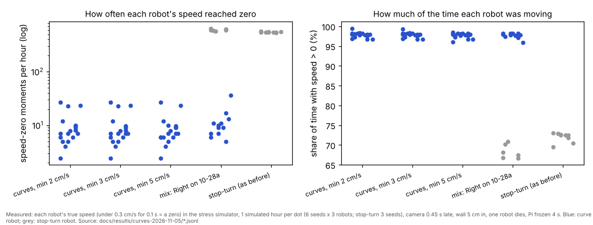

# Continuous curves ("never stops") and the calibration's lost-tag recovery (5 Nov evening, simulator and tests only)

## Premise

Nick, 5 Nov 16:06: "eliminate the stop and turn. I want them running continuously with curving turns where velocity
never drops to 0." His decisions: (1) new firmware with continuous arc driving, robots on older firmware fall back to
stop-turn-drive, each robot's mode shown and counted apart; (2) reversing only if absolutely necessary, sharper curves
first, plan so a robot can always loop away, a reverse logged as a speed-zero moment; (3) a minimum speed when
avoiding, chosen from 2 / 3 / 5 cm/s with evidence; (4) both styles everywhere as a choice: free roam defaults to
curves, ordered point sequences (missions / run_plan) default to stop-turn-drive, Mission Control shows the choice,
calibration gets what curves need; (5) free roam in curves: an arc menu, curved reservations, a reflex that changes
speed or curvature, a front stop that turns into a sharp curve away, and a report of speed > 0 and every speed-zero
moment with why; (6) keep today's fixes.

Added at 16:30 / 16:34 (coordinator): the CALIBRATION run (calib_run.py) replaces "stop and hold when the tag is
lost" with a safe recovery (the hold kept behind a switch): back towards the nearest spot where the tag read reliably,
straight legs and turns on the spot only (school runs never curve), every step checked so the whole dead-reckoning
bubble stays clear of the edges and outlets; the same rules for the school mission / run_plan lost-robot handling.

**Measured, and where from.** Speed > 0 / speed-zero moments: in the stress simulator, each robot's TRUE speed every
0.05 s (under 0.3 cm/s for 0.1 s or more = one speed-zero moment, its reason the controller's latest note); on the
robots (the run's report), the robot's own wheels (FOLLOW, 1 cm/s or more over 0.6 s, every 0.5 s). Gaps: the exact
distance between the two 9.5 cm squares. Nothing here touched a robot or a Pi; no real Arduino compile is possible
here (the proxy refuses the Arduino downloads): the firmware passed `tools/fwcheck/check.sh` (g++ syntax check
against stand-in headers), as every firmware build in this repo.

## Data

**What was built** (commits ea8e33f, 8c03cfc and this report's)

| Part | Where | In one line |
|---|---|---|
| Firmware 2026-11-05c | `firmware/home_lab/pose.h` (driveCurve), `follow.h`, `params.h`, `corr.h` | `fs <id> R x0 y0 h0 k len cms fmin`: a piece of constant curvature k (0 = straight) driven on the own pose; R pieces in a row run into each other without slowing; nothing queued at the end: it **coasts** round the same curve (`arc_coast_ms` 800), then brakes; `farc <k> [len]` bends the running piece (or the coast) from where it is; the front check in an R piece **dodges** (a 6 cm-radius curve away from the nearer side at 4 cm/s, `arc_dodge_r`) instead of stopping, and brakes only under 4 cm (`arc_dodge_stop_cm`) or when held at speed 0; `fspd` keeps its scale across R pieces; the watchdog stops a coast too; `arc_k_scale` / `arc_d_scale` saved with `save` (5 values). T / D / C / A / W / K / P / Z steps unchanged |
| Simulators | `tools/sim/fw_follow.py`, `robot.py`, `fleet_sim.py`; `tools/fleet/freeroam_fastsim.py` | the same R / farc / coast / dodge (fleet_sim's robots now run 11-05c; `--sim-fw NAME=2026-10-28a` for old ones); the stress simulator: `--fw 2026-11-05c`, `--fw-mix Right=2026-10-28a`, `--motion`, `--v-min`, true speed and speed-zero moments |
| Free roam 11-05d | `tools/fleet/freeroam_core.py`, `freeroam.py`, `freeroam_report.py`, `run-fleet-pi.sh` | `--motion curves` (default) / `stopturn` (launcher word `stopturn`); robots older than 11-05c keep stop-turn-drive; details below; report section "Never stops"; `motion` in run.json |
| Curves' calibration | `freeroam_core.arc_fit` / `arc_save` | each finished curve piece (radius 40 cm or tighter, 35 deg or more) fitted with a circle from the camera's spots: curvature and length against what was asked (arcfit.csv); when a robot parks, the medians are set and saved on it if 15+ pieces agree within +-0.03 (`--no-arc-save` switches it off) |
| Planner / missions / Mission Control | `planner.py` (`motion`, `corner_r_cm`), `mission_run.py --motion`, `mission_control.html` | `stopturn` (default) or `curves`: a route's inner corners become arcs (follow step C, firmware 2026-10-28a and newer) of 12 cm (8 or 6 if the legs are short) where the arc keeps the whole body's turning room from everything on the map; elsewhere the corner stays a stop and turn. Mission Control's mission page: "How the robots turn" |
| Calibration recovery | `calib_run.py` 11-05c, `calib_report.py` | `--lost-policy recover` (new default; site `calibration.lost_policy`; `hold` = the old stop and wait, kept; also the last resort); details below; `legs.csv` gains `interrupted` |
| e02 runner | `tools/experiment/e02.py` | accepts 2026-11-05c in its firmware lists (it would have refused a reflashed robot) |
| Tests | `tools/fleet/tests/test_curves.py` (15) | geometry and loop disc, menu, R pieces queued ahead, firmware mix, stop-turn style, dodge and a lost piece report, fastsim runs, arc fit and save, firmware and mirror, planner corners and Mission Control, launcher, calibration recovery (steps, margins, bubble, switch), the farc resend |

**The curve controller as built** (Nick's numbered points; deviations in bold)

1. Firmware: as above. A robot's mode is decided when it joins (firmware 2026-11-05c or newer and motion curves),
   said on the screen (`motion: CURVES (never stops on purpose)` / `stop-turn-drive (its firmware is older ...)`),
   an event, and a `style` column in motion.csv, moves.csv and zeros.csv.
2. Reversing: the curve robot never plans a reverse. **Every piece ends where a loop-away circle (radius 10 cm, on the
   side further from the edges) fits inside the board and is reserved for it for ever** (the reservation's tail),
   so when nothing else fits it circles in its own disc (the `loop` rung) instead of stopping. Reverse / back-off /
   edge-turn remain only from a stand (the start, after a real stop) when no curve fits: each is a logged speed-zero
   moment.
3. Minimum speed: below.
4. Everywhere as a choice: as above. In missions the curves are C steps (all robots since 2026-10-28a), so a D -> C
   -> D chain still slows at the joins (the D step brakes at its end); the turning on the spot at corners is gone.
   **The calibration got its curve values from the run itself, not from a new phase in the school calibration**
   (CLAUDE.md "discover, don't pre-map", and Nick at 16:34: the school runs do not curve): see Sweep 2 and the
   questions.
5. Free roam in curves: menu curvature (radius 12, 25, 50 cm left / right, straight) x length (10-20, 20-35, 35-55
   cm) x speed (5, 7.5, 10, 12 cm/s, capped by the outer wheel), 84 cells, least-used first, seeded, 10 % free;
   reservations sampled along the curve every 0.25 s / 3 cm with the same margins and time slack as stop-turn, plus
   the loop disc; the next piece planned and queued as soon as the current one starts; the reflex predicts each curve
   robot along its pieces, then slows (never under the minimum speed), speeds up, or bends (`farc` 1/30, 1/15, 1/10
   left / right, smallest first, also at the minimum speed), and only when nothing keeps the circles apart within
   1.2 s holds it at speed 0 (`fspd 0`, a logged trophy break, ended by a new piece away after 0.6 s); a dodge keeps
   the keep-out discovery (a felt robot is no keep-out) and the next piece is planned from the dodge; lost by the
   camera: dead reckoning with the same bubble, and over 8 cm **find-me loops in its own disc instead of the wiggle**
   (the wiggle above 16 cm).
6. Kept: camera delay and clock (the clock alignment ignores curve robots' windows without a stop: at piece joins it
   found a false -0.35 s in the first test), discovered keep-outs and walls, edge escapes. **Stop-turn behaviour is
   unchanged**: the e04 real-conditions rehearsal (seed 2, camera 1 s late, clock 0.7 s, wall, trap, 10-28a)
   reproduces its old numbers exactly (closest 0.09 cm, clock 0.63 s) after one change was confined to curve robots.

**Stress simulator, final code** (6 seeds x 1 simulated hour per group; real-board conditions: camera 0.45 s late, a
wall 5 cm inside the x_min edge, 122 x 122 cm, three robots; every run also has tag dropouts, 3 % packet loss, wheel /
gyro errors, bad turns, a robot that dies at a random time and the Pi frozen 4 s; evidence in
docs/results/curves-2026-11-05/):

| group | robot-hours | contacts | closest bodies cm | closest body to an edge cm | speed > 0, median robot (worst) | speed-zero moments per robot-hour, median (worst) | >= 2 moving at once | all 3 moving |
|---|---|---|---|---|---|---|---|---|
| curves, minimum 2 cm/s | 18 | 0 | 7.57 | 2.97 | 98.0 % (96.7) | 7 (27) | 97.7 % | 41.5 % |
| curves, minimum 3 cm/s | 18 | 0 | 4.44 | 2.97 | 98.0 % (96.7) | 7 (27) | 97.7 % | 41.6 % |
| **curves, minimum 5 cm/s (set)** | 18 | 0 | 7.57 | 2.97 | 97.8 % (96.1) | 7 (27) | 97.7 % | 41.4 % |
| mix: Left, Center curves; Right on 10-28a | 12 + 6 | 0 | **2.94** | 4.25 | curves 97.9 % (95.9); Right 67.8 % (66.6) | curves 10 (36); Right 600 (646) | 92.7 % | 28.5 % |
| stop-turn-drive as before (11-05b, 3 seeds) | 9 | 0 | 7.01 | 11.03 | 72.5 % (69.5) | 548 (574) | 64.0 % | 14.1 % |

"Moving" here is the robot's true speed (0.3 cm/s or more), so a turn on the spot counts as not moving; that is why
stop-turn-drive scores 72 % here and 94-99 % "any motion" in the e04 report. "All 3 moving" is low in every group
because one robot dies part-way through every run. Why the curve robots' speed still reached zero (all 18 curve
robot-hours at 5 cm/s): lost near an edge, standing until seen (trophy break) 23, find-me wiggle when far more lost 20,
the start 18, the Pi frozen 4 s (watchdog) 14, a stop-turn rung from a stand 16, unexplained 17 (under 1 a robot-hour).

**Minimum speed when avoiding.** With planning working, the reflex acted only 21-33 times in 18 robot-hours, so 2, 3
and 5 cm/s came out nearly the same: identical in 4 of 6 seeds; in seed 5 the 3 cm/s run came to 4.4 cm (2 and 5 cm/s:
7.6-8.1), in seed 1 the 5 cm/s run had 31 speed-zero moments an hour against 43. **Set: 5 cm/s** (`V_MIN_AVOID`): no
worse anywhere, slightly better in two places, and the highest "never stop" floor. Thin evidence (the difference is
2 of 6 seeds); the finer DOE is in Sweep 1.

**Found and fixed while building** (each found by the stress simulator, fixed, re-run):

| What | Why | Fix |
|---|---|---|
| Robots crowding, bending again and again, 2-3 contacts in 2 of 6 seeds, 400+ speed-zero moments an hour in the dead-robot seeds (the first minimum-speed comparison, kept in docs/results/curves-2026-11-05/before-farc-fix/) | a `farc` (bend) was resent every 0.3 s for ever: its FSPD answer did not clear it, so every later piece was bent and the queue dropped | the answer clears it; a move's end clears it; test |
| A curve robot stopped every 0.2 s while lost near an edge | the stop-turn rule "lost near an edge: ease to a stop" fired again on each new piece | curve robots ease to a stop only when far more lost (16 cm); their pieces carry the bubble |
| A dodge then a coast at speed after a hard stop (fspd 0) | the front check dodged a robot held at speed 0 | held at 0: a plain stop, never a dodge (firmware and simulators) |
| Contacts after a forced loop beside an edge | the forced loop from a coast was not checked | checked (never closer to anyone or an edge), else the other side, else the stop-turn ladder |
| A false camera clock of -0.35 s | curve robots' speed changes between pieces lined up wrongly | curve robots' windows without a stop are not used; stop-turn unchanged |
| 0.1 s speed zeros at every piece join in the simulator | the simulator lost a step between pieces (not the firmware) | the simulator runs on in the same step |
| A curve piece's end report lost, then its successor's start: the move hung 20-40 s | nothing tied the queued piece's start to the old one's end | the next piece's start (report or FOLLOW's current step) ends the last one; an overdue piece is re-aimed with `farc` |
| Recovery estimate 26 cm blind after a 53 cm leg | the time since the last read included the settle and measuring time | what it drove since the last read, from the leg's own end; the leg's length error added to the bubble |

Each dot is one robot for one simulated hour: on the left how often its speed reached zero, on the right how much of
the time it was moving; the curve robots (blue) sit near 7 stops an hour and 98 % moving, the stop-turn robots (grey)
near 550 and 70 %.

**Real-time chain** (`freeroam.py run --dry`, fleet_sim with its firmware mirror, camera 0.3 s late, Right on
2026-10-28a, 3.6 min; logs/freeroam-curves-dry1, report copied to docs/results/curves-2026-11-05/dry-chain-report.md):
Left and Center joined as curves, Right as stop-turn. Speed > 0: Left 98.1 %, Center 97.2 %, Right 71.7 %; at least
two at once 98.6 %; speed-zero moments: Left 2 (the start, lost near an edge), Center 2 (the start, a find-me
wiggle), Right 38 (one per turn on the spot). No reflex events, 163 moves, 6 loops.

**Calibration recovery** (calib_run 11-05c; simulator, the school table, one camera; two spots the camera cannot read:
within 14 cm of P12 (the far end of zone 2, by the camera's view limit) and within 12 cm of P13 (16 cm from the bottom
edge), each for 30 s from the first time the robot comes there; quick phase A + the short tour; true values wheels
1.07, gyro 0.94; evidence in docs/results/calib-recovery-2026-11-05/):

| run | robot | lost-tag events | what happened | time to be seen again | jump when seen (bubble) | closest to an edge (leg ends, camera) | legs flagged, out of the fit |
|---|---|---|---|---|---|---|---|
| r2, recover | calibrated (saved values), firmware **2026-10-29b** | 4 (P12 twice, P13 twice) | turned back and drove 2-3 steps of 5 cm towards where it last read well; seen again every time | 6.7-8.7 s | 0.3-0.9 cm (4.1-6.6) | 27.1 cm | 4 |
| r1, recover | uncalibrated (from the defaults) | 2 | bubble already near 8 cm (after a 53 / 38 cm leg at 10 % allowance + a half turn): no step, a wiggle, then the old hold | 20-22 s (the hold) | - | 19.5 cm | 2 |
| r3, hold (old) | uncalibrated | 2 | stopped and waited | 27.5 s each | - | 18.3 cm | 0 (the old way) |

All three runs finished (fit, read back, parked). The recovery never moved the robot nearer an edge than the normal
legs did.

Recovery rules as built: the leg is stopped when the tag is unread 1 s (as before), or the tag is gone at a leg's end;
the robot's spot = the last camera read moved on by what it drove since (this leg's speed x the time since that read;
turns: the leg's own record); bubble = 2.0 cm + 0.07 cm per cm blind (measured 29 Oct; uncalibrated + 0.06 = the
legs' 10 % vs 4 % allowance) + the sideways effect of a heading error of 3 % (uncalibrated 7 %) of the degrees turned
blind over the distance driven after them; it turns on the spot towards the nearest spot where 8+ camera reads
averaged well, then drives 5 cm steps at 5 cm/s, each checked with the bubble against the edge margin, the camera's
view edge and the outlets / tiles / parked robots (turns: the corners' swing too); over 8 cm of bubble, 40 cm blind or
a margin: stop, a +-15 deg wiggle if the turn room is clear, then the old hold (30 s, then the run ends). Seen again:
the jump (odometry vs camera) and whether it was inside the bubble are logged (events `recover_end`); the interrupted
leg is flagged in legs.csv and left out of the fit and the report's tours; the rest of that move is aimed again from
the camera. Works with firmware 2026-10-29b (only `turn` / `go` legs and `stop`).

**Tests**: `test_curves.py` 15 passed (after the last fixes); with `test_freeroam.py` (21), `test_save_wiggle_multi.py`,
`test_e04_baseline_pins.py` and the e02 runner tests: 95 passed (3 min 53 s). Not run: the full 9-minute suite.

## Conclusion

- In the simulator, curve robots are moving 98 % of the time and their speed reaches zero about 7 times an hour (the
  start, a frozen Pi, being lost near an edge), against 72 % and about 550 times an hour for stop-turn-drive; no
  contact in 54 robot-hours of curves, closest bodies 7.6 cm at the chosen 5 cm/s.
- Mixing firmware is the tightest case: two curve robots with one stop-turn robot came within 2.9 cm (no contact).
  Reflash all three, or run `stopturn`.
- Curves use more of the board: bodies came within 3 cm of an edge (stop-turn: 11 cm); the robots' own 6 cm border
  and edge guard are under that, and the simulator does not model the border (a border stop would be a speed zero).
- The calibration now recovers a lost tag by itself instead of waiting when its position is still well known (a
  calibrated robot: back in view in about 7 s instead of 27 s); an uncalibrated robot after a long leg is too
  uncertain under the 8 cm cap and waits as before. The old hold is one switch away and still the last resort.
- Robots on 2026-10-28a run tonight exactly as this afternoon (stop-turn-drive with the 11-05c fixes); reflashing to
  2026-11-05c is what turns curves on.

## What's next

1. Reflash Left, Center and Right to 2026-11-05c (home runbook step 1), then tonight's run with full video:
   `./run-fleet-pi.sh freeroam 4 full-video`.
2. From that run: speed-zero moments and why (zeros.csv), dodges, loops, the arc fit (arcfit.csv) and whether it
   saved; the real coast (do pieces arrive in time over WiFi?).
3. School mission / run_plan lost-robot recovery (not built, see below), after Nick confirms the rule for other robots.

## Not built as asked

- **School missions / run_plan lost-robot recovery.** run_plan already drives a lost robot on blind for up to 40 cm
  on its planned line and then holds it (or stops everyone) while the others re-plan around where it stood. Driving
  it back towards a reliable spot means moving a robot the others' new plan treats as standing still: that needs the
  planner to reserve the recovery path first. Not safe to add without that, so it is a question below rather than
  half-built.
- **A calibration arc phase**: the curves' calibration is discovered during the free roam (above) instead.

## Sweep 1: new tests that may now be necessary

- Board: firmware 2026-11-05c on one robot: an R piece chain (straight, r 25 left, r 12 right) at 7.5 cm/s; `farc`
  mid-piece; a coast running out (Pi stopped for 2 s); a box in front of an R piece (the dodge) and at 3 cm (the brake).
- Board: the WiFi lag against the coast: how often the next piece arrives after the last one ended (coast) and after
  0.8 s (a stop) - from tonight's zeros.csv ("coast ran out").
- Simulator: the dead-robot case in curves with more seeds (the closest approaches are all there); a DOE of the
  minimum speed 4 / 5 / 6 / 7 cm/s and of LOOP_R 8 / 10 / 14 cm.
- Simulator: the full chain (`--dry-chain`) in curves, with the camera bridge's own tracking of curving robots.
- School simulator: run_plan with `--motion curves` end to end (only the planner's corners and Mission Control's
  choice were tested), checking the 8 cm net on arcs.
- Calibration: the recovery near the outlet plates and with a parked robot beside the reliable spot; a tag lost in a
  turn leg; a robot on 10-29b at the school table (the real one).

## Sweep 2: possible inaccuracies in what this relied on

- **The stress simulator does not model the robots' own 6 cm border** (border.h): curves brought a robot's middle to
  7.7 cm from an edge in truth; a border stop would be a speed-zero moment it does not count. It also treats all four
  board sides as walls the front sensor sees (dodges at the edges).
- **Simulators, not robots.** The R step, coast and dodge exist only as code checked for syntax and mirrored in two
  Python simulators written to match it; the real wheel and gyro response on curves (inner wheel near standstill at r
  6-12 cm, slip on plywood) is not known. The stress simulator's sensor for the dodge is mine (two side rays).
- **Chosen numbers** (each marked in the code): K_BINS (radius 12 / 25 / 50), ARC_LEN_BINS, LOOP_R 10 cm, LOOP_EDGE,
  AVOID_K, the firmware's arc_coast_ms 800, arc_dodge_r 6, arc_dodge_cms 4, arc_dodge_stop_cm 4, arc_vmin 2, the
  free-roam arc fit's thresholds (15 pieces, +-0.03), the planner's corner_r_cm 12 and corner angles 8-120 deg;
  calibration recovery: RECOVER_STEP_CM 5, RECOVER_MAX_CM 40, RECOVER_BUBBLE_CAP 8, the uncalibrated bubble growth
  (0.13 cm/cm, 7 % of turned degrees) and the wiggle 15 deg. The minimum speed 5 cm/s is from 4 seeds only.
- **The curve reservations assume constant speed per piece** (the firmware ramps between pieces at 20 cm/s^2; covered
  by the time slack, not modelled).
- **The arc calibration's meaning**: on a robot whose own pose is corrected by the camera 10 times a second, the
  fitted curvature mostly measures the tracking, not the wheels; values near 1 are expected and saving them changes
  little. Its median uses the last 80 % of each piece and the camera's arc for the length (chosen).
- **The recovery's spot** after a lost go-leg assumes it drove at the leg's speed since the last read; a slower final
  approach would put it short of that (inside the bubble at 5 cm/s legs).
- **The dry run's menu chart** counts stop-turn cells only; curve pieces are in moves.csv (style curve).
- The e04 real-conditions rehearsal's closest approach (0.09 cm with a 1 s camera delay) was already that tight before
  this build; unchanged here.

## Questions for Nick

**Substantive**
1. School missions: may a lost robot drive back towards a reliable spot while the others carry on, if the planner
   first reserves that path (they wait or go round), or should it stay held as now until seen? (Recommended: reserve
   and recover, built next.)
2. The curves' calibration from the run (saved when a robot parks) instead of a separate arc phase: fine, or do you
   want a short arc phase at the start too (about 1 minute per robot)?
3. Minimum avoiding speed 5 cm/s (from 4 seeds): accept, or run the finer DOE first (about 20 minutes of simulator)?

**Other**
4. Old robots in a curves run turn on the spot as before: say so on the screen only (as now), or also blink?
5. The dodge curves left or right by the front sensor's more open side: fine?
