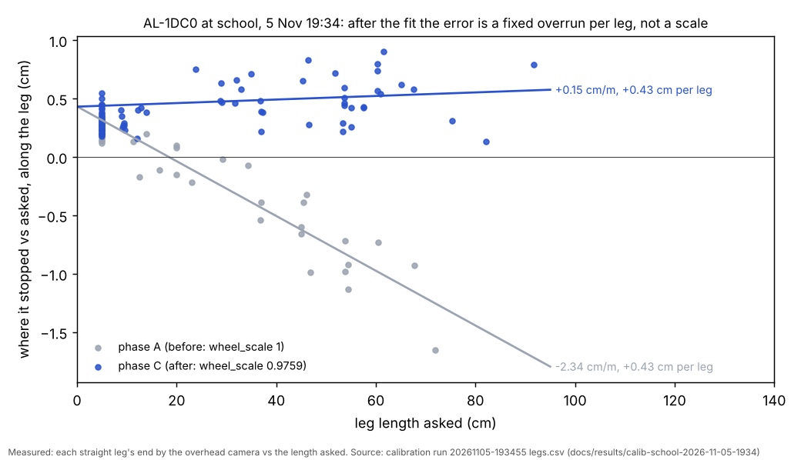
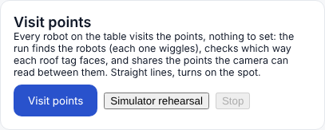
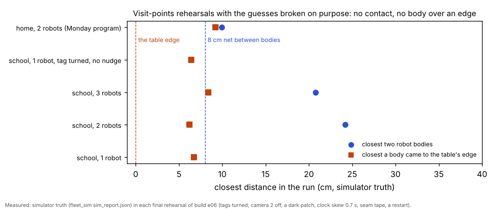

# Phase 1: multi-robot runs that observe, then trust (5 Nov evening, simulator and tests only)

## Premise

The first real school runs (5 Nov, AL-1DC0, one C920e at the TV end) went wrong wherever the code trusted a setting
instead of what it could see: the roof tag was stuck on 180 deg off (legs ran backwards, 1 cm from an edge); the camera
names defaulted to home's; the site assumed two cameras and gave a second robot zones nobody can see; the line sensors
took the seam's tape for an edge; the tag did not read at P11 or far up the table and the run ended instead of
narrowing; a downscaled frame read a tag the full frame missed; a robot woken from sleep restarted and refused to turn;
tag height was typed per site robot name; the run slept the robot at the end, wiping values it could not save. Nick's
decisions (5 Nov 20:28) for phase 1 of 3: one run for however many robots are on the table, found by the wiggle, each
tag's heading found by its first drive and checked all run long; the table shared over the area where tags actually
read; straight lines with turns on the spot for point visits; Measure's cameras over typed values; self-checks for each
of the evening's settings; a straight-line lost-tag recovery in missions with the others' paths reserved; a one-button
Visit points on Mission Control's Production screen; a simulator that breaks the guesses on purpose.

Added during the build by the coordinator: (a) the real 19:34 calibration's wheel fit "overshot" (find why with the real
legs); (b) Nick 20:46: every run type's robot-side safety layers (tilt stop, bottom-zone drop) switched on and read
back, a tilt or drop trip kept out and backed away from, never forward; (c) the 4-hour home free-roam analysis (Center
tilted 3.4 deg at the x = 0 edge for 64 min): pose disagreement re-seeds, a standing-tilt rule, moves "done" without
moving, reverses only when shown safe, cpu.csv in every run; (d) Nick 21:11: those last two replaced by evidence fusion
(3'), never repeating a failed action unchanged (3b) and swept-space evidence (4'); (e) Nick 21:14: a hard side-edge
invariant (the robot's possible-locations circle never overlaps the perimeter along any planned path) in every run
type, and home has no walls either.

**Measured, and where from.** Real data: the 19:34 calibration's legs.csv / fit.json (copied to
docs/results/calib-school-2026-11-05-1934/). Everything else is the simulator (fleet_sim robots, the tag picture
simulator with the real tag bridge, the point-fix camera) and unit tests; nothing touched a robot or a Pi. Firmware
2026-11-05d passed the stand-in syntax check (tools/fwcheck), as every firmware build here; no real Arduino compile.

## Data

### 1. The wheel fit did not overshoot: a fixed overrun per leg read as "cm per metre"

Each dot is one straight leg at school: grey before the fit, blue after; the grey line slopes (a scale error the fit
removed), the blue line is flat about 0.43 cm above zero (every leg ends the same few millimetres long).

| | phase A (wheel_scale 1) | phase C (0.9759) | source |
|---|---|---|---|
| along error = slope x length + offset | -2.34 cm/m x L + 0.43 cm | +0.15 cm/m x L + 0.43 cm | legs.csv, legs of 10 cm or more |
| true wheel scale (camera / counted) | fitted 0.9759 | C's own legs say 0.9765 | through the counted lengths |
| overrun at 5 cm/s / 10 cm/s | predicted from A: 0.32 / 0.49 cm | measured in C: 0.31 / 0.52 cm | stop_overrun (speed-split) |
| "signed cm/m" (the old report's figure) | -0.89 (-1.12 on drives only) | +1.31 | the report divided the fixed overrun by short legs |

**Why.** The robot stops when its own count reaches the asked length (minus a 0.15 cm tolerance), then rolls on:
about 0.3 cm at 5 cm/s and 0.5 cm at 10 cm/s. That is the same few millimetres on every leg, so "error per metre" is
large on a 5-50 cm leg and looks like a scale. Not double counting (the fit's coast term already separated it: 0.63 cm),
not wheel_scale applied twice (C's slope is flat), not the 5 cm finals (they were not in the scale fit). **Fixed:**
calib_run 2026-11-05h measures the overrun per speed in phase A and from phase B on sends each leg that much short
("stop lead", `--stop-lead off` keeps the old way); on the real C legs it takes the mean along error from +0.43 to
0.00 cm (test_stop_lead). The report now splits the distance error into its scale part (cm/m) and its fixed part (cm
per leg). The lead is kept on the Pi (stop_leads.json): firmware 2026-10-29b cannot save it. **Simulator case** that
reproduces it (`--sim-coast 0.08`, true wheel 0.976): fit 0.9787, C slope -0.15 cm/m with a fixed +0.23 cm per leg
and "+0.44 cm/m" in the old figure, the same pattern (smaller: the simulated coast is a pure wheel run-down).

### 2. What was built

| Part | Where | In one line |
|---|---|---|
| observe.py (new, shared) | tools/fleet/observe.py | every check below, pure functions, 20 tests |
| Robots found however many | wiggle_bind `--robots auto`, mission_run `--robots auto` | the camera counts the roof tags, the run waits for that many robots; slots Alpha, Bravo, Charlie ... |
| Tag heading | calib_run / wiggle_bind heading_nudge, tag bridge and facing check yaw_off, HeadingWatch in calib_run and run_plan | a 6 cm nudge (or a quarter turn first, if only sideways is clear) after each wiggle; every straight stretch checked after; two disagreeing stretches re-learn it |
| Readability | observe.ReadMap; mission_run run_readmap; run_plan learns it, saves readmap.json, the site keeps it | seeded from the camera models (whole roof in the picture, 14 px), earlier runs at half weight, learned from every robot's reads |
| Table sharing | observe.split_points; mission_run `--split auto` (production.split "halves" kept) | readable points only, cut along the table into equal runs, each to the robot standing nearest; homes where the robots were seen |
| Lost tag in missions | run_plan recover_blind | turn to face where it was last read and drive straight there FORWARDS (edge guard on), path checked against the edges (the invariant) and the others' next steps; points learned unreadable skipped |
| Safety layers | observe.safety_settings; calib_run arm_safety, wiggle_bind, mission_run guard_cmds, freeroam, run-fleet-pi.sh | tilt_stop_deg 5, tilt_ms 300, safe_lift 1, edge_bot_cm 11, safe_edge from the site (school 2) set and read back; not read back = not moved |
| Trips | calib_run after_trip, run_plan trip_back_off, freeroam tilt_trip | a keep-out at the nose, a straight reverse over its own trail or camera-shown room, else hold; firmware 2026-11-05d allows only that |
| Firmware 2026-11-05d | motion.h, pose.h, follow.h, e02.h (+ simulators) | a tilt ends the follow step (not the run); forward drives and turns refused while tilted; a straight backward drive allowed |
| Four protections (3', 3b, 4', invariant) | observe.move_outcome / FailMemory / Trail / back_out_plan / path_ok; freeroam, run_plan, calib_run | below |
| Restarts | freeroam on_boot, calib_run (refused leg), run_plan (existed), wiggle_bind / calib (existed) | a new boot id: safety layers and compass check again, automatically |
| Stay awake | calib_run (`--sleep-at-end` kept), freeroam (`--sleep-parked` kept), Mission Control idle sleeper | robots sleep after 30 min with no run |
| Cameras | camnames.resolve | one plugged camera is the overhead whatever its name; two with wrong names both used, said |
| Detection | tagcore.WindowTracker | a wanted tag missing after the full picture: searched again at half size |
| Surface marks | observe.edge_trip_kind; run_plan | a line-sensor trip with the camera well inside the table: a surface mark, logged; that robot's line cue off (bottom zone stays) |
| Measure | site_fit measure_trust | switch built; default left at "typed" (section 5) |
| Mission Control | Production screen | a Visit points card: one button, a simulator rehearsal, a Stop that turns red |
| cpu.csv | calib_run, freeroam (missions had it) | the heat tracker works for every run |
| Simulator breakers | fleet_sim `--tape`, `--stop-coast`; tag_cam tag_yaw / dark / clock_skew_s; robot.py wheel-over-edge tilt; mission_run `--sim-bind --sim-tag-yaw --sim-dark --sim-clock-skew --sim-robots` | the real binding runs in dry runs too |

The new card on Mission Control's Production screen: one button runs every robot on the table; Stop is always there.

### 3. The four protections (Nick 21:11 / 21:14) as built

- **3' Move outcome by evidence.** move_outcome votes with the wheels (weight 1: they can spin), the accelerometer
  (1.5), the gyro (1.5), the front range against the expected change (2), the line sensors (0.5) and the camera only
  with a fresh fix (3). Physical impossibility (faster than 30 cm/s) decides alone. Own sensors agreeing with the camera
  blind: accepted, bubble grown. Wired: free roam (RAW rows: ax, dC_cm, lineC), run_plan (own pose, RAW, camera),
  calib_run (its LEG record, camera).
- **3b Never repeat unchanged.** FailMemory per robot: the same kind, direction and length (within 25 %) from within
  5 cm of a failure is not planned again; 3 failures within 8 cm = a hazard (keep-out for everyone, re-seed from the
  camera or a find-me, a full stop said).
- **4' Swept space by evidence.** back_out_plan: (a) back along its own breadcrumb trail (no camera), (c) a fresh camera
  fix showing room behind, (d) turn on the spot (only if its circle is clear) so the front sensors check, then forward,
  (e) hold. Free roam's back-off / reverse rungs and the trip back-offs use it; a tilted robot cannot turn, so (d) is
  not offered then.
- **Side-edge invariant.** path_ok: the circle of half diagonal (6.72) + uncertainty (camera error, bubble, the
  camera's staleness x speed) + 1 cm never crosses a side or keep-out at any sample of a planned move (turns included:
  the circle covers any heading); a robot already overlapping may only shrink it. Free roam: every move (feasible,
  curve_ok, back_move). run_plan: the blind watch stops a robot whose circle crosses; the recovery is checked with it;
  planned paths keep 11 cm (planner margins) > 8.7 cm by construction. Calibration: the legs' safety check keeps 13 cm +
  the leg's error, and every leg is aimed from a fresh camera pose. Every side is a drop at home too (site walls false).

**The named cases, driven through the free-roam controller as the robots' records drive it**
(tests/test_e06_edges.py, 6 cases, and the pure checks in tests/test_observe.py):

| Case | What the controller did |
|---|---|
| Camera washed out (no fixes) while standing near the x = 0 edge after driving 30 cm towards it | backs off along its own trail (no camera needed); with no trail behind it, no reverse at all |
| A firmware that answers every move "done" at once (Left's 4,289 reverses) | "did not move: not physically possible", the same reverse not repeated; the third at that spot = a hazard kept out for everyone and a full stop said |
| Wheels slip (its own pose says 14 cm; no jolt; front range unchanged; camera blind) | "did not move" (score from wheels, accelerometer, front range) |
| Center's shallow approach: 33 cm at 27 deg to the x = 0 edge, ending 5 cm from it | never planned (its circle would cross the edge on the way); turning and going inwards is |
| The clock ratchet: every fix 1.3 s stale | the circle grows 13 cm: from 25 cm off the edge only moves inwards are allowed |
| Standing tilt 3.4 deg for 3 s (a wheel over the edge) | "tilt stop" event, keep-out, its next move a back-off over evidence or it stands, never forward |

### 4. Rehearsals (simulator)

Every school rehearsal broke the guesses at once: roof tags turned on their robots (Alpha 180 deg, Bravo 90, Charlie
-90), camera 2 switched off, a patch the camera cannot read (x 150-200, y 0-50 cm), the camera's clock 0.7 s off,
seam tape across the table at x 99 cm, and Alpha restarting at 70 s (its settings and compass check gone). The robots
were found by the real binding code (`--sim-bind`), so the counts, wiggles, nudges and compass checks are the real
ones. Evidence: docs/results/e06-rehearsals-2026-11-05/ (each run's log, sim truth, split, summary).

| Rehearsal | Found / tags | Points: shared, done, skipped (why) | Contact | Closest bodies | Closest body to an edge | Run ended? |
|---|---|---|---|---|---|---|
| School, 1 robot | 1; tag -180 found | 16 readable, 16 done; 24 skipped at the start (camera does not read there) | no | - | 6.7 cm | no (Alpha's restart: re-checked and calibrated, held once more for 36 s, back in) |
| School, 2 robots | 2; -180 and +90 found | 16 (8 + 8), 15 done; 24 skipped at the start, 1 in the run (no room to turn there) | no | 24.2 cm | 6.2 cm | no |
| School, 3 robots | 3; -180, +90, -90 found | 18 (6 + 6 + 6), 18 done; 22 skipped at the start | no | 20.8 cm | 8.4 cm | no |
| School, 1 robot, tag turned 180 and NO nudge (the heading watch alone) | - | 20, 20 done | no | - | 6.4 cm | no: HEADING RE-LEARNED after two stretches |
| Home, 2 robots, Monday program | (lights) | - | no | 9.95 cm | 9.2 cm | no |
| Home, 2 robots, seam tape across the board | - | - | no | 16.1 cm | 9.9 cm | **yes**: both robots' line sensors hit the tape at once, logged as SURFACE MARKS; then the Monday program found no route for 30 re-plans ("out of re-plans"). The same happens with surface marks switched off (old way), so it is the program's re-plan near an edge, not this build (phase 3) |
| Calibration, 2 robots (AL-1DC0 tag 180, AL-2B7F tag 90, coast 0.08 s, tape, asleep) | 2; both found | P01-P20 quick tours | - | - | middle 20.8 cm from an edge (12.3 cm from a keep-out) | no; fits wheel 0.9759 / 0.9755 (true 0.976), gyro 1.091 / 1.092 (true 1.086); stop lead applied, C's fixed part per leg -0.4 to +0.2 cm (7-10 legs a tour: the quick tours are thin) |
| Calibration, 1 robot, tag 90, unreadable patch at P13 | 1 | P13 skipped after 4 losses, then by the map | - | - | - | no (before: "lost the roof tag on the way to P13 four times: stopped") |
| Free roam (home board, 3 robots, 6 min, firmware 11-05d) | safety layers read back x 3 | - | 0 contacts | no reflex event let circles touch | - | no; moving 97-99 %, 10,404 candidate moves refused by the side-edge invariant (the menu picks others) |

Each row is one final rehearsal: the blue dot is how close two robot bodies came, the orange square how close a body
came to the table's edge (simulator truth); every dot is right of its dashed line.

**Found by the rehearsals and fixed (each re-run after):**

| Found | Fix |
|---|---|
| The facing check turned robots to match a turned tag (the bridge knew the offset, facing.py did not) | facing.py applies the tag offsets |
| A robot rejoined on the camera's last spot, 36 cm stale, and came to 5.3 cm of another robot | rejoin only on a fresh fix (the newest drained first) |
| After a restart a robot's heading was 105 deg off the camera's while its position agreed; it refused every fix and drove to 9.5 cm of the x = 0 edge, stopped by its drop check | the camera guard checks heading (at the picture's time) as well as position |
| A drop trip placed an 80 cm strip across the middle of the table (the robot's own pose was off) | the edge goes where the camera has the robot; interior trips are a small keep-out |
| A back-off after a drop was halted by the camera guard | the guard leaves a backing-off robot alone |
| Recovery steps were taken for "old steps" (a re-plan every 5 s) | its own steps are recognised |
| A recovery ended 1 cm inside the unreadable patch | it drives 10 cm past the last read spot |
| A 0.4 cm step judged "did not move" made re-plans repeat | moves under 3 cm are not judged |
| Trip / hazard obstacles had a source the map refuses: the run crashed at its end | valid sources |
| The new checks read `t_run` before the run started: the home run crashed at its start | guarded |
| Robots lost at the picture's corner (tag at 3 sizes from the border) | the readability seed keeps 5 tag sizes inside |
| The calibration ended when it lost the tag 4 times on the way to one point | the point is skipped, the tour goes on |

The full fleet suite then found five more, all fixed (rerun: 645 passed, 9 skipped): the binding wiggle averaged two heading readings either side of 180 deg as 0 (a +90 turn read as -91, robot not bound: now averaged round the circle; an old fault the new start headings exposed); free roam declared `--attended` twice (the ladder's flag, same meaning: kept once); the surface-mark check read the coordinator's settings where a test had none; two tests still expected the old park spots and the old blank tag height.

### 5. Measure: cameras over typed values (built, not switched on)

In site_fit's own simulator (seed 2, 14 tag spots, 8 stickers), "cameras" (typed values as a 5 cm seed, the tags'
printed size as the scale) made the table 394.0 x 166.0 cm (true 396.2 x 167.6) and its worst sticker 4.4 cm off; the
tape-trusted fit made 396.3 x 167.5 and 2.4 cm. The blur that reads a tag 1.5-3.5 % small (2 Nov report) is why: the
tape fixes the scale. Observe-then-trust says the evidence wins, so the switch exists (site `measure_trust`:
"cameras" / "typed") but the default stays "typed", and every typed value is still checked against the cameras and a
disagreement over 1.5 % said (as before). Question 1.

### 6. Tag heights and scale solved by the program (Nick 21:44): what is done now, and the design for phase 3

**Now.** Measure already fits each roof tag's height (and tilt) by its TAG ID wherever two cameras see it (roof_cal,
site_fit: the rehearsal's setup fitted 5.9 +- 0.6 cm and 7.2 +- 1.6 cm for a true 6.0 cm, typed 6.19); the binding
carries a tag's fitted height to whichever robot wears it, so a height no longer belongs to a site robot NAME. The
typed 6.19 cm is now the one seed for every robot (`tags.height_cm`): a third robot no longer falls back to the 6.0
placeholder, and AL-1DC0 no longer borrows "Alpha's" value. With ONE camera (school tonight) Measure cannot pin a
height and the seed is used, said in the setup words, as before.

**Why not more in phase 1 (measured / worked out):**

| Source Nick named | What it can give | The catch |
|---|---|---|
| Printed tag size (8 cm) vs apparent size | range along the camera ray -> height: h = Hc - k (Hc - h_used) / size_ratio | needs the blur factor k to 0.3 % and the camera height Hc to 2 cm for +-1 cm; in the rehearsal Measure's camera height came out 218 cm for a true 200 cm, and k 0.985 (both fitted, not known) |
| Roof square 9.5 cm, body size | the same as above with a bigger target | the roof's edge is low contrast in the pictures (not detected today) |
| Parallax while turning on the spot | a tag OFF the axle traces a circle whose apparent radius scales by (Hc - h_used)/(Hc - h) | the school tags are centred on the axle (offset 0.1 cm in the rehearsal): no circle, no information |
| Known-length drives after the wheel fit | every camera position scales about the camera's nadir by (Hc - h_used)/(Hc - h): a uniform scale | identical to a wheel_scale error: the fit cannot tell them apart (circular) |
| Reference tags on the table (height 0) | k and the camera pose at height 0 | they are 12 cm tags: their blur is not the 8 cm tags' blur |
| A robot standing on a typed sticker | its camera position is displaced from the sticker radially (about the nadir) by (h - h_used) r / Hc | hand placement +-1 cm gives +-1 cm per placement; several stickers average it |

**Design for phase 3 (one fit, with uncertainty):** a single least-squares fit per run over every robot's tag
height h_i and the camera's height and pose, from (1) robots standing on typed stickers at the start and at parking
(radial offsets about the nadir), (2) the tag-size ratio with the blur modelled as a fixed corner inset in pixels
(fitted from the reference tags, applied to the 8 cm tags by size, not as a ratio), (3) two-camera parallax wherever
camera 2 sees the robot, and (4) the off-axle circle when a tag is mounted off centre; the typed 6.19 cm as a prior of
+-1 cm. Expected (worked out, not measured): +-0.5 cm with 3 stickers and 2,000 size reads; the fitted height then
feeds the bridge for the rest of the run and is kept per tag on the Pi. Effect today: at the school geometry a 1 cm
height error moves a robot's camera position 0.8-2.2 cm (x 0-200 cm), inside the 13 cm edge margin.

### 7. Jay-Sun's agreements of 5 Nov: how each is honoured

| Agreement | In the code |
|---|---|
| Robots drive at school only with Jay-Sun in the room | site `attended_only`: free roam refuses without `--attended`; calibration and missions say it at the start; Mission Control's Visit points asks "Is he here?" |
| Experiments: camera = ground truth; odometry never camera-corrected | odometry_raw.csv is rebuilt offline from the robots' RAW wheel and gyro rows (run_exports.py), never from the robot's own (fused) pose, so no fpose, re-seed or recovery of this build can enter it; the robot's fused pose stays in follow.csv as before; the shakedown stays a no-camera run (tracking none) |
| Clock alignment from timestamps and the sync wiggle only; no RFID | nothing in this build reads RFID; the RFID tools stay off |
| Robots and tags (Alvik 3 = AL-1DC0 tag 2, Alvik 4 = AL-EB54 tag 3, Alvik 5 = AL-E7DC tag 4; Alpha 0, Bravo 1; 5 spare) | typed pins in the site as first guesses; every run's check wiggle confirms the tag that turns, and a different one re-binds it, said |
| Sticker P16 is lost | runs drive to typed coordinates and need no sticker; the run says P16 is missing |
| Hourly sleep check-in at school (AL-1DC0 died on the 10-minute one) | site `sleep_checkin_min` 60: the idle sleeper and `--sleep-at-end` use it (the robots stay awake after a run by default) |
| One console at a time on UDP 5005 | the run stops before anything moves and says another program (Jay-Sun's console) is listening, and to ask him |
| Lighting fixed across experiments | the tag bridge logs each camera's picture brightness (brightness.csv, every 2 s) and says LIGHTING CHANGED at 15 % from the first minute |
| Half the table needs Dr. Sodhi's OK | an experiment whose points the cameras cannot read is refused, naming the points (`--allow-half-table` with that OK) |
| Table frame (0,0) at the A3 corner | unchanged (the reference tags' frame) |

## Conclusion

- The visit-points run now works with however many robots stand where the camera sees them: in the simulator 1, 2 and 3
  robots were found, every turned tag (90, 180, -90 deg) was found by its 6 cm nudge, and with one camera the 16-18
  readable points were shared and done with no contact (closest bodies 20.8 cm, bodies 6.2 cm or more from the
  edges), the unreadable half skipped with its reason, and no run ended. Without the nudge, the heading watch found a
  180 deg tag after two 8 cm stretches.
- The calibration's "overshoot" was a fixed 3-5 mm overrun per leg, not the wheel fit (C's own legs give the same
  scale, 0.9765 vs 0.9759); the stop lead removes it on the real legs (+0.43 -> 0.00 cm mean), and the report now
  shows scale and fixed parts apart.
- Every run type sets and reads back the robot's tilt stop and drop check; a tilt or drop is kept out and backed away
  from only over its own trail or camera-shown room; a robot whose pose (or heading) disagrees with the camera is
  stopped and re-seeded; moves "done" without moving are failures, never repeated unchanged; no planned path lets the
  robot's possible-locations circle cross an edge.
- Rehearsals found 12 real faults in the new code and the old flows around it (above); each was fixed and re-run.
- Left open: the Monday program's re-plan after a tape crossing (home), the planner-reserved recovery corridor, the
  height fit (designed), Measure's cameras-win (built, off on evidence).

## What's next

1. Pull on the Pi (school runbook step 3, `git pull`), then the school setup (step 4) as usual.
2. Reflash to 2026-11-05d where possible (the tilt behaviour; older robots still run, with their tilt stop ending the
   step or run as before). Robots on 2026-10-29b (AL-1DC0) need `--min-firmware ""` as on 5 Nov.
3. Calibrate every robot (P09 / P01 / P06), then Visit points with every robot on the table, Jay-Sun in the room.
4. After the session: upload, heat tracker, and the brightness.csv / readmap.json / did_not_move counts reviewed.
5. Phase 2: Mission Control's one-button screens; phase 3: the full audit, one fused pose, the height fit (section 6).

## Not built as asked

- **Measure "cameras win"**: built as a switch, left off (section 5, question 1).
- **Lost-robot recovery with the others' paths reserved in the planner**: the recovery checks the others' current
  spots and next planned steps; the planner does not reserve the recovery corridor for them (question 2).
- **Tag heights solved by the program**: designed, not built (section 6); one seed for every robot now.
- **Rehearsing a trip in every run type on the full chain**: the edge-miss mission run never reached an edge (the
  heading watch turned it round first); trips are proven in the controller cases (free roam), in the 2-robot rehearsals
  (two real drop trips: one exposed the back-off being halted by the camera guard, one the 80 cm interior strip;
  both fixed) and in the observe.back_out_plan tests.
- **Free roam at school**: not rehearsed on the school table (home board only); it refuses to start there without
  `--attended`.

## Rigid assumptions found, and what replaced them

| Assumption (where) | Replaced by | Switch kept |
|---|---|---|
| The roof tag faces the nose (every tag reader) | the nudge's measured offset per tag, re-learned by the heading watch; bridge, facing check, calibration Eye | none needed (offset 0 when it agrees) |
| The run's robots are the site's two (mission_run `--robots`, wiggle_bind slots) | as many as the camera counts tags and as answer | `--robots Alpha,Bravo` still works |
| Zones 1-2 / 3-4 split at x = 78 in (production.zones) | readable points split between the robots found | production.split "halves" / `--split halves` |
| The camera reads to x 110 cm (`--view-x-max`, VIEW_X_MAX_CM) | ReadMap (camera model, earlier runs, this run); the nudge ignores the typed view limit where the robot is seen | `--view-x-max` kept |
| Camera 2 present (site cameras) | site's side.use false read; missing model = one camera | cameras.side.use |
| Camera names (camnames) | what is plugged in | cameras.json "observe": false |
| A line trip is an edge (edge guard) | camera distance from the edge decides; surface mark logged, line cue off for that robot | site safe_edge |
| Robots wake ready (calibration, free roam, missions) | boot id watched: safety layers and compass check again | - |
| Sleep at the end | stay awake, idle sleeper 30 min | `--sleep-at-end`, `--sleep-parked`, site idle_sleep_min |
| The full frame finds every tag | downscaled retry | tagcore.DOWNSCALE_RETRY 0 |
| A move reported done happened | evidence fusion | - |
| Reversing near an edge is fine after a front stop | trail / camera evidence or turn-then-forward or hold | - |
| The board's sides at home are walls | every side a drop (site walls false) | site "walls": true |
| The fixed stop overrun is a scale (calibration report) | split into scale and fixed parts; the stop lead | `--stop-lead off` |
| Measure's typed size is right | checked, switch built, default kept typed on evidence | site measure_trust |

**Left for phase 3's full audit and motion fusion**: tag height per site robot name (still typed: AL-1DC0 got Alpha's
6.19; the roof check measures it with two cameras only); the free roam's start (ladder L0/L1) still assumes home's
three names; the planner's fixed margins (11 cm) are not yet scaled by live uncertainty (the invariant is checked on
top); the accelerometer threshold and tilt numbers have no bench data; the camera clock is aligned in the free roam
and checked in missions by the camera guard, not in the calibration; feel-out still assumes rectangular tables; the
experiments (e1-e4) still use the fixed halves (an experiment's design); wheel slip is judged per move, not mapped
(discover-not-map: own_vs_cam rows exist); one fused pose (tag + odometry + gyro + accelerometer) is still several
estimators side by side.

## Sweep 1: new tests that may now be necessary

- Bench (DOE, needed before trusting the numbers): a wheel over a 1 / 2 / 3 cm drop, standing and driving: the
  standing tilt (2.5 deg / 2 s) and the accelerometer's rolling jolt (0.03 g); the firmware 2026-11-05d backward drive
  while tilted (does it come back level?).
- Board: firmware 2026-11-05d on one robot: a follow D step forwards while tilted must be refused at once; a rev 1 D
  step must run; the e02 `go -6` must run while tilted and `go 6` must not.
- Board, school: the heading nudge with the tag at 0 / 90 / 180 deg; the Visit points button with 1, 2, 3 robots
  (camera 2 off); a robot placed where the camera cannot read it (it must be refused or kept out, not driven).
- School: the readability map against the real room light (it seeds from 14 px; the real limit was ~100 cm in x).
- Simulator: the readability seed from the school's REAL camera model (the dry runs use two straight-down simulated
  cameras, not the end-mounted C920e); the dark-patch cases with the patch across the table's middle.
- Calibration on the board: the stop lead (C's fixed error should fall from ~0.4 cm to ~0 per leg).
- Free roam, real run: evidence fusion counts (did_not_move per hour), reverses refused for lack of evidence, the
  invariant's refusals per hour (counts in the run's state), and whether robots still roam 95 %+ of the time.
- Mission Control: the idle sleeper on the Pi (a real 30 min idle).

## Sweep 2: possible inaccuracies in what this relied on

- **Chosen, not derived** (each marked in code with a DOE note): NUDGE_CM 6, SNAP_TOL 20 deg, WATCH_SEG_CM 8,
  WATCH_CONFIRM 2, CELL_CM 20, READ_OK 0.6, TAG_PX_MIN 14 (from two observations at school), IDLE_SLEEP_MIN 30,
  STAND_TILT 2.5 deg / 2 s, ACCEL_JOLT 0.03 g, LINE_CHANGE 15, PHYS_MAX_CMS 30, FailMemory 5 cm / 25 % / 3 within
  8 cm, BACK_OFF_CM 10, trip keep-out 5 cm at 5 cm ahead, EDGE_MARGIN_CM 1, RECOVER_BEYOND_CM 10, TYPED_SEED_SD 5 cm,
  LEAD_MAX 1.5 cm, the evidence weights (wheels 1, accelerometer 1.5, gyro 1.5, front 2, line 0.5, camera 3).
- **The simulator is not the school.** Its two cameras look straight down over each half; the real one looks down the
  table's length from the TV end, so "where tags read" differs (the dry runs drop camera 2 to approximate). The dark
  patch, tape and clock skew are mine. The wheel-over-edge tilt (3.5 deg) is a model of Center's 3.4 deg.
- **Stop lead**: from one robot's one run (AL-1DC0, 38 phase-A legs); its speed dependence (0.3 / 0.5 cm) may differ on
  other robots and surfaces; it is measured per run, so it adapts, but only in the calibration (missions do not use it).
- **The heading nudge** needs 6 cm clear both ways (or sideways); a robot boxed in gets no nudge and relies on the
  watch (two 8 cm stretches: up to 16 cm driven the wrong way, inside the planner's margins).
- **Evidence fusion on real robots**: the accelerometer's units and noise in RAW rows are taken from the firmware's
  header (ax in g); no real slip has been recorded to check the rule.
- **Readability learned per 20 cm cell**: a point in a cell no robot has visited keeps the seed's guess.
- **The lost robot's recovery** checks the others' current spots and their next 4 planned step ends, not a full
  time-reserved corridor in the planner (Not built as asked).
- **Measure**: the cameras-versus-tape comparison is from site_fit's own simulator only.
- The rehearsals' sim robots restart only where asked; a restart during a turn or during the nudge was not rehearsed.

## Questions for Nick

**Substantive**
1. Measure: the switch for "cameras over typed values" is built but left on the tape, because in the simulator the
   cameras alone were worse (table 2 cm short, a sticker 4.4 cm off, against 2.4 cm). Keep the tape as the default, or
   switch to cameras now? (Recommended: keep the tape until a real Measure shows the cameras' own size within 1 %.)
2. A lost robot in a mission now drives forwards to where it was last read (+10 cm), checked against the edges and
   the others' next steps, but the others' plans do not wait for it. Enough for Monday, or do you want the planner
   to reserve that path first (phase 3)?
3. No tilt bench test (Nick 21:38): the standing-tilt (2.5 deg for 2 s) and accelerometer (0.03 g) numbers stay as
   chosen numbers with a DOE note in observe.py. Should the first real school session's raw.csv be used to re-pick
   them (a read-only check after the run), or leave them until a DOE is scheduled?
4. The stop lead exists only in the calibration. Use it in missions too (each robot's lead from its last calibration,
   kept on the Pi)?

**Other**
5. Extra robots are named Charlie, Delta, Echo ... in the run (their WiFi names stay on the robots). OK?
6. A surface mark switches that robot's line sensors off for the rest of the run (the bottom zone stays on). OK, or
   only near the mark?
7. Robots sleep after 30 minutes with no run (Mission Control on the Pi). A different wait?
