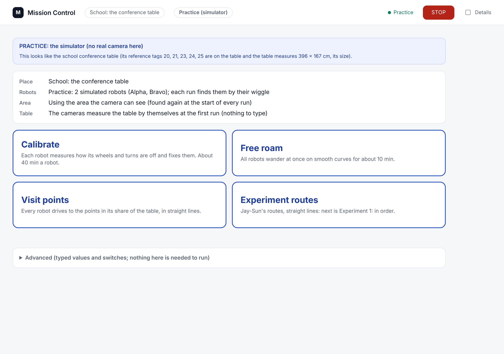
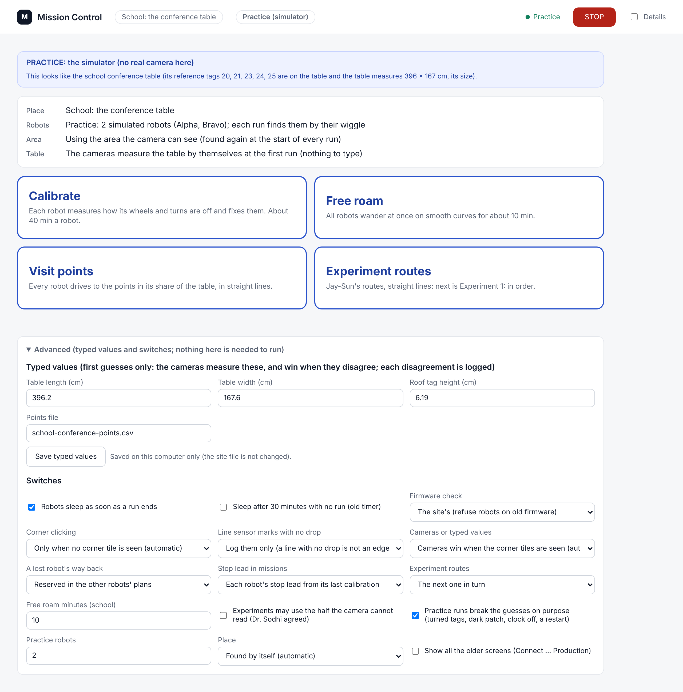
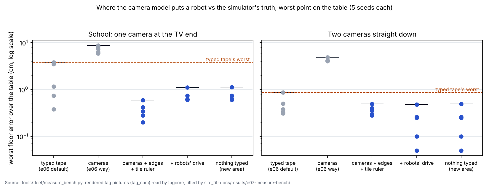
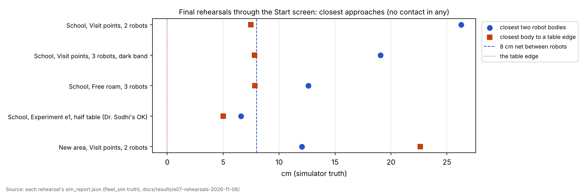

# Phase 2: Mission Control a newcomer can run (6 Nov morning, simulator and tests only)

## Premise

After phase 1 (e06) every run worked for however many robots were on the table, but starting one still meant knowing
which screen, which card and which setting. Nick's decisions for phase 2: one Start screen with a big button per run
type (Calibrate, Free roam, Visit points, Experiment routes) that works for any number of robots, found and named by
their wiggle (Charlie, Delta, Echo after Alpha and Bravo); table sharing decided by what the cameras see; curves for
free roam, straight lines with turns on the spot for Visit points and Experiment routes; one Mission Control that knows
by itself whether it is at home, at school or in a new area; nothing typed, every typed value moved to a collapsed
Advanced section; automatic mapping at least as accurate as the typed values; cameras win over typed values, with the
disagreement logged; old firmware still refused, its override under Advanced. His answers to e06's questions: a lost
robot's recovery path reserved in the other robots' plans; missions use each robot's stop lead; line-sensor trips with
no drop logged, nothing else; robots sleep as soon as a run ends (switch in Advanced, the 30-minute timer kept as an
option); standing-tilt and accelerometer numbers left alone.

**Measured, and where from.** Everything below is the simulator (fleet_sim robots, the tag picture simulator with the
real tag bridge, rendered tag pictures read by the real detector) and unit tests. Nothing touched a robot, a Pi or the
network. Rehearsals ran the real Mission Control page in a browser (Playwright), each in its own network namespace.

## Data

### 1. The Start screen

The page someone new sees: where it is, how many robots, which part of the table it uses, the four buttons, and the red
STOP at the top right.

| Part | In one line |
|---|---|
| Place | `site_detect.py` scores every known site against the evidence: the corner tiles in the picture (strongest), the measured table, the cameras plugged in and their names, this computer's name, the site used last (weakest). A clear winner is used; nothing close is a new area with a site of its own (in `~/.config/mirlt/sites-local`, never in the repo), with points laid out on the measured table (30 cm grid, 17 cm in). Pinning a site by hand stays (Advanced; `./run-fleet-pi.sh site <name> pin`). |
| Robots | before a run: the roof tags the camera sees (`The camera sees 2 roof tags`); during and after: the names the wiggle gave (`Found 2 robots: Alpha, Bravo`) |
| Area | the readable area the last run learned (`Using the area the camera can see: about 150 of the table's 396 cm length`) |
| Table | `Table measured by the cameras: 396 x 168 cm`; a typed size that differs is said and logged |
| Buttons | grey with the reason when a run cannot work there (home has no points: Visit points and Experiment routes grey) |
| Status | plain words from the run (`Naming each robot by its wiggle`, `Visit points is running.`, points done, its last lines) |
| STOP | on every screen: stops the page's run (its own Ctrl+C) and, on the robots, broadcasts `stop` to every robot (stop_all.py) |
| Advanced | collapsed: typed values (table, tag height: saved on this computer, laid over the site file), the firmware override, corner clicking, surface marks, cameras vs typed, half-table experiments, recovery reservation, stop lead, experiment choice, roam length, practice settings, the site pin, and "show all the older screens" |
| Practice | with no real camera (or `--sim-room`), every button runs the simulator with the guesses broken: tags turned 180 / 90 / -90, a dark patch, the camera's clock 0.7 s off, the first robot restarting 70 s in |

What each button runs:

| Button | Roof-tag site (school, new area) | Home (lights) |
|---|---|---|
| Calibrate | calib_run.py, every robot found, as before | the ladder's L0 + L1 (find by lights, calibrate) |
| Free roam | every robot wanders over its share of the readable points in a random order on curves (`mission_run --roam-min`, about 10 min) | freeroam.py (curves; until 10 % battery or 4 h) |
| Visit points | as e06 (stop-turn-drive) | grey: no points on the board |
| Experiment routes | Jay-Sun's next route (e1 to e4 in turn; shakedown under Advanced), stop-turn-drive; 2 robots: his halves exactly, other counts: the table cut into that many runs | grey |

Advanced, opened: every typed value and switch lives here; nothing in it is needed to start a run.

### 2. Automatic mapping against the typed tape

The problem from e06: the cameras alone (4.4 cm) were worse than the typed tape (2.4 cm). The cause was not the
cameras' geometry but how a tag's size was read. Found and fixed:

| Found | Fix | Effect (simulator) |
|---|---|---|
| A blurred square's corners come out inside it: the detector read 8 cm tags 2-8 % small, so a table measured by the tags came out large | `tagcore.refine_edges`: each corner where the square's four edges cross, each edge where the grey level is half-way between the black border and the white margin (switch `tagcore.EDGE_REFINE`) | a drawn square: 0.2 % off (before 3-7 %); 12 cm tiles 0.4 % |
| The simulator drew every tag 0.46 % large (texel centres put on the roof's corners) and squeezed by the roof's rounding | `tag_cam` draws the roof's outer edges at its corners, at the texture's own size | tiles read from their edges 1.000 straight down |
| The robots' 8 cm tags have a 0.66-cell white margin: far and small, even their edges read 1-1.5 % small | with corner tiles read, the tiles' printed size is the ruler, and the roof reads' corners are fitted as sitting a fixed number of pixels inside (one number, 0 +- 1 px; `site_fit.INSET_FIT`). The first try (dropping reads under 5 px a cell) was better at school (0.59 against 1.11 cm) but broke two geometric cases (a 15 deg roof read 28 deg; one camera 2.1 cm); kept as the switch's other side | school worst 1.11 cm with the drive, under the tape's 3.80 |
| Two cameras straight down over a small table (the new-area room): the roofs' fitted heights (3.2 / 3.9 cm for 6.2) and the cameras' height (126 / 108 cm for 200) slid together; a robot ended 48 cm off | when the cameras' height with the roofs fitted is more than 25 % from what the flat tiles say, the roofs are held at their typed height and the fit is made again, said | 202 / 210 cm, robots on their points within 1 cm |
| The school's far corner tiles (21, 22) do not read from the TV end: the fit refused to run without a typed size | a far side nothing fixes is held at the typed seed, else a 150 / 120 cm guess, and said; the runs keep to the readable area | the fit runs with nothing typed |

Each dot is one simulated room: how far the camera model puts a robot from where it truly is, at the worst point of the
table; lower is better, and every blue dot (the e07 cameras) sits at or under the dashed line (the typed tape's worst).

| Setup (5 seeds each) | typed tape (e06 default) | cameras, e06 way | cameras, e07 (still robots) | e07 + drive | nothing typed |
|---|---|---|---|---|---|
| School: one camera at the TV end, worst floor error, worst seed / mean | 3.80 / 1.92 cm | 8.68 / 7.29 | **0.59 / 0.37** | 1.11 / 0.74 | 1.12 / 0.74 |
| Two cameras straight down | 0.87 / 0.48 | 4.85 / 4.25 | **0.49 / 0.37** | 0.48 / 0.23 | 0.49 / 0.23 |
| Table width error, worst (school / two cameras) | 0.01 / 0.06 (typed = truth) | 3.28 / 4.36 | 0.27 / 0.35 | 0.48 / 0.42 | 0.48 / 0.43 |

Source: `tools/fleet/measure_bench.py` (rendered pictures through tagcore and site_fit), `docs/results/e07-measure-bench/`.
Parity is reached: the cameras alone are at least as accurate as the typed tape in both setups, and the typed tape in
this simulator is the exact truth (a real tape is not). One more honest number: in site_fit's own geometric simulator
(no blur at all, the typed size the exact truth) the tape-trusted fit stays the tighter one (0.6 against 0.8 cm worst,
test_ref_tags); with blur the cameras win, which is why the default is "auto" and not "cameras" everywhere. One limit, said plainly: at school, with one camera, the far
corner tiles do not read, so the table's **length** comes from the typed value as a seed (or a guess with nothing
typed). The camera model that places the robots does not depend on it, and the runs use only the readable area.

**Default now** `measure_trust: auto`: the cameras win when the corner tiles are read (school), the typed tape when no
tile is read (the roof tags alone are not a good enough ruler: e06's numbers stand there). Every typed value the
cameras disagree with is appended to `tagcal/disagreements.jsonl` (time, what, both values, which was used).

### 3. Nick's answers to e06's questions, as built

| Answer | Built | Switch kept |
|---|---|---|
| A lost robot's recovery path reserved in the others' plans | run_plan: its corridor (half diagonal + its blind error + 1 cm, either side and past each end) goes on the map and the robot is taken out of the plan while it drives, so the others re-plan round it; seen again it rejoins, not seen it is held where it ended | `--recover-reserve off` (e06: their next 4 steps checked) |
| Missions use each robot's stop lead | mission_run passes each robot's lead from the Pi's stop_leads.json (by WiFi name through the binding); run_plan sends forward drives that much short (interpolated by speed; legs under 3 cm, reverses and others as planned; at most 40 % of a leg, 1.5 cm) | `--no-stop-lead`, Advanced |
| Surface marks: log, do not act | a line trip with no drop is logged (where, the camera's distance from the edge, its age) and the robot re-plans from where it stands; the line sensors are not touched and nothing is mapped | `--surface-marks act` (e06), `off` (before e06), Advanced |
| Sleep right away when a run ends | Mission Control sends every robot `sleep` (the site's check-in) as soon as a real run it started ends; practice runs never | Advanced: sleep when done (on), the 30-minute timer (off) |
| Old firmware refused; override under Advanced | unchanged refusal; Advanced "No check" = the old `--min-firmware ""` (saved per computer) | |

### 4. Rehearsals (simulator, the real page clicked in a browser)

Every rehearsal ran the real Mission Control (`--sim-room`) in a browser: the button on the Start screen was clicked,
the run watched to its end, the page photographed. Practice runs broke the guesses: roof tags turned (180 / 90 / -90
deg), a dark patch (or a dark band across the readable area), the camera's clock 0.7 s off, the first robot restarting
70 s in, stop leads seeded. Evidence: `docs/results/e07-rehearsals-2026-11-06/` (each run's summary, coordinator log,
simulator truth; the failed tries kept beside, named by what went wrong).

| Rehearsal (button) | Place found | Robots found | Points: shared, done, skipped | Closest bodies | Closest body to an edge | Ended |
|---|---|---|---|---|---|---|
| School, Visit points, 2 robots | school | 2 (tags 180 / 90 found) | 10 + 10, 20 done; 20 skipped (camera does not read) | 26.3 cm | 7.5 cm | done (restart handled; stop lead sent) |
| School, Visit points, 3 robots, dark band x 70-110 | school | 3 | 7 + 7 + 6, 20 done; 20 skipped | 19.1 cm | 7.8 cm | done; one lost robot's way back RESERVED, held when not seen, rejoined later |
| School, Free roam, 3 robots (curves) | school | 3 | 7 + 7 + 6, 36 visits | 12.6 cm | 7.8 cm | done |
| School, Experiment routes, one camera | school | 2 | - | - | - | refused before moving, in plain words (Jay-Sun's half-table agreement) |
| School, Experiment e1 with the half-table OK ticked | school | 2 | 10 done | **6.6 cm** | 5.0 cm | ended after 666 s: "every robot is out" (65 re-plans, 25 recoveries in the dark half) |
| School, Calibrate (1 robot, quick) | school | AL-1DC0 | P01-P20 tour | - | - | wheel 0.9712, gyro 1.0313 (true 0.97 / 1.03); drift not pinned (kept) |
| Home, Free roam (3 robots, 3 min) | home | Left, Center, Right | - | no reflex event | - | time cap; moving 99.7 %, 0 full stops |
| Home, Calibrate (ladder L0 + L1) | home | 3 | - | - | - | L1 PASS for all three |
| New area (182 x 91 cm, two cameras), Visit points | new area, own site and points | 2 (tags 180 / 90 found) | 5 + 5, 10 done | 12.0 cm | 22.6 cm | done |
| School with a camera named like home's, home's Pi name, last site home | school | - | - | - | - | detection only |

Each row is one final rehearsal started from the Start screen: the blue dot is how close two robot bodies came, the
orange square how close a body came to the table's edge (simulator truth); only the half-table experiment (which needs
Dr. Sodhi's OK) came under the 8 cm net, without contact.

**Found by the rehearsals and fixed:**

| Found | Fix |
|---|---|
| The page did not load (a name used twice in its script) | renamed |
| "Points done: [object Object]" | the count |
| A run refused at its start ended as "Experiment routes ended." with a command-line flag as the reason | plain words with what to press in Advanced |
| A reserved recovery never ended: the robot's step reports went to the "out" handler | its STEP reports go to the recovery |
| ... then its old steps' reports crashed run_plan (KeyError), ending the run | a recovering robot's STEP reports go to the recovery alone |
| ... then the run ended "all robots done" while it was recovering, with points to do | the run waits for a recovering robot (the 25 s recovery watch still bounds it) |
| A small table's simulator room never started (12 stickers 25 cm apart do not fit) | as many as fit |
| Both simulated robots put on one point (no point 25 cm from the edges) | any free point |
| The school taken for a new area made earlier (it had copied the school's tile ids) | a new area does not claim the portable tiles; back in the same new area, its own site is used |
| New-area points 17 cm in: a drop trip with no way back; 25 cm in: no room for the heading nudge, a turned tag never learned, a robot lost 48 cm | points 30 cm in, the runs' edge room 17 cm |
| The roofs' heights and the cameras' height slid together (new area) | held at typed when the cross-check is 25 % off |
| The calibration's last line still said "sleeps after 30 minutes" | says when it sleeps now |

## Conclusion

- Someone new can run every run type from one screen: the place is found (home, school, a new area: all four
  simulated rooms decided right, including a school camera named like home's on home's Pi), the robots are found and
  named by their wiggle (1, 2 and 3 rehearsed), the table and the readable area are measured, nothing is typed, and the
  red STOP is on every screen. Typed values and switches are all under Advanced, closed.
- Automatic mapping is at least as accurate as the typed tape in the rendered-picture simulator: worst floor error 0.59
  cm (still robots) / 1.11 cm (with a drive) against the tape's 3.80 cm at school, 0.49 against 0.87 cm with two
  cameras. The key was reading each tag's size from its edges and making the corner tiles the ruler. Cameras win by
  default where the tiles are read; every disagreement with a typed value is logged.
- Nick's five answers are built: the recovery path reserved (rehearsed: reserved, re-planned round, rejoined), the stop
  lead in missions (sent on every forward drive), surface marks logged only, robots asleep as soon as a run ends,
  tilt numbers untouched.
- The full fleet suite: 667 passed, 9 skipped (e06: 645), with 23 new tests (tests/test_e07_start.py; the last one added after this run, passing on its own) and the known
  calibration test now checking the intended "recover" default (it passed here before too; it now asserts it).
- The rehearsals found 12 faults in the new code and around it; each was fixed and re-run. The half-table experiment
  (which needs Dr. Sodhi's OK) brought two robots to 6.6 cm in the simulator: the refusal that guards it stays the
  default.

## What's next

1. **Monday (school)**: the steps in `docs/how-to/mission-control-start.md` (git pull, restart Mission Control, put the
   robots down, press a button). Start with **Visit points**, then **Calibrate** for any robot not calibrated here.
2. After the session: upload, heat tracker, and look at `tagcal/disagreements.jsonl` (what the cameras measured
   against the typed table) and the Start screen's words against what Nick saw.
3. Phase 3 (not started, as asked): the full rigidity audit, motion fusion, self-solved tag height, and the planner
   "out of re-plans" fault on the seam-tape home rehearsal. Found for it in this build: (a) a robot that cannot do its
   heading nudge (no room) is straightened at the start to its unverified tag heading and can be lost; (b) blind
   driving in an unreadable half brought robots under the 8 cm net (the planner's margins do not grow with a robot's
   blind error); (c) after a mid-run restart a robot's own heading stayed 20 deg off the camera's and every fix was
   refused (the camera guard caught it, the point was reported at +-18 cm, 5 cm off; the same in e06's rehearsal);
   (d) the in-run re-calibration after a restart rolled a body to 4.9 cm from an edge; (e) the restart re-check's
   "camera's position is N s old" loop for a robot whose tag is turned and never seen again.

## Not done as asked

- **Corner selection at home is not automatic.** Home tracks by the robots' lights with corners clicked once; those
  clicks are saved and reused, so the Start screen asks for them only when no floor calibration exists (a big yellow
  card that opens the existing clicking screen). Finding the plywood's corners by themselves in the picture was not
  built: no real home picture was available to test a board detector against, and a wrong automatic corner is worse
  than one click. The school needs no clicks (the corner tiles).
- **Free roam at school is not freeroam_core.** Home's continuous free roam (reflex, reservations at 20 Hz) runs only
  on home's lights chain. At a roof-tag site the Free roam button makes every robot wander over its share of the
  readable points in a random order on curves through the mission planner (`mission_run --roam-min`): continuous
  movement with pauses of 0.5 s at each point, not home's never-stop controller. Porting freeroam_core to the tag bridge
  is its own build.
- **Visit points and Experiment routes are grey at home**: the home board has no points. A new area gets a grid of
  points from the measured table; home could too (question 2).
- **The table's length at school is not measured by the cameras**: the far corner tiles (21, 22) do not read from the
  TV end, so the length is the typed value (or a guess with nothing typed), said on the screen. The camera model that
  places the robots does not depend on it (section 2), and runs keep to the readable area.

## Sweep 1: new tests that may now be necessary

- **Real camera, printed tags of known size** (DOE): the read-size ratio from the edges (`refine_edges`) against cell
  size and position on the school table: the simulator says 1.000 straight down, 0.988-0.993 for small far tags; the real
  C920e with JPEG and focus 0 may differ. This decides EDGE_PROFILE_CELLS and MIN_CELL_PX_TILES.
- **School, Monday**: Measure with nothing typed (Advanced: clear the table size) against the typed 396.2 x 167.6: the
  width and the disagreement log; then a Visit points run, point errors as before.
- **Site detection on both Pis**: `python3 tools/fleet/site_detect.py` on the home Pi and the school Pi, cameras plugged
  and unplugged (the decision and its words).
- **The red STOP on the robots**: one press during each run type stops every robot within a second (stop_all's broadcast
  plus the run's own stop).
- **Sleep when done** on the robots: the robots answer `sleep` after a real run, wake for the next run by themselves.
- **Simulator**: a recovery with the corridor reserved and another robot planned through it (the rehearsal dark band);
  a stop lead on simulated wheels that coast (fleet_sim `--stop-coast`) to show the point error falling.
- **Unit**: Starter.start for every kind with a stub session (command lines), the refusal words for every NOT STARTED;
  a coordinator-level test of a reserved recovery (its STEP reports, the run waiting, the rejoin), which only the
  rehearsals cover now; the roof-height slide as a site_fit case (it did not reproduce in the geometric simulator,
  only in rendered pictures).
- **Simulator, phase 3**: a robot with no room for its heading nudge and a turned tag (the start straightening trusts
  the unverified heading); blind legs in an unreadable half against the 8 cm net.

## Sweep 2: possible inaccuracies in what this relied on

- **Chosen, not derived** (DOE note beside each in the code): EDGE_PROFILE_CELLS 0.6 (DOE: yes, real printed tags);
  EDGE_MIN_CONTRAST 15 (no DOE: a guard); MIN_CELL_PX 3, MIN_CELL_PX_TILES 5 (kept behind INSET_FIT) and INSET_SD_PX
  1 px (DOE: yes, read-size ratio against cell size on the real camera); HEIGHT_GAP_HOLD 25 % (DOE note: the gap over
  real setups); FAR_GUESS_CM 150 x 120 and its 100 cm pull (no DOE: a placeholder that only keeps the fit
  still); site_detect's weights (6 tiles, 5 table, 3 camera names, 1.5 camera count, 1 computer name, 0.5 last site;
  CLEAR 2, ENOUGH 3; TABLE_TOL 6 %) (DOE: no; an order of trust; the four rooms rehearsed decide correctly, more real
  rooms would test it); GRID_CM 30 and GRID_EDGE_CM 30 for a new area's points, its runs' edge room 17 (DOE: yes, drop
  trips, nudges done and points per minute in the simulator); ROAM_MIN 10, PRACTICE_ROAM_MIN 3, ROAM_DWELL_S 0.5, ROAM_S_PER_POINT 14 (no DOE: times);
  LEAD_MIN_LEG_CM 3 and LEAD_MAX_SHARE 0.4 (no DOE: guards); the recovery corridor's +1 cm (no DOE: the planner's own
  margin is added on top).
- **The measure bench is a simulator.** The blur is a Gaussian of 0.9 px with noise and JPEG; real lenses, focus and
  the room's light differ. The typed tape in the bench is the exact truth (a real tape is not), which favours "typed".
  The school camera's pose is my estimate of "a tripod at the TV end with all four corners in the picture".
- **The simulator drew tags 0.46 % large until this build.** Every earlier simulator result that relied on a tag's
  read size (e02's "tags read 1.5-3.5 % small", e06's measure comparison) included that error.
- **Stop lead**: from one robot's one calibration (AL-1DC0); other robots and surfaces may differ. Missions use each
  robot's own when it has one, else none.
- **Free roam at school** is a wander between points, not home's controller (Not done as asked).
- **New-area sites copy the school's corner-tile ids** (the tiles are portable), so in a room with tiles and no
  measured table, a new area and the school score the same; the table size separates them once measured.
- **Practice Calibrate at home** (the ladder's dry run) leaves its simulator running after it ends (stopped by hand
  after the rehearsal); harmless on the Pi (practice only runs where no camera answers) but untidy: not fixed.
- **The new-area room** is my construction (two cameras 200 cm up over a 182 x 91 cm table, tiles brought along).
- **Rehearsal timing**: two rehearsals ran side by side on 2 CPUs; robots' watchdog ("nothing from the laptop for 1.5 s;
  standing still") fired 17 times in the 3-robot free roam: the robots stood, safe, but slower than on the Pi alone.

## Questions for Nick

**Substantive**
1. Free roam at school is a wander between points on curves through the mission planner, with half-second stops; home's
   never-stop controller (freeroam_core) runs only on home's lights chain. Port freeroam_core to the roof-tag bridge
   (its own build), or is the wander enough for school?
2. The home board has no points, so Visit points and Experiment routes are grey at home. Give home a grid of points
   from its measured board, as a new area gets (30 cm apart, 30 cm in)?
3. Experiment routes with a robot count other than two cut the table into that many runs along its length (Jay-Sun's
   halves exactly for two robots). That is my design, not Jay-Sun's: ask him before using 1 or 3 robots for his data?
4. The table's length at school comes from the typed value (the far tiles do not read from the TV end). Keep typing it
   (Advanced), or move a tile or the camera so the far end reads?

**Other**
5. Robots now sleep as soon as a real run ends (the next run wakes them). The 30-minute timer is in Advanced, off. OK?
6. The one-button Experiment routes cycles e1 to e4 (the shakedown, which needs the robots placed by hand, is chosen in
   Advanced). OK?
7. Free roam at school runs about 10 minutes per press (Advanced changes it). A different default?
8. The Start screen opens in practice (the simulator) whenever the Pi's camera does not answer, with a blue bar saying
   so. Should it instead refuse to run and say "camera not answering"?
