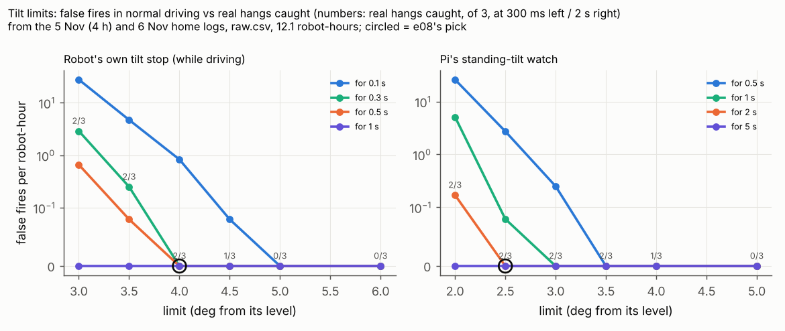
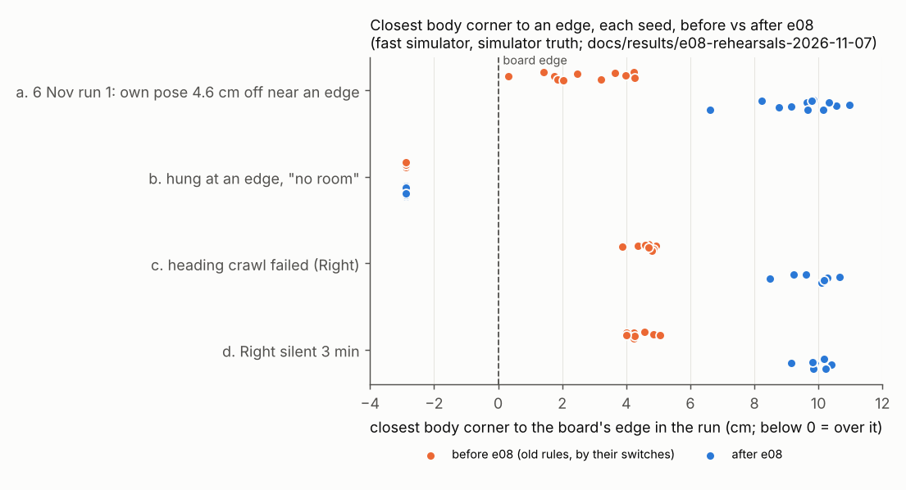

# e08, Phase A of the one pipeline: edge safety and shared watches (7 Nov, simulator and logs only)

## Premise

On 6 Nov (run 1) Center planned a wide curve from a position 4.6 cm wrong, swung its front over the x = 0 edge, tilted
6.1 deg and stood ("no room to back away"); its 8 cm reverse "did NOT move". Right sat out the whole run after a heading
crawl that the camera had mis-measured. The 7 Nov audit traced this to two pipelines built side by side, each missing the
other's safeguards. Nick chose one pipeline in phases; this is Phase A: make home runs safe again, with every rule in one
shared module that both free roam (`freeroam_core`) and the missions (`run_plan`) use. Nick's eleven decisions (A1-A11)
are built below. Nothing touched a robot, a Pi or the network (only GitHub and the release downloads).

**Measured, and where from.** Logs: releases `freeroam-20261105-155001-freeroam` (4 h, 3 robots) and
`freeroam-20261106-210129-freeroam` (run 1). Run 2's logs (`freeroam-20261106-212356-freeroam`) are not uploaded, so
they are not used. Rehearsals: the fast simulator (`freeroam_fastsim`, the same controller the Pi runs) with new
injections, and Mission Control's practice runs. "Before" = today's code with every e08 switch set back to the old rule.

## Data

### 1. What was built (each old rule kept behind a switch)

| Decision | Built | Old rule's switch |
|---|---|---|
| A1 stale position | Own pose vs camera (latency-compensated): the disagreement is added to the position uncertainty **at once**; a curve piece is chained from the planned end only while the robot is within 4 cm of the plan, else the next piece starts from the fused position; a 2 s disagreement over 5 cm re-seeds the pose without stopping the robot | `--pose-rule wait2s` / `MIRLT_POSE_RULE` |
| A2 one edge rule | `safety_rules.clearance_cm` = half diagonal 6.72 + uncertainty now + stopping distance (where the move stops) + camera edge error (lights 5 cm, roof tags 0), on every sample of every path: curve bulges, loop discs, turns on the spot, blind backing. Used by free roam (live, per robot), missions, school points, DOE loop, ladder, calibration room | `--edge-rule fixed` / `MIRLT_EDGE_RULE=fixed` (16, 9.2, 17, 13, 25, 12 cm) |
| A2 sure / unsure | `edge_judgement`: clear / sure near an edge / unsure, logged on each change (`edge_judgement.csv`). Unsure + attended: a plain-words question on Mission Control's Start screen, that robot held; unsure alone: a 6 cm move only along a direction the camera AND its own pose call inward, else hold | - |
| A3 tilt recovery | Pi-side tries, each logged (`recovery.csv`): straight back when backing is inward by camera and own pose (or its trail), even if the general room check says no; a reverse one wheel's worth to each side; a 15 deg inward pivot with the tilt stop raised to tilt + 2 deg for that step only (restored after); hold and ask only when nothing safe remains, retried every 20 s. **No firmware change, no reflash** | `--no-tilt-recovery` |
| A4 tilt limits | From the logs: robot tilt stop **4 deg / 300 ms** (was 5); standing watch kept at 2.5 deg / 2 s. Sent at every run's start as runtime params | `MIRLT_TILT_RULE=old` |
| A5 shared watches | Free roam now has the heading watch (its own heading against the camera's motion, re-set after 2 bad checks), the stop lead (forward drives sent short by the robot's calibrated lead; one shared function with run_plan), surface marks logged only, virtual-border fires counted | `heading_watch=False`; no leads file = none |
| A6 keep-outs | One rule (`keepout_confirmed`): one sensor-only stop fades after 15 s; felt twice, a drop, an edge or tilt trip, a failure hazard stay. Free roam, run_plan (front_stop's 15 s) and `observe.trip_keepout` | `--keepout-rule permanent` |
| A7 no sitting out | Silent 120 s: held as an obstacle, checked every 20 s, rejoins once heard and camera and own pose agree 3 s. A failed heading crawl: joins held; a 6 cm nudge the camera watches gives its heading; rejoins | `--silent-out`, `--heading-out` |
| A8 keep going | Default `keep_going` in `home.json`, `sites.py`, `run_plan`, Mission Control's fallback; `doe_loop` keeps going by default | `on_problem: stop`, `run_plan --on-problem stop`, `doe_loop --no-keep-going`, `./run-fleet-pi.sh doe ... park` |
| A9 E02 runner | The Pi start page opens on Mission Control; its Start/Stop tab says "Start a run: Open Mission Control"; the E02 start card shows only with "Show the old runner" ticked (the server refuses an E02 start without it) | the tick-box, or `MIRLT_OLD_RUNNER=1` |
| A10 superseded | `./run-fleet-pi.sh calib` sleeps the robots when it ends; Monday-demo modes hidden and `./run-fleet-pi.sh monday` refused | `calib awake`; `MIRLT_MONDAY_DEMO=1` |
| A11 battery | `engine_checks.battery_floor(run_type=...)`: free roam 10 %, everything else 25 % (`MIRLT_MIN_BATTERY` still overrides) | - |

### 2. The numbers behind the rule (from the 5 and 6 Nov logs)

| Term | Value | How measured |
|---|---|---|
| Half diagonal | 6.72 cm | geometry |
| Position uncertainty | 1 cm camera + live disagreement + staleness x speed + bubble when lost | camera sigma (cam_bridge); the rest measured live |
| Plan-ahead uncertainty (missions, points) | 1.7 cm | 95th percentile cross-track error at drive ends, 2,176 drives, 5 Nov 0-90 min |
| Stopping distance | 1.4 / 2.1 / 2.0 / 2.4 cm at 5 / 7.5 / 10 / 13 cm/s | 95th percentile overrun past the planned end, same drives, the camera's 0.44 s delay added back (median 0.1 cm) |
| Camera edge error (lights) | 5 cm | 5 Nov edge trips: bottom-zone trips at camera 4.9-7.5 cm from the edge where the drop puts the middle about 8-10 cm (2-5 cm outward); Right's nose over y = 0 for 16 min: camera 2.8 cm past the edge, true middle 0-4.8 cm inside (3-7.5 cm). 25 / 27 Oct: 5-9 cm |
| Result | path 12.7 cm, move end 15.1 cm (agreeing, lights); points 15.8 cm (missions), 10.8 cm (school, tags); DOE / ladder 18.5 cm; calibration room 14 cm | was 9.2 / 16 / 17 / 13 / 25 / 12 |

**Sure or unsure (how it is decided).** Each half second, per robot: its margin = distance to the nearest edge minus the
derived clearance with its full uncertainty. Margin above 0: **clear**. Inside the clearance: **sure** when the camera is
fresh (under 0.6 s past its measured delay) and its own pose is within **3 cm** of the camera, or its own sensors feel
the edge (tilt, drop); **unsure** otherwise. A person's answer stands 60 s at that spot. The 3 cm is my choice (three
camera sigmas). A DOE should set it: replay the logs for the share of unsure moments at 2 / 3 / 5 cm against the
incidents caught (5 Nov logs: own pose vs camera median 0.8 cm, 90 % under 1.7 cm in the healthy first 90 min).

### 3. Tilt limits re-picked (A4)



Each line is one time limit: lower limits fire on normal driving (left axis, per robot-hour), higher ones miss the real
hangs (the numbers); the circles are the values chosen.

| Robot's tilt stop (driving), 300 ms | false fires (12.1 robot-h) | real hangs caught of 3 |
|---|---|---|
| 3.0 deg | 35 (2.9 / h) | 2 |
| 3.5 deg | 3 (0.25 / h) | 2 |
| **4.0 deg (new)** | **0** | **2** |
| 5.0 deg (old) | 0 | 0 in the logged rows |

| Pi's standing watch | false fires | caught |
|---|---|---|
| 2.0 deg / 2 s | 2 (0.17 / h) | 2 |
| **2.5 deg / 2 s (kept)** | **0** | **2** (12.6 s and 2.6 s after the hang began) |
| 3.0 deg / 1 s | 0 | 2 (1 s sooner; 0.4 deg less margin over Center's 3.4 deg hang) |

The third real hazard (Right's nose over y = 0 for 16 min, 5 Nov) never tilted past 3.5 deg; only its line sensors
caught it, so no tilt limit can. On Nick's worry about false starts and stops: at 4 deg the logs show none in 12 h of
driving, and Right's 5.1 deg braking dip (50 ms) stays under the 300 ms time.

### 4. Rehearsals, before and after (fast simulator, simulator truth)



Each dot is one simulated run: how close any body corner came to the board's edge; the old rules (orange) let bodies
come within 2-5 cm, the new ones (blue) keep them about 8-11 cm in, and the hung robot (b) starts over the edge in both.

| Case (seeds x length) | Rules | Closest body to an edge, worst / median (cm) | Closest centre (cm) | Hung, fell | % time moving (robot in question) | Closest bodies (cm) | Outcome |
|---|---|---|---|---|---|---|---|
| a. 6 Nov run 1: Center's own pose 4.6 cm inward of truth for 2 s, every 12 s, fixes refused (12 x 6 min) | before | **0.3** / 2.3 | 6.3 | 0, 0 | Center 97.5 | 9.1 | bodies at the edge in most seeds; no hang in the model |
| | after | **6.6** / 9.7 | 12.3 | 0, 0 | Center 96.1 | 9.0 | 59 "unsure" moments, 6 holds, all logged |
| b. Center hung at x = 0, the 6 Nov spot (10 x 3 min) | before | (starts at -2.9) | 3.5 | 10 hung (362 s in all), 0 | Center 70.9 | 6.0 | "tilted and no room to back away: stands"; freed only by chance |
| | after | (starts at -2.9) | 3.5 | 10 hung (58 s in all), 0 | Center 88.4 | 9.0 | **10 of 10 recovered** (median 6.3 s; all by the one-sided reverse to the side still on the board) |
| c. Right's heading crawl failed, the camera 15 cm off for 8 s (8 x 6 min) | before | 3.9 / 4.7 | 9.5 | 0, 0 | Right 0 (out) | 7.3 | out for the whole run |
| | after | 8.5 / 9.9 | 13.9 | 0, 0 | Right 93.2 | 4.6 | **8 of 8 rejoined** (median 2.8 s after the start, by the nudge) |
| d. Right silent 3 min, then back (8 x 9 min) | before | 4.0 / 4.3 | 9.2 | 0, 0 | Right 31.9 | 7.5 | out at 120 s, for good |
| | after | 9.1 / 9.9 | 14.3 | 0, 0 | Right 64.0 | 6.5 | **8 of 8 rejoined** (3 s after it was heard again) |
| e. 4 h, ~4.5 false front stops per robot-hour (2 seeds) | keep-outs permanent | 6.9 / 7.0 | 13.0 | 0, 0 | all robots 55.1 | 5.6 | 40 keep-outs at the end (median), 8,300 fallbacks a run |
| | keep-outs fading (e08) | 7.9 / 8.0 | 13.7 | 0, 0 | all robots **86.6** | 6.3 | 71 faded, 17 left (felt twice), 4,000 fallbacks a run |

No contact in any run. "Before" in a-d = every e08 switch set back (fixed edges, 2 s pose rule, permanent keep-outs, out
when silent or without a heading, no tilt recovery, 5 deg); e compares only the keep-out rule. Runs:
`docs/results/e08-rehearsals-2026-11-07/runs.jsonl` (`tools/fleet/rehearse_phase_a.py all`).

**(f) e07's rehearsals under the new edge rule and keep-going** (Mission Control practice runs, the real page's API;
`docs/results/e08-regression-2026-11-07/`):

| Run | e07 | e08 | Closest bodies | Closest body to an edge | Ended |
|---|---|---|---|---|---|
| School, Visit points, 2 robots (restart 70 s in) | done | done; the restarted robot held, its points reassigned (keep going); 1 point skipped (no turn room) | 14.9 cm (e07 26.3) | 6.6 cm (e07 7.5): school points now 10.8 cm in (roof tags: no camera edge error) | done |
| School, Free roam, 3 robots | done | done, 36 visits | 12.0 cm (e07 12.6) | 8.1 cm (e07 7.8) | done |
| Home, Free roam, 2 robots, 3 min (freeroam.py on the simulator) | 99.7 % moving | 98.1 / 99.7 % moving, 1 full stop | centres 23.8 cm apart | 10.3 cm (centre 15.8) | time cap |

### 5. The derived rule replayed on the real runs

Every logged move's path (stop-turn lines, curve arcs from their start, end and turn) checked against the derived rule
with the own-pose-vs-camera disagreement measured at the move's start:

| Run | Moves checked | Would have been refused | Of note |
|---|---|---|---|
| 6 Nov run 1 | 82 | 19 (23 %): curves whose bulge came 10-13 cm from an edge | **Move 45** (path 2.0 cm inside the clearance at 21, 12) and **move 46** (the -200 deg curve: Center already inside, only moves gaining room) both refused; the incident does not start |
| 5 Nov, 0-90 min | 443 (every 5th) | 2.0 % | the healthy period: the coverage cost |
| 5 Nov, 90-160 min | 374 | 7.0 % | disagreement median 1.8 cm |
| 5 Nov, 160-240 min | 6,711 | 24.3 % | disagreement median 17.8 cm (the clock ratchet). Center's menu drives at 175.4, 175.6 and 175.9 min (the last is the 44 cm drive into x = 0) refused; its short off-menu moves "gaining room" in the camera's frame would still have been allowed by the path rule, but with its own pose 36 cm off the camera the sure/unsure watch holds it (or asks) first |

Virtual border (left as it is): **0 fires** in both runs (5 Nov 4 h: 37 obstacle and 3 edge-guard step ends; 6 Nov: 5
obstacles, 4 dodges, 1 tilt). It is now counted in every free roam (`border_fires`).

### 6. Found and fixed during the build

| Found | Fix |
|---|---|
| The immediate re-seed shifted the robot's pose history and broke the camera-clock alignment (2 tests) | re-seed still after 2 s, without stopping; the widening is what is immediate |
| The new stop-lead table clashed with the clock code's `leads` attribute | renamed |
| A hung robot's backing was judged "not inward" at 63 deg to the edge (tolerance 60) | "inward" = gains distance by both sources (80 deg); the end must still be further in |
| The simulator treated open board edges as walls for the front sensor (a pivot at the edge was refused as "obstacle -4.9 cm") | open drops in the edge-physics mode |
| The start line still said "Moves end 16 cm ..." | says the derived rule (or the fixed one when switched) |
| Blind backing checked only its end against the derived rule (self-review) | the whole reverse path |

## Conclusion

- The 6 Nov sequence is closed at three points: the 4.6 cm disagreement now widens the clearance at once (moves 45 and
  46 are refused in the replay); a robot that still tilts at an edge backs or pivots out by the camera's inward
  direction (10 of 10 freed in the simulator, median 6 s, against standing); Right's case rejoins (8 of 8, median 3 s) instead of
  sitting out, and a silent robot rejoins when heard again. Fading keep-outs kept 4 h of false stops from halving the
  time moving (87 % against 55 %). (My conclusions; the hung-robot physics is a model, below.)
- The cost is coverage: paths now keep about 12.7 cm from edges instead of 9.2, so about 2-7 % of normal moves (23 % of the 6 Nov curves) near
  edges are refused and robots stand a little more (case a: Center moving 96.1 % against 97.5 %; more full stops, each logged
  with why).
- Tilt: 4 deg / 300 ms on the robots, standing 2.5 deg / 2 s on the Pi, chosen from 12.1 robot-hours with no false fire.
- Tests: the full fleet suite 689 passed, 9 skipped (e07: 667 / 9), with 22 new ones (`tests/test_e08_phase_a.py`) and
  9 tests moved to the new defaults; one feel-out simulator test failed only under the rehearsals' load (passes alone,
  failed the same way in the baseline run). The launcher's 4 known failures (camera names, no camera on this machine)
  are unchanged.
- Every e07 behaviour kept its switch; keep-going is the default everywhere; the E02 runner and Monday's demo are
  switched off, not deleted.

## What's next

1. A short attended home free roam (the commands below): look for `edge_judgement`, `recovery`, `held` rows and the
   Start-screen question; upload as usual.
2. The bench test the logs cannot replace: one wheel over a 1 / 2 / 3 cm drop, which recovery tries free it (the
   simulator's hang model is my guess).
3. Phase B (not started, as asked): one tracking layer with motion at school, the EKF in the loop, raw-gyro heading.
   Nothing here blocks it: the rules live in `safety_rules.py`, used by both pipelines.

## Questions for Nick

**Substantive**
1. The derived rule costs room: curve paths now keep about 12.7 cm from the edges (9.2 before) and points 15.8 cm at
   home. Most of that is the camera's 5 cm edge error, whose sign follows the nose (outward facing the edge, inward
   backing or side-on). Keep it as a full 5 cm everywhere, or apply it only when the robot is not facing the edge (about
   2-3 cm more room on forward moves)? A taped edge approach would measure it properly first.
2. School points are now 10.8 cm from the edges (roof tags have no edge error), where the typed 13 cm was before: more
   stickers reachable, bodies to 6.6 cm from the edge in the rehearsal. Keep the derived value at school, or keep 13
   there as a floor until the seam tape and the table's real edge are checked with Jay-Sun?
3. When the run is unsure about a robot near an edge and nobody is there, it holds that robot (or moves it inward when
   camera and its own pose agree). Should an unattended run also save a picture of that moment for you to look at
   later?
4. The recovery's pivot raises the robot's tilt stop to the tilt now + 2 deg (at most 9 deg) for one 15 deg turn. Is
   that acceptable, or would you rather it never turn while tilted (the firmware's own rule) and hold instead?

**Other**
5. The E02 runner's start card now hides behind "Show the old runner" on the start page. OK, or remove the card from
   the page altogether (the runner itself stays)?
6. Mission Control now asks at every real start "Will you stay with the robots?". Ask only for free roam, or always?
7. The DOE loop and ladder now use 18.5 cm instead of your 25 cm. Run one short DOE loop before trusting it unattended?

## How to run it at home

No reflash: firmware 2026-11-05d is fine (the new tilt limit is sent at the start of every run).

**Window: the Pi's terminal** (SSH from the laptop, as usual). Type, then Enter:

```
cd ~/alvik-fleet-capstone
```

```
git pull
```

You should see `e08` files listed (safety_rules.py among them).

**Easiest: Mission Control.** On the laptop's browser open the Pi's start page (`http://100.122.222.75:8091`). It now
opens on the Mission Control tab. Press **Free roam**. Two questions pop up: "Start Free roam on every robot?" press
**OK**; "Will you stay with the robots?" press **OK** if you will watch (then a yellow question card can appear under
the run's status, naming a robot it is unsure about near an edge; press the answer that is true; that robot is held until
you do), or **Cancel** to let it decide alone (it never moves an unsure robot outward). You should see "Free roam is
running." and the run's last lines.

**Or from the terminal** (Pi terminal), for an attended 30-minute run:

```
./run-fleet-pi.sh freeroam 0.5 attended
```

You should see `Free roam started in tmux session 'freeroam'`. Then, to watch:

```
./run-fleet-pi.sh freeroam-status
```

You should see each robot's mode; a robot whose heading crawl failed now shows as joined (held at first), not out. The
start lines say `Edge rule: derived (e08)`. To go back to every old rule for a comparison run:

```
./run-fleet-pi.sh freeroam 0.5 old-rules
```

When it ends, **start the upload straight away** (it runs while we talk):

```
./run-fleet-pi.sh freeroam-finish
```

## Self-review (re-read the diff against A1-A11, re-ran what changed)

I re-read the whole diff against A1-A11, ran the full suite, and re-ran every rehearsal after each fix. What the
review found and what I did:

| Found in review | Effect | Done |
|---|---|---|
| Blind backing checked only its end against the derived rule | A2 says the whole swept path, blind backing included | the derived rule on the whole reverse path |
| The unsure watch halted a robot's back-off (an inward move) under a 1 s camera delay: a front-stop loop in the 5 Nov stress test | a robot that is moving away from the edge was stopped | an inward move (ends further in than it starts) is never interrupted; outward ones are |
| The stopping distance was added to the clearance at a move's end even for an inward move, so a 3 cm reverse out of a corner never "gained room" and Center stood after its recovery (case b: moving 40 % instead of 89 %) | a robot freed from a hang stood for minutes in a corner | the overrun now extends the path along its own direction (inward overruns count as inward) |
| My own-pose injection also stopped the simulated robot's watchdog from seeing the refused fixes (a real robot counts every packet), so it ran a dropped curve piece into the edge (case a, seed 8: body 2.7 cm) | a simulator artifact, not the controller | fixed in the simulator; every case re-run |
| Case e's false front stops only hit straight drives; curve robots barely drive those (0 injected) | the keep-out comparison was empty | injected in curve pieces too (as a dodge); re-run |
| The how-to said `--attended` and environment variables, which `run-fleet-pi.sh freeroam` ignores (tmux) | Nick's commands would have silently not worked | the script now takes the words `attended` and `old-rules` |
| The start line still said "Moves end 16 cm" | wrong words on the screen | says the rule in force |
| The regression harness wrote Mission Control's run folders inside the repo (a relative path) | 400 MB of frames would have been committed | moved the summaries out, deleted the folder; nothing of it committed |

Checked and left: the pivot raises the robot's tilt stop to at most 9 deg for one step and is restored when the step ends
(and by every run's start if the Pi stops mid-step); a held robot gets no heartbeat while it holds no step (the watchdog
only stops steps); run_plan's unsure robots are logged and asked about but not held (said under Not done).

## Not done as asked

- **Run 2's logs** (6 Nov 21:23) are not uploaded: not used.
- **run_plan's unsure robots are logged and asked about, not held**: the mission planner has no per-robot hold that keeps
  its plan; the plan's own edge room (the same derived rule) and the robots' edge guards protect it meanwhile. Free roam
  holds them.
- **"One wheel at a time backward"** is approximated Pi-side by a reverse along a line offset 2 cm to one side (the
  follow step steers, so one wheel works harder); a true one-wheel step needs firmware (not built: a reflash).
- **Rehearsal (c)'s heading crawl** was rehearsed at the controller level (held start + the camera 15 cm off for 8 s);
  the real start chain (ladder crawl -> held -> camera bridge) was not run end to end in the dry chain.

## Sweep 1: new tests that may now be needed

- Bench: one wheel over a 1 / 2 / 3 cm drop; which recovery tries free it, the tilt each reads (sets the simulator's
  hang model and RECOVER_TILT_MARGIN).
- Board: a tape-measured approach to an open edge at 0 / 45 / 90 deg with the lights tracker (the 5 cm camera error).
- Logs: the next attended run's `edge_judgement.csv` against what Nick saw (were the unsure moments real?).
- Simulator: two robots both unsure near the same edge at once; a question left unanswered for 10 min.
- The dry chain (`freeroam.py run --dry-chain`) with a failed crawl, to rehearse the held start end to end.
- Mission Control school rehearsals with the derived 10.8 cm point room on more seeds (points now reachable nearer the
  edges).

## Sweep 2: possible inaccuracies in what this relied on

| Number / assumption | Value | Chosen or measured | DOE? |
|---|---|---|---|
| Camera edge error | 5 cm | measured, few events (3 trips, 1 long hang) | yes: taped edge approaches |
| Stopping distance | 1.4-2.4 cm | measured (camera end, delay added back; includes camera noise) | no: re-measure per robot |
| Plan-ahead uncertainty | 1.7 cm | measured, one run, one board | no: re-measure per site |
| Sure tolerance | 3 cm | chosen | yes (log replay) |
| Unsure re-check, person's answer stands | 2 s, 60 s at 3 cm | chosen | no (times) |
| Off-plan threshold for chaining curves | 4 cm (3 + 1) | chosen | yes, with the sure tolerance (fewer coasts vs edge margin) |
| Re-seed | over 5 cm for 2 s | kept from observe (chosen) | yes: 3 / 5 / 8 cm |
| Disagreement decay | 1 s | chosen | yes, with the above |
| Inward tolerance | 80 deg | chosen | no (a definition; the end must be further in) |
| Recovery: tilt margin, cap, pivot, side offset, retry | +2 deg, 9 deg, 15 deg, 2 cm, 20 s | chosen | yes (the bench test) |
| Held robot: check every / agree for | 20 s / 3 s | chosen | no |
| Unconfirmed keep-out fade | 15 s | Nick's "about 15 s" | yes (front_stop's DOE note) |
| Tilt 4 deg / 300 ms, standing 2.5 deg / 2 s | from logs | measured on 3 hazards only; my level estimate is not the firmware's (taken at its compass check), and raw rows are logged at ~34 a second, so a 300 ms window is about 10 rows | yes (the bench) |
| The simulator's hang model | a wheel over = hung at 6.5 deg; straight reverse spins; a reverse or pivot working the on-board wheel frees it | chosen to match one real hang | the bench test decides |
| Fixed-rule "before" | today's code with old switches | not the old commit itself | - |
| Replay | curve start heading from chord and turn; disagreement from the nearest camera and own-pose rows (0.45 s delay assumed) | approximations | - |
