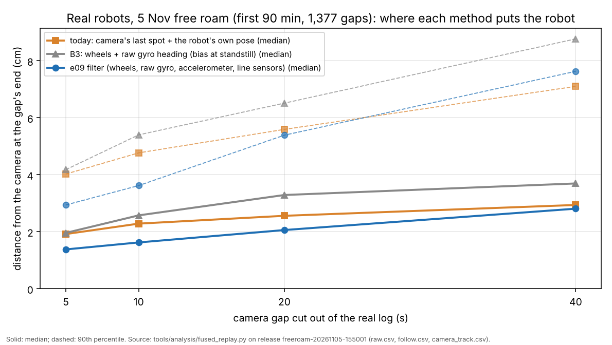
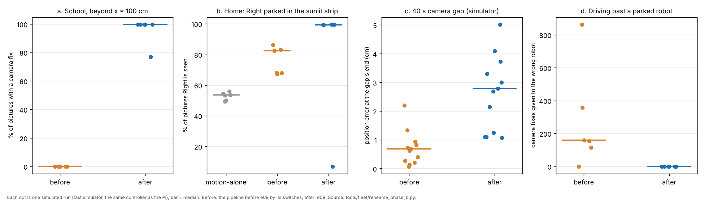

# e09, Phase B of the one pipeline: one tracking layer, the filter in the loop (7 Nov, simulator and logs only)

## Premise

Nick's 7 Nov plan: one pipeline for every site, built in phases. Phase A (e08) made the edges safe. Phase B (this build)
puts every camera source through **one tracking layer** and puts the proven sensor-fusion filter **in the loop** for
both free roam (home) and Mission Control (school). The 7 Nov audit found the pieces built but unused: the lock-on
tracker (22-23 Oct: seen in 94 / 93 / 96 % of pictures against 41 / 40 / 72 % for the motion detector alone) ran only in
the old E02 runner; the school had no camera source beyond the roof tags, which stop reading past about x = 100 cm; the
filter (25 Oct: 5.1 cm after 40 s with no camera, against 19.2 cm for the robot's own pose) ran only offline; the brick
watch and the parked-robot watch were off; the fast simulator never swapped names, so four real name swaps could not be
rehearsed. Nothing touched a robot, a Pi or the network (only GitHub, for the push).

**Measured, and where from.** Real logs: the 5 Nov 4 h home free roam (first 90 min, three robots) and 6 Nov run 1,
local copies of their releases. Everything else is the fast simulator (`freeroam_fastsim`, the controller the Pi runs)
with a new camera mode that sends **sightings with no names** through the layer, and Mission Control's practice runs
(the real page's API, the tag picture simulator with the real tag bridge). "Before" = today's code with every e09 switch
set back.

## Data

### 1. What was built (each old way kept behind a switch)

| Asked | Built | Old way's switch |
|---|---|---|
| B1 one tracking layer | `tracking_layer.py`, used by the home runner (`freeroam.py`), the fast simulator, and (lock-on, filter) the school's `run_plan` / `tag_bridge`. Sources: roof tags (named), motion detector (no name), **lock-on** (named by the robot it was seeded on), lights (no name), ML detector slot (stub, **off**: `MIRLT_ML_DETECTOR=1`) | `--old-tracking` / `./run-fleet-pi.sh freeroam old-tracking`; bridges `--no-lock` |
| Lock-on in the bridges | `lock_bank.py`: one lock per robot, seeded on a robot standing still that the detector (home) or its roof tag (school) sees sure, never with another robot within 16 cm; used when the detector or the tags miss it; fixes go out as `src ...:lock` | `--no-lock` |
| Seed motion from the tag (school) | the tag bridge seeds each robot's lock from its tag read while it stands; beyond x = 100 the lock follows it; the layer keeps its name | `--no-lock` |
| Brick watch on | the home runner starts the camera bridge with `--brick-watch`; its objects become confirmed keep-outs (`on_obstacle`); the layer also confirms unclaimed sightings standing 2 s | `--no-brick-watch` |
| Parked-robot watch on | a robot whose wheels stand 2 s while the camera's averaged spot moves 3-15 cm: "moved while parked": pose taken from the camera, logged, a picture asked | the layer's `parked_watch` (off under `--old-tracking`) |
| Identity: wiggle first | close pass (middles under 16 cm): no camera fix for either until they part; then each camera track's motion is compared with each robot's own wheels and gyro (kept / swapped back); unclear: one robot wiggles on its spot and the turning outline names it (school: waits for a tag read, at most 8 s); one robot's lights can no longer be handed to another (sightings 3.5 cm apart are one object) | `MIRLT_IDENTITY=predict` |
| Camera watch (my addition) | every 6 cm of a robot's travel the camera's track must turn the way its own heading did; 4 of 6 votes the other way, from 2 robots: the picture is not trusted; until 4 votes agree the camera is "not proven" and cannot re-seed a pose by itself | `MIRLT_CAMERA_WATCH=0` |
| B2 filter in the loop (**beside by default**, 3b) | `fused_pose.py`: one filter per robot on the Pi (the 25 Oct `tools/fusion/ekf.py`), fed by RAW (wheels, raw gyro rate, accelerometer bumps, line-sensor drops, front stops logged) and the layer's fixes at the picture's time; its pose feeds the planner (`pos()`), its uncertainty the Phase A edge rule (`unc()`); a disagreement widens it at once and Phase A's own-pose-vs-camera widening stays on top; in camera gaps its position goes to the robot as a fix every second; school: `run_plan`'s edge watch and gap forwarding | `--pose-source` ekf / blend (**blend is the default**: 3b) |
| Learned trust | each camera source's noise learned from its own fixes (after 30); the wheel distance and turn scales learned as filter states; the turn error 0.014 per degree (measured) used, not 0.005 | - |
| B3 heading from the raw gyro | `GyroHeading`: raw gz minus the bias taken at every standstill, sign learned from the wheels; with the switch on, the planner uses it and a standing robot is told it (`fpose`). **Pi-side from RAW: no firmware change, no reflash.** | **OFF by default** (`--gyro-heading`, `MIRLT_GYRO_HEADING=1`) |
| B4 picture when unsure alone | free roam: each camera's newest picture into `<session>/pictures/` (`pictures.csv` says why); school: `run_plan` logs `picture_wanted`, mission_run's frame saver writes it | - |
| B5 Nick's Phase A answers | kept as the defaults: camera edge error 5 cm everywhere; school points 10.8 cm; tilt-recovery pivot at most 9 deg | - |

### 2. The filter on the real robots' logs



The blue line (the e09 filter) sits under the orange one (today's way) for every gap length: after a camera gap, the
filter puts the robot closer to where the camera then sees it.

Gaps of 5-40 s cut out of the camera track; error = distance from the camera at the gap's end (cm). Source:
`tools/analysis/fused_replay.py`.

| Gap | Gaps | Filter (median / 90 %) | Today: camera spot + own pose | Raw-gyro heading (B3) | Filter inside its own uncertainty |
|---|---|---|---|---|---|
| 5 s | 453 | **1.38** / 2.94 | 1.92 / 4.03 | 1.96 / 4.18 | 74 % |
| 10 s | 384 | **1.62** / 3.62 | 2.29 / 4.77 | 2.58 / 5.40 | 87 % |
| 20 s | 318 | **2.06** / 5.39 | 2.56 / 5.59 | 3.29 / 6.51 | 88 % |
| 40 s | 222 | **2.81** / 7.63 | 2.94 / 7.10 | 3.70 / 8.77 | 91 % |

(5 Nov, first 90 min.) 6 Nov run 1 (2 robots, 3 min, 28 gaps): filter 1.44 / 1.93 / 2.44 / 3.29 cm against 2.51 / 3.23 /
2.96 / 2.29 for 5 / 10 / 20 / 40 s; too few gaps to lean on.

What the filter learned on the real robots: gyro bias 0.41-0.77 deg/s (re-taken 13-16 times in 90 min); wheel distance
scale 0.979-1.008; the wheels turn 1.04-1.08 times what the gyro says; camera noise smaller than the 1 cm assumed (its
learned trust sits at the floor, 0.5 of the variance).

**B3 on the logs.** The raw gyro with its standstill bias, alone, is **worse** than today's own pose at every gap
length (also with its scale set to 0.99: 2.50 / 2.94 / 3.40 cm at 10 / 20 / 40 s). The library yaw reads 0.92 of the
raw rate (IQR 0.91-0.93, 3,000 three-second windows); the firmware's fitted gyro_scale 1.075 already puts it within 1 %,
and the library yaw does not drift standing. The 25 Oct result (2.0 against 15.9 cm) was on uncalibrated robots; it does
not repeat on the calibrated 5 Nov robots. B3 stays OFF, as Nick asked. (My conclusion.)

### 3. Rehearsals, before and after (fast simulator, simulator truth)



Each dot is one simulated run: after e09 (blue), the school robots stay tracked beyond the tags' reach, the parked
robot in the sunlit strip stays seen, and no camera fix goes to the wrong robot.

All "after" runs had the filter **in charge** (`pose_source ekf`); see section 3b for why the default is now the blend.

| Case (seeds x length) | Pipeline | Tracked: % of pictures with a fix (median run / worst run) | Position error, median (cm) | Other | Closest body to an edge, worst / median (cm) | Contacts |
|---|---|---|---|---|---|---|
| a. School 396 x 168 cm, tags read only to x = 100 (6 x 15 min, 2 robots) | before (tags only, blend) | 32 / 0.5; **beyond x = 100: 0** | 2.61 (beyond: 3.07) | points of a 30 cm grid reached: 13 of 65 (3 of 50 beyond); moving 38.9 % | 10.1 / 11.0 | 0 |
| | after (tags + motion + lock-on, filter) | 99.8 / 78.7; **beyond x = 100: 99.7** | 0.42 (beyond: 0.49) | **44.5 of 65 (36.5 of 50 beyond)**; moving 98.7 % | 11.2 / 12.5 | 0 |
| b. Home: sunlit strip x 30-45 (lights wash out, the detector fails), a dark corner, Right parked in the strip 3 min (6 x 9 min) | motion alone | Right 49-56 % | 0.95 | - | 9.6 / 10.0 | 0 |
| | before (motion + lights) | Right 67-86 % | 1.07 | - | 9.5 / 10.4 | 0 |
| | after (+ lock-on, layer) | **Right 99.1-99.7 %** in 5 runs; **6.9 %** in one | 0.43 | 17 identity wiggles (11 kept, 6 unclear), 1 swap and 6 wrong fixes in the bad run | 11.3 / 12.1 | 0 |
| c. A 40 s camera gap for Center (12 x 3.6 min) | before (blend) | - | at the gap's end 0.65 (worst in gap 1.5) | - | 9.1 / 10.1 | 0 |
| | after (filter) | - | at the gap's end **2.73** (worst 2.95) | 73 filter positions sent to the robot in gaps | 10.8 / 11.2 | 0 |
| d. Driving past a parked robot the camera cannot see standing (the 27 Oct swap; 6 x 9 min) | before (names by prediction) | 9.5 / 0 | 13.1 | **8 swaps, 1,653 fixes to the wrong robot**; bodies 0.05 cm apart | 2.3 / 9.4 | 0 |
| | after (layer, lock-on) | 97.9 / 95.7 | 0.69 | **0 swaps, 0 wrong fixes**; closest bodies 6.8 cm | 11.6 / 12.3 | 0 |
| f. 30 min home free roam, end to end, after (2 seeds; a dead robot, a 4 s Pi freeze, a brick put down at 10 min, a parked robot pushed at 15 min) | after | 74 / 40 (the dead robot counts) | 0.82 | the brick kept out in both (2 camera objects); 5 identity wiggles; 1 wrong fix; the push was not caught (the robot was not parked then) | 11.4 / 11.7 | 0 |
| g1. Camera clock 0.7 s ahead (4 x 5 min) | before / after | 98.9 / 99.97 | 1.35 / 0.93 | moving 98.4 / 98.2 % | 9.9 / 11.9 (worst) | 0 / 0 |
| g2. Wrong camera name (the picture mirrored left to right; 4 x 5 min) | before | 81 | 119 | the run went on (narrowed: moving 5.0 %); 2 swaps | **-5.1 / -4.4** | 0 |
| | after | 34 | 90 | went on (moving 3.5 %); the camera distrusted in 2 of 4 runs | **-4.3 / -4.0** | 0 |
| g3. The camera gone from 60 s (4 x 5 min) | before / after | 20.6 / 20.8 (the first minute) | 1.07 / 16.1 | the run went on, narrowed: moving 24.1 / 24.8 %; no robot over 13 cm near an edge | 9.9 / 12.9 (worst) | 0 / 0 |

No falls in any run. g2: bodies 4-6 cm over an edge (the edge-physics model; the robots' own line-sensor edge guard
stopped them) both before and after: a wrong camera name is not handled safely by Phase B (Conclusion). Runs:
`docs/results/e09-rehearsals-2026-11-07/runs.jsonl` (`tools/fleet/rehearse_phase_b.py`).

**e. Phase A's cases with the filter in charge (4 seeds each, Phase A's own harness, against e08's same seeds):**

| Case | e08 (blend) | e09 (filter in charge) |
|---|---|---|
| a. 6 Nov repeat: Center's own pose 4.6 cm off every 12 s | body worst 9.6 cm, Center moving 97.0 % | 10.3 cm, 95.9 % |
| b. Center hung at x = 0 | 4 of 4 recovered, Center moving 86.3 %, hung 24 s in all | 4 of 4 recovered, **Center moving 36.9 %**, hung 47 s; **two bodies touched in one run** |
| c. Right's heading crawl failed | 4 of 4 rejoined, body worst 9.2 cm, Right moving 94.0 % | 4 of 4 rejoined, 11.3 cm, 91.4 % |
| d. Right silent 3 min | 4 of 4 rejoined, 9.8 cm, Right moving 64.0 % | 4 of 4 rejoined, 9.9 cm, 63.5 % |

### 3b. The decision this forced: the filter beside, not in charge, by default

Case e(b) failed with the filter in charge: after its recovery the hung robot stood (moving 37 % against 86 %; two
runs 1-4 %), and in one run two other robots touched. Run again with the blend in charge (same seeds, same filter
running beside it) every robot moved 90-94 % and nothing touched. I did not find the cause in the time left (my guess:
the wheels turn while the body is hung, the filter believes them, and the disagreement keeps the robot "unsure near an
edge"). So, against the brief: **`pose_source` defaults to `blend`**; the filter runs beside it on every robot (fed
RAW and the fixes, its summary in `state.json`), and one word puts it in charge (`./run-fleet-pi.sh freeroam ... filter`,
`--pose-source ekf`, `MIRLT_POSE_SOURCE=ekf`). Rehearsals a, b, d, f, g above ran with it in charge. (My decision; it is
question 1.)

### 4. Mission Control end to end (practice runs, the real page's API)

Practice runs through Mission Control's API (same rooms as e08's regressions), run **before** the default switch above
(the filter in charge).

| Run | e08 | e09 | Closest bodies | Closest body to an edge | Ended |
|---|---|---|---|---|---|
| School, Visit points, 2 robots (Alpha restarts 70 s in) | done; 1 point skipped | done (Alpha out at its restart, its points reassigned, as e08) | 15.1 cm (e08 14.9) | 8.2 cm (e08 6.6) | done, 224 s |
| Home, Free roam, 2 robots, 3 min | 98.1 / 99.7 % moving (its own count) | 94 / 94 % moving (my count from the simulator's truth: not the same measure) | centres 24.3 cm apart (e08 23.8) | 9.8 cm (e08 10.3) | time cap |

At school the tag bridge's lock-on ran on the rendered pictures: seeded 102 times, locked on both robots, used once (the
practice room keeps to the readable area, so the tags almost never missed); no errors. At home the practice room's
simulator sends named fixes without pictures, so the lock-on does not run there.

### 5. Found and fixed during the build

| Found | Fix |
|---|---|
| A late or skewed camera (1 s late, clock 0.7 s ahead) made the filter's speed and wheel-scale states run away (numbers to 1e13) | camera fixes correct position (and heading / scales through the covariance) but never speed, turn rate or bias; wheel scales held in 0.85-1.15; a late fix moved on by the filter's own motion, never its corrections; a fix over 40 cm off is "another place", left to the controller's re-find rules |
| A disagreeing fix flung the heading through the covariance | used with its noise stretched by how far out it is; the rest of the disagreement added to the uncertainty at once (A1 kept) |
| With RAW silent the filter carried the last speed on for ever (a held robot's estimate drove away, its sightings fell out of the gate) | at most 0.3 s past the last RAW row; the doubt keeps growing |
| One robot's lights handed to another robot whose gate had grown | sightings within 3.5 cm are one object |
| Gates grew with the clock (10 cm/s): a standing robot's gate took a stranger's outline | grows with the robot's own travel (0.15 cm/cm) and 2 cm x sqrt(s) |
| A wrong camera name: the mirrored picture re-seeded poses (Phase A's 2 s rule) and pulled the filter | the camera watch; until proven, a disagreeing fix does not move the filter, is not sent to the robot, and cannot re-seed |
| The parked watch fired on single noisy sightings (14 false "moved" in 3 min) | averages 10 sightings at the stand against the last 6 |
| A wiggle's verdict took any robot turning anywhere | only outlines turning within 12 cm of the pair, and one robot at most half as far as the other |
| The fast simulator's robots never stood still, so the gyro bias was never taken | they stand 1 s before the run (as the compass check and the start's find do on the Pi) |
| The home runner's layer had no start position (no robot could join, dry run) | the bridge's first named fix starts each track |

## Conclusion

- **The filter is better than today's way on the real robots' logs, but not yet safe in charge.** After 5-20 s without the camera it is 0.5-0.7 cm
  closer (28-29 %), after 40 s 0.1 cm (median). Its uncertainty, calibrated on those gaps (6 x sigma), held the real error
  87-91 % of the time for 10-40 s gaps. In the fast simulator it is worse in a 40 s gap (median 2.7 against 0.7 cm),
  because the simulator's own pose has only constant scale errors (no measured library-yaw noise); the real logs are the
  evidence, the simulator's own-pose model needs the measured noise (Sweep 1). With the filter in charge, Phase A's
  hung-robot case stood the robot after its recovery and two robots touched once: **it now runs beside the blend by
  default** (3b). (My reading and decision.)
- **School beyond the tags:** with the lock-on seeded from the tags, both robots were tracked in 99.7 % of pictures beyond
  x = 100 (before: 0 %), reached a median 36.5 of the 50 far grid points (before 3), and moved 98.7 % of the time (before
  38.9 %, stuck blind). One of six runs lost 21 % of its fixes to a false camera-watch alarm (below).
- **Home losses:** Right parked in the sunlit strip was seen in 99.1-99.7 % of pictures in five of six runs (before 67-86 %,
  motion alone 49-56 %); one run fell to 6.9 % (a false camera-watch alarm and a swap after a close pass).
- **Name swaps:** driving past a parked robot the camera cannot see, the old naming gave 1,653 camera fixes to the wrong
  robot (8 swaps, two bodies 0.05 cm apart) in six runs; the layer gave none.
- **Safety:** no contact in rehearsals a-d, f, g; one in e(b) with the filter in charge (above). Bodies kept 11.2-11.6 cm
  from edges in the e09 runs (before: 9.1-10.1). A wrong camera name still
  ends with bodies 3-6 cm over an edge before their own edge guards stop them, before and after (section 3, g): Phase C's
  start check is where that belongs.
- Tests: the fleet suite **712 passed, 9 skipped, 0 failed** (e08: 689 / 9), 22 new (`tests/test_e09_phase_b.py`), run in its own
  network namespace with the final defaults; the first full run's one failure (a test double of the camera bridge)
  was fixed.


## What's next

1. Find why the hung robot stands with the filter in charge (case e(b)), then put the filter in charge on the board.
2. A short attended home free roam (below): look at `state.json` ("tracking", "filters"), `tracking.csv`, `pictures/`.
3. Find why the camera watch fired falsely in 2 of 12 rehearsal runs before trusting it unattended (or run with
   `MIRLT_CAMERA_WATCH=0` meanwhile: the only cost is the wrong-camera-name case, already unsafe).
4. Phase C (discovery at start, proven workspace): prove the camera with the first drives before any free move; that
   closes the wrong-camera-name case.

## Questions for Nick

**Substantive**
1. The filter is built into the loop but **beside, not in charge, by default** (3b). Agree to keep it so until the
   hung-robot case is understood, or put it in charge now (the logs say it tracks better)?
2. The filter's uncertainty is 6 x its sigma, set so the real error was inside it 90 % of the time (95 % would need 8 x,
   about 1 cm more room near edges at normal tracking). Is 90 % the right target, or 95 % as Phase A's stop distance?
3. The identity wiggle stops a robot for about 2.5 s after an unclear close pass (11 wiggles in 6 home runs of 9 min).
   Acceptable for the "never stops" trophy, or should a robot that a close pass leaves unclear first drive on and be
   checked by its motion for a few seconds more?
4. The camera watch (my addition, not asked): keep it on by default with its false alarms (2 of 12 runs) until they are
   understood, or off until then?
5. B3 does not help the calibrated robots on the 5 Nov logs. Keep it as an off switch only, or try it once on the board
   with a fresh, uncalibrated robot (where 25 Oct said it helps)?

**Other**
6. School's identity check has no wiggle (it waits up to 8 s for a tag read). Should Mission Control wiggle mid-run too?
7. Pictures when unsure alone: one per robot each time it becomes unsure (38-83 in a 9 min simulated run with a parked
   robot). Limit to one a minute per robot?

## How to run it at home

No reflash: firmware 2026-11-05d is fine. Everything new runs on the Pi from the telemetry it already gets.

**Window: the Pi's terminal** (SSH from the laptop, as usual). Type, then Enter:

```
cd ~/alvik-fleet-capstone
```

```
git pull
```

You should see `tracking_layer.py`, `fused_pose.py` and `lock_bank.py` in the list of changed files.

**Easiest: Mission Control.** On the laptop's browser open the Pi's start page (`http://100.122.222.75:8091`), Mission
Control tab, press **Free roam**, answer **OK** to "Start Free roam on every robot?" and **OK** to "Will you stay with the
robots?" if you will watch. You should see "Free roam is running." Nothing on the page is new: the new parts are in the
logs.

**Or from the terminal** (Pi terminal), an attended 30-minute run:

```
./run-fleet-pi.sh freeroam 0.5 attended
```

You should see `Free roam started in tmux session 'freeroam'`. To watch:

```
./run-fleet-pi.sh freeroam-status
```

You should see each robot's mode. New in the run's lines: `identity wiggle` (a robot wiggles after passing another
closely), `camera object` (something new put on the board, now kept out), `moved while parked`. To try the filter in
charge of the poses (off by default, section 3b; only with you watching):

```
./run-fleet-pi.sh freeroam 0.5 attended filter
```

To compare with the tracking before e09 (same rules otherwise), a run with:

```
./run-fleet-pi.sh freeroam 0.5 attended old-tracking
```

When it ends, **start the upload straight away** (it runs while we talk):

```
./run-fleet-pi.sh freeroam-finish
```

## How to run it at school

No reflash. **Window: the Pi's terminal** at school:

```
cd ~/alvik-fleet-capstone
```

```
git pull
```

On the laptop's browser open the Pi's start page, Mission Control tab, press **Visit points** (or **Free roam**), answer
the questions as before. You should see "Visit points is running." The tag bridge now also follows each robot by its
lock-on past the tags' reach; in the run folder `bridge_summary.json` has a `lock` part (seeds, found, lost) and
`coordinator.jsonl` has `lock_refused` and `picture_wanted` lines (and `gap_forward` when the filter is in charge, which
it is not by default). Going back to tags only (no lock-on) is not on Mission Control's page yet (see Not done).

## Sweep 1: new tests that may now be needed

- Board, home: the lock-on on the Pi's own pictures (CPU per picture with three robots; it was 6-28 ms a picture on the
  laptop, 22 Oct). The heat tracker will show it.
- Board, school: a robot driven past x = 150 cm and back: does the tag-seeded lock hold it (the simulator's lock is a model)?
- Simulator: give the fast simulator's own heading the measured library-yaw noise (IQR +-1 % per 3 s window), then re-run
  case c: today it favours the blend.
- Logs: the camera watch's votes on the 5 Nov run (would it have fired falsely there?).
- A replay of the 22-23 Oct footage through `lock_bank` + the layer (the footage is in releases, not here).
- Mission Control: a school run with a robot driven blind beyond x = 100 (the practice room keeps to the readable area).
- A real brick and a hand on the home board (the brick watch had never run in free roam).

## Sweep 2: possible inaccuracies in what this relied on

| Number / assumption | Value | Chosen or measured | DOE? |
|---|---|---|---|
| Filter uncertainty multiplier | 6 x sigma | measured for a chosen 90 % coverage (5 Nov, 1,377 gaps; the camera is the reference and has its own noise) | yes: the coverage target |
| Turn error per degree | 0.014 | measured (logs DOE, 25 Oct) | - |
| Library yaw / raw gyro | 0.92 (IQR 0.91-0.93) | measured (5 / 6 Nov, 3 s windows) | - |
| Wheels' turn / gyro | 1.02-1.035 (filter learned 1.04-1.08) | measured | - |
| Gyro bias | 0.40-0.77 deg/s | measured | - |
| Camera source sigmas | tags 0.6, motion 1.0, lock 1.2, lights 1.5 cm | chosen starting values; learned after 30 fixes | no (learned) |
| Wheel-scale limits | 0.85-1.15 | chosen (a guard) | no |
| Jump = another place | 40 cm | chosen (the real runs' worst disagreement 36 cm) | no |
| Close pass / parted | 16 / 22 cm | chosen | yes: swaps caught vs wiggles per hour |
| Swap margin, min motion | 2 cm, 3 cm | chosen | yes, with the above |
| Wiggle window, near, clear | 2.5 s, 12 cm, half as far | chosen | no |
| School wait for a tag | 8 s | chosen | no |
| Gate growth | 0.15 cm/cm + 2 cm x sqrt(s), max 25 | chosen | yes |
| Sightings as one object | 3.5 cm | chosen | no |
| Camera watch | 6 cm checkpoints, 20 deg, 4 of 6 votes from 2 robots, 4 to trust again | chosen; **false alarms in 2 of 12 runs** | yes, on logs |
| Parked watch | 2 s standing, 3-15 cm, 10 / 6 sightings averaged, once per 10 s | chosen | yes |
| Brick (layer) | 2 s standing, 6 cm keep-out | chosen (brickwatch.py's own numbers on the Pi) | as brickwatch's DOE note |
| Gap forwarding | every 1 s while under 8 cm | chosen | yes: against the robot's own drift |
| Lock seed clear | 16 cm, re-seed 3 s | chosen | no |
| Simulator sources | motion 93 % moving / 19 % still (measured, 21 Oct footage); lock 96 / 85 %, lights 85 / 20 / 90 %, tags 90 %, dark / busy 30 %, merge under 3 cm, lock jump 5 % | the rest **chosen** to give the 22-23 Oct numbers; the rehearsals test the layer's logic, not the detectors | the real footage decides |
| Rehearsal d | a parked robot the camera never sees standing | chosen to reproduce 27 Oct | - |
| Simulator own pose | constant wheel and gyro scale errors only | chosen (e04); optimistic for the blend | measure (Sweep 1) |
| Simulator raw gyro | scale +-0.5 %, bias 0.40-0.76 drifting 0.0005 / step | bias measured, the rest chosen | - |
| Real-log replay | the robot's own pose re-made from RAW the firmware's way (the logged own pose took camera fixes through the cut gaps) | an approximation | - |
| B3's verdict | from 2 sessions of calibrated robots | measured, narrow | the board test above |

## Not done as asked

- **The filter in charge by default**: built and wired (planner, edge rule, gap forwarding, both sites) but left beside
  the blend by default after rehearsal e(b) (section 3b).
- **The motion detector at school**: the tag bridge got the lock-on seeded from the tags, not the floor-memory motion
  detector (the audit's 1-2 days with its CPU check). Where a lock lets go beyond the tags, the robot drives on its filter
  until a tag reads it again.
- **The school planner from the filter**: `run_plan` plans from the robot's own pose; the filter feeds its edge watch and
  is sent to the robot in camera gaps (so its own pose follows the filter there), not the planner directly.
- **School wiggle**: no mid-run identity wiggle at school (waits for a tag, at most 8 s).
- **Switches in Mission Control's Advanced**: `--old-tracking`, `--pose-source`, `--gyro-heading` exist on the runners and
  in `./run-fleet-pi.sh freeroam`; Mission Control does not pass them yet, nor the tag bridge's `--no-lock`.
- **Rehearsal b** compares sources in a modelled strip, not the 22-23 Oct footage itself (in releases, not here).
- **Rehearsal sizes**: 6 seeds a case (4 for e), shorter than planned, after three restarts for fixes.
- **The live tracking view**: no live page for free roam yet; the picture in section 3 is drawn from the simulator.

## Self-review (re-read against B1-B5, re-ran what changed)

| Found in review | Effect | Done |
|---|---|---|
| The runner gave the layer each robot's own pose at arrival, not at the picture's time | predictions off by the camera's 0.44 s delay of motion | own pose at the picture's time |
| The filter's own-heading input (added to fix the simulator) made the real-log gaps worse (20 s: 2.65 to 4.88 cm) | a simulator fix hurting the real robots | used only when there is no raw gyro |
| The parked watch, camera watch and wiggle were first rehearsed with single noisy sightings | false "moved while parked" and wrong wiggle verdicts | averaged / bounded (section 5) and every case re-run |
| The camera watch still fires falsely in 2 of 12 runs | lost tracking in those runs | not fixed: said above, switch added (`MIRLT_CAMERA_WATCH=0`), question 3 |
| A wrong camera name is not made safe | bodies over an edge before the edge guard | not fixed: Phase C; said. Found on the way: with the filter forwarding its pose in gaps while the camera was unproven, one wrong-name run had a contact and a fall: forwarding now waits for a proven camera (re-run: none) |
| The Phase A cases first ran without Phase A's firmware setting (robots on stop-turn) and showed a false 30 % loss in moving time | a wrong alarm | re-run through Phase A's own harness (section 3, e) |
| A line-sensor drop widened the filter on every RAW row while it lasted | a hung robot's doubt grew without end | widened once per drop (case e(b) still fails: 3b) |
