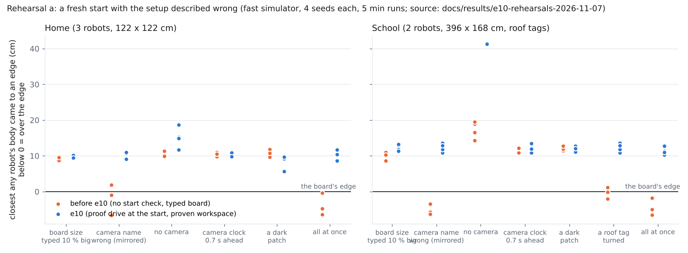
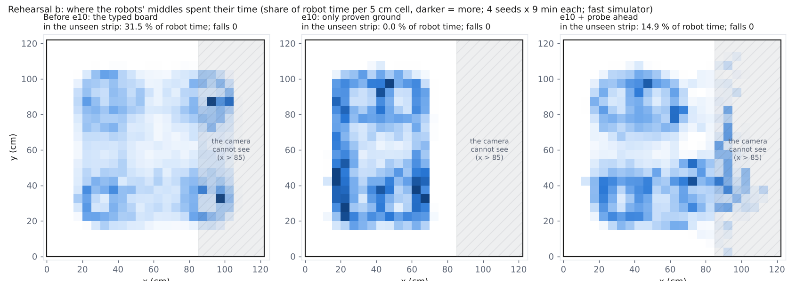
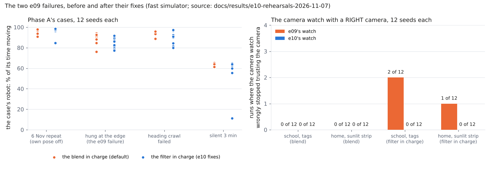
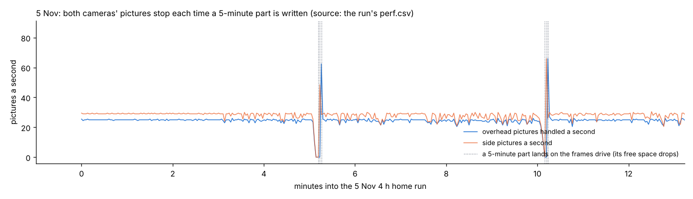
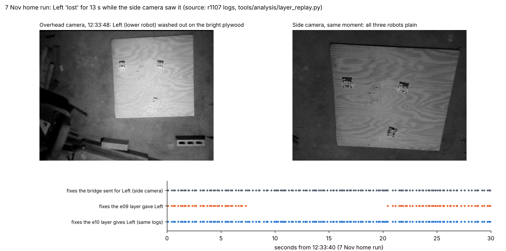
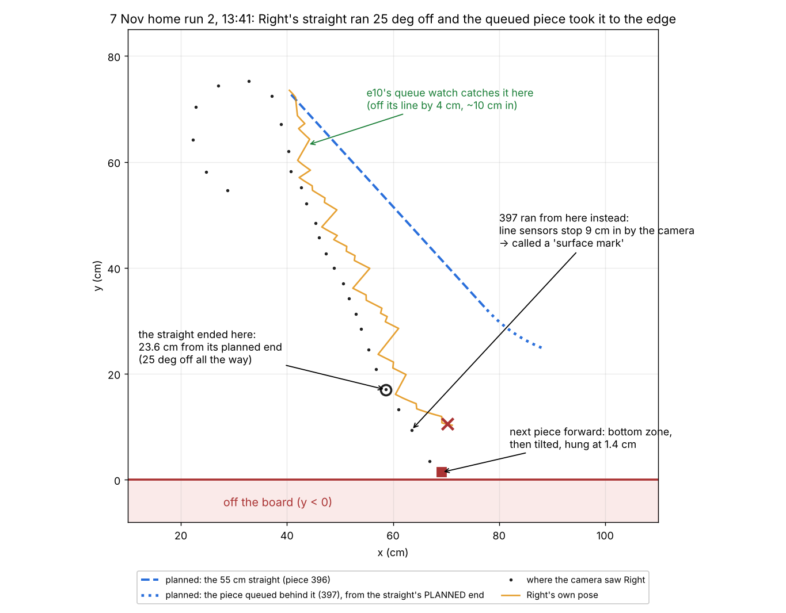
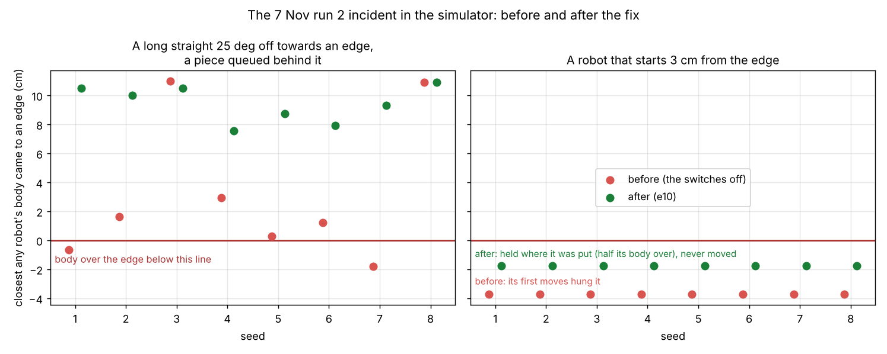

# e10, Phase C of the one pipeline: discovery at the start, the proven workspace, school free roam, the e09 fixes, preferences (7 Nov, simulator and logs only)

## Premise

Nick's 7 Nov plan: one pipeline for every site, in three phases. Phase A (e08) made the edges safe, Phase B (e09) gave
every site one tracking layer and the filter. This is the last phase: the system **finds out its own setup at the start
of every run** instead of trusting what was typed, plans **only on ground it has proven** is table, runs **free roam at
school through the same controller**, fixes the two things e09 left (the filter's hang case, the camera watch's false
alarms), and gets a **preferences page with a first-time quiz**. Nothing touched a robot, a Pi or the network (only
GitHub, for the push).

**Measured, and where from.** The fast simulator (`freeroam_fastsim`, the controller the Pi runs, camera sightings with
no names through the tracking layer, the robots' raw sensors, the edge physics, now with the look-ahead bottom zone);
the home runner's own dry mode over real UDP (`freeroam.py run --dry`); Mission Control's practice runs through its API;
the real 5 Nov log (first 90 min) for the filter's uncertainty. "Before" = e09's defaults through the switches.

## Data

### 1. What was built (each old way kept behind a switch, decided automatically by default)

| Asked | Built | The switch (the old way) |
|---|---|---|
| C1 discovery at every start | `start_discovery.py`: each robot drives a short "L" on its spot (turn 45 deg, 12 cm, quarter turn, 12 cm; 4 cm/s; its edge sensors on). The camera's spots against its own wheels and gyro give: **camera seen** (none: the run narrows), **handedness** (mirrored: a wrong camera name; the other calibrations the Pi has are tried and the one that matches is used), **scale** (the board's size its calibration was made with is wrong: the board found = typed / scale), **turned roof tags** (corrected per robot), **clock skew** (from when the spot and the wheels start to move), each robot's **wheel and gyro fit** (pooled on the Pi per robot, saved on the robot with `corr save` once sure: **no reflash**) | `--no-discovery`, `MIRLT_DISCOVERY=0` |
| C1 feel-out | the home free roam now feels the board's real edges with the robots' own edge sensors through C2's probes and records every drop; the school keeps `feel_first` (e07) as it was | - |
| C2 proven workspace | `proven_workspace.py`: a 2.5 cm grid: seen by the camera (inside its setup's outline, where it can see, not a dark patch), felt by a robot's wheels, or a drop. The planner's every edge distance is now to the nearest ground that is not proven (`freeroam_core.edge_dist`). Saved per site; used again only on the same outline | `--typed-board` (the rectangle, as before) |
| C2 probe ahead (a setting) | a robot standing near unproven ground drives slowly (3 cm/s) straight into it, its bottom zone and line sensors guarding it; what its wheels roll over becomes proven, a drop it feels is marked; then it reverses back along the strip it proved | **off by default**; `--probe-ahead`, `./run-fleet-pi.sh freeroam ... probe`, the page's "Explore" |
| C3 school free roam on the same controller | `mission_run` hands the found robots and its tag bridge to `freeroam.py --external-bridge --tracking tags`: the same controller, filter, layer (with the mid-run identity wiggle), proof drive and workspace as at home; practice mode too | **now the default** (its practice run passed); the planner's roam is the switch: `MIRLT_SCHOOL_ROAM=planner`, the page's "School free roam runs on" (question 2) |
| C3 motion at school | the tag bridge now runs the motion detector (cam_bridge's tracker, the robots' own poses as its prediction) beside the lock-on, re-seated by every tag read; its sure sightings go out as `tag_bridge:motion` where neither tag nor lock gave a fix | `--no-motion`, `MIRLT_TAG_MOTION=0` |
| C4 the filter's hang case | three causes found and fixed (section 3) | `MIRLT_UNC_SPLIT=0`; `--no-shuffle` |
| C4 the camera watch | cause found and fixed (section 3) | `MIRLT_CAMERA_WATCH_METHOD=e09`; the watch itself **still off by default** |
| C4 95 % | the filter's uncertainty: 8 x sigma (was 6), measured on the real log | `MIRLT_UNC_SPLIT=0` and a `k_sigma` |
| C5 preferences | Mission Control's Start screen: a first-time quiz (5 questions) that fills in a page of choices; the essentials up front, every e08 / e09 / e10 switch under Advanced; saved per site on the Pi (`~/.config/mirlt/prefs/<site>.json`); every run started from the page gets them | - |
| Claude's defaults | pictures "unsure near an edge": at most one per robot per minute; wiggle stop 2.5 s kept; gyro-rate heading off | on the page |

### 2. Discovery and the proven workspace



With a broken guess (left of each pair, e09's start) robots went over the edge; after the proof drive (right) none did.

**Rehearsal a: a fresh start with broken guesses** (4 seeds each, 5 min after the start; "position error" = the controller's idea of where the robots are against the truth):

| Site | Broken guess | Pipeline | Runs | Found at the start | Closest body to an edge, worst / median (cm) | Falls | Contacts | Moving (median of runs) | Position error (cm, median) |
|---|---|---|---|---|---|---|---|---|---|
| home | all | before | 4 | - | -6.5 / -5.6 | 2 | 0 | 7.7 % | 106.9 |
| home | all | after | 4 | wrong name/mirrored | 8.5 / 9.5 | 0 | 0 | 96.3 % | 2.2 |
| home | clock | before | 4 | - | 9.8 / 10.7 | 0 | 0 | 98.4 % | 1.6 |
| home | clock | after | 4 | ok/as configured | 9.8 / 10.6 | 0 | 0 | 98.1 % | 1.2 |
| home | dark | before | 4 | - | 9.7 / 10.7 | 0 | 0 | 98.4 % | 1.1 |
| home | dark | after | 4 | ok/as configured | 5.6 / 9.5 | 0 | 0 | 93.0 % | 1.1 |
| home | mirror | before | 4 | - | -6.6 / -1.0 | 1 | 0 | 5.0 % | 108.0 |
| home | mirror | after | 4 | wrong name/mirrored | 9.1 / 10.8 | 0 | 0 | 98.1 % | 1.1 |
| home | none | before | 4 | - | 9.7 / 10.1 | 0 | 0 | 3.9 % | 0.6 |
| home | none | after | 4 | missing/as configured | 11.7 / 15.1 | 0 | 0 | 0.0 % | None |
| home | size | before | 4 | - | 8.5 / 8.9 | 0 | 0 | 98.5 % | 9.6 |
| home | size | after | 4 | ok/as configured | 9.5 / 10.0 | 0 | 0 | 98.3 % | 1.6 |
| school | all | before | 4 | - | -6.5 / -3.6 | 2 | 0 | 36.3 % | 290.2 |
| school | all | after | 4 | wrong name/mirrored | 10.2 / 11.2 | 0 | 0 | 98.6 % | 4.0 |
| school | clock | before | 4 | - | 10.9 / 12.1 | 0 | 0 | 98.7 % | 1.6 |
| school | clock | after | 4 | ok/as configured | 10.8 / 11.4 | 0 | 0 | 98.7 % | 0.9 |
| school | dark | before | 4 | - | 11.4 / 11.7 | 0 | 0 | 98.6 % | 0.9 |
| school | dark | after | 4 | ok/as configured | 11.1 / 11.8 | 0 | 0 | 98.7 % | 0.9 |
| school | mirror | before | 4 | - | -6.5 / -6.0 | 3 | 0 | 45.1 % | 329.9 |
| school | mirror | after | 4 | wrong name/mirrored | 10.9 / 12.4 | 0 | 0 | 98.7 % | 0.9 |
| school | none | before | 4 | - | 14.3 / 17.7 | 0 | 0 | 3.5 % | 1.4 |
| school | none | after | 4 | missing/as configured | 41.3 / 41.3 | 0 | 0 | 0.0 % | None |
| school | size | before | 4 | - | 8.7 / 10.2 | 0 | 0 | 98.5 % | 22.7 |
| school | size | after | 4 | ok/as configured | 11.3 / 12.3 | 0 | 0 | 98.6 % | 3.8 |
| school | tag | before | 4 | - | -2.1 / -1.1 | 0 | 0 | 48.7 % | 0.9 |
| school | tag | after | 4 | ok/as configured | 10.9 / 12.4 | 0 | 0 | 98.7 % | 0.9 |

"none" = no camera at all: the run narrows to standing (0 % moving, nobody near an edge), as it should. "dark" at home: the proof drive passes; one robot came to 5.6 cm in a dark patch (the edge rule held).



Where the robots went when the camera sees only x < 85 cm: e09 (the typed board) drove blind over a third of its time; e10 stays on proven ground, and with probe ahead slowly proves more.

**Rehearsal b: the camera sees only x < 85 cm of the home board** (4 seeds x 9 min):

| Start | Closest body to an edge, worst / median (cm) | Falls | Contacts | Moving | Time where the camera cannot see | Board proven (%) | Probes |
|---|---|---|---|---|---|---|---|
| e09 (typed board) | 10.5 / 10.9 | 0 | 0 | 87.8 % | 31.5 % | - | 0 |
| e10 | 6.3 / 6.6 | 0 | 0 | 82.2 % | 0.0 % | 68.0 | 0 |
| e10 + probe ahead | **-1.5** / 4.5 | 0 | 0 | 86.6 % | 14.9 % | 74.4 | 18 (median) |

The probe run's -1.5 cm (seed 3): Right probing along the y = 0 edge in unseen ground; its bottom zone stopped it with a
front corner 1.5 cm past the edge, no wheel over, no hang. That is the bottom zone's reach doing its job at the limit;
it is one reason probe ahead stays off (question 4).

### 3. The two e09 failures: causes and fixes

**The filter in charge left a freed robot standing (e09 rehearsal e(b)).** Three causes, each shown in the logs of a
traced run (`tools/fleet/rehearse_phase_a.py` case b, the filter in charge):

| Cause found | Effect | Fix |
|---|---|---|
| Camera fixes move the filter's clock to "now", so the robot's RAW rows (stamped a few tens of ms earlier) arrived "in the past" and were thrown away, its "standing still" readings with them | the filter's speed doubt grew without end: a robot standing in plain view read 5-20 cm of position doubt near the edge, and nothing fitted | late rows (up to 0.5 s) are applied at the filter's time |
| One factor (6 x sigma, from real camera GAPS) was applied to a robot the camera sees 12 times a second | 3-5 cm of doubt against the blend's 1-2 cm | two parts: the doubt the last camera fix left x 2.45 (the 2-D 95 % factor) + the doubt grown since that fix x 8 |
| An "edge turn" under 3 deg (a robot already facing the middle) sent nothing and waited for the 15 s slow-move timeout, again and again; and a robot freed 0.5-1 cm deeper in a corner than the blend's had no move the circle rules allow | stood 30 s, or for the rest of the run | an empty move ends at once; a last "corner shuffle" rung checks the body's four corners exactly through a small turn and a short slow drive that gains room; the recovery's reverse may run up to 6 cm longer when that ends with room to turn |

**The camera watch's false alarms (2 of 12 e09 runs).** Each vote compared the turn between two 6 cm chords of single
sightings with the robot's own heading change. For the lock-on's 0.8 cm a chord turn's noise is about 19 deg
(sqrt(6) x sigma / 6 cm), as big as the turn being checked (about 17 deg on a 20 cm curve): about 10 % of votes went
the wrong way (60 of 608 in e09's run b-5), and now and then 4 of 6 did. Now each checkpoint is the average of 0.4 s of
sightings, checkpoints 12 cm apart, the robot's heading taken at the same moments, and a vote counts only when the
expected turn is over 3 x its noise. On the two e09 runs that alarmed: 0 wrong votes of 585 and 538.



Left: the freed robot now drives on with the filter in charge. Right: the camera watch's false alarms are gone.

**Rehearsal d: the filter in charge, Phase A's cases** (12 seeds each; moving = each robot's share of time, median / lowest):

| Phase A case | Pose source | Closest body, worst (cm) | Falls | Contacts | Moving, median / lowest robot |
|---|---|---|---|---|---|
| a (own pose off) | blend | 7.7 | 0 | 0 | 97.8 / 90.9 % |
| a | filter | 9.8 | 0 | 0 | 97.0 / 84.8 % |
| b (the hang case: Center starts hung at x = 0) | blend | -2.9 (its start) | 0 | 0 | 90.4 / 76.2 % |
| b | filter | -2.9 (its start) | 0 | 0 | 88.3 / 77.2 % |
| c (heading crawl failed) | blend | 9.3 | 0 | 0 | 95.6 / 88.8 % |
| c | filter | 10.0 | 0 | 0 | 90.9 / 79.8 % |
| d (Right silent 3 of 9 min) | blend | 9.1 | 0 | 0 | 63.9 / 61.1 % |
| d | filter | 9.6 | 0 | 0 | 62.3 / **11.2 %** |

e09 with the filter in charge left case b's freed robot standing; now it drives on. One new finding: in case d, seed 6,
with the filter in charge, Right rejoined after its silence but then stood with a "hazard" stop for the rest of the run
(11 % moving); the blend never did. Not chased in this build (Sweep 1). These ran before the run 2 fixes; case b starts a
robot hung at the edge, which the new start check would now hold (the e08 tests that need it set `start_edge=False`).

**Rehearsal e: the camera watch on, false alarms** (Phase B's cases a and b, 12 seeds each, both watch methods):

| Case | Pose source | e09 watch: runs with an alarm / wrong votes | e10 watch: runs with an alarm / wrong votes |
|---|---|---|---|
| a | blend | 0 of 12 / 0 | 0 of 12 / 0 |
| b | blend | 0 of 12 / 0 | 0 of 12 / 0 |
| a | filter | **2 of 12** / 947 | 0 of 12 / 0 |
| b | filter | **1 of 12** / 858 | 0 of 12 / 0 |
| camera mirrored mid-run (6 seeds) | blend | caught 3 of 6 | caught 0 of 6 |

Both let bodies over the edge in the mirrored case (2 falls each): the watch is not the guard against a mirrored camera;
the start's proof drive is (rehearsal a).

**95 %.** On the real 5 Nov log (1,377 gaps cut out of the camera track, `tools/analysis/fused_replay.py`) the new
uncertainty held the real error **97 / 96 / 96 %** of the time for 10 / 20 / 40 s gaps (e09's 6 x sigma: 87 / 88 /
91 %); 5 s gaps 87 %, where the camera's own ~1 cm noise (the reference) dominates. The filter's positions are unchanged
(1.38 / 1.62 / 2.06 / 2.81 cm median, as e09). Source: `docs/results/e10-rehearsals-2026-11-07/replay_1105_90.json`.

### 4. School free roam, 30 min

**Rehearsal c: school free roam, 30 min, on the free-roam controller** (2 seeds; 40 of Jay-Sun's points, 30 on the far side the roof tags do not reach):

| | Points reached (far side) | Robots moving | Tracked on the far side | Closest body (cm) | Contacts |
|---|---|---|---|---|---|
| before (e09 layer, no discovery), seed 1 | 5 of 40 (1 of 30) | 8 / 2 % | 0 % | 13.7 | 0 |
| before, seed 2 | 4 of 40 (3 of 30) | 7 / 1 % | 0 % | **-5.6** | 0 |
| after (e10), seed 1 | 38 of 40 (28 of 30) | 98.7 / 98.7 % | 99.7 % | 10.9 | 0 |
| after, seed 2 | 35 of 40 (26 of 30) | 98.7 / 98.7 % | 99.7 % | 11.3 | 0 |

Mission Control practice (dry, the real programs over UDP, simulated robots and tag bridge): free roam at school on the
free-roam controller ran end to end: the proof drive found the 0.70 s clock skew, robots moving 95 / 91 %, no collision,
closest gap 18.1 cm, closest to the open edge 5.1 cm. Visit points as before: done, no collision. Files:
`docs/results/e10-rehearsals-2026-11-07/mission-control-practice/`.

### 5. End to end

**Rehearsal f: 30 min home free roam, the e10 start, a robot dying and a Pi freeze included** (2 seeds):

| Seed | Discovery said | Contacts | Falls | Closest body (cm) | Moving (Left / Center / Right) |
|---|---|---|---|---|---|
| 1 | Camera, board and clock check out against the robots' own movement. | 0 | 0 | 9.5 | 98.4 / 98.3 / 98.1 % |
| 2 | (the same) | 0 | 0 | 8.7 | 98.4 / 97.8 / 97.9 % |

Re-run with the run 2 fixes on (no heading fault injected): seed 1 0 contacts, 0 falls, closest body 9.5 cm, moving
98.4 / 98.1 / 98.1 %; seed 2 the same with 8.5 cm and 98.0 / 96.8 / 95.4 %. The queue watch acted 13 and 85 times in
30 min (8 and 52 re-aims with no stop, 2 and 18 heading re-sets with a stop). Both seeds include a robot that dies and a Pi
freeze; I did not check why seed 2 had six times as many. My reading: the watch costs at most 1-3 % of moving time here.

Mission Control practice, home free roam with discovery: 99.4 % moving.

### 6. Two camera faults from the real runs (added by the coordinator mid-build)

**Every robot lost the camera at once, about 4 s every 5 minutes (5 Nov, 4 h, full-video mode).** The cause is in the
code, and the run's own log shows it happening:

- Free roam's frame saver (`doe_loop.CamFrames`) reads the camera's `/live` stream and, every 300 s, built the whole
  5-minute part in memory (about 3,600 pictures, 100-200 MB) and wrote it in one go, from that same reading thread.
- The recorder (`camrec.py`) writes its full video in the same loop that hands each picture to `/live` (port 8000),
  and both went to the same USB drive. While the drive took the part, the recorder's next write waited, and so did
  every picture for the trackers.
- `perf.csv` of that run: at each part (5.2, 10.2, 15.2 ... min) the frames drive's free space drops by 0.1-0.14 GB and,
  in the same seconds, both cameras' delivered pictures fall to 0, then catch up at 60 a second. The bridge's own
  output stops for every robot at the same moments (2409.7, 2709.7, 3910.3 s: 300 s apart).



Each time a 5-minute part landed on the drive, both cameras' pictures stopped (the two dips to 0).

Fixed on both sides: (1) the recorder's video is written by its own thread from a 3-second queue: a slow drive drops
recorded frames (counted in `meta.json` as `rec_dropped`), never live ones; (2) the part is written by its own thread,
streamed in 4 MB pieces with short pauses, byte for byte the same file. Tests: with a drive stalled 1.5 s, the live
pictures' longest gap is under 0.3 s (the old way: over 1.2 s); `frames.csv` still matches the video frame for frame
(`tools/pi/tests/test_camrec_no_stall.py`). The old ways: `MIRLT_REC_WRITE=inline`, `MIRLT_PART_WRITE=inline`. Not yet
seen on the Pi itself (Sweep 1).

**Left "lost" for 13 s while it stood in a bright patch (7 Nov home run, 12:33:48; the run's only full stop).** The
overhead camera could not see Left on the bright plywood, but the side camera could, and the bridge sent its fixes the
whole time. The tracking layer dropped them. A moment earlier the controller had re-set Left's own pose 14 cm to the
camera's (`fpose`); the layer predicts a robot as "last sure spot + how far its own pose moved since", read the re-set as
a 14 cm drive backwards, and every real sighting fell outside Left's gate. Its brick watch then took Left's own still
spot for a new object. Fixed in the layer: an own-pose step faster than any robot drives is a re-set (the history is
shifted, not read as motion), and no new object is declared within 12 cm of a robot's own pose. Replayed on that run's
logs (`tools/analysis/layer_replay.py`): e09's layer leaves Left 13.2 s without a fix; e10's layer leaves no robot over
3 s without one in the whole run, and finds 4 such re-sets. The switch: `MIRLT_OWN_RESETS=0`.



The side camera saw Left the whole time (top row of dots); e09's layer dropped 13 s of it (middle); e10's keeps it all.

So the side camera already covered the overhead's bright spot at home (cam_bridge fuses both); what failed was the layer
after it. At school the second camera is still switched off in the site file (the tag bridge can fuse two). The lock-on
was not needed here (the side camera saw Left); it stays seeded on standing robots as e09 built it.

### 7. The 7 Nov run 2 incident: Right left hanging over the y = 0 edge (the coordinator's priority item)

**What happened** (run 2's logs, read only: `moves.csv`, `step.csv`, `follow.csv`, `camera_track.csv`,
`surface_marks.csv`, `events.csv`, 13:41:13-13:41:31):

1. Right got a 55 cm straight (move 396, planned from (40.8, 72.7) towards (77.7, 32.1)). Its own heading was about
   25 deg off, so it drove 25 deg further round all the way; it reported "done" 23.6 cm from the planned end, at
   (58.6, 17.0) by the camera. The camera's fixes kept its own **position** right (within 4 cm) but not its heading.
2. The next piece (397) had been queued on the robot **0.27 s after the straight started**, planned from the straight's
   **planned** end. Nothing checked it again. It ran from where Right really was, 17 cm from the edge, heading for it.
3. At 13:41:27.9 the line sensors stopped 397. The camera put Right's middle 9.4 cm in, over the 8 cm surface-mark
   rule, so the stop was logged as a **surface mark** (nothing kept out). The filter's doubt at that moment was 6.1 cm.
4. Then a new piece forward (the robot's own heading still wrong): the bottom zone stopped it after 0.27 s, a stop-turn
   step tilted it, and it hung at 1.4 cm from the edge with nothing safe left to try.

The robot's firmware already drops its queued steps when a step fails (`follow.h`: "an earlier step failed"), and the
controller forgot its own copy too; so after the edge-guard stop nothing old ran. What ran was **new**, planned from a
wrong heading after a wrong "surface mark" verdict. Also, the "unsure near an edge" check fired at 13:41:25.5 but did not
stop the straight, because it judged "moving inward" by the piece's **planned** end (32 cm in), not where Right was going.



The planned straight (dashed) and the piece queued behind it (dotted) against where the camera saw Right (dots).

**Fixed (each behind a switch, on by default, the old way one setting away):**

| Asked | Built | Switch |
|---|---|---|
| (a) re-check queued pieces every tick against the fused pose and the edge rule | `queue_watch`: every tick while a curve piece runs, (1) how far the fused position (and the camera's own fix, at its time) is **across** the piece's path: over 4 cm for 0.3 s is "off plan"; (2) its own heading against the camera's course (the camera's track against its own pose's track over the last 1.5 s: on a curve both bend alike, so the difference is the heading error); 10 deg off for 0.5 s and the rest of the piece **plus every queued piece**, chained from where it really is the way it really goes, is checked with the edge rule. Off plan or failing: the queued pieces are dropped; with its heading over 15 deg off, its heading is re-set (`fpose`), it stops and the next piece is planned from where it stands; otherwise the piece is re-aimed from the fused position (`farc`, which also drops the robot's queue; no stop). A dropped piece that starts on the robot anyway is halted. The "unsure near an edge" check now judges "inward" by where the piece really ends | `MIRLT_QUEUE_WATCH=0`; Preferences > Advanced "Queue watch" |
| (b) after an edge-guard or tilt stop drop every queued piece; the surface-mark verdict defers to the uncertainty | the dropping already happened on both sides (above: checked in the firmware and the controller, and a test); the verdict now uses the camera's edge distance **less the filter's uncertainty**: run 2's 9.4 cm with 6.1 cm of doubt is 3.3 cm, so it is the edge (kept out, backed away from), logged as "edge, not a mark" | `MIRLT_MARK_UNC=0`; "A line-sensor stop near an edge counts as the edge" |
| (c) a long straight checkable mid-move against the camera | the same watch runs all along every piece, straights included: 25 deg off is caught after about 10 cm (4 cm across), and sooner when the queued piece would break the edge rule (in the test on run 2's numbers: after 5.5 cm, 42 cm from the edge) | as (a) |
| (d) a start check | a robot with any corner of its body less than 1 cm inside the board by the camera (over the edge, or right at it) does not move; it says, in plain words, e.g. "Right starts at the board's edge: part of its body is over the edge (the camera puts its middle 3.0 cm from the edge). It will not move. Please move it a hand's width (10 cm) onto the board; it starts by itself once it is there." A robot just inside (Right on 5 Nov, 6.6 cm in, facing out) starts, and e08's edge-trap rule backs it out. The proof drive (its first move a turn on the spot) is skipped for any robot whose middle is under 7.7 cm in (asked as a question when someone is watching; a picture is saved when not) | `MIRLT_START_EDGE=0`; "Start check" |
| (e) a simulator reproduction | `freeroam_fastsim` `hdg_fault`: a 35 cm+ straight starts with the robot's own heading 25 deg off the way that takes it towards the nearest edge (only when it would end within 14 cm of one), the firmware not steering back by position (as Right's), until it is told its heading. Rehearsal `rehearse_phase_c.py g`, 8 seeds x 9 min, home, the e10 start; and a robot started 3 cm from the edge | - |



Left: the closest any body came to an edge per run with run 2's heading fault (red before, green after). Right: a robot put down 3 cm from the edge: before, its first moves hung it; after, it waits to be moved in.

**Rehearsal g** (8 seeds each; source `docs/results/e10-rehearsals-2026-11-07/incident/runs.jsonl`):

| Case | Runs | Faults injected | Closest body to an edge, worst / median (cm) | Runs with a hang | Falls | Contacts | Moving (median) | Queue watch acted (re-aimed / heading re-set) | Held at the start |
|---|---|---|---|---|---|---|---|---|---|
| heading-after | 8 | 9 | 7.5 / 9.6 | 0 | 0 | 0 | 98.0 % | 133 (77 / 27) | 0 |
| heading-before | 8 | 11 | -1.8 / 1.4 | 2 | 0 | 0 | 98.4 % | 0 (0 / 0) | 0 |
| start-after | 8 | - | -1.8 / -1.8 | 0 | 0 | 0 | 98.3 % | 5 (2 / 2) | 8 |
| start-before | 8 | - | -3.7 / -3.7 | 8 | 0 | 0 | 98.2 % | 0 (0 / 0) | 0 |

With the heading fault, before: 2 of 8 runs hung a robot and the worst body was 1.8 cm over; median 1.4 cm in. After: no hang, worst 7.5 cm in, moving unchanged (98 %). The queue watch acted about 17 times per 9-minute run (most re-aims with no stop); the injected fault was 9-11 per 8 runs, so most actions are on ordinary drift of 4 cm or more; in 30-minute runs with no fault it acted 13 and 85 times (section 5). How often on real logs is a Sweep 1 item.

Before = the three switches off (e10 otherwise). "Held at the start" counts robots held; its body figure is where it was
put (-1.8 cm: 3 cm in, half its 9.5 cm body over), and it never moved. Tests: `tools/fleet/tests/test_e10_incident.py`
(7: run 2's straight caught within 15 cm and its queued piece dropped, the old way leaves it, an on-line straight left
alone, run 2's line trip is the edge, the start check holds and releases, the proof drive skips an edge robot, and the
simulator's before / after).

**What it does not fix.** The cause of the 25 deg itself (Right's own heading after a 217 deg turn at 9 cm/s; the e08
heading watch needs two straight stretches to re-set it) is not known from the logs; the queue watch now catches the
effect within about 10 cm. A robot hung at the start still waits for a person (the hold); e08's tilt recovery still
runs for a robot that tilts during a run.

## Conclusion

- **The start now checks its guesses.** With a wrong camera name, a wrong board size, turned tags or all of them at
  once, e09's start drove robots over the edge (bodies up to 6.6 cm over, 8 falls in its 52 runs); after the proof
  drive no body went over in any of 52 runs, and the position error fell from 10-330 cm to 1-4 cm. No camera: the run narrows to standing.
- **Planning stays on proven ground.** Where the camera cannot see, e09 spent a third of its time blind; e10 none.
  Probe ahead proves more of it but brought one front corner 1.5 cm past the edge: it stays off.
- **School free roam works on the home controller** in the simulator (35-38 of 40 points against 4-5) and in a Mission
  Control practice run; it is now the school's default, the planner one setting away.
- **Both e09 failures are fixed** in the simulator: the hung robot drives on with the filter in charge, and the camera
  watch has had no false alarm in 48 runs (e09's way: 3 of 24 with the filter).
- **The run 2 incident is reproduced and fixed** in the simulator: with run 2's heading fault, 2 of 8 runs hung a robot
  before, none after; a robot put down at the edge waits instead of hanging. On the real board none of this has run yet.
- **Two real-log camera faults fixed:** the 5-minute video part no longer stalls the live pictures (a test; not yet on
  the Pi) and Left's 13 s loss is gone on the replayed 7 Nov log.
- Full fleet suite: 733 passed, 9 skipped, 2 failed on the first full run with every change (e09: 712 passed, 9 skipped). The 2 failures were the 5 Nov edge-trap tests: the first start check held a robot 6.6 cm in that the trap rule should back out; the check now looks at the body's corners, and those test files pass again (32 of 32), as do the e08 / e09 / e10 files (67 of 67). The pi tests for the stream fix: 3 of 3.

## What's next

1. Nick answers the questions below (the filter in charge, the school's controller, the camera watch).
2. One attended home run with the new start (the proof drive takes about 15 s): read `discovery.json`, `workspace.json`
   and `~/.config/mirlt/robots/<robot>.json` in the run folder and on the Pi.
3. At school with Jay-Sun: one Visit points run as before, then one free roam on the free-roam controller (steps below).
4. The board's edge bench test (tilt, hang, bottom zone at the edge), asked for in five reports: it decides the corner
   shuffle's 1 cm margin and the bottom zone's reach, both chosen.

## Questions for Nick

**Substantive**
1. The filter's hang case is fixed: with the filter in charge the freed robot moved 88 % (median; the lowest robot 77 %) of the time over 12
   seeds (the blend 90 % / 76 %), no contact, no fall, and Phase A's other cases held. Put the filter in charge by
   default now, or after one attended home run with `filter`?
2. School free roam on the free-roam controller (one pipeline) is built, rehearsed in the fast simulator (35-38 of 40 points, 99.7 % tracked on the far side, no contact)
   and passed a Mission Control practice run (the 0.70 s clock skew found, no collision). I made it the school's default; the first real one should be with Jay-Sun watching. Keep it the
   default, or switch back to the planner's roam until that run (Preferences > Advanced, one setting)?
3. The camera watch no longer alarms falsely (0 false alarms in 48 runs, the blend or the filter in charge; e09's way alarmed in 3 of 24 with the filter), but against a camera mirrored mid-run it now rarely gets a
   vote (the mirrored sightings mostly miss every robot's gate), so it is no longer the main guard: the start's proof
   drive is. Turn the watch on by default (it is cheap and quiet now), or leave it off?
4. Probe ahead (proving ground the camera cannot see) is off by default, as you asked ("behind a setting"). In the
   rehearsal it proved 74 % of the board against 68 % (it reached half the unseen strip); one robot's front corner went 1.5 cm past the edge before its bottom zone stopped it (no wheel over) and nothing fell. Keep it off until the edge bench test?
5. (Run 2) The queue watch is on by default. In the simulator it re-aims or stops a robot about 17 times per 9-minute
   run (most without a stop); on the real board, with real drift, it may act more often. Keep it on, and should the
   next home run be attended so we can read its `off plan` events?
6. (Run 2) A robot put down at an edge now waits for a person, alone or not (it never drives off on its own). Or should
   it first try e08's tilt recovery (back straight inward) when the camera and its own pose agree which way is in?

**Other**
7. The proof drive goes the same way every time (left turns). Near an edge it is guarded only by the robots' own edge
   sensors. Should it first turn to face the board's middle as the camera sees it (one more turn, about 2 s)?
8. The first-time quiz has 5 questions. Anything you would ask a new user that is missing (for example the robots'
   names, or the battery floor)?

## How to run it at home

No reflash: firmware 2026-11-05d already has `corr save` (each robot's calibration kept at power-off) and everything else
runs on the Pi.

**Window: the Pi's terminal** (SSH from the laptop, as usual). Type, then Enter:

```
cd ~/alvik-fleet-capstone
```

```
git pull
```

You should see `start_discovery.py` and `proven_workspace.py` in the list of changed files.

**Easiest: Mission Control.** On the laptop's browser open the Pi's start page (`http://100.122.222.75:8091`),
Mission Control tab. The first time you will see **"First time here: five quick questions"**: click one answer to each,
then **Fill in my preferences**. You should see **"Preferences for home"** with your answers; nothing else is needed.
Press **Free roam**. At the start each robot makes a short L-shaped drive on its spot (about 15 s); then the run's lines
say **"Discovery: Camera, board and clock check out ..."** (or what it found and fixed). Then free roam as before. A robot
put down at the board's edge does not move and the run says so ("... starts at the board's edge ... Please move it at
a hand's width (10 cm) onto the board"); move it in and it starts by itself.

**Or from the terminal** (Pi terminal), an attended 30-minute run:

```
./run-fleet-pi.sh freeroam 0.5 attended
```

You should see `Free roam started in tmux session 'freeroam'`. To watch:

```
./run-fleet-pi.sh freeroam-status
```

Look for the line that starts with `Discovery:`. To also let the robots slowly prove parts of the board the camera
cannot see (off by default), start it this way instead:

```
./run-fleet-pi.sh freeroam 0.5 attended probe
```

To compare with e09's start (no proof drive, the typed board):

```
./run-fleet-pi.sh freeroam 0.5 attended no-discovery typed-board
```

When it ends, **start the upload straight away** (it runs while we talk):

```
./run-fleet-pi.sh freeroam-finish
```

## How to run it at school

No reflash. **Window: the Pi's terminal** at school:

```
cd ~/alvik-fleet-capstone
```

```
git pull
```

On the laptop's browser open the Pi's start page, Mission Control tab. Answer the five questions the first time (they
are kept for the school separately from home). **Visit points** runs as before. **Free roam** now runs on the same controller
as home (with Jay-Sun in the room the first time): press **Free roam**. You should see `FREE ROAM on the free-roam
controller (e10)` and then a `Discovery:` line. If a robot is placed at the table's edge you will see "... starts at the
board's edge ... Please move it a hand's width (10 cm) onto the board": move it in and it starts by itself. To go back to the
planner's roam: Preferences > **Advanced** > **"School free roam runs on"** > "The planner over Jay-Sun's points". The tag bridge's summary (`bridge_summary.json`) now has a `motion` count per robot.

## Sweep 1: new tests that may now be needed

- **Board, home (attended):** the proof drive on the real robots: its fits (`~/.config/mirlt/robots/*.json`) against the
  last calibration's values; how often it is guarded by an edge sensor. My guess: the 12 cm legs fit wheel scale to
  about +-2 % per run, so `corr save` happens after 4-9 runs.
- **Board:** a deliberately wrong camera name (the side camera's calibration on the overhead stream) once, attended, to
  see the proof drive refuse it on real pictures (the simulator's "wrong name" is a clean mirror).
- **Board:** the edge bench test (five reports ask for it): the bottom zone's real reach at the edge, a hang and its
  recovery; it sets the corner shuffle's margin and the probe's planned depth.
- **School, Mission Control practice and real:** free roam on the free-roam controller with Jay-Sun watching; the tag
  bridge's `motion` counts and its CPU on the school Pi (the heat tracker will show it).
- **Simulator:** the controller re-finding a robot that comes back into view after a long blind stretch (it took one
  re-find rule and a duplicate-sighting rule here; the layer's gates for a robot out of view need their own rehearsal).
- **Simulator:** probe-ahead over 4 h (does the proven area keep growing; do returns ever block each other).
- **Logs:** run the e10 camera watch over the 5 Nov 90-minute log (its votes on real sightings).
- **Simulator:** the proof drive with a robot placed 8-12 cm from an edge facing out (under 7.7 cm it is now skipped; just
  over, its first turn's corners).
- **Simulator:** rehearsal d case d seed 6 with the filter in charge: why Right stood with a "hazard" stop after rejoining.
- **Simulator:** the queue watch over 4 h at home and 30 min at school (it re-aimed 37 times and re-set headings 20 times
  in 4 x 9 min with the heading fault injected; how often without one, on real logs).
- **Logs:** replay the queue watch over run 2 and run 3 (r143835) to count how often it would have acted on real data.
- **Board:** why Right's own heading was 25 deg off after a 217 deg turn at 9 cm/s (gyro scale at speed?).

## Sweep 2: possible inaccuracies in what this relied on

| Number / assumption | Value | Chosen or measured | DOE? |
|---|---|---|---|
| Filter uncertainty, blind part | 8 x sigma | measured for a chosen 95 % (real 5 Nov log, 1,377 gaps: 97 / 96 / 96 % at 10 / 20 / 40 s; 87 % at 5 s) | yes: the coverage target |
| Filter uncertainty, tracked part | 2.45 x sigma | not chosen: the 2-D 95 % factor; assumes the filter's own posterior is right while the camera sees the robot (not measured: the camera is the only reference) | measure against a tape reference (audit M8) |
| Late RAW rows used | up to 0.5 s | chosen | no |
| Empty-move pause | 0.5 s | chosen | no |
| Corner shuffle margin | 1 cm + uncertainty, every corner | chosen | yes: hangs per hour in corners (edge bench test) |
| Recovery reverse may run longer by | 6 cm | chosen | no |
| Camera watch | 0.4 s averaged checkpoints, 12 cm apart, vote over 3 x noise, wrong over 2 x | chosen; 0 false alarms in 24 rehearsal runs | yes, on the 5 Nov log |
| Duplicate sighting | 3 x nearer another robot, in its gate | chosen | no |
| Proof drive | turns 45 / 90 deg, legs 12 cm at 4 cm/s, stands 1.5 / 1.2 / 1.2 s | chosen (10 cm legs gave one false "board size wrong" in 5 seeds) | yes: fit spread against room needed |
| Board size called wrong | over 6 % and over 3 standard errors | chosen (wheel scales differ +-3 %: measured 5 Nov) | yes |
| Clock skew acted on | over 0.15 s | chosen (the picture's own ~0.15 s) | no |
| Turned tag | over 20 deg, snapped to 90 deg when within 15 | chosen | no |
| Calibration saved on the robot | pooled standard error under 1 % | chosen | no |
| Workspace cell | 2.5 cm; whole cells only | chosen (up to 2.5 cm conservative) | no |
| Bottom zone (simulator) | a drop 9.5-10.5 cm ahead stops a forward drive | chosen from feel_table's "9-11 cm"; the real reach on the conference table is not measured | the edge bench test |
| Probe | 3 cm/s, 8 cm past proven ground, at most 50 cm, every 8 s a robot | 3 cm/s is feel_table's; the rest chosen | yes: area proven per minute against time lost |
| Camera edge error | 5 cm everywhere (Phase A) | Nick's decision, kept | - |
| Simulator: a camera's board view | the outline it was set up with, where it can see | a model; on the Pi the outline comes from the corner tiles (school) or the corner clicks (home), not from the picture itself | - |
| Simulator: the wrong camera name | a clean mirror, or the board's size scaled | a model; another real camera's calibration would be off in more ways | the board test above |
| Rehearsal a's first robot positions | random, 30 cm in, 40 apart (home); fixed (school) | chosen (as e04-e09) | - |
| Pictures when unsure | one per robot per minute | Claude's default (Nick may change) | no |
| Off plan (queue watch) | 4 cm across the path for 0.3 s | chosen (own pose and camera agree within 3 cm, plan margin 1 cm) | yes: false re-aims against how early a bad piece is caught |
| Heading error that triggers the edge re-check | 10 deg for 0.5 s; re-set at 15 deg | chosen | yes, with the above |
| Course from the camera | 1.5 s of fixes, 3 cm of travel | chosen | no |
| Re-aim only with this much piece left | 0.6 s | chosen (the queued piece might start first) | no |
| Surface mark | camera edge distance less the uncertainty, over 8 cm | 8 cm from e08 (the school tape); the subtraction chosen | no |
| Start check | every body corner 1 cm in to start (3 cm once held); the proof drive needs the middle 7.7 cm in | 1 cm chosen (the camera's ~1 cm error); 7.7 cm is the body's turning circle + 1 cm | no |
| Simulator heading fault | 25 deg, only when the straight would end within 14 cm of an edge, no steering back | a model of run 2 (one case) | - |

## Not done as asked

- **Discovery for Visit points and experiments at school.** The proof drive runs in free roam (home, and school free
  roam on the free-roam controller). Visit points and experiment routes still go through `run_plan`, whose own start
  checks (e06: wiggle naming, the tag heading by a nudge, the corner tiles' site fit, the feel-out on a new table) cover
  the same guesses in their own way; the proof drive's analysis is not called there.
- **The feel-out at home as its own step.** Home free roam has no separate feel-out crawl at the start; the board's real
  edges are found by the probes (a setting, off by default) and by any edge-sensor stop during the run, both written
  into the proven workspace. The school keeps `feel_first` as it was.
- **A board outline found in the picture itself.** The camera's part of the proven workspace is the outline the
  camera's setup gives (corner tiles at school, corner clicks / the typed board at home), checked against the wheels by
  the proof drive; nothing segments the table in the picture.
- **Tag height and table length** are already measured by the school's setup (roof_cal, the corner tiles: e07); nothing
  new was built for them. At home there are no roof tags.
- **Probe-ahead** works in the simulator but is left off by default, as asked; on the real board it has never run.
- **The rehearsals of the final code.** The big rehearsal ran on a frozen copy taken before two late layer changes (the
  own-pose re-set and its brick guard, from the coordinator's 7 Nov item); the camera-watch variant with the filter in
  charge ran on the final code. My expectation: the simulator's controller already shifts its own-pose history on its
  re-sets, so these change little there; not re-run.
- **Nothing on the real robots, Pis or cameras** (as instructed): every number here is the simulator, the dry runner or
  the real logs.
- **The run 2 fixes ran in the simulator, the unit tests and the full suite only**: the other rehearsals (a-f) and the
  Mission Control practice runs ran before them (rehearsal g and a 30-minute home run (f) were re-run with them).
- **Why Right's own heading was 25 deg off** is not known from the logs (see section 7).

## Self-review

| Found in review | Effect | Done |
|---|---|---|
| The workspace counted a half-covered cell at the board's edge as seen (122.24 cm is not on a cell boundary) | up to 0.26 cm more room than there is | only whole cells count; the planner is up to 2.5 cm conservative instead |
| The simulator's mirror fault flipped about the believed board, which the discovery corrects | the fault moved mid-run; "all at once" ended with bodies 2 cm over | the fault flips about the typed board; re-run |
| The clock was estimated after the standing spots, which a skewed clock cuts short | a 0.7 s skew read as "board 7 % small" | the clock first, then the spots; the onset timed at half of each leg as each source measured it |
| 10 cm legs | one false "board size wrong" in 5 seeds | 12 cm legs, longer stands, and 3 standard errors needed |
| The proof drive's step ids reused the controller's | every later step refused as a duplicate (robots stood) | the controller starts above the proof drive's ids |
| No heartbeat during the proof drive | the robots' watchdog stopped the legs | a status every 0.5 s |
| A lost "done" report | one robot's proof drive hung | FOLLOW's last-done id stands in |
| Probes never fired for curve robots; then robots stayed out in unseen ground; then a neighbour's lights were handed to them; then the lost-robot rule stopped the return | probe-ahead did nothing, then stranded robots | tried between pieces; a return along the proved strip; the duplicate-sighting rule; the return exempt from the lost-robot stop |
| The e10 duplicate-sighting rule also acted behind e09's "old way" switch | e09's test of the old way failed | only on the new path |
| The school free roam hand-over: run_plan's own arguments, the attended-only check, a 25 s wait shorter than the tag setup, robots with no pose of their own | the practice run did not start (four tries) | each fixed; the fifth practice run ran end to end |
| The first queue watch took the robot's course from the camera's track alone; on curves that read 20-50 deg off and it acted 454 times in 9 min (moving fell to 89 %) | many needless stops | the course is now the camera's track against its own pose's track over the same moments; 40 times with the fault injected, moving 98 % |
| The proof drive ran on a robot started at the edge (the start check only covered the controller) | the proof drive's turn hung it | the proof drive skips a robot the camera puts at the edge |
| The first start check held any robot under 7.7 cm in, including the 5 Nov trap (6.6 cm in, all of it on the board), which e08 backs out | the full suite's 2 failures | it now holds only a robot with a body corner under 1 cm in |
