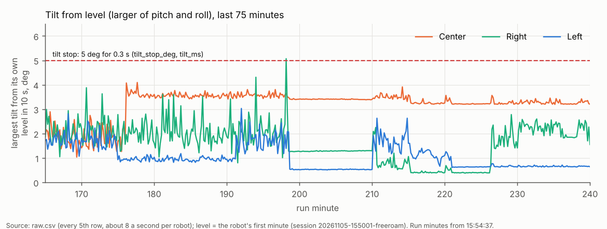
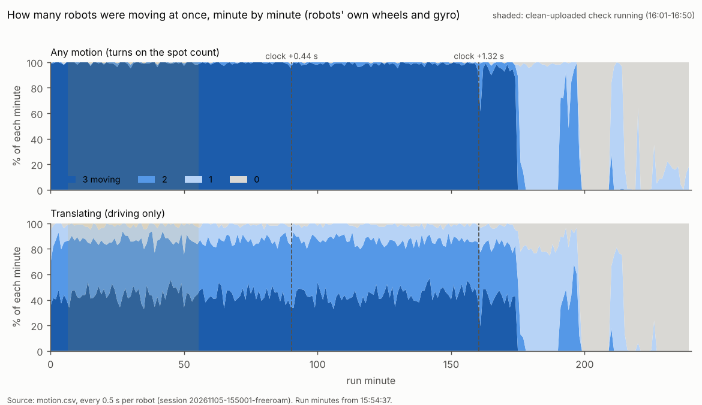
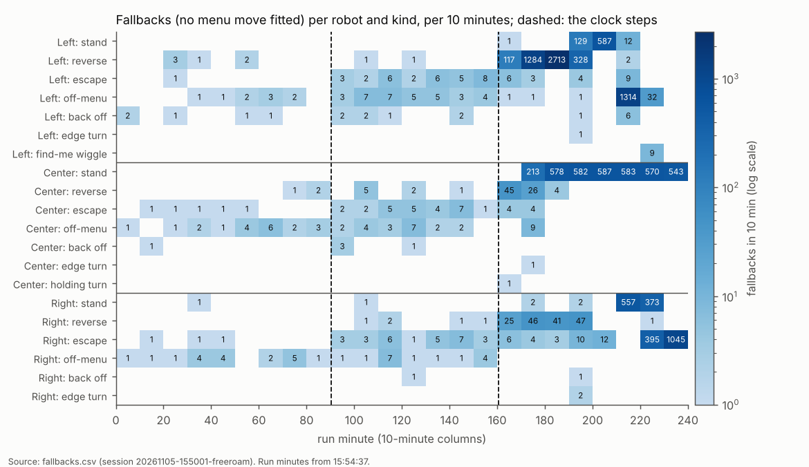
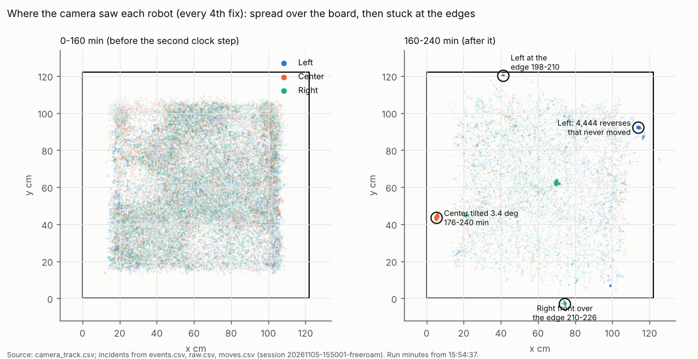
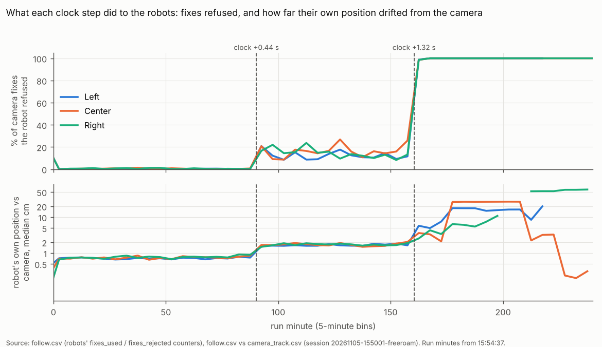
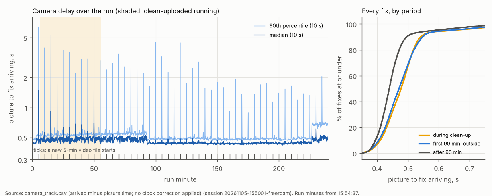
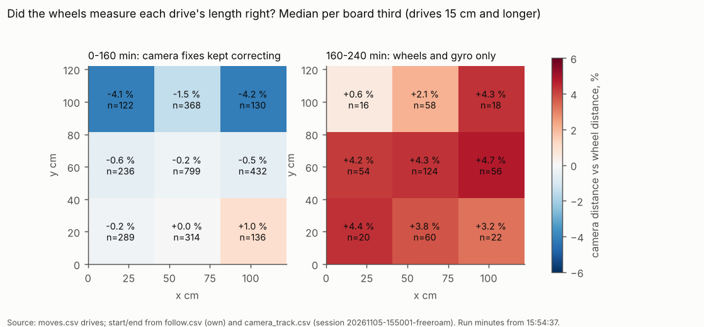
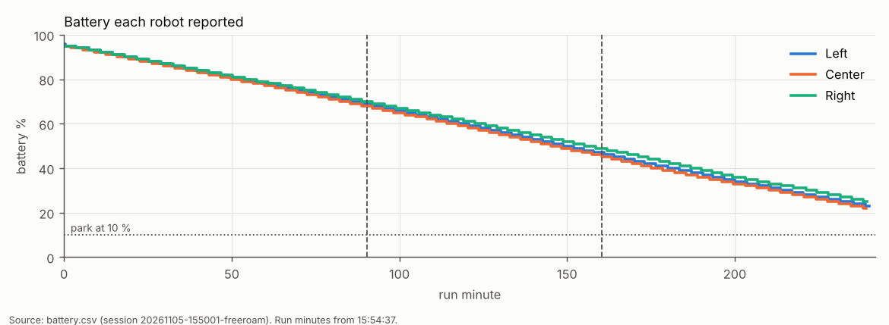
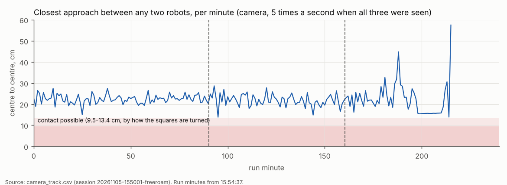

# Home free roam, 4 hours (5 Nov 15:50): what happened, and why it stopped

Session `20261105-155001-freeroam`: Left, Center, Right on firmware 2026-10-28a, stop-turn-drive, 122 x 122 cm board,
two cameras, roaming 15:54:37-19:54:44 (240 min, ended at its 4 h cap). Logs only (release
`freeroam-20261105-155001-freeroam`, the logs zip; no video or frames downloaded); the 17-minute run
`freeroam-20261105-143553-freeroam` for comparison. "Run minute" = minutes after 15:54:37.
**Measured** = read from the logs; **Claude's reading** = my interpretation, marked as such.

## Priority: Center tilted at the edge (Nick, 20:46)

**What happened (measured).**

| run min (clock) | what | source |
|---|---|---|
| 175.38 (18:50:00) | Center given a 35 cm menu drive towards the y = 0 edge; its **edge guard (bottom zone) stopped it** at 175.55, about 9 cm from that edge by the camera | moves.csv, step.csv, edge.csv |
| 175.55-175.92 | 2 reverses, a 47 cm drive, an edge turn, then 5 off-menu drives that the robot reported "done" in 0.06-0.6 s without moving, then a 70 cm and a 28 cm drive | moves.csv |
| 176.10 (18:50:43) | step 3008: a ~44 cm forward drive. Center's **own pose** said it drove from (23, 77) to (19, 34), straight "down"; the **camera** saw it go from (21, 74) to **(5.4, 43.5): diagonally into the x = 0 edge**, about 27 deg off the edge line | step.csv, camera_track.csv |
| 176.22 (18:50:50) | **the controller halted it**: "stuck: drive commanded, the camera saw it move 0.8 cm in 3 s". Nothing on the robot had stopped it | events.csv, step.csv (`halted`) |
| 176.2-240 | Center sat at camera (5.4, 43.5) for the last **64 min**, tilted **3.4 deg from its level** (roll +3.4 deg, pitch +1.9 deg; peaks 4.1 deg), its right line sensor reading 77-82 against 53 on the board (that side dipping), "lifted" never set. Its centre was 5.4 cm from the edge and a corner reaches 6.7 cm, so a corner or wheel was at or over the edge | raw.csv, camera_track.csv |
| 177.7-240 | the controller sent it 13 more reverses (14 cm, blind backwards) and logged 3,656 "stand" fallbacks; the first reverse ran its wheels 3.6 s without the camera seeing it move ("stuck" again at 177.7); the rest were reported done in 0.05-0.2 s. 13 full stops, 2,923 s in all | moves.csv, fallbacks.csv, breaks.csv |
| ~214 (19:28) | Center's tilt eased to 3.2 deg and the right line sensor returned to 54, with no command that moved it; Left's front sensor reported "Center" 6.4-6.8 cm ahead at 214.1-214.8 | raw.csv, events.csv |

Center (orange) sat just under the 5 deg tilt stop for its last 64 minutes; Right's single spike to the line at 198 min is the tilt stop that ended its run.

**What stopped it: the controller's "stuck" rule, not the robot.** Measured: the tilt stop (5 deg for 0.3 s) never
fired for Center, because the tilt stayed at 3.2-4.1 deg; the edge guard did not trip at the x = 0 edge (it had tripped
correctly 40 s earlier at the y = 0 edge, driving straight at it); the front sensor saw nothing. The edge guard only
looks ahead (line sensors and the bottom zone at the nose): **Claude's reading:** coming at the edge at a shallow angle,
the side wheel reached the edge before the nose did, so neither cue could fire.

**Why it drove there (measured, then Claude's reading).** From minute 160.4 every robot **refused every camera fix**
(the clock ratchet below), so Center steered by wheels and gyro alone; at minute 176 its own position was 17 cm from the
camera's. The controller planned the drive from the camera's position, the robot executed it from its own: the drive
landed 17-27 cm from where it was planned, at the edge. The clock bug (fixed in 8e602c2) is the cause; the missing
side-edge and low-tilt protection is why nothing stopped it.

**Are the tilt stop and the edge guard on in the free roam? Yes, both (measured).** `tools/fleet/freeroam.py` sends
`SAFE` at start-up: `set safe_edge 3` (line sensors and bottom zone), `edge_dir 0`, `edge_thr 150`, `edge_n 3`,
`edge_bot_cm 11`, `bumper_cm 0`. The tilt stop is not in SAFE but is on by firmware default (params.h:
`tilt_stop_deg 5`, `tilt_ms 300`, `safe_lift 1`; `safe_edge` defaults to 0, which SAFE overrides). All three robots
reported `tilt_stop_deg 5`, `tilt_ms 300`, `safe_edge 3`, `safe_lift 1` at the start (param.csv). Two limits by design
(motion.h): the edge guard works **forward only ("backing up is blind")**, and 4,703 of the run's moves were reverses;
the tilt stop needs 5 deg.

**Right and Left at the edges too (measured).** Right: its **tilt stop fired once** (198.3, "tilted 5.8 deg"), right
after a front stop on Center from about 13 cm/s; raw.csv shows pitch peaking 5.1 deg above level for ~50 ms during that
hard brake, then level (Claude's reading: a braking nose-dip, not a fall). Its follow run restarted, it stood 12 min
(14 moves each timing out after 49 s, cause not found), then at 210.4 drove 70 cm into the y = 0 edge; **its edge guard
(line sensors) stopped it** with all three line sensors reading 632-677 (no floor under the nose), and it stayed there
16 min (camera centre 2.8 cm past the edge line) until a move took it back at 226.4. Left: stood 12 min with its centre
1.6 cm from the y = 122 edge (198-210), then the camera put it 3 cm past x = 122 at 215.2 and lost it for the rest of
the run; its line sensors and tilt stayed normal, so it was on the board (the camera reads outward at open edges).

**What should change (Claude's recommendations; each a question below).**
1. Act on the robot-vs-camera disagreement (Observe, then trust): when a robot refuses most fixes or its own pose is
   more than ~5 cm from the camera for a few seconds, stop planning moves for it and re-seed its pose (or restart its
   follow run) instead of driving on. This run had 80 minutes of 13-52 cm disagreement and kept driving.
2. Treat "stuck" near an edge, and a standing tilt, as hazards: no further blind reverses; stop that robot, say so,
   keep the others roaming. A **standing tilt rule** (for example 2.5 deg for 2 s while not driving: this run's robots
   stood within 1.5 deg on the board, drove with spikes to 4.4 deg) would have caught Center at 176.2. Those two numbers
   are chosen; a bench DOE (a wheel over a 1 / 2 / 3 cm drop, standing and driving) is the right way to set them.
3. Detect "done without moving": a move reported done in under 10 % of its estimate with no camera movement, twice in a
   row, means the robot and the controller disagree on where it is; stop the loop (this is what drove Left's 4,289-move
   loop and Right's 1,440 escapes below).
4. Reverses near an edge only with camera-confirmed room behind, since the robot cannot see backwards.

Video to check by eye (overhead track, uploaded): Center's drive into the edge at `overhead_track_184941` +1:02-1:09;
Right's tilt stop at `overhead_track_190942` +3:13; Right into the y = 0 edge at `overhead_track_192442` +0:22; Left
over x = 122 at `overhead_track_192942` +0:04. No overhead file after 19:34:42 was uploaded, and no side-camera files.

## Premise

Nick's trophy: three robots moving at the same time, continuously. This run used the 11-05c controller (camera delay
measured online, own-pose comparison, back-off / reverse / edge-turn rungs) on 10-28a firmware. Asked: (1) moving shares
over time, (2) what stopped them, (3) the clock ratchet's effect, (4) the accidental CPU-load experiment, (5) odometry
vs camera by board position and battery, (6) collisions.

## Data

### 1. The trophy, before and after the clock steps

For 160 minutes all three robots were moving almost every second (dark top band) and about half the time all three
were driving; after the second clock step that fell apart within 15 minutes.

| share of time (motion.csv, robots' own wheels and gyro) | 0-90 min (clock 0) | 90-160 min (+0.44 s) | 160-240 min (+1.32 s) | whole run | 17-min run 14:35 |
|---|---|---|---|---|---|
| all 3, any motion | **99.3 %** | **98.7 %** | 17.2 % | 71.8 % | 81.6 % |
| at least 2, any motion | 99.8 % | 99.9 % | 28.0 % | 75.9 % | 83.0 % |
| all 3 translating (driving) | **43.9 %** | **44.4 %** | 7.6 % | 32.0 % | 37.8 % |
| at least 2 translating | 86.2 % | 86.5 % | 21.0 % | 64.6 % | 73.3 % |

Per robot (any / translating): 0-160 min each 99.3-99.7 % / 74.9-77.1 %; 160-240 min Center 19.8 / 14.9 %, Left
33.3 / 25.0 %, Right 49.7 / 37.4 %. The collapse came at minute 175 (all three moving 92-97 % in each 2.5-minute block
from 160 to 175, then 0 % for the rest of the run). Measured, so the trophy number to quote: **160 continuous minutes
with all three moving 99 % of the time and all three driving 44 %**; Claude's reading: these are the simulator's
numbers (94.5 / 43.5 %) reproduced on real robots.

### 2. What stopped them

Before minute 160 a robot needed a fallback only a few times per 10 minutes; after it, thousands, almost all
standing, reversing, escaping or off-menu moves that went nowhere.

| per hour (fallbacks.csv) | 0-90 min | 90-160 min | 160-240 min |
|---|---|---|---|
| stand | 0.7 | 0.9 | 4,010 |
| reverse | 6.0 | 12.8 | 3,527 |
| escape | 6.0 | 75.3 | 1,133 |
| off-menu | 31.9 | 59.9 | 1,024 |
| back off (after a front stop) | 4.0 | 10.3 | 6.0 |
| full stops (breaks.csv) | 1 (1 s) | 1 (1 s) | 28 (4,632 s: Center 2,923, Right 960, Left 749) |
| front stops (events.csv) | 6 | 12 | 16 |

**Left's 7,356 moves** = 6,005 rows in moves.csv + 1,349 find-me wiggles (195-220 min, "bubble too big") + 2. Of the
6,005, **4,289 were 14 cm reverses at one spot**, camera (113.9, 92.2), 8 cm from the x = 122 edge, from minute 174.9
to 191.2: each reported done in 0.05 s (median), the camera saw 0.3 cm of movement per move, one every 0.21 s. Left's own
pose meanwhile said (98.2, 100.3), 17.7 cm away. Claude's reading (geometry checked): the reverse was planned from the
camera's spot, and from Left's own position the end of that line was already 17 cm behind it, so the firmware called it
done at once and the controller asked again. Before minute 160 Left made ~490 moves an hour like the others. The same
pattern: Left 1,346 off-menu fallbacks at 210-220 (camera 3 cm past x = 122); Right 1,440 escapes at 226.5-240, each
"done" in 0.31 s with 40 cm end error.

Before the second clock step the robots covered the whole board inside the 16 cm edge margin; after it they ended up
parked at four spots on or over the edges.

### 3. The clock ratchet

The first step made the robots refuse about one camera fix in seven; the second made them refuse all of them, and
their own idea of where they were drifted 10-50 cm from the camera.

Measured: the applied camera clock stepped at **90.27 min** (0 to +0.436 s) and **160.41 min** (to +1.322 s)
(camera.csv). The real picture-to-fix delay never changed (0.44-0.47 s median throughout, camera_track.csv). The
robots' own counters (follow.csv `fixes_rejected`; the firmware refuses fixes older than 1 s):

| | 0-90 min | 90-160 min | 160-240 min |
|---|---|---|---|
| camera fixes refused by the robots | 0.4 % | 14.7 % | **100 %** (74,726 of 74,726) |
| own pose vs camera, median (90 %) cm | 0.7 (1.7) | 1.7 (3.4) | 13.2 (52.4) |
| drive end error, median cm (moves.csv) | 1.0 | 2.5 | 40.0 |
| drive time / estimate, median | 1.03 | 0.98 | 0.04 |
| lost episodes (lost.csv), per hour | 115 | 23 | 17 |
| jump when seen again, median (inside bubble) | 1.0 cm (85 %) | 3.2 cm (41 %) | 4.4 cm (30 %) |
| "camera disagrees" | 0 | 0 | 1 |
| edge guard trips / tilt stops | 0 / 0 | 0 / 0 | 3 / 1 |

Conclusion from the table (Claude's reading): **+0.44 s was survivable** (moving shares unchanged; front stops, escapes
and end error 2-12x up); **+1.32 s crossed the robots' 1 s fix limit**, so from then on the controller and the robots
used two different maps, and every later stand, loop and edge excursion follows from that. The lost rate fell after
90 min because the "lost" limit rose with the applied clock (1.2 to 1.6 to 2.5 s), not because tracking improved.

### 4. The CPU-load experiment (clean-uploaded, 16:01-16:50 = minutes 6.4-55.4)

The tall spikes come every 5 minutes, exactly when the recorder starts a new video file, during the clean-up and long
after it; the clean-up itself shifted the delay by a few milliseconds.

| per fix, picture to arrival (camera_track.csv) | during clean-up | first 90 min, outside | after 90 min |
|---|---|---|---|
| median s | 0.477 | 0.471 | 0.439 |
| 90 % s | 0.541 | 0.548 | 0.496 |
| 99 % s | 0.933 | 0.865 | 0.772 |
| fixes over 1 s | 0.80 % | 0.60 % | 0.48 % |

- Spikes: **45 of 45** 10-second windows whose 90 % delay passed 1 s fell at a 5-minute mark, within 6 s of a new
  overhead video file (155437, 155937 ...). Their size shrank over the run: 2.2-6.4 s in the first hour (clean-up or
  not: 2.2-3.5 s at 55-90 min), 1.1-2.1 s after 140 min. All 24 "lost report" events came 2.5-7.2 s after a file change.
- Behaviour in the first 90 min, clean-up vs outside: all three moving 99.2 vs 99.3 %, all three driving 44.2 vs
  43.6 %; 1,451 vs 1,508 moves/h; 46.5 vs 50.9 fallbacks/h; drive end error 1.0 vs 1.0 cm; lost episodes 100 vs 115/h.
  perf.csv: 25 pictures a second in both.
- Conclusion (Claude's reading): **the clean-up did not change robot behaviour**; the delay spikes are the video
  rollover. The whole first 90 min ran ~0.03 s slower than later for a reason the logs do not show (no cpu.csv).

### 5. Odometry vs camera, and battery

On wheels alone (right) every part of the board shows the same thing, the camera measuring each drive about 4 % longer
than the wheels; no patch of the board stands out.

- The last 80 minutes are a clean odometry test (no fix accepted): **428 drives** of 15 cm or more. Camera length /
  wheel length = **1.040** (median; IQR 0.044); 1.035-1.044 per robot; 1.039-1.043 at every speed (5, 7.5, 10,
  13 cm/s); +0.6 to +4.7 % in the nine board cells, no cell different from the rest (Kruskal-Wallis p = 0.13*).
  Heading: drive to drive, the travel direction changed by a median 1.2 deg more or less than the gyro said (90 %:
  2.9 deg), no direction bias (median -0.2 deg).
- While fixes corrected the pose (0-160 min) the cells read -0.2 to +1.0 %, except the two far corners at y > 81 cm
  (-4.1 % and -4.2 %, n = 122 / 130). Claude's reading: a camera scale effect on the far side, not the floor.
- Nothing local to discover from this run: no seam, bump or slippery patch shows (Observe, then trust). 28 front-sensor
  keep-outs were felt, 21 later driven through cleanly; no wall finding; 19 blind stretches of 5 cm or more, 17 inside
  the bubble. The one board-wide finding is the 4 % scale gap, which is either the wheels or the camera's 30 Oct
  calibration (a tape-measured drive tells them apart).

*Kruskal-Wallis: a rank test asking whether several groups could come from the same distribution; p = 0.13 means
differences this size between cells happen by chance about one time in eight.

All three ran down at the same steady rate whether driving or standing, and none reached the 10 % parking level in 4 h.

Battery (battery.csv): Left 96 to 23 %, Center 95 to 22 %, Right 95 to 25 % in 4 h; **17-19 % an hour in every
period**, including the last 80 min when they mostly stood (17.4-17.9 %/h). At that rate 10 % comes at about 4 h 40 min.

### 6. Collisions

The two closest robots never came within reach of each other while the camera could see all three; the line ends at
215 min, when the camera lost Left.

- Robot-robot (camera, 5 a second, all three seen 79 % of the run): closest centres **13.8 cm** (Left-Center, minute
  95.1); 15.1 cm in the first 90 min. Two 9.5 cm squares can touch only under 13.4 cm, so **no contact seen**. Front
  sensors: closest 3.4 cm (Left to Right, minute 211.7). Reflex "circles touched" 4 times: the planning circles,
  closest seen 10.8 cm centre-to-centre by the controller's own projected positions.
- Robot-edge: 0-160 min the closest centre came 10.3 cm from an edge (a corner reaches 6.7 cm): none over. 160-240 min:
  the four edge incidents above (Center tilted at 5.4 cm; Right's nose over y = 0 for 16 min; Left at 1.6 cm, then
  outside by the camera but on the board by its sensors).

## Conclusion

- **The trophy is real for 160 minutes**: three robots moving 99 % of the time, all three driving 44 %, no contact,
  none closer than 10.3 cm to an edge (measured).
- **The run broke at minute 160 because of the clock ratchet** (already fixed in 8e602c2): every fix refused, two maps,
  loops of instantly-finished moves, and all three robots at or over edges by minute 210 (measured; the chain is
  Claude's reading).
- **Center's tilt was caught by nothing on the robot**: under 5 deg, side-on to the edge, then 13 blind reverses. The
  safety layer has gaps exactly where the controller's picture is wrong (Claude's reading).
- The CPU-load window changed nothing; the 5-minute video rollover causes the delay spikes.
- No board feature to map; a uniform 4 % wheel-vs-camera scale gap; battery 17-19 %/h regardless of driving.

## What's next

1. Confirm 8e602c2 on a 30-60 min attended run: `fixes_rejected` stays near 0 % and the applied clock stays within
   0.25 s of the tracks' estimate.
2. Build the four protections in the priority section (pose-disagreement stop and re-seed, standing tilt and
   stuck-at-edge hazards, "done without moving" loop detector, camera-checked reverses), with simulator cases that break
   the clock and put a wheel over an edge.
3. A bench DOE for the standing-tilt threshold, and a tape-measured 100 cm drive per robot for the 4 % scale gap.
4. Log the Pi's temperature and load in the free roam (cpu.csv is missing, so the heat tracker could not run), and
   smooth the video rollover (lower priority or a separate process).

## Appendix A: incident times and files

| incident | run min | local | overhead video file, offset |
|---|---|---|---|
| Left's reverse loop begins | 174.9 | 18:49:31 | overhead_track_184441 +4:50 |
| Center edge guard (y = 0) | 175.55 | 18:50:10 | overhead_track_184941 +0:29 |
| Center into the x = 0 edge, halted | 176.10-176.22 | 18:50:43-50 | overhead_track_184941 +1:02-1:09 |
| Right edge guard (bottom zone) | 179.2 | 18:53:49 | overhead_track_184941 +4:08 |
| Right tilt stop 5.8 deg | 198.3 | 19:12:55 | overhead_track_190942 +3:13 |
| Right nose over y = 0 | 210.45 | 19:25:04 | overhead_track_192442 +0:22 |
| Left past x = 122 (camera), lost | 215.15 | 19:29:46 | overhead_track_192942 +0:04 |
| Right back on the board | 226.4 | 19:41:01 | not uploaded |

## Appendix B: method notes

- Moving: motion.csv's own definition (own pose from FOLLOW, at least 1 cm/s or 4 deg/s over 0.6 s, every 0.5 s);
  shares computed per 0.5 s tick across the three robots. It is the robots' own wheels: a wheel spinning in place
  counts as moving.
- Own pose vs camera: each camera_track fix matched to the nearest FOLLOW record 0.1 s later (within 0.3 s).
- Odometry drives: menu / escape / off-menu / free drives of 15 cm or more that ran at least 0.8 of their estimated
  time; start = after the turn on the spot (75 deg/s) + 0.3 s, end = move end + 0.2 s; camera position = median of
  fixes within 0.25 s. Heading per drive = change between consecutive drives under 1 min apart (the absolute offset
  accumulates without fixes).
- Tilt: max(|pitch - level|, |roll - level|) as the firmware computes it, level = the robot's first minute (the
  firmware takes it at its compass check), every 5th raw row.
- Robot gaps: camera_track positions in 0.2 s bins, all three seen.
- Scripts: kept in the analysis session's scratchpad, not committed (one-off).

## Sweep 1: new tests that may now be necessary

- Simulator: the applied camera clock stepping to +1.3 s mid-run (robots refusing every fix): the controller must stop
  and re-seed, not loop.
- Simulator: a robot whose own pose is 15-20 cm off the camera: moves reported done instantly must be detected.
- Simulator and bench: a wheel over the edge from a shallow approach (20-30 deg), standing tilt 2-4 deg.
- Bench DOE: standing and driving tilt with a wheel over 1 / 2 / 3 cm drops; braking pitch from 13 cm/s at a front stop
  (Right's 5.8 deg).
- Board: a tape-measured 100 cm straight drive per robot (wheels vs camera, the 4 % gap).
- Logs: the next run's cpu.csv against the video rollover spikes.
- Why Right's restarted follow run stood 12 min with 49 s move time-outs (not found here).

## Sweep 2: possible inaccuracies in what this relied on

- **Clean-up window 16:01-16:50** is from Nick's status message, not from the logs.
- **Camera positions near open edges read outward** (cam_bridge notes, 5-9 cm; Left "outside" while its sensors said
  on the board), so the edge distances in 160-240 min are uncertain in both directions; the sensor readings (line
  sensors, tilt) are the stronger evidence.
- **Center "wheel at or over the edge"** is inferred from roll, the right line sensor and the camera, not seen.
- **Right's tilt as a braking dip**: the 5.1 deg peak is from raw rows about 20 ms apart; the firmware's own level
  (taken at its compass check) was not logged, so its 5.8 deg cannot be reproduced exactly.
- **Odometry ratio** compares wheels with a camera calibrated on 30 Oct; which one is 4 % off is not known. The
  0-160 min cells are pulled to the camera by fixes and say little about the wheels.
- **Moving shares** use the robots' own odometry; a spinning wheel on a stuck robot would count as moving (Center at
  177.7 for 3.6 s).
- **Robot gaps** only where the camera saw all three (79 % of the time); a contact while one was unseen would not show.
- **"Left's own pose 17.7 cm away"** uses FOLLOW records stamped on arrival (0.05-0.2 s late); negligible while standing.
- Chosen, not derived (DOE would suit 1-3): the 2.5 deg / 2 s standing-tilt suggestion, the 5 cm / few-seconds
  disagreement trigger, the 10 %-of-estimate "done without moving" rule; the 10-second spike windows and the 1 s spike
  threshold; the 3 x 3 board cells.
